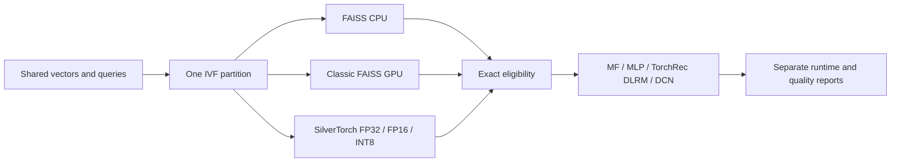

# GPU retrieval and recommendation ranking

_A public-code SilverTorch reproduction and a controlled FAISS/TorchRec benchmark study._

---

This repository vendors Meta's public SilverTorch source at
`22c2007ed5d28ec8304de081cc2393778708ad12`, with its Apache-2.0 license intact,
and adds independent correctness checks, ANN/filtering benchmarks, complete
local retrieval-rerank pipelines, and trained recommendation baselines.[^1]

**This is not a reproduction of Meta's private production results.** The public
release does not contain the production datasets, trained MoL OverArch, value
model rules, or client-side serving load generator. The paper's 23.7x QPS and
20.9x cost-efficiency claims cannot be inferred from these offline runs.[^2]

## 📚 Study guide

| Document | Purpose |
| --- | --- |
| [SilverTorch explained](docs/silvertorch-study.md) | Architecture, algorithms, model choices, and what the published gains mean |
| [Benchmark protocol](docs/benchmark-protocol.md) | Fairness, metrics, datasets, numerical contracts, and experiment matrix |
| [Upstream audit](docs/upstream-audit.md) | Public-code boundaries and independently reproduced correctness hazards |
| [Measured findings](docs/results.md) | Completed study, limitations, and adoption implications |
| [Full measurement tables](docs/measured-tables.md) | Generated ANN, filtering, pipeline, and quality operating points |
| [Upstream provenance](third_party/silvertorch/UPSTREAM.json) | Exact source, commit, license, and modification policy |

Operational `progress.md`, access configuration, logs, datasets, checkpoints,
and working results are local and ignored. Nothing in the committed project
selects an AML allocation or contains a credential.

## 🚀 Reproduce the benchmarks

### CPU correctness on Windows

```powershell
$env:PYTHONPATH = "$PWD\src"
python -m pytest tests\test_core.py tests\test_movielens.py -q
python -m rrbench.cli --help
python scripts\verify_upstream.py
```

Requires Python 3.10+, PyTorch, NumPy, and pytest. The optional dependencies in
`pyproject.toml` describe CPU and GPU interfaces; use the matched environment
below for the complete TorchRec experiment, rather than installing an arbitrary
FBGEMM wheel into an existing GPU image.

A CPU-only ANN run can explicitly select `--backends faiss-ivf-cpu
faiss-hnsw-cpu` in a `faiss-cpu` environment. Its FP32 oracle runs on CPU when
CUDA is absent; GPU backend requests fail rather than silently falling back.

### GPU environment on a Linux CUDA node

Use an isolated environment; do not replace the CUDA stack of a shared base
image. The supplied GPU manifest pins the runtime used by this study:
PyTorch 2.13.0+cu129, Triton 3.7.1, FAISS 1.14.1, TorchRec 1.8.0, and
FBGEMM 1.8.0+cu126. This CUDA-12-minor combination was validated by actual
embedding forward/backward and SilverTorch CUDA tests, not just imports.

```bash
export UV_CACHE_DIR="$PWD/.local/uv-cache"
uv sync --project environments/gpu
export PYTHONPATH="$PWD/src:$PWD/third_party/silvertorch"
export CUDA_HOME=/usr/local/cuda-12.9
bash scripts/build_silvertorch.sh \
  "$PWD/environments/gpu/.venv/bin/python" "$PWD/third_party/silvertorch"
environments/gpu/.venv/bin/python -m pytest tests -q
```

`build_silvertorch.sh` discovers CUDA development headers shipped in installed
NVIDIA wheels. It does not install an operating-system toolkit or modify
upstream code. CUDA compilation is Linux-only in this study.

### Representative commands

```bash
PYTHON=environments/gpu/.venv/bin/python

# Paper-shaped ANN component experiment, not a production QPS replay.
$PYTHON -m rrbench.cli ann --items 20000000 --clusters 4096 \
  --ks 2048 4096 --probes 8 24 64 256 --batches 16 \
  --warmup 50 --iterations 100 --repeats 3 --output runs/ann-20m
$PYTHON -m rrbench.cli ann-stages --items 20000000 --clusters 4096 \
  --output runs/ann-20m

# Raw Bloom approximation versus exact eligibility and CPU posting lists.
$PYTHON -m rrbench.cli filter --items 1000000 --output runs/filter-1m
$PYTHON -m rrbench.cli audit-upstream --output runs/upstream-audit.json

# Complete local retrieval + filtering + actual TorchRec reranking.
$PYTHON -m rrbench.cli pipeline --items 1000000 --output runs/pipeline-1m
$PYTHON -m rrbench.cli rank-timing --output runs/rank-timing

# Train a common retriever, then a real TorchRec DLRM on the same data.
$PYTHON -m rrbench.cli quality --data data/movielens --model mf \
  --seed 17 --eval-users 2000 --output runs/mf-s17
$PYTHON -m rrbench.cli quality --data data/movielens --model torchrec-dlrm \
  --seed 17 --eval-users 2000 --mf-checkpoint runs/mf-s17/best.pt \
  --output runs/dlrm-s17
```

MovieLens is downloaded only for the explicitly requested research experiment.
Its source and prepared data must not be redistributed or used commercially
without GroupLens permission.[^3] The benchmark emits manifests, raw timing
samples, checkpoint-selection evidence, and atomic completion markers.

Dataset credit: F. Maxwell Harper and Joseph A. Konstan, "The MovieLens
Datasets: History and Context," ACM TiiS 5(4), Article 19 (2015).[^6]

`quality-ann` additionally evaluates the previously selected MF, MLP, DLRM,
and DCN checkpoints with real ANN engines and query-time seen-item exclusion.
Its `--checkpoints` directory contains `mf_s17.pt`, `mlp_s17.pt`,
`torchrec-dlrm_s17.pt`, and `torchrec-dcn_s17.pt` for seed 17; repeat with
seeds 23 and 42. See the [protocol](docs/benchmark-protocol.md).

The GPU wheel is the community `faiss-gpu-cu12` build, not an official Meta
binary distribution.[^5] The matched CPU/GPU implementation comparison uses
that same 1.14.1 build, with an additional separately installed
`faiss-cpu==1.14.2` CPU reference.

## 🏗️ What is compared



The ANN oracle is exhaustive FP32 inner-product search with TF32 disabled.
All IVF methods use identical centroids and item assignments. INT8 global and
rowwise symmetric quantization are named adaptations; neither is silently
claimed to be the paper's undocumented complete quantization recipe.

The repository's DLRM and DCN baselines instantiate
`torchrec.models.dlrm.DLRM` and `DLRM_DCN`, with actual
`EmbeddingBagCollection` and `KeyedJaggedTensor` execution.[^4] They are not
MLPs renamed as TorchRec.

## 🔬 Important interpretation limits

GPU kernels, sequential offline throughput, and serving QPS are different
measurements. This study does not invent RPC overhead, an AWS cost model,
business engagement labels, or an online A/B lift. Random-weight pipeline
timings are runtime-only; recommendation quality comes from trained,
validation-selected MovieLens models.

Bloom signatures are approximate membership tests, not replacements for the
eligibility rules themselves. In particular, complementing an approximate
membership mask can produce false negatives. The adapter conservatively
removes negative literals from Bloom prefiltering and evaluates exact rules
before the final candidate cap. See the [audit](docs/upstream-audit.md).

[^1]: Meta. "SilverTorch public GPU retrieval library." https://github.com/meta-recsys/silvertorch/tree/22c2007ed5d28ec8304de081cc2393778708ad12
[^2]: Xue et al. (2026). "SilverTorch: A Unified Model-based System to Democratize Large-Scale Recommendation on GPUs," SIGIR '26 / arXiv v5, and engineering overview. https://doi.org/10.1145/3805712.3809755 ; https://arxiv.org/abs/2511.14881v5 ; https://engineering.fb.com/2026/05/26/ml-applications/silvertorch-index-as-model-new-retrieval-paradigm-recommendation-systems/
[^3]: GroupLens. "MovieLens 1M usage license and dataset description." https://files.grouplens.org/datasets/movielens/ml-1m-README.txt
[^4]: Meta-PyTorch. "TorchRec DLRM implementations." https://github.com/meta-pytorch/torchrec/blob/v1.8.0-rc1/torchrec/models/dlrm.py
[^5]: Di-Is. "FAISS GPU wheels." https://github.com/Di-Is/faiss-gpu-wheels
[^6]: Harper and Konstan. "The MovieLens Datasets: History and Context." https://doi.org/10.1145/2827872