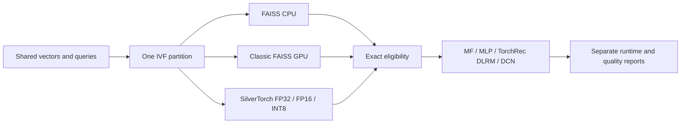

# GPU retrieval and recommendation ranking

_A public-code SilverTorch reproduction and a controlled FAISS/TorchRec benchmark study._

---

This repository vendors Meta's public SilverTorch source at
`22c2007ed5d28ec8304de081cc2393778708ad12`, with its Apache-2.0 license intact,
and adds independent correctness checks, ANN/filtering benchmarks, complete
local retrieval-rerank pipelines, and trained recommendation baselines.[^1]

**This is not a reproduction of Meta's private production results.** The public
release does not contain the production datasets, trained MoL OverArch, value
model rules, or client-side serving load generator. The paper's 23.7x QPS and
20.9x cost-efficiency claims cannot be inferred from these offline runs.[^2]

## 📚 Study guide

| Document | Purpose |
| --- | --- |
| [SilverTorch explained](docs/silvertorch-study.md) | Architecture, algorithms, model choices, and what the published gains mean |
| [Benchmark protocol](docs/benchmark-protocol.md) | Fairness, metrics, datasets, numerical contracts, and experiment matrix |
| [Upstream audit](docs/upstream-audit.md) | Public-code boundaries and independently reproduced correctness hazards |
| [Measured findings](docs/results.md) | Completed study, limitations, and adoption implications |
| [Full measurement tables](docs/measured-tables.md) | Generated ANN, filtering, pipeline, and quality operating points |
| [Independent seed replication](docs/seed-replication.md) | Separate seed23/42 follow-up against the immutable seed17 reference |
| [Frozen TorchRec inference](docs/torchrec-inference.md) | FP32/BF16 and dense-path compilation fidelity, runtime, and first-call costs |
| [Real semantic study](docs/semantic-study-design.md) | Full 8.84M real passages, audited 1.8M recommendation items, stronger LM encoders/rerankers, and separate model/stage costs |
| [Real-corpus measured findings](docs/real-semantic-results.md) | Completed eight-representation ANN matrix, strong text/TorchRec comparisons, paired quality intervals, and 24 complete one-GPU cells |
| [Real-catalog GPU profiles](docs/real-semantic-profiling-results.md) | Completed 60 fresh ANN timing conditions and 20 separate CUDA traces; precision-dependent crossover and limits |
| [Initial actual-pipeline findings](docs/actual-pipeline-initial-results.md) | Reviewed nine-attempt partial frame: observed memory advantage, small whole-batch timing change, and unavailable FP32/MLP primaries |
| [Full actual-pipeline findings](docs/actual-pipeline-results.md) | Completed 72 attempts, four CUDA profiles and 16 scorer/cap contrasts; memory versus wall time, BGE quality/cost, negative larger-cap evidence and unavailable primary NI |
| [Query-only adaptation findings](docs/query-adaptation-results.md) | One fixed Qwen0.6 LoRA epoch over 50,000 queries and the unchanged 8.84M item bank; head-rank gains, Recall@1000 losses and unmerged adapter cost |
| [Upstream provenance](third_party/silvertorch/UPSTREAM.json) | Exact source, commit, license, and modification policy |

Operational `progress.md`, access configuration, logs, datasets, checkpoints,
and working results are local and ignored. Nothing in the committed project
selects an AML allocation or contains a credential.

## 🚀 Reproduce the benchmarks

### CPU correctness on Windows

```powershell
$env:PYTHONPATH = "$PWD\src"
python -m pytest tests\test_core.py tests\test_movielens.py -q
python -m rrbench.cli --help
python scripts\verify_upstream.py
```

Requires Python 3.10+, PyTorch, NumPy, and pytest. The optional dependencies in
`pyproject.toml` describe CPU and GPU interfaces; use the matched environment
below for the complete TorchRec experiment, rather than installing an arbitrary
FBGEMM wheel into an existing GPU image.

A CPU-only ANN run can explicitly select `--backends faiss-ivf-cpu
faiss-hnsw-cpu` in a `faiss-cpu` environment. Its FP32 oracle runs on CPU when
CUDA is absent; GPU backend requests fail rather than silently falling back.

### GPU environment on a Linux CUDA node

Use an isolated environment; do not replace the CUDA stack of a shared base
image. The supplied GPU manifest pins the runtime used by this study:
PyTorch 2.13.0+cu129, Triton 3.7.1, FAISS 1.14.1, TorchRec 1.8.0, and
FBGEMM 1.8.0+cu126. This CUDA-12-minor combination was validated by actual
embedding forward/backward and SilverTorch CUDA tests, not just imports.

```bash
export UV_CACHE_DIR="$PWD/.local/uv-cache"
uv sync --project environments/gpu
export PYTHONPATH="$PWD/src:$PWD/third_party/silvertorch"
export CUDA_HOME=/usr/local/cuda-12.9
bash scripts/build_silvertorch.sh \
  "$PWD/environments/gpu/.venv/bin/python" "$PWD/third_party/silvertorch"
environments/gpu/.venv/bin/python -m pytest tests -q
```

`build_silvertorch.sh` discovers CUDA development headers shipped in installed
NVIDIA wheels. It does not install an operating-system toolkit or modify
upstream code. CUDA compilation is Linux-only in this study.

### Representative commands

```bash
PYTHON=environments/gpu/.venv/bin/python

# Paper-shaped ANN component experiment, not a production QPS replay.
$PYTHON -m rrbench.cli ann --items 20000000 --clusters 4096 \
  --ks 2048 4096 --probes 8 24 64 256 --batches 16 \
  --warmup 50 --iterations 100 --repeats 3 --output runs/ann-20m
$PYTHON -m rrbench.cli ann-stages --items 20000000 --clusters 4096 \
  --output runs/ann-20m

# Raw Bloom approximation versus exact eligibility and CPU posting lists.
$PYTHON -m rrbench.cli filter --items 1000000 --output runs/filter-1m
$PYTHON -m rrbench.cli audit-upstream --output runs/upstream-audit.json

# Complete local retrieval + filtering + actual TorchRec reranking.
$PYTHON -m rrbench.cli pipeline --items 1000000 --output runs/pipeline-1m
$PYTHON -m rrbench.cli rank-timing --output runs/rank-timing

# Train a common retriever, then a real TorchRec DLRM on the same data.
$PYTHON -m rrbench.cli quality --data data/movielens --model mf \
  --seed 17 --eval-users 2000 --output runs/mf-s17
$PYTHON -m rrbench.cli quality --data data/movielens --model torchrec-dlrm \
  --seed 17 --eval-users 2000 --mf-checkpoint runs/mf-s17/best.pt \
  --output runs/dlrm-s17
```

MovieLens is downloaded only for the explicitly requested research experiment.
Its source and prepared data must not be redistributed or used commercially
without GroupLens permission.[^3] The benchmark emits manifests, raw timing
samples, checkpoint-selection evidence, and atomic completion markers.

Dataset credit: F. Maxwell Harper and Joseph A. Konstan, "The MovieLens
Datasets: History and Context," ACM TiiS 5(4), Article 19 (2015).[^6]

`quality-ann` additionally evaluates the previously selected MF, MLP, DLRM,
and DCN checkpoints with real ANN engines and query-time seen-item exclusion.
Its `--checkpoints` directory contains `mf_s17.pt`, `mlp_s17.pt`,
`torchrec-dlrm_s17.pt`, and `torchrec-dcn_s17.pt` for seed 17; repeat with
seeds 23 and 42. See the [protocol](docs/benchmark-protocol.md).

The GPU wheel is the community `faiss-gpu-cu12` build, not an official Meta
binary distribution.[^5] The matched CPU/GPU implementation comparison uses
that same 1.14.1 build, with an additional separately installed
`faiss-cpu==1.14.2` CPU reference.

The final inference-only extension uses the selected MF/DLRM/DCN checkpoints
without training or holdout labels:

```bash
$PYTHON -m rrbench.inference --data data/movielens \
  --checkpoints checkpoints --smoke --output runs/inference-smoke
$PYTHON -m rrbench.inference --data data/movielens \
  --checkpoints checkpoints --output runs/inference-frozen
```

Keep `checkpoints` local/ignored and supply `mf_s17.pt`,
`torchrec-dlrm_s17.pt`, and `torchrec-dcn_s17.pt` plus the corresponding
seed23/42 files. Outputs use new immutable directories. The
[inference report](docs/torchrec-inference.md) distinguishes verified FP32
compiler fidelity from BF16 approximation and does not infer recommendation
quality from ranking overlap.

### Expanded real-corpus semantic study

The separate semantic environment is pinned in `environments/semantic`.
`configs/semantic-models-pinned.json` fixes the four encoder and three
reranker revisions. The expanded pipeline audits full corpus IDs, licenses,
recorded-clock recommendation eligibility, token lengths for every input,
model-card pooling/scoring, native/MRL dimensions, and complete artifact
checksums before full encoding.

The real-data study uses **8,841,823 MS MARCO passages** and **1,798,875
training-observed, caption-covered KuaiRand videos**. The full experiment is
complete: 150 encoded shards, eight catalog representations, 276 measured
ANN grid records plus 10 explicit unsupported outcomes, and 24 co-resident
encoder/index/scorer cells. The [results report](docs/real-semantic-results.md)
and [checksummed CSV/JSON](results/2026-10-10-real-semantic/summary.json)
separate semantic quality, quantization fidelity, and whole-pipeline costs.
MS MARCO is IR rather than personalized recommendation. KuaiRand captions
are retrospective metadata, and frozen-catalog test-positive event coverage
is only 14.78%; conditional ranking metrics must not hide that ceiling.

Qwen8 improves measured IR retrieval, but larger models do not automatically
improve reranking or personalization. SilverTorch's speed ordering changes
with batch and precision; resident TorchRec/cached scoring helps with FAISS
too. The recommendation common first-500 pool has no known positives for
the 819 selected users, so its zero reranking metrics are a candidate ceiling,
not evidence of scorer equivalence. All primary online samples and memory
observations, including the recovered allocator warning, are preserved.

Run the corresponding Python modules with `--help` for audited acquisition,
token-length certification, disjoint shard encoding/merging, judged IR
panels, frozen exposure histories, ANN and supervised semantic rankers.
GPU work uses Linux, the matched environment, explicit source/model
receipts, and separate ignored output directories. The new FP16 FAISS arm
uses actual IVF scalar half codes rather than an ignored IVFFlat cloning
option. See the [design](docs/semantic-study-design.md) for the complete
fairness and reviewer gates.

### Controlled personalization and profiling extension

`configs/semantic-extension-v1.json` defines the authorized, bounded follow-up.
The [extension protocol](docs/semantic-extension-protocol.md) details its
controls, fixed admission and exploratory interpretation.
The [completed personalization result](docs/controlled-personalization-results.md)
reports a failed validation expansion gate despite inexpensive user-head
inference. The [real ANN characterization](docs/real-semantic-profiling-results.md)
now includes 3,000 varying batch durations and 20 actual CUDA profile
conditions. The [initial raw-encoder pipeline frame](docs/actual-pipeline-initial-results.md)
records all nine designated MLP/batch16 attempts: large observed INT8-layout
memory savings versus half, only 1.83% lower whole-batch wall time, and
unavailable FP32/MLP primary references. The
[complete actual-pipeline report](docs/actual-pipeline-results.md) now preserves
all 72 attempts, 2,688 unprofiled batch durations, four separate CUDA profiles
and 16 secondary scorer/cap comparisons. BGE improves selected-dev ranking
over the cached MLP at substantial implementation-specific cost; scoring500
rather than50 candidates does not establish a dev-MRR benefit and lowers
TREC19 nDCG in pointwise exploratory comparisons. Both FP32/MLP primary
non-inferiority assessments remain not assessed. The
[sealed aggregate package](results/2026-10-12-actual-pipeline/checksums.json)
retains unsupported measurements and all negative/null outcomes.
It reuses the frozen real catalogs instead of repeating corpus encoding. The
personalization experiment fits a small shared user head over the same prior
exposure histories, with fixed-mean, popularity, recurrence and wrong-user
controls. The profiling experiment separates CPU/CUDA traces from unprofiled
timing and pairs each deployed pipeline's quality with its actual candidates.

The personalization runner exposes `smoke`, `train` and `evaluate` commands via
`python -m rrbench.semantic_personalization_run --help`. A fixed seed17
validation checkpoint determines whether a second seed is admitted before the
pilot deadline; final test results never authorize further fitting. Input,
implementation and checkpoint hashes prevent stale result reuse. Reused test
panels remain post-test exploratory, and admission/qualification thresholds
are resource and research gates, not production-uplift guarantees.

The conditional [query-only pilot](docs/query-adaptation-results.md) is also
complete: native1024D Qwen0.6, one fixed50,000-query epoch,782 updates and an
unchanged8.84M item bank. Its selected-dev MRR improves, but every
Recall@1000 point estimate decreases, with negative intervals on internal
validation and TREC20. Attached, unmerged FP32 adapters increase encoding
wall time by17-19% and raw-query/exhaustive-search batch16 wall time by8.80%.
The [complete aggregate package](results/2026-10-12-query-adaptation/checksums.json)
retains all20 quality contrasts and900 durations across three fresh paired
runtime contexts. This is an asymmetric retrieval trade-off, not a general
finetuning victory, a personalization rescue or a cross-study model leaderboard.
The [fixed protocol](configs/semantic-extension-query-adaptation-v1.json)
and `python -m rrbench.semantic_query_adaptation_run --help` expose audited
mining, real gradient/resume smoke, one-epoch fitting, exact evaluation and
matched runtime phases without embedding allocation access in source.

## 🏗️ What is compared



The ANN oracle is exhaustive FP32 inner-product search with TF32 disabled.
All IVF methods use identical centroids and item assignments. INT8 global and
rowwise symmetric quantization are named adaptations; neither is silently
claimed to be the paper's undocumented complete quantization recipe.

The repository's DLRM and DCN baselines instantiate
`torchrec.models.dlrm.DLRM` and `DLRM_DCN`, with actual
`EmbeddingBagCollection` and `KeyedJaggedTensor` execution.[^4] They are not
MLPs renamed as TorchRec.

## 🔬 Important interpretation limits

GPU kernels, sequential offline throughput, and serving QPS are different
measurements. This study does not invent RPC overhead, an AWS cost model,
business engagement labels, or an online A/B lift. Random-weight pipeline
timings are runtime-only; recommendation quality comes from trained,
validation-selected MovieLens models.

Bloom signatures are approximate membership tests, not replacements for the
eligibility rules themselves. In particular, complementing an approximate
membership mask can produce false negatives. The adapter conservatively
removes negative literals from Bloom prefiltering and evaluates exact rules
before the final candidate cap. See the [audit](docs/upstream-audit.md).

[^1]: Meta. "SilverTorch public GPU retrieval library." https://github.com/meta-recsys/silvertorch/tree/22c2007ed5d28ec8304de081cc2393778708ad12
[^2]: Xue et al. (2026). "SilverTorch: A Unified Model-based System to Democratize Large-Scale Recommendation on GPUs," SIGIR '26 / arXiv v5, and engineering overview. https://doi.org/10.1145/3805712.3809755 ; https://arxiv.org/abs/2511.14881v5 ; https://engineering.fb.com/2026/05/26/ml-applications/silvertorch-index-as-model-new-retrieval-paradigm-recommendation-systems/
[^3]: GroupLens. "MovieLens 1M usage license and dataset description." https://files.grouplens.org/datasets/movielens/ml-1m-README.txt
[^4]: Meta-PyTorch. "TorchRec DLRM implementations." https://github.com/meta-pytorch/torchrec/blob/v1.8.0-rc1/torchrec/models/dlrm.py
[^5]: Di-Is. "FAISS GPU wheels." https://github.com/Di-Is/faiss-gpu-wheels
[^6]: Harper and Konstan. "The MovieLens Datasets: History and Context." https://doi.org/10.1145/2827872