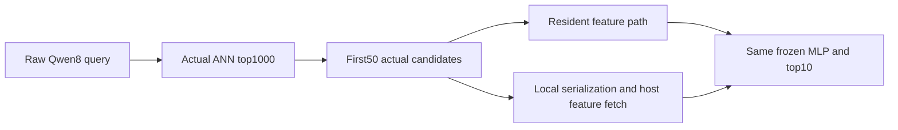

# Initial actual-query pipeline findings

_Reviewed partial frame: all nine designated batch16 MLP attempts, not completion of the full matrix._

---

The Silver rowwise INT8 layout used substantially less observed GPU memory
than FAISS scalar-half at this matched raw-Qwen8/MLP operating point, but
reduced whole-batch wall time by only **1.83%**. The two predeclared
FP32-referenced primary assessments remain **not assessed**: none of the
three required FP32/MLP reference contexts maintained its headroom gate.[^1]

## 📐 The complete partial frame

| Contract | Evidence in this publication |
| --- | --- |
| Catalog | 8,841,823 real MS MARCO passages; Qwen8 normalized MRL1024 |
| Online query input | Actual raw Qwen8 forwards in immutable execution groups; historical batch32 cache is diagnostic only |
| Operating point | Probes64, retrieve1000, score the actual first50, return10; frozen semantic-MLP seed17 |
| Batch and contexts | Batch16, three fresh execution contexts; same ordered groups across backends |
| Attempts | Nine CLI cells: six successful half/INT8, three memory-budget-unsupported FP32 |
| Condition records | Eighteen resident/local-cascade outcomes, not eighteen independent process contexts |
| Timing | Ten warmups and 50 varying paired batches per successful boundary condition |
| Judged populations | Same 1,000 selected dev queries; separate 43-query TREC19 and 54-query TREC20 panels |
| Geometry | Three source-matched full-catalog exhaustive FP32 references for the actual query vectors |

This is a **post-test exploratory** follow-up. All attempts are retained,
including unavailable measurements. These nine cells were executed first
under the prospective scheduling amendment; the remaining 63 cells and four
separate pipeline profiles continue under the unchanged protocol.[^2]

Every successful point has source-bound complete query, candidate, scorer and
final-ID arrays. Independent whole-group probes and every measured batch
are checked against actual raw quality outputs. Candidate/final IDs match
exactly within each backend's boundary control; independent scorer values
use the declared `1e-5` tolerance. Final ranking is independently verified
against the **exact persisted FP32 score order**, allowing only genuine
equal-score ties. Quality is recomputed from those final IDs before
aggregation.

## 💾 Large observed memory difference, small wall-time difference

These arithmetic means cover the three fresh context-level resident batch
means; batch16 numbers are not per-query latency or serving throughput.[^1]

| Measurement | FAISS scalar-half | Silver rowwise INT8 |
| --- | --- | --- |
| Mean resident batch wall time | 78.9318 ms | 77.4834 ms |
| Maximum sampled benchmark-device usage | 51.8115 GiB | 40.5322 GiB |
| Minimum conservative sampled headroom | 28.1210 GiB | 39.4003 GiB |
| Mean selected-dev MRR@10 | 0.351776 | 0.351776 |
| Mean TREC19 nDCG@10 | 0.737995 | 0.737995 |
| Mean TREC20 nDCG@10 | 0.733631 | 0.733631 |

The mean **paired** INT8/half latency ratio is `0.9816511`, or about 1.83%
less batch wall time. The difference between the arithmetic context means is
1.4485 ms. No latency confidence interval, p99, offered-load SLO or production
speedup is inferred from these finite synchronized observations.

The observed device-memory difference is **11.2793 GiB in every matched
context**. This is a whole-layout measurement: changing backend/index
implementation changes auxiliary allocation as well as code width. One
fewer stored byte per component accounts for approximately 8.4322 GiB at
this catalog/dimension; it does not explain the entire measured difference.
The result is not a claim of pure quantization savings or lower total
deployment cost.

The encoder, index and scorer are co-resident on the benchmark device. An
additional UUID-bound administrative context on an unused GPU allows the
original keeper to yield cooperatively; its **418 MiB observed allocation**
is recorded separately from the one-byte context tensor and from the memory
table above. The result is not whole-job single-device accounting.

## 🎯 Observed metric stability is not identical retrieval

Per-query selected-dev MRR@10 matches on all 1,000 queries in each of the
three contexts. The secondary paired bootstrap averages each query's metric
across contexts and resamples the same 1,000 identities once. It gives an
empirical mean difference of zero and a pointwise95% interval `[0, 0]`.
This is not unseen-query uncertainty, universal quality equivalence or a
replacement primary non-inferiority decision.[^1]

The stored-candidate supplement shows what the metric omits.[^3]

| Context | Identical ordered top1000 | Identical ordered prefix50 | Mean top1000 set overlap | Identical ordered final10 |
| --- | --- | --- | --- | --- |
| 0 | 0 / 1097 | 6 / 1097 | 99.5952% | 1097 / 1097 |
| 1 | 0 / 1097 | 10 / 1097 | 99.5982% | 1096 / 1097 |
| 2 | 0 / 1097 | 6 / 1097 | 99.6001% | 1097 / 1097 |

Candidate membership overlaps strongly, but no complete ordered top1000
list matches. The final ordered top10 matches except for one query in one
context; that difference is **not reflected in selected-dev MRR@10**.
It is not labeled unjudged without checking the relevant qrels. Ordered
equality and set overlap are different measurements.

Geometric Recall@1000 also differs despite matching top-rank judged metrics.
For example, context0 reports `0.8340410` for half and `0.8338706` for INT8
against the same exhaustive actual-query reference.[^1] The approximation
is not lossless.

## 🔄 Resident execution helps both backends

The local/resident latency ratio averages `1.062924` for FAISS scalar-half
and `1.056645` for Silver INT8. In this implementation, the local cascade
therefore costs approximately **6.29% and 5.66% more than resident execution**,
respectively.[^1] Reversing the comparison requires a different percentage
denominator.

This is an in-process serialization/feature-fetch boundary, not an invented
network RPC. It produces no neural ranking-quality improvement and is not
exclusive to SilverTorch: FAISS feeds the resident scorer too.

## 🚧 Missing primary references and unfinished profiling

Each FP32/MLP reference **loaded the encoder, index and feature cache
co-resident**, then failed to maintain the prescribed 2-GiB CUDA-free margin
during raw-query quality execution. The attempts are explicitly
memory-budget unsupported, not observed CUDA OOMs, inability to load Qwen8,
or universal FAISS infeasibility. The gate is not relaxed and the reference
is not rescued with allocator or model changes.[^1]

The predeclared primary comparison requires three valid compatible FP32/MLP
reference contexts. Independent geometric oracles, secondary half/INT8
results and successful FP32/BGE layouts cannot substitute for that missing
set. Accordingly, **both primary assessments remain unavailable**.

The small whole-pipeline timing change relative to the standalone ANN study
is useful evidence, but it does not identify a causal encoder-time fraction.
The four planned actual-pipeline profiles are not complete in this
publication. Earlier standalone 5,000-query ANN timings under a different
resource regime cannot be subtracted from these raw 1,097-query pipeline
times. No MFU, energy, RPC, serving-QPS, tail-SLO, private Meta engagement or
cost-efficiency claim follows.

The [initial summary](../results/2026-10-11-semantic-extension/pipeline-initial-summary.json)
binds all nine attempts. The
[eighteen condition records](../results/2026-10-11-semantic-extension/pipeline-initial-b16-conditions.csv)
leave unsupported metrics blank, never zero. The
[statistics](../results/2026-10-11-semantic-extension/pipeline-initial-statistics.json)
keep primary and secondary conclusions separate; the full matrix remains
in progress.

[^1]: [Source-bound initial summary](../results/2026-10-11-semantic-extension/pipeline-initial-summary.json), [measured conditions](../results/2026-10-11-semantic-extension/pipeline-initial-b16-conditions.csv) and [paired/boundary statistics](../results/2026-10-11-semantic-extension/pipeline-initial-statistics.json).
[^2]: [Extension protocol and prospective amendments](semantic-extension-protocol.md) and [geometry-matched pipeline configuration](../configs/semantic-extension-pipeline-v2.json).
[^3]: [Stored-candidate diagnostic and payload hashes](../results/2026-10-11-semantic-extension/pipeline-initial-candidate-diagnostic.json).
