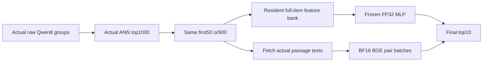

# Full actual-query retrieval and ranking findings

_Complete numerical frame: 72 pipeline attempts, four separate CUDA profiles and six full-catalog exact-query references._

---

Silver rowwise INT8 substantially reduces observed device memory relative to
FAISS scalar-half, but changes whole-pipeline wall time only modestly. A BGE
cross-encoder improves selected-dev ranking against the frozen cached MLP,
at a considerable implementation-specific cost. Scoring ten times as many
candidates does not establish a dev-MRR benefit and lowers TREC19 nDCG in
the secondary cap comparisons. Both predeclared FP32/MLP non-inferiority
assessments remain **not assessed**, because their required reference layouts
failed the unchanged headroom gate.[^1][^2]

This completes the declared numerical characterization, not deployment
qualification or Meta's private production reproduction. The
[initial nine-attempt publication](actual-pipeline-initial-results.md)
remains an immutable partial checkpoint.

## 🔬 Complete frame and interpretation

| Contract | Completed evidence |
| --- | --- |
| Catalog | 8,841,823 real MS MARCO passages; normalized Qwen8 MRL1024 item vectors |
| Online queries | Actual raw Qwen8 forwards in immutable execution groups; historical batch32 vectors are diagnostic only |
| Retrieval and ranking | Shared 16,384-cluster partition, probes64, actual top1000, score first50/500, return10 |
| Matrix | Three fixed restarted contexts, three backends, two scorers, two caps, batches1/16: 72 CLI attempts |
| Successful/unsupported | 60 successful CLI attempts; 12 memory-budget-unsupported FP32/MLP attempts |
| Boundary outcomes | 84 successful unprofiled timing conditions and 24 unsupported outcomes; all108 retained |
| Timing | MLP10 warmups/50 measured batches; BGE2/8; 2,688 unprofiled batch durations |
| Judged populations | Original 1,000 selected dev queries, separate TREC19/20 panels of43/54 |
| Geometry | All six actual-query contexts have source-matched exhaustive whole-catalog FP32 references, TF32 disabled |
| Profiles | Four successful separate cap50/batch16 traces, two instrumented batches each |
| Secondary amendment | All16 scorer/cap contrasts assessed; specified after partial results, not original primary preregistration |

All source, query, ordered candidate1000, scored-prefix, exact final ranking
and resource identities are checked before aggregation. Independent
whole-group probes and every measured/pretrace batch are checked against
actual quality outputs. Within-backend candidate/final IDs match exactly;
independent scorer values use `1e-5`. Sorting is checked against the
**exact persisted FP32 score order**, allowing only genuine equal-score
ties.[^1][^3]

The follow-up is **post-test exploratory**. Per-query metric values are
averaged over the three fixed contexts, then the original query identities
are resampled once with20,000 draws. They are not3,000 independent dev
queries. Primary intervals would use the declared adjustment and margin;
secondary intervals are pointwise95%, without familywise qualification.
TREC panels stay separate rather than being pooled into dev MRR.[^2][^3]

These are offline synchronized batch observations, not offered-load serving
QPS, p99, latency confidence intervals, energy or MFU measurements.

## 💾 Backend memory savings are larger than wall-time changes

The table reports paired INT8/half ratios of context-level resident means,
not a ratio selected from the fastest context. Memory ranges cover all three
matched context differences in **sampled whole-layout usage**.[^2]

| Scorer | Cap | Batch | INT8/half wall-time ratio | Observed memory saving, GiB | Dev MRR difference |
| --- | --- | --- | --- | --- | --- |
| MLP | 50 | 1 | 0.98073 | 11.2773–11.2793 | 0 |
| MLP | 50 | 16 | 0.98165 | 11.2793 | 0 |
| MLP | 500 | 1 | 0.98660 | 11.2773–11.6914 | 0 |
| MLP | 500 | 16 | 0.98908 | 11.6914 | 0 |
| BGE | 50 | 1 | 0.99899 | 11.0684–11.2793 | +0.0000917 |
| BGE | 50 | 16 | 0.99554 | 11.2773–11.5234 | −0.0000833 |
| BGE | 500 | 1 | 1.00272 | 11.2793 | +0.0001667 |
| BGE | 500 | 16 | 0.99425 | 10.8828–11.6895 | −0.0000833 |

For cap50/MLP/batch16, resident batch means remain78.9318 ms for half and
77.4834 ms for INT8: **1.83% less batch wall time**, alongside11.2793 GiB
less observed benchmark-device usage. The BGE/cap500/batch1 point is
slightly slower with INT8; there is no universal complete-pipeline speed
ordering.[^1][^2]

One fewer stored byte per component accounts for approximately8.4322 GiB
at this catalog/dimension. The larger measured difference includes index
implementation and auxiliary allocation differences; it is not pure
one-byte quantization savings. Identical judged MRR is also not lossless
retrieval: the initial stored-candidate diagnostic found no identical
ordered top1000 lists despite approximately99.6% set overlap.[^4]

The valid FP32/BGE layouts supply their own secondary comparisons. They
cannot replace unavailable FP32/MLP references. All12 FP32/MLP layouts
loaded the encoder, index and feature cache co-resident, then failed to
maintain the prescribed2-GiB CUDA-free margin during quality execution.
These are **headroom-budget failures**, not observed CUDA OOMs or universal
FAISS infeasibility. The three-valid-reference rule is unchanged, so both
primary non-inferiority assessments are unavailable.[^1][^2]

## 🧠 Scorer quality and information-path cost

These arithmetic means cover three context-level resident batch means.
Batch16 values are batch wall time, not individual-request latency.[^1]

| Backend | Scorer | Cap | Batch | Mean batch ms | Dev MRR@10 | Maximum sampled device GiB |
| --- | --- | --- | --- | --- | --- | --- |
| Half | MLP | 50 | 1 | 50.8543 | 0.350899 | 51.7041 |
| Half | BGE | 50 | 1 | 112.1102 | 0.379000 | 37.7119 |
| Half | MLP | 50 | 16 | 78.9318 | 0.351776 | 51.8115 |
| Half | BGE | 50 | 16 | 1037.3443 | 0.379041 | 37.8779 |
| INT8 | MLP | 50 | 1 | 49.8717 | 0.350899 | 40.4268 |
| INT8 | BGE | 50 | 1 | 111.9960 | 0.379091 | 26.4326 |
| INT8 | MLP | 50 | 16 | 77.4834 | 0.351776 | 40.5322 |
| INT8 | BGE | 50 | 16 | 1032.7093 | 0.378958 | 26.4170 |

At the same actual ordered top1000 and prefix50, all four BGE-versus-MLP
selected-dev intervals below are positive. This supports a scoped
scorer-path improvement on the inspected query population, not a causal
effect of parameter count or general recommendation uplift.[^5]

| Backend/batch | BGE−MLP dev MRR@10 | Pointwise95% interval | Full-protocol time ratio | Common-eight diagnostic |
| --- | --- | --- | --- | --- |
| Half/1 | +0.0281004 | [+0.0095899,+0.0467897] | 2.20460 | 2.19963 |
| Half/16 | +0.0272653 | [+0.0087367,+0.0460080] | 13.14242 | 13.24108 |
| INT8/1 | +0.0281921 | [+0.0096789,+0.0468461] | 2.24583 | 2.25424 |
| INT8/16 | +0.0271820 | [+0.0086600,+0.0459248] | 13.32813 | 13.44192 |

The full protocols retain50 MLP versus8 BGE measurements. The diagnostic
uses exactly MLP's first8 measured groups and BGE's8 matching groups,
never a favorable replacement subset. Both views are reported; unequal
10-versus2 warmup histories remain. Quality uses all original query rows
independently of those timing counts.[^5]

The ranking paths change information and residency, not just model size:

The MLP path duplicates full-catalog item vectors as resident scoring
features. BGE does not keep that feature bank; it fetches text. Accordingly,
a more powerful text scorer can have a smaller observed layout footprint
and fit where the FP32/MLP reference fails. That is not a pure parameter-size
effect. Memory observations also differ in sampling coverage: for example,
17 BGE versus101 MLP samples at the compared cap50/batch1 conditions are
not matched continuous-peak observations.[^1][^5]

BGE scores per query in pair batches of64, with a Python loop over queries.
Its batch16 cost is therefore specific to this fetching/padding/scoring
implementation, not an optimally cross-request-batched cross-encoder or a
universal law for larger models. MLP and BGE training/objective, input
information and precision also differ.[^3][^5]

## 🎯 A larger scored prefix is not automatically better

All eight cap contrasts remain in the published secondary family, including
null and negative results. The four BGE contrasts show a small positive dev
MRR point difference, but every dev interval includes zero. TREC19 nDCG
falls in all four pointwise secondary intervals.[^5]

| Backend/batch | BGE cap500−50 dev MRR | Dev95% interval | TREC19 nDCG difference | TREC19 95% interval | Time ratio |
| --- | --- | --- | --- | --- | --- |
| Half/1 | +0.0046635 | [−0.0001389,+0.0102255] | −0.0055453 | [−0.0114856,−0.0001210] | 5.78033 |
| Half/16 | +0.0045663 | [−0.0002460,+0.0101043] | −0.0055453 | [−0.0114856,−0.0001210] | 9.65284 |
| INT8/1 | +0.0047385 | [−0.0000685,+0.0102758] | −0.0056046 | [−0.0115465,−0.0001767] | 5.80399 |
| INT8/16 | +0.0045663 | [−0.0002460,+0.0101043] | −0.0056046 | [−0.0115465,−0.0001767] | 9.64035 |

The small TREC19 panel, inspected tests and unadjusted multiple secondary
comparisons limit this regression finding. It is not a globally confirmed
harm, but neither may it be hidden behind a favorable dev point estimate.
All TREC20 cap-change intervals include zero.[^5]

For MLP, cap500 produces no selected-dev MRR or TREC19 nDCG gain in any of
the four comparisons. TREC20 differences are approximately−0.00118 at
batch1 and−0.00120 at batch16; their intervals reach zero. Resident MLP
runtime changes little, but the local-cascade cost grows substantially.[^5]

The shared first50 score diagnostic is important. MLP scores change by up
to approximately`2.62e-6`; BGE changes2 of54,850 shared values per context
with a maximum difference of0.015625. Candidate IDs and raw queries match,
but cap-dependent batching/padding/numerics can change scores. No observed
quality change is attributed solely to the extra450 scored items.[^5]

## 🔄 Residency helps both backends

Every successful within-backend boundary control has exact candidate/final
ID parity and the declared scorer tolerance. These are measured local
serialization and host-feature-fetch paths, not invented network RPCs.[^2]

| Backend | Cap | Batch | Local/resident ratio | Extra local wall time |
| --- | --- | --- | --- | --- |
| Half | 50 | 1 | 1.01199 | 1.20% |
| Half | 50 | 16 | 1.06292 | 6.29% |
| Half | 500 | 1 | 1.05169 | 5.17% |
| Half | 500 | 16 | 1.38252 | 38.25% |
| INT8 | 50 | 1 | 1.01140 | 1.14% |
| INT8 | 50 | 16 | 1.05664 | 5.66% |
| INT8 | 500 | 1 | 1.04611 | 4.61% |
| INT8 | 500 | 16 | 1.36341 | 36.34% |

FAISS benefits from resident features too. This boundary comparison
introduces no new neural-ranking algorithm or quality gain, and its
percentages use resident time as the denominator.[^2]

## ⚙️ Actual profiles without fabricated wall fractions

Each row is a separate cap50/batch16 profile containing two instrumented
batches. The primary wall-time observations above are unprofiled.[^6]

| Backend/scorer | CUDA kernel events | Unique kernel names | Sum of kernel durations, ms |
| --- | --- | --- | --- |
| Half/MLP | 5,096 | 84 | 137.5265 |
| Half/BGE | 17,506 | 86 | 1246.6475 |
| INT8/MLP | 5,248 | 115 | 134.6098 |
| INT8/BGE | 17,658 | 120 | 1244.3741 |

These are kernel-event counts, not independent requests or unique launch
sites. Operator rows include raw-query encoding, ANN, candidate boundaries
and feature/text fetching plus scoring. Same-name rows can represent
different CPU/device event views; inclusive ranges overlap or nest. They
are retained separately rather than summed into a critical path.[^6]

Neither these kernel sums nor attributed CPU/CUDA range totals are wall-time
fractions, MFU or energy. Earlier standalone ANN results use different
queries/resource conditions and cannot be subtracted from these pipeline
observations to invent an encoder-time fraction.

The benchmark device holds the actual encoder/index/scorer. An additional
idle UUID-bound administrative context enables native cooperative handoff;
its418-MiB measured admission allocation is recorded separately from both
the one-byte tensor payload and benchmark-device memory. This is not
whole-allocation single-GPU accounting or a continuous administrative
memory ceiling.[^1][^3]

## 🧭 Implications for subsequent work

| Observation | Appropriate next investigation |
| --- | --- |
| INT8 saves considerable layout memory but little whole-batch time here | Choose based on complete-pipeline memory and matched quality, not standalone ANN speed alone |
| BGE improves selected-dev ranking at substantial implementation cost | Optimize and measure cross-request text-pair batching before generalizing its batch16 cost |
| Cached MLP features increase the resident footprint | Compare information paths and feature residency, not only scorer parameter counts |
| Cap500 lacks an established dev gain and has negative TREC19 evidence | Retain a small-cap control; do not assume more reranking candidates means better quality |
| Residency helps FAISS and Silver | Separate the benefit of co-residency from a claimed unique SilverTorch ranking algorithm |
| FP32/MLP references are unsupported under the fixed gate | Keep primary NI unavailable; a new layout study would need a new prospective protocol |

MS MARCO is IR, not personalized recommendation. The separately completed
[personalization experiment](controlled-personalization-results.md)
failed its fixed expansion gate; this IR reranking result does not repair
that candidate-signal problem. Sparse judgments, retrospective recommendation
metadata and previous test inspection remain limitations of the broader
study.[^7]

The complete CSV/JSON package preserves every attempt, raw timing sample,
judged denominator, geometric reference disposition, secondary result and
profile outcome. Unavailable metrics are blank, not zero.[^1]

[^1]: [Complete source-bound summary](../results/2026-10-12-actual-pipeline/pipeline-summary.json), [all72 attempts](../results/2026-10-12-actual-pipeline/pipeline-attempts.csv), [all108 boundary outcomes](../results/2026-10-12-actual-pipeline/pipeline-conditions.csv), [raw durations](../results/2026-10-12-actual-pipeline/pipeline-latency-samples.csv), [quality](../results/2026-10-12-actual-pipeline/pipeline-quality.csv) and [actual-query geometry](../results/2026-10-12-actual-pipeline/pipeline-geometry.csv).
[^2]: [Primary, backend-secondary and boundary statistics](../results/2026-10-12-actual-pipeline/pipeline-statistics.json).
[^3]: [Frozen scientific/runtime protocol](semantic-extension-protocol.md), [pipeline contract](../configs/semantic-extension-pipeline-v2.json) and [actual pipeline implementation](../src/rrbench/semantic_profiling.py).
[^4]: [Initial stored-candidate diagnostic](../results/2026-10-11-semantic-extension/pipeline-initial-candidate-diagnostic.json) and [initial actual-pipeline report](actual-pipeline-initial-results.md).
[^5]: [All16 fixed secondary scorer/cap contrasts](../results/2026-10-12-actual-pipeline/pipeline-scorer-cap-statistics.json), including separate panel intervals, full/common-eight timing views, memory sampling counts and shared-prefix score diagnostics.
[^6]: [All four profile attempts](../results/2026-10-12-actual-pipeline/pipeline-profile-attempts.csv), [profile summaries](../results/2026-10-12-actual-pipeline/pipeline-profiles.csv), [kernel events by name](../results/2026-10-12-actual-pipeline/pipeline-profile-kernels.csv) and [unmerged operator rows](../results/2026-10-12-actual-pipeline/pipeline-profile-operators.csv).
[^7]: [Completed controlled personalization](controlled-personalization-results.md) and [original real-corpus findings](real-semantic-results.md).
