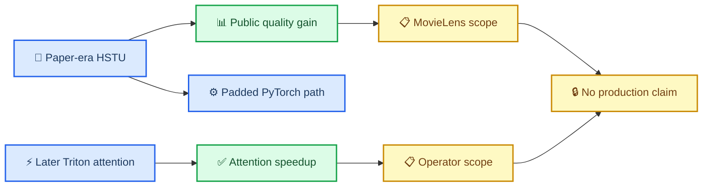

# HSTU public reproduction results

_Final MovieLens-1M quality reproduction and A100 model/kernel characterization_

---

## 📋 Abstract

The exact first public Meta HSTU release reproduced its MovieLens-1M headline
quality within the frozen absolute tolerances for SASRec, HSTU, and
HSTU-large. Final-epoch HSTU reached HR@10 `0.3000` and NDCG@10 `0.1694`;
HSTU-large reached `0.3263` and `0.1858`; the matched SASRec baseline reached
`0.2816` and `0.1581`. HSTU-large's best repeatedly observed holdout epoch
slightly exceeded the published NDCG@10 target, but epoch 100 remains the
predeclared primary result because the released trainer has no validation
split.

The paper-era implementation does not reproduce the paper's optimized-kernel
speed claims. In clean batch-128 full-catalog inference, exact search itself
took about `0.417 ms` for every model, while encoding took `2.267 ms` for
SASRec, `2.997 ms` for HSTU, and `11.733 ms` for HSTU-large. A separately
pinned later Triton HSTU attention implementation was `3.15x` to `4.53x`
faster than its PyTorch reference in forward and `1.98x` to `2.27x` faster in
forward-plus-backward. The correct interpretation is therefore two-part:
HSTU reproduced a scoped public quality advantage, while fused/ragged
execution—not the paper-era model code alone—provides the large attention
efficiency gain.

## 🎯 Primary quality result

### Frozen final-epoch comparison

| Model | Published HR@10 | Observed HR@10 | Difference | Published NDCG@10 | Observed NDCG@10 | Difference |
| --- | ---: | ---: | ---: | ---: | ---: | ---: |
| SASRec | 0.2853 | 0.2816 | -0.0037 | 0.1603 | 0.1581 | -0.0022 |
| HSTU | 0.3097 | 0.3000 | -0.0097 | 0.1720 | 0.1694 | -0.0026 |
| HSTU-large | 0.3294 | 0.3263 | -0.0031 | 0.1893 | 0.1858 | -0.0035 |

All rows pass the predeclared descriptive gates of absolute HR@10 difference
at most `0.02` and absolute NDCG@10 difference at most `0.01`. These are
reproduction tolerances, not statistical equivalence tests.

Relative to the matched observed SASRec result:

- HSTU improves HR@10 by `0.01838` (`6.53%`) and NDCG@10 by `0.01133`
  (`7.17%`).
- HSTU-large improves HR@10 by `0.04470` (`15.87%`) and NDCG@10 by
  `0.02766` (`17.50%`).

The gains are measured on one public next-item task and do not establish the
paper's private ranking, online, or scaling-law claims.[^1]

### Complete released cutoffs

| Model | HR@10 | NDCG@10 | HR@50 | NDCG@50 | HR@200 | NDCG@200 |
| --- | ---: | ---: | ---: | ---: | ---: | ---: |
| SASRec | 0.2816 | 0.1581 | 0.5508 | 0.2174 | 0.7540 | 0.2484 |
| HSTU | 0.3000 | 0.1694 | 0.5710 | 0.2294 | 0.7735 | 0.2602 |
| HSTU-large | 0.3263 | 0.1858 | 0.5929 | 0.2450 | 0.7884 | 0.2749 |

The paper-era evaluator's logged MRR and HR@5000 are excluded: misses receive
synthetic rank 2,501, which creates a nonzero MRR floor and makes HR@5000
trivially true. Published HR/NDCG cutoffs through 200 are unaffected.[^2]

### Repeated-holdout diagnostic

| Model | Best NDCG@10 epoch | Best NDCG@10 | HR@10 at that epoch | Final NDCG@10 |
| --- | ---: | ---: | ---: | ---: |
| SASRec | 97 | 0.1584 | 0.2815 | 0.1581 |
| HSTU | 94 | 0.1706 | 0.3022 | 0.1694 |
| HSTU-large | 94 | 0.1902 | 0.3331 | 0.1858 |

The best rows are diagnostics only. The released code evaluates the same
last-event holdout every epoch and provides no independent validation set, so
choosing epoch 94/97 would be test selection.

## 📊 Data, coverage, and executed geometry

| Quantity | Measured value |
| --- | ---: |
| Users | 6,040 |
| Rating events | 1,000,209 |
| Training events after last-event holdout | 994,169 |
| Rated items | 3,706 |
| Training-observed items | 3,704 |
| Evaluation catalog rows | 3,883 |
| Warm held-out events | 6,038 |
| Cold held-out events | 2 |
| Mean / median / p95 history before holdout | 164.60 / 95 / 555 |
| Maximum history before holdout | 2,313 |
| Model history cap | 200 |

The evaluation catalog includes all `movies.dat` rows, including 177 metadata
rows without a rating event. The two cold held-out targets count as misses;
metrics are not conditioned on warm coverage. Every rating value is treated as
a next-item event by the released loss.

| Model | Parameters | Blocks | Heads | Item dimension | Epochs | Optimizer steps | Batch |
| --- | ---: | ---: | ---: | ---: | ---: | ---: | ---: |
| SASRec | 238,800 | 2 | 1 | 50 | 101 | 4,848 | 128 |
| HSTU | 234,400 | 2 | 1 | 50 | 101 | 4,848 | 128 |
| HSTU-large | 313,000 | 8 | 2 | 50 | 101 | 4,848 | 128 |

All runs used 128 uniform local-catalog negatives per positive, sampled
softmax at temperature `0.05`, AdamW at `0.001`, TF32 enabled, and the same
chronological split and exhaustive item universe.

## ⚙️ Training execution

The three quality runs executed concurrently on separate A100 80GB GPUs.
Their wall times are useful resource receipts, not clean model-throughput
comparisons because CPU, storage, and node services were shared.

| Model | Wall minutes | Maximum sampled device use | Minimum sampled free memory |
| --- | ---: | ---: | ---: |
| SASRec | 87.60 | 24,253 MiB | 57,667 MiB |
| HSTU | 86.69 | 24,333 MiB | 57,587 MiB |
| HSTU-large | 98.55 | 25,531 MiB | 56,389 MiB |

The trainer uses DDP/NCCL even for one visible GPU, enables autograd anomaly
detection, evaluates the full holdout after every epoch, and performs
additional periodic evaluation. These whole-run memory and wall observations
should not be interpreted as optimized training service efficiency.

Clean isolated training-step measurements tell a different and more useful
model-cost story:

| Model | Batch / sequence | Mean step ms | Examples/s | PyTorch peak allocated |
| --- | --- | ---: | ---: | ---: |
| SASRec | 128 / 211 | 15.326 | 8,352 | 2,415 MiB |
| HSTU | 128 / 211 | 25.578 | 5,004 | 2,476 MiB |
| HSTU-large | 128 / 211 | 70.454 | 1,817 | 3,673 MiB |

These are repeated fixed-batch optimizer steps from the trained checkpoints,
with 3 warmups and 20 synchronized measurements. They are not independent
training examples or a full-epoch throughput benchmark.

## ⚡ Exact retrieval inference

### FP32 weights with TF32 enabled

Each end-to-end measurement includes HSTU/SASRec encoding, exact dot-product
search over 3,883 items, seen-item exclusion, and sorted top-200 selection.
Every row has 10 warmups and 50 synchronized unprofiled measurements.

| Model | Batch 1 mean / p95 ms | Batch 16 mean / p95 ms | Batch 128 mean / p95 ms |
| --- | ---: | ---: | ---: |
| SASRec | 2.157 / 2.184 | 2.245 / 2.278 | 2.650 / 2.676 |
| HSTU | 2.855 / 2.877 | 2.868 / 2.898 | 3.414 / 3.444 |
| HSTU-large | 8.745 / 8.601 | 8.903 / 8.934 | 12.046 / 12.092 |

HSTU is not faster than SASRec in this paper-era PyTorch implementation.
HSTU-large's batch-1 mean exceeds its p95 because one retained high outlier
raises the mean; raw durations remain in the aggregate package.

At batch 128, the shared exact-search policy is nearly constant:

| Model | Encode mean ms | Exact search mean ms | End-to-end mean ms |
| --- | ---: | ---: | ---: |
| SASRec | 2.267 | 0.416 | 2.650 |
| HSTU | 2.997 | 0.417 | 3.414 |
| HSTU-large | 11.733 | 0.418 | 12.046 |

The model, not the small exact catalog, determines most observed latency.
Offline `batch_size / batch_time` throughput is retained in the result files
but is not serving QPS under queueing or a tail-latency SLO.

### BF16 inference fidelity

| Model | Batch-128 FP32/TF32 ms | Batch-128 BF16 ms | BF16 time change | Top-10 set overlap |
| --- | ---: | ---: | ---: | ---: |
| SASRec | 2.650 | 2.377 | -10.30% | 0.9813 |
| HSTU | 3.414 | 3.241 | -5.07% | 0.9734 |
| HSTU-large | 12.046 | 11.121 | -7.68% | 0.9695 |

BF16 improves the measured batch-128 time but changes top-10 membership. Set
overlap is a numerical-fidelity diagnostic, not held-out recommendation
non-inferiority. Batch-1 HSTU-large overlap is `0.90` for one query, which is
especially unsuitable for a quality claim.

## 🔬 Later fused-attention contrast

The first public commit has no optimized attention kernel. To isolate
execution progress, the separately reviewed current commit was measured with
fixed BF16 jagged inputs on the same A100. These rows compare only the portable
PyTorch and Triton attention operators; they do not include projections,
relative-bias construction outside the operator, full HSTU layers, exact
search, or model quality.

| Batch | Sequence | PyTorch forward ms | Triton forward ms | Forward speedup | Forward+backward speedup | Relative L2 error |
| ---: | ---: | ---: | ---: | ---: | ---: | ---: |
| 16 | 200 | 0.743 | 0.236 | 3.15x | 1.99x | 0.00353 |
| 16 | 512 | 0.745 | 0.234 | 3.18x | 1.98x | 0.00046 |
| 16 | 1,024 | 1.075 | 0.237 | 4.53x | 2.27x | 0.00051 |

This establishes a real A100 Triton advantage for the later operator. It does
not reproduce the paper's H100 FlashAttention2 comparison, current H100 CUDA
path, HSTU Ultra stack, or production throughput.[^3]

## 📚 Scale probes

The released real datasets do not reach one million items. MovieLens-20M
tests event scale with 20,000,263 ratings and roughly 27K catalog rows. Amazon
Books is the closest released item-scale task at 695,762 filtered items, still
below one million. These probes are reported separately from the 101-epoch
MovieLens-1M reproduction and do not substitute partial training for a paper
quality reproduction.

The aggregate package records completed data audits, bounded one-epoch or
100-user execution, and any explicit unsupported or failed outcome.

### MovieLens-20M one-epoch probe

| Quantity | Value |
| --- | ---: |
| Users | 138,493 |
| Events | 20,000,263 |
| Rated items | 26,744 |
| Evaluation catalog rows | 27,278 |
| Unrated catalog rows | 534 |
| Cold held-out events | 37 / 138,493 |
| Maximum pre-holdout history | 9,253 |

Both released models completed one real epoch and exhaustive evaluation with
256-dimensional item embeddings and the released 200-event history cap:

| Model | HR@10 | NDCG@10 | HR@50 | NDCG@50 | HR@200 | NDCG@200 |
| --- | ---: | ---: | ---: | ---: | ---: | ---: |
| SASRec | 0.1935 | 0.1027 | 0.4422 | 0.1571 | 0.6919 | 0.1949 |
| HSTU | 0.2217 | 0.1203 | 0.4758 | 0.1760 | 0.7154 | 0.2123 |

This proves the released code executes on the complete 20M-event dataset and
retains the one-epoch HSTU ordering. Each model executed 1,082 optimizer steps.
It is not the 101-epoch published result and is not used as a quality
reproduction claim.

### Amazon Books 695,762-ID smoke

The released preprocessing has two distinct attrition stages:

| Stage | Users | Events | Observed items |
| --- | ---: | ---: | ---: |
| Raw ratings | 8,026,324 | 22,507,155 | 2,330,066 |
| One-pass user/item count filter | 811,227 | 10,444,211 | 695,762 |
| Final prepared sequences | 694,897 | 10,053,086 | 686,623 |

The model still allocates and searches the released expected catalog of
695,762 IDs, so 9,139 IDs have no prepared interaction. Warm held-out coverage
is `682,058 / 694,897 = 98.15%`; 12,839 held-out events are cold.

The exact first public Amazon Gin files do not parse because they bind removed
parameter `train_fn.item_feature_embedding_dim`. The smoke removes only that
stale binding, matching upstream repair commit
`88acd0308bb549e005ae6532ee54585457e1b4a4`, and preserves every other released
setting.[^4]

Both HSTU and SASRec completed one real epoch on 100 deterministic users and
performed seven optimizer steps and exhaustive search over all 695,762 IDs.
Both used 64-dimensional item embeddings and the released 50-event history
cap. HSTU had zero hits through 200; SASRec had HR@200 `0.01` and NDCG@200
`0.00154`. These sparse, nearly untrained outcomes are execution evidence and
a candidate-difficulty warning, not a paper-quality estimate or model
comparison.

## ⚠️ Limitations

- One deterministic seed was run; this is a source/config reproduction, not a
  multi-seed uncertainty study.
- The same last-event holdout is observed every epoch; final epoch 100 is
  primary to avoid test-selected reporting.
- MovieLens uses every rating as an interaction event and does not reproduce
  production action types or target-aware ranking.
- The exact-search catalog is only 3,883 rows.
- Quality-run wall time was measured under three concurrent model runs;
  clean timing comes from the separate fixed-batch characterization.
- BF16 overlap is not recommendation-quality evidence.
- The later Triton benchmark is not the first-release model path or H100 CUDA
  implementation.
- No private trillion-parameter, online lift, serving QPS, p99, energy, cost,
  or MFU result is inferred.
- The requested `gpt-6-astra` MAX/largest-context reviewer was not exposed by
  this runtime. No substitute is labeled as that review.

## 🎯 Conclusions

The released MovieLens result is reproducible at the intended level: both HSTU
arms retain their quality ordering over the matched SASRec baseline and all
three final checkpoints meet the frozen headline tolerances. The reproduction
does not support a blanket HSTU speed claim. In the exact paper-era code, HSTU
encoding and training steps are slower than SASRec, especially for the
eight-layer model.

The later kernel contrast explains how both statements can be true. HSTU's
model formulation supplies the scoped quality gain; later ragged/fused Triton
execution supplies a substantial attention speedup. Deployment decisions must
measure the complete trained model and candidate policy on target hardware
rather than transfer either the private production claim or an isolated
kernel ratio.

## 🔗 References

[^1]: Zhai, J., et al. (2024). "Actions Speak Louder than Words: Trillion-Parameter Sequential Transducers for Generative Recommendations." _Proceedings of the 41st International Conference on Machine Learning_, PMLR 235:58484-58509. https://proceedings.mlr.press/v235/zhai24a.html

[^2]: Meta. (2024). "Paper-era full-catalog evaluator." https://github.com/meta-recsys/generative-recommenders/blob/9afe62cccfbb1e893780313b89a2d43185c5f66d/data/eval.py

[^3]: Meta. (2026). "Generative Recommenders," reviewed later commit `acc36be02236750cd98d99246f7d7ef1412edd0e`. https://github.com/meta-recsys/generative-recommenders/tree/acc36be02236750cd98d99246f7d7ef1412edd0e

[^4]: Meta. (2024). "Remove deprecated item feature embedding dimension," commit `88acd0308bb549e005ae6532ee54585457e1b4a4`. https://github.com/meta-recsys/generative-recommenders/commit/88acd0308bb549e005ae6532ee54585457e1b4a4
