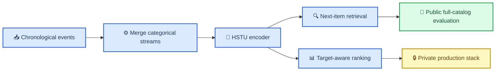
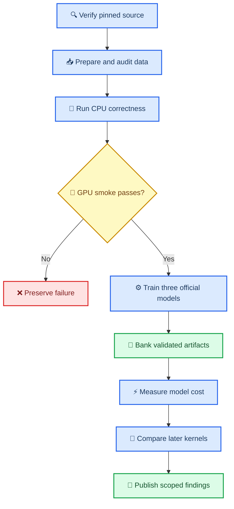

# HSTU for generative recommendation

_Primary-source study, public-code audit, and frozen reproduction design_

---

## 📋 Abstract

Meta's HSTU work reframes recommendation as sequential transduction rather
than as a conventional fixed-feature DLRM. The authoritative publication is
the ICML 2024 paper in PMLR volume 235; arXiv v3 is the matching final public
revision.[^1][^2] HSTU replaces Transformer softmax attention and feed-forward
blocks with pointwise SiLU attention, relative time/position bias, normalized
aggregation, and an elementwise gate. The paper also introduces generative
sequence-level training, Stochastic Length, fully ragged attention kernels,
and M-FALCON candidate scoring.

The first public repository commit does **not** release the production
training data, trillion-parameter configuration, production checkpoints,
M-FALCON serving stack, or optimized kernels used for the paper's throughput
claims. It releases 43 Apache-2.0 files for the traditional sequential
recommendation experiments on MovieLens and Amazon Books.[^3] This study pins
that exact commit and treats later Triton, CUDA, DLRMv3, and HSTU Ultra code as
separate historical work. The frozen experiment reproduces MovieLens-1M
HSTU, HSTU-large, and the matched SASRec baseline with full-catalog metrics,
then measures paper-era model cost and a separately labeled later-kernel
contrast on A100 hardware.

## 📋 Questions and evidence boundaries

This work asks:

1. What does the original HSTU algorithm compute, and how do its sequence,
   attention, normalization, gating, and objective choices differ from a
   standard Transformer recommender?
2. Which paper claims can the first public release reproduce, and which depend
   on unavailable production data, features, kernels, checkpoints, or traffic?
3. Do the released MovieLens-1M configurations reproduce their published
   full-catalog quality against the released SASRec baseline?
4. What GPU time and memory belong to the paper-era model implementation, and
   what improvement belongs only to later fused or ragged kernels?

The work does not reinterpret private 1.5-trillion-parameter or online A/B
results as outcomes of a small public run. It also does not merge this
sequential-model track into the prior SilverTorch/FAISS/TorchRec leaderboard:
the data, objectives, sequence semantics, candidate universes, and measured
boundaries differ.

## 📚 Publication and source provenance

### Authoritative publication

| Artifact | Verified identity | Role in this study |
| --- | --- | --- |
| ICML publication | PMLR 235:58484-58509, July 2024 | Authoritative paper and public tables[^1] |
| arXiv | `2402.17152v3`, submitted 2024-05-06 | Final public source and appendix[^2] |
| Paper-era code | `9afe62cccfbb1e893780313b89a2d43185c5f66d` | Reproduction source[^3] |
| Current reviewed code | `acc36be02236750cd98d99246f7d7ef1412edd0e` | Later-history and kernel audit only[^4] |
| HSTU Ultra-era paper | _Bending the Scaling Law Curve in Large-Scale Recommendation Systems_, KDD 2026 | Later architecture and systems context, not ICML 2024 reproduction[^5] |

The GitHub repository now resolves to
`meta-recsys/generative-recommenders`; the user-supplied
`facebookresearch/generative-recommenders` URL redirects to that canonical
repository. The code is Apache-2.0 licensed.[^4]

### Paper-era versus later repository

The first public commit states that it contains only the Section 4.1.1 public
experiments and that optimized HSTU kernels may be released later.[^3] The
history confirms that distinction:

| Era | Public content | Interpretation |
| --- | --- | --- |
| 2024-04 paper-era pin | MovieLens/Amazon preprocessing, HSTU, SASRec, sampled softmax, brute-force evaluation | Public quality reproduction |
| Late 2024 | Triton ragged HSTU attention begins appearing | Later kernel implementation |
| 2025 | CUDA/Hopper attention and broader operators | Later hardware-specific system work |
| 2026 | DLRMv3, HSTU Ultra, FP8 paths, KuaiRand-1K examples | Different model/system generation |

No GitHub releases or downloadable checkpoint assets exist at the reviewed
current head. Reproduction therefore starts from data preparation and
training rather than from an author checkpoint.[^4]

The first public Amazon Books Gin files also bind the removed
`train_fn.item_feature_embedding_dim` parameter. Upstream deleted those stale
bindings in commit `88acd0308bb549e005ae6532ee54585457e1b4a4` on 2024-04-26.
An Amazon run from the exact first commit therefore needs a disclosed one-line
config adapter; it is not executable byte-for-byte as published.[^9]

## 🧠 Recommendation as sequential transduction

### Production formulation in the paper

The paper merges high-cardinality categorical histories into one chronological
stream. Slowly changing categorical streams can be run-length compressed and
merged into the main engagement stream. Frequently changing numerical
features are not serialized individually; the authors instead argue that a
sufficiently expressive target-aware sequence model can reconstruct relevant
aggregates from categorical events.[^1]

The ranking and retrieval formulations are related but not identical:

| Task | Input sequence | Supervision | Public paper-era implementation |
| --- | --- | --- | --- |
| Retrieval | `(item, action)` event tokens | Next positively acted-on item | Simplified next-item MovieLens/Amazon task |
| Ranking | Interleaved `item, action, item, action` tokens | Next action at item positions | Not reproduced by released Section 4.1.1 code |

Interleaving candidates and actions makes ranking target-aware inside a causal
sequence. At production scale, M-FALCON appends candidate microbatches,
prevents candidates from attending to one another, and reuses cached history
states.[^1] That algorithm is described in the paper but absent from the first
public code snapshot.

### HSTU layer

For layer input \(X\), HSTU computes one fused projection and splits it into a
gate, values, queries, and keys:

\[
U,V,Q,K = \operatorname{Split}(\operatorname{SiLU}(XW_1)).
\]

It then applies causal pointwise attention with learned relative positional and
log-bucketed temporal bias:

\[
A(X)V(X) =
\frac{\operatorname{SiLU}(QK^\top + \operatorname{rab}^{p,t})}{N}V.
\]

The output is normalized, gated, projected, dropped out, and added to the
residual:

\[
Y = X + W_2\left(U \odot
\operatorname{LayerNorm}(A(X)V(X))\right).
\]

The first release implements this exact high-level structure in
`modeling/sequential/hstu.py`.[^6] The important distinctions from SASRec are:

- **No softmax normalization:** SiLU is applied independently to each
  query-key score, then scaled by sequence length.
- **Count/intensity information remains:** attention does not force each row to
  sum to one.
- **Relative time and position bias:** the same layer learns positional bias
  and log-bucketed timestamp differences.
- **Explicit gate:** \(U\) multiplicatively gates the normalized aggregate.
- **No separate Transformer FFN:** the fused projection, gate, and output
  projection replace the attention-plus-FFN pair.

The released implementation converts jagged inputs to padded dense tensors for
the \(QK^\top\) and attention-value products. It is real HSTU code, but it is
not the fully ragged fused kernel used for the paper's H100 throughput
figures.[^3][^6]

Two implementation details are narrower than the paper notation. The fused
input projection is a bias-free matrix parameter even though the paper writes
the generic linear form with a bias; the output projection retains a bias.
The module stores an attention-dropout setting but does not apply it in this
path. Released configs set attention dropout to zero, so the latter does not
change the reproduced configurations.[^6]

### Training objective

The public trainer uses generative next-item supervision at every valid
position, not one impression-level label per user sequence. For each positive
next item, it draws uniform local-catalog negatives and applies sampled
softmax at temperature `0.05`.[^7]

This amortizes one sequence encoding across many next-item targets. The paper
describes the resulting training complexity as reducing an additional
sequence-length factor relative to repeatedly encoding one history per
impression.[^1] The public experiment remains a conventional multi-epoch,
full-shuffle academic setup rather than the paper's private one-pass streaming
system.

Precision is also mixed by implementation boundary. Training similarity calls
enter BF16 autocast even when weights are FP32, whereas full-catalog evaluation
uses the brute-force `torch.mm` top-k module and the config enables TF32.[^11][^12]
The performance study therefore labels FP32/TF32/BF16 paths explicitly instead
of describing the entire run as one precision.

## 🔬 What the public release actually permits

### Released assets

| Asset | Available at paper-era pin | Notes |
| --- | --- | --- |
| HSTU model | Yes | Real HSTU module and relative-bias implementation |
| SASRec baseline | Yes | Same sampled-softmax family, not original BCE SASRec |
| Frozen configs | Yes | ML-1M, ML-20M, Amazon Books |
| Data download/preprocessing | Yes | Downloads public source archives |
| Full-catalog evaluation | Yes | Exact brute-force item scoring |
| Optimized HSTU kernels | No | Explicitly deferred in first README |
| M-FALCON implementation | No | Paper description only |
| Production datasets/features | No | Private |
| Author checkpoints | No | No release assets |
| Production load generator | No | Private |

The MovieLens configs execute at the pinned first commit. The Amazon configs
require the stale-binding removal described above.

### Public dataset semantics

The released MovieLens preprocessor sorts every user's ratings
chronologically. Training removes the latest event and predicts subsequent
items throughout the remaining sequence; evaluation predicts the latest event
from prior history. The model truncates to the most recent 200 historical
events.

The rating value is carried as payload but is not used to filter sampled
softmax supervision. A one-star rating and a five-star rating are both
next-item events in this public task. This follows the common sequential
recommendation convention discussed by the paper, but it is not the richer
production action vocabulary.

Our source-exact preparation measured:

| Quantity | MovieLens-1M |
| --- | ---: |
| Users | 6,040 |
| Rating events | 1,000,209 |
| Training events after last-event holdout | 994,169 |
| Rated items | 3,706 |
| Training-observed items | 3,704 |
| Evaluation catalog rows | 3,883 |
| Maximum item ID | 3,952 |
| Mean pre-holdout history | 164.60 |
| Median pre-holdout history | 95 |
| 95th percentile history | 555 |
| Maximum pre-holdout history | 2,313 |
| Nonchronological user rows | 0 |
| Held-out target already in history | 0 |
| Warm held-out events | 6,038 / 6,040 |
| Cold held-out events | 2 / 6,040 |

The loader builds evaluation candidates from every `movies.dat` row, not only
items observed in ratings. The exhaustive catalog therefore has 3,883 IDs,
including 177 metadata rows without a rating event in this dataset.
Two held-out targets never occur in any fitting sequence, so unconditional
metrics include two cold-item misses rather than silently conditioning on warm
coverage.

MovieLens permits research use with attribution but prohibits redistribution
and commercial use without permission; raw and prepared data therefore remain
outside Git.[^8]

### Published-table provenance hazard

The first public README contains incorrect MovieLens-1M HSTU rows: it lists
`0.3294` HR@10 for HSTU and `0.3556` for HSTU-large. The PMLR paper and current
README instead report `0.3097` and `0.3294`, respectively.[^1][^3][^4] The
frozen protocol uses the PMLR/current values and preserves this discrepancy
rather than selecting the more favorable early README numbers.

The trainer also evaluates the same last-event holdout after every epoch and
does not define a separate validation split. This reproduction predeclares
epoch 100 as primary and reports any best-observed epoch only as a diagnostic;
it does not select a test winner.

The evaluator searches at most 2,500 items. Targets missing from that prefix
are assigned synthetic rank 2,501. HR/NDCG at the published cutoffs through
200 remain zero for those misses, but the logged `MRR` receives a nonzero
`1/2501` floor and `HR@5000` becomes trivially true. This study therefore uses
the published HR/NDCG cutoffs and excludes those two diagnostics from
conclusions.[^10]

## ⚙️ Complexity, kernels, and hardware

### Model complexity versus execution efficiency

The HSTU architecture and the fused kernel are separate interventions:

| Layer | Paper-era public path | Later optimized path |
| --- | --- | --- |
| Sequence storage | Jagged inputs, padded attention intermediates | Fully ragged grouped computation |
| Attention matrix | Materialized by PyTorch `einsum` | Tiled Triton/CUDA kernel |
| Relative bias | Constructed as a tensor | Fused into attention kernel |
| Backward | Standard autograd intermediates | Recompute/tiled backward |
| Hardware evidence | Public quality code; GPU with at least 24GB HBM | Later Triton and H100/SM90 CUDA evidence |

The paper reports HSTU-versus-FlashAttention2 efficiency at sequence lengths up
to 8,192 on H100-class hardware.[^1] The first public README does not expose
the corresponding kernel. Current repository documentation adds Triton
operators and a FlashAttention-v3-derived CUDA path optimized for H100, plus
later HSTU Ultra benchmarks on H100 96GB.[^4] An A100 run can characterize the
portable PyTorch/Triton paths, but it cannot reproduce an H100-specific
throughput table.

### Catalog scale

The released public tasks do not provide a million-item real catalog:

| Dataset | Events | Released-code items | Interpretation |
| --- | ---: | ---: | --- |
| MovieLens-1M | 1.00M | 3,883 catalog rows / 3,706 rated | Primary reproducible quality task |
| MovieLens-20M | 20.00M | 27,278 catalog rows / 26,744 rated | Event-scale probe, not catalog scale |
| Amazon Books | 10.05M prepared | 695,762 catalog IDs / 686,623 prepared | Closest released item scale, still below 1M |

Synthetic MovieLens-3B support was added after the paper-era pin. It expands
events rather than establishing a million-item real recommendation catalog,
so it is not substituted for the missing scale.

The completed bounded scale executions and their cold-item accounting are in
the [measured findings](hstu-results.md).

## 🧪 Frozen experimental design

The complete machine-readable contract is
[`configs/hstu-reproduction-v1.json`](../configs/hstu-reproduction-v1.json).
The stages are gated so that source/data correctness and a 100-user real GPU
smoke precede full training.

The primary quality comparison uses the three official MovieLens-1M configs:

| Model | Blocks | Heads | `d_qk` | `d_v` | Parameters | Public role |
| --- | ---: | ---: | ---: | ---: | ---: | --- |
| SASRec | 2 | 1 | N/A | N/A | 238,800 | Matched Transformer baseline |
| HSTU | 2 | 1 | 50 | 50 | 234,400 | Architecture-matched HSTU |
| HSTU-large | 8 | 2 | 25 | 25 | 313,000 | Scaled public HSTU |

Parameter counts are measured from the exact instantiated MovieLens-1M
models and include item and positional embeddings.

All use 50-dimensional item embeddings, 128 uniform sampled negatives,
temperature `0.05`, AdamW at `0.001`, batch 128, 101 epochs, and exhaustive
full-catalog HR/NDCG. A separate seed adapter initializes Python, NumPy, and
PyTorch without changing upstream files because the released trainer seeds
Python but not PyTorch.

The 100-user smoke executed actual official forward, backward, optimizer,
full-catalog evaluation, checkpoint write, and checkpoint reload for HSTU and
SASRec. Both completed with finite losses and more than 80GB sampled free
device memory. These values are admission evidence, not model-quality claims.

## ⚠️ Limitations and review status

- **Production evidence is unavailable:** private data, features, objectives,
  checkpoints, traffic, and online metrics cannot be reproduced.
- **Public ranking is unavailable:** Section 4.1.1 is retrieval-style next-item
  recommendation, not the paper's target-aware action-ranking stack.
- **No untouched validation split exists:** the trainer repeatedly evaluates
  the last-event holdout.
- **Ratings are not preference-filtered:** every rating event becomes
  next-item supervision.
- **Paper-era kernel claims are unavailable:** the first release has no
  optimized kernel; later code must be reported separately.
- **Public real catalog scale is below one million items:** Amazon Books is
  expected to retain 695,762 items.
- **Exact requested reviewer is unavailable:** this runtime does not expose a
  `gpt-6-astra` model or an independently verifiable one-million-token context.
  No substitute review is labeled as Astra.

## 🎯 Relationship to the prior GPU retrieval study

HSTU can produce a user representation that feeds an exact or approximate
item search, so it is conceptually upstream of FAISS or SilverTorch retrieval.
That does not make the public HSTU run a SilverTorch end-to-end reproduction:
the pinned HSTU experiment uses exhaustive dot-product search over a 3,883-row
catalog and no eligibility engine or learned early reranker.

A valid future cascade comparison would freeze one trained HSTU checkpoint,
one item universe, one seen-item policy, and one full-catalog oracle before
replacing exact search with FAISS or SilverTorch. Candidate recall and
downstream HR/NDCG would then be reported together. The present study first
establishes whether the public HSTU model itself reproduces its released
quality.

## 🔗 References

[^1]: Zhai, J., et al. (2024). "Actions Speak Louder than Words: Trillion-Parameter Sequential Transducers for Generative Recommendations." _Proceedings of the 41st International Conference on Machine Learning_, PMLR 235:58484-58509. https://proceedings.mlr.press/v235/zhai24a.html

[^2]: Zhai, J., et al. (2024). "Actions Speak Louder than Words: Trillion-Parameter Sequential Transducers for Generative Recommendations," arXiv v3. https://arxiv.org/abs/2402.17152v3

[^3]: Meta. (2024). "Generative Recommenders," first public commit `9afe62cccfbb1e893780313b89a2d43185c5f66d`. https://github.com/meta-recsys/generative-recommenders/tree/9afe62cccfbb1e893780313b89a2d43185c5f66d

[^4]: Meta. (2026). "Generative Recommenders," reviewed commit `acc36be02236750cd98d99246f7d7ef1412edd0e`. https://github.com/meta-recsys/generative-recommenders/tree/acc36be02236750cd98d99246f7d7ef1412edd0e

[^5]: Ding, Q., et al. (2026). "Bending the Scaling Law Curve in Large-Scale Recommendation Systems." _Proceedings of KDD 2026_. https://doi.org/10.1145/3770855.3818322

[^6]: Meta. (2024). "Paper-era HSTU implementation." https://github.com/meta-recsys/generative-recommenders/blob/9afe62cccfbb1e893780313b89a2d43185c5f66d/modeling/sequential/hstu.py

[^7]: Meta. (2024). "Paper-era HSTU trainer and sampled-softmax loss." https://github.com/meta-recsys/generative-recommenders/blob/9afe62cccfbb1e893780313b89a2d43185c5f66d/train.py

[^8]: GroupLens. "MovieLens 1M Dataset Usage License." https://files.grouplens.org/datasets/movielens/ml-1m-README.txt

[^9]: Meta. (2024). "Remove deprecated item feature embedding dimension," commit `88acd0308bb549e005ae6532ee54585457e1b4a4`. https://github.com/meta-recsys/generative-recommenders/commit/88acd0308bb549e005ae6532ee54585457e1b4a4

[^10]: Meta. (2024). "Paper-era full-catalog evaluator." https://github.com/meta-recsys/generative-recommenders/blob/9afe62cccfbb1e893780313b89a2d43185c5f66d/data/eval.py

[^11]: Meta. (2024). "Paper-era generalized interaction module." https://github.com/meta-recsys/generative-recommenders/blob/9afe62cccfbb1e893780313b89a2d43185c5f66d/modeling/similarity_module.py

[^12]: Meta. (2024). "Paper-era brute-force MIPS implementation." https://github.com/meta-recsys/generative-recommenders/blob/9afe62cccfbb1e893780313b89a2d43185c5f66d/indexing/mips_top_k.py
