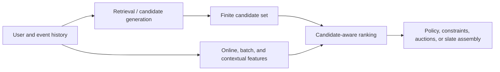

# Modern industrial recommender structures beyond HSTU

## Scope and answer

The earlier study did **not** establish that the industry mainly compares HSTU,
HSTU-large, and SASRec. Those are sequential **retrieval encoders** in one
public generative-recommendation release. Real production systems usually
combine several model roles:

HSTU, SASRec, PinnerFormer, and generative systems can produce or enrich user
representations and candidates. DLRM, DCN V2, DIN, BST, TWIN, and TransAct are
more naturally candidate scorers. Monolith is primarily a training and serving
system. Putting all of them in one quality leaderboard would erase the most
important architectural distinction.

This extension therefore preserves the completed HSTU/SASRec retrieval study
and adds a separate, fixed-candidate ranking experiment.

## Evidence map

| Family | Public industrial evidence | Core structure | Public reproducibility boundary | This study |
|---|---|---|---|---|
| DLRM | Meta describes a production-oriented recommendation model and open-sourced reference implementation [1] | Sparse embedding bags, dense tower, pairwise feature interaction, over-architecture | Public model; production feature schema and traffic are private | Actual `torchrec.models.dlrm.DLRM` |
| DCN V2 | Google reports web-scale ranking deployments [2] | Learned explicit bounded-degree crosses, including low-rank mixtures | Public layers/paper; production data and full systems are private | Actual TorchRec `DLRM_DCN` with three low-rank cross layers |
| DIN | Alibaba reports deployment in its display-ad ranking system [3] | Candidate-conditioned local activation over behavior embeddings | Author repository has no declared license; production features are private | DIN-style normalized-attention adaptation; no copied source and not a canonical reproduction |
| DIEN | Alibaba models evolving interests with an auxiliary next-behavior loss and AUGRU [4] | Interest extractor plus target-aware recurrent evolution | No maintained licensed official stack suitable for this panel | Researched, not admitted to keep the finite matrix interpretable |
| BST | Alibaba applies a Transformer to target-aware behavior ranking [5] | Behavior Transformer plus nonsequential features | No official implementation located | Researched predecessor; official TransAct is the admitted Transformer arm |
| TWIN | Kuaishou reports a deployed lifelong-behavior CTR system [6] | Same target-behavior relevance metric in a coarse GSU and exact ESU | No official public code, feature cache, or long-history dataset | Independent structural adaptation, explicitly not a production reproduction |
| TransAct | Pinterest reports deployment of realtime action modeling alongside batch user embeddings [7] | Candidate-concatenated action Transformer, random recency mask, max/latest outputs | Official Apache-2.0 module is public; data, batch embeddings, heads, and serving are not | Official module unchanged, wrapped in a public-data ranking head |
| PinnerFormer | Pinterest reports deployed batch user representations [8] | Long-sequence Transformer with dense all-action future prediction | No complete official training stack or production feature stream | Researched; not synthesized as an “official” baseline |
| Monolith | ByteDance describes online training, collisionless embeddings, and production serving [9] | System architecture rather than one interchangeable ranker | Archived public system code exists, but an offline MovieLens model comparison is not equivalent | Not admitted to the model leaderboard |
| OneRec / OpenOneRec / OneTrans | Recent work covers private production generation, open recommendation foundation models, and unified sequence/feature interaction [10-12] | Generative recommendation or unified Transformer formulations | The original OneRec production stack remains private; OpenOneRec is public but targets 1.7B/8B instruction-following foundation models rather than matched candidate ranking | Research context only; no invented equivalent or forced leaderboard cell |

“Used in industry” in the table means that the primary paper reports a
production deployment or production-motivated system. It does not mean that
private traffic, current production prevalence, business lift, or later
internal versions can be independently verified from the public release.

## What the admitted models test

### DLRM

DLRM separates dense processing from sparse embedding lookup and then computes
explicit pairwise interactions before an over-architecture [1]. The experiment
uses the real TorchRec implementation, not a renamed multilayer perceptron.
Because MovieLens lacks industrial context features, the matched inputs are
deliberately small:

- user ID;
- candidate item ID;
- latest historical item ID;
- normalized history length, mean rating, request gap, and training-only item
  popularity.

This is a structure test, not a claim that four dense features reproduce a Meta
production ranker.

### DCN V2

DCN V2 explicitly learns feature crosses rather than requiring an MLP to infer
all multiplicative interactions [2]. The admitted arm keeps the DLRM inputs
fixed and changes only the interaction structure to TorchRec's real
`DLRM_DCN`, with three low-rank cross layers. That isolates the architecture
contrast without granting DCN richer features.

### DIN-style normalized-attention adaptation

For candidate embedding \(e_c\) and historical embedding \(e_i\), the local
activation unit scores

\[
a_i = \operatorname{MLP}([e_i, e_c, e_i-e_c, e_i \odot e_c]).
\]

Softmax-normalized weights pool the history specifically for the candidate.
The scorer then consumes the candidate, pooled interest, their elementwise
interaction, user embedding, and matched dense features. This is intentionally
labeled an adaptation: canonical DIN preserves interest intensity through
unnormalized activation weights, uses Dice activations, and includes
mini-batch-aware regularization. The author repository does not grant a
reusable license, so no source was copied.

### TWIN-style adaptation

TWIN's important structural idea is consistency: the coarse General Search
Unit (GSU) and Exact Search Unit (ESU) use the same target-behavior relevance
function [6]. The public-data adaptation:

1. scores all 200 available historical events with a shared target-history
   dot product plus rating/recency cross bias;
2. selects the top 20 events;
3. applies softmax aggregation to those same scores; and
4. ranks with the pooled interest.

It does **not** reproduce Kuaishou's feature cache, `10^4`-`10^5` histories,
traffic, latency stack, or online lift.

### Official TransAct module

Pinterest's public module is vendored unchanged at commit
`2c8b6c93b679949b9581cf592c46ddcba55f3d09` under Apache-2.0. It:

- embeds action types;
- concatenates action-item and candidate embeddings at every sequence
  position;
- applies a random training-time recency window;
- passes the sequence through `nn.TransformerEncoder`; and
- returns a transformed max pool plus the latest \(N\) outputs.

The adapter maps MovieLens ratings 1-5 to action types, feeds the most recent
50 interactions first, and supplies item timestamps in their native Unix-second
unit. A learned user embedding stands in for a batch user representation. That
last component is **not** claimed to reproduce PinnerFormer.

## Frozen experiment

The machine-readable protocol is
[`configs/industry-ranking-v1.json`](../configs/industry-ranking-v1.json).

### Chronology and labels

- Dataset: the same official-preprocessor MovieLens-1M sequences used by the
  HSTU reproduction.
- Training positions: before each user's final two events, with a deterministic
  user-balanced cap of 10 positions and 50,000 examples total.
- Validation target: last event for a frozen deterministic 1,000-user
  partition.
- Test target: last event for the complementary 5,040 users.
- History: at most 200 earlier interactions.
- Training candidates: one observed target plus the first 32 non-target items
  from exact HSTU-large top-200 retrieval for that historical context. The
  target is removed from the negative list after retrieval and supplied only
  as the supervised positive.

The official HSTU training split excludes each user's last event, then retains
at most a 200-event history plus its training target. Autoregressive
supervision covers shifted positions inside that retained window. A draft
extension that used the second-last event for validation therefore gave the
retriever prior exposure to the validation label for users whose retained
window included it. The direct code audit rejected that result. Both final
ranker partitions use last events that HSTU never observed, and users are
disjoint between selection and test.

### Candidate ceiling

All rankers receive the same first 200 candidates from the frozen epoch-100
HSTU-large exact full-catalog retrieval order. Prior-history items are excluded
and the held-out target is never injected.

The first 100-user implementation pilot also constructed a fixed-width
three-retriever interleave. Truncation made its ceiling lower than HSTU-large's
own list, so that construction failed the gate. The diagnostic remains
preserved; it is not relabeled as the successful pool.

HSTU-large was frozen before ranker execution from the completed prior study.
That prior comparison used the same MovieLens last-event task, so this is a
downstream adaptation benchmark, not a fresh independent holdout for choosing
the retriever family. The final validation/test user partition is independent
for ranker checkpoint selection.

Candidate coverage is reported independently at 50, 100, 200, and 500.
Unconditional ranker metrics count an absent target as zero. Conditional
metrics answer only how well the ranker orders candidates after retrieval has
made the target available.

Every model is a residual reranker over the common prior
\(-\log(\text{HSTU-large rank})\). Its learned residual scale starts at zero,
so epoch 0 exactly preserves HSTU-large ordering. A model is retained only if a
later checkpoint improves frozen validation NDCG@10; otherwise the measured
outcome is the unchanged retrieval baseline.

### Selection and efficiency

- Seeds: 17 and 42.
- Optimizer: AdamW, learning rate `1e-3`, weight decay `1e-4`.
- Item popularity and recency-gap normalization are fitted only on the 50,000
  training positions. Validation/test timestamps cannot change the normalizer.
- Maximum learned epochs: 10, with epoch 0 admitted as the frozen retrieval
  prior.
- Checkpoint selection: unconditional validation NDCG@10 on the frozen
  deterministic 1,000-user last-event partition.
- Full validation and test: once after checkpoint selection.
- Inference timing: batch 16 x 200 candidates, exact model history shape, 10
  warmups and 50 synchronized samples.
- Training timing: batch 64 x 33 candidates, 3 warmups and 20 synchronized
  samples.
- FP32/TF32 is the quality path. BF16 is timed separately and top-10 set
  overlap is reported rather than assumed.

Using random full-catalog negatives would make training much easier than
scoring HSTU's top candidates. A rejected pilot did exactly that. The final
matrix matches the training and evaluation candidate distribution through
official HSTU-large exact retrieval.

## Provenance and licensing

- TorchRec experiment tag: `v1.8.0-rc1`, commit
  `0ea0ec09512930dbcbf6d24cb65132a77835bce8`.
- TransAct repository: `pinterest/transformer_user_action`, commit
  `2c8b6c93b679949b9581cf592c46ddcba55f3d09`, Apache-2.0.
- All five original TransAct files are verified against
  [`third_party/transact-source-sha256.json`](../third_party/transact-source-sha256.json).
- DIN-style and TWIN-style code in this repository is independently authored
  from the cited papers. No source was copied from an unlicensed repository.

## Review limitation

The exact GPT-6-Astra model with MAX reasoning and an independently exposed
numeric one-million-token context was not available in this runtime. A
GPT-6.1 Sol reviewer with MAX reasoning and long context independently checked
the implementation, experiment design, numerical aggregates, provenance, and
conclusions. Its findings triggered a training-only normalization fix,
stronger aggregation guards, clearer DIN labeling, and expanded committed
provenance. No substitute is mislabeled as Astra, and no numeric `1M` context
claim is made.

## Primary sources

1. Naumov et al., “Deep Learning Recommendation Model for Personalization and
   Recommendation Systems,” arXiv:1906.00091,
   <https://arxiv.org/abs/1906.00091>.
2. Wang et al., “DCN V2: Improved Deep & Cross Network and Practical Lessons
   for Web-scale Learning to Rank Systems,” arXiv:2008.13535,
   <https://arxiv.org/abs/2008.13535>.
3. Zhou et al., “Deep Interest Network for Click-Through Rate Prediction,”
   arXiv:1706.06978, <https://arxiv.org/abs/1706.06978>.
4. Zhou et al., “Deep Interest Evolution Network for Click-Through Rate
   Prediction,” arXiv:1809.03672, <https://arxiv.org/abs/1809.03672>.
5. Chen et al., “Behavior Sequence Transformer for E-commerce Recommendation
   in Alibaba,” arXiv:1905.06874, <https://arxiv.org/abs/1905.06874>.
6. Chang et al., “TWIN: TWo-stage Interest Network for Lifelong User Behavior
   Modeling in CTR Prediction at Kuaishou,” arXiv:2302.02352,
   <https://arxiv.org/abs/2302.02352>.
7. Xia et al., “TransAct: Transformer-based Realtime User Action Model for
   Recommendation at Pinterest,” arXiv:2306.00248,
   <https://arxiv.org/abs/2306.00248>; official code:
   <https://github.com/pinterest/transformer_user_action>.
8. Pancha et al., “PinnerFormer: Sequence Modeling for User Representation at
   Pinterest,” arXiv:2205.04507, <https://arxiv.org/abs/2205.04507>.
9. Liu et al., “Monolith: Real Time Recommendation System With Collisionless
   Embedding Table,” arXiv:2209.07663,
   <https://arxiv.org/abs/2209.07663>; code:
   <https://github.com/bytedance/monolith>.
10. “OneRec: Unifying Retrieve and Rank with Generative Recommender and
    Iterative Preference Alignment,” arXiv:2502.18965,
    <https://arxiv.org/abs/2502.18965>.
11. “OpenOneRec: An Open Foundation Model and Benchmark to Accelerate
    Generative Recommendation,” arXiv:2512.24762,
    <https://arxiv.org/abs/2512.24762>; code:
    <https://github.com/Kuaishou-OneRec/OpenOneRec>.
12. “OneTrans: Unified Feature Interaction and Sequence Modeling with One
    Transformer in Industrial Recommender,” arXiv:2510.26104,
    <https://arxiv.org/abs/2510.26104>.
