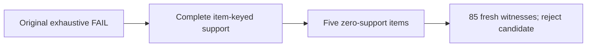

# Beauty conditioned-native-prompt-support admission

_2026-10-28 · CPU-only rejection study · Scientific decision remains with the parent._

---

## 🎯 Recommendation

**Reject this candidate.** Conditioning auxiliary template selection cannot retain
every original item under the existing strict-clean checks: **five items have zero
admissible `index2item` templates**. No sampling wrapper or training configuration
was created. The untouched native corpus remains **FAIL**.[^audit]

This concerns only the separately licensed OpenLLaMA-7B-v2 compatible-backbone,
released-ID hybrid. Original LLaMA-1 access remains unconfirmed; neither this
study nor a future correction is an exact paper reproduction.[^track]



## 📊 Exact native evidence

The original audit covers **3,072,191** variants: **3,063,119** strict-clean and
**9,072** distinct failures. Defect counts overlap; do not sum them as failed rows.

| Group | All variants | Strict-clean |
|---|---:|---:|
| Train `seqrec` | 2,234,021 | 2,234,021 |
| Validation `seqrec` | 380,171 | 380,171 |
| Test `seqrec`, prompt 0 | 22,363 | 22,363 |
| Train `item2index` | 229,919 | 229,828 |
| Train `index2item` | 205,717 | 196,736 |

Every auxiliary prompt has **12,101** original items. Ranges below denote
identical counts **for each prompt ID**, not a range total. All unlisted defects
are zero.

| Task / prompt IDs | Clean per prompt | Defects per prompt |
|---|---:|---|
| `item2index` 0–5 | 12,101 | None |
| `item2index` 6–18 | 12,094 | 7 each: `full_over_cap`, `prompt_over_cap`, `all_masked`, `eos_lost`, `incomplete_code`, `intended_labels_mismatch`, `response_trigger_lost_to_truncation` |
| `index2item` 0–5 | 12,072 | `prefix_mismatch` 29; `intended_labels_mismatch` 29 |
| `index2item` 6–11 | 11,274 | `empty_response` 734; `empty_response_field` 734; `prefix_mismatch` 87; `intended_labels_mismatch` 93; 7 each: `full_over_cap`, `target_over_cap`, `eos_lost` |
| `index2item` 12–16 | 11,332 | `empty_response_field` 734; `prefix_mismatch` 29; `intended_labels_mismatch` 36; 7 each: `full_over_cap`, `target_over_cap`, `eos_lost` |

Each `seqrec` prompt 0–16 is clean for all 131,413 training prefixes and all
22,363 validation users; test prompt 0 is clean for all 22,363 users.

Aggregate defects: `full_over_cap`/`eos_lost` **168 each**;
`prompt_over_cap`/`all_masked`/`incomplete_code`/
`response_trigger_lost_to_truncation` **91 each**; `target_over_cap` **77**;
`prefix_mismatch` **841**; `intended_labels_mismatch` **1,003**;
`empty_response` **4,404**; `empty_response_field` **8,074**.
Full-length quantiles are p50 **84**, p90 **157**, p99 **312**, max **6,955**
against the unchanged **2,048**-token limit.

## 🔍 Why conditioning cannot preserve coverage

| Task | Admissible prompts per item → number of original items |
|---|---|
| `item2index` | 6 → 7; 19 → 12,094 |
| `index2item` | **0 → 5**; 6 → 764; 11 → 82; 17 → 11,250 |

All 12,101 item identities remain represented in the diagnostic, including the
24 items sharing 11 colliding SID groups. Identity is the original item ID,
not the SID string. Only **12,096/12,101** items have `index2item` support.

- **Blank descriptions:** 734 items; 733 retain clean title-only responses.
  The remaining item's title responses have a token-prefix mismatch. All raw
  titles, including after native ``.strip().strip(".!?,;:`")``, remain nonempty.
- **Boundary mismatch:** the native `Response:` suffix has no added whitespace.
  Some response starts merge with its final token. Native length-based masking
  then suppresses part of the contextual response. Of 29 title-boundary failures,
  24 can use unchanged description-only responses, but five cannot.
- **Zero support:** four items fail the prefix/mask check for all 17 response
  forms. The fifth fails title/both forms at the boundary, while its description
  is empty. Private evidence retains every original ID and failed prompt.
- **Fresh confirmation:** all **85/85** zero-support variants were re-rendered,
  retokenized and passed through the actual native collator, both batched and
  singleton. **0 strict-clean**; 79 prefix/intended-mask failures, 6 empty
  responses, 11 empty response fields. Native algorithm parity holds for all
  85—algorithm fidelity does not imply correct response masking. Maximum full
  length is only **560**, so these are not context-limit failures.

The original strict criterion checks empty **response** fields, not every empty
instruction field. Adding the latter restriction would further reduce support;
it cannot rescue these five items. No new emptiness policy was adopted.

## ⚖️ Sampling and alternatives

The required native epoch contains **131,413 + 12,101 + 12,101 = 155,615**
examples across all three tasks. There is no strict-clean auxiliary draw for five
required item/task pairs, so this policy cannot realize that contract.

For supported pairs, hypothetical conditioning changes template probability
from `1/19` or `1/17` to `1/|allowed(item, task)|`; title/description probabilities
also change. For 733 blank-description items, title-only `index2item` probability
would become 1. This is neither unchanged native sampling nor evidence of better
recommendation performance.

| Alternative | Why it does not satisfy this bounded request |
|---|---|
| Whitespace or mask repair | Changes rendered strings or the loss boundary/objective; needs a separate scientific decision and audit |
| Whole-item filtering / skipping unsupported auxiliary rows | Loses item coverage or the original task counts |
| Dropping an auxiliary task | Changes the all-three-task recipe |
| Context beyond 2,048 | Unsupported here and does not fix these five boundary/empty-field failures |

Keep Beauty blocked; do not introduce a fallback policy or launch training.

## 🧪 Verification and receipts

`scripts/letter/beauty_prompt_support.py` is a **read-only rejection diagnostic**,
not a candidate sampler. Its complete support reconstruction is hash-bound to
the original item order, corpus/index, model/tokenizer, source and auditor.
All **38** original audit artifacts were verified; every worker/group/prompt
summary was reconciled with the complete failure ledger. Inputs and original
artifacts were reverified after the fresh witnesses.

Tests were written first: the missing implementation failed, then the targeted
suite passed **45 tests locally** (two native-runtime skips) and **47 tests on
the bound CPU runtime**, including those two native tests. Existing legacy
bitsandbytes/deprecation warnings were nonfatal; no dependencies were changed.

```powershell
python -m pytest -q -p no:cacheprovider `
  --basetemp=.local\letter\beauty-support-tests-NEW `
  tests\test_letter_beauty_prompt_support.py tests\test_letter_lc_audit.py
```

The full native study invocation is preserved in private `verify.ps1` and the
bound entry log. Its expected exit code is **2**, `FAIL_ZERO_SUPPORT`, not a tooling failure.
Private evidence contains the untouched full native audit beside `rejection-001`
(`report.json`, `support-diagnostic.json`, `zero-support-witnesses.json`,
`completed.json`), locally copied and checksum-verified.

| Evidence | SHA-256 |
|---|---|
| Original `audit.json`, still FAIL | `16c5cdb3976d6f469d7e16687438409e6c16588cbc502ae6f61dbe964bc00b78` |
| Rejection `report.json` | `021eb608cddebe8353b2904557a8c36e6d042e4696d35d8924e02aa68c90a22b` |
| Fresh zero-support witnesses | `f8048654ab280af86c44b71c8abe45f633944060128a5e9dedf4d11ab26fb883` |

Post-wrapper exhaustive auditing and sampler continuation tests are **not
applicable**: the prerequisite failed and no wrapper exists. No gradients, model
training, GPU work, held-out scores, Gen2 writes or changes to running tracks
were performed.

[^audit]: [Preserved aggregate native corpus audits](../results/2026-10-28-letter/lc-corpus-audit-openllama-released-id.json); pinned [auditor](../scripts/letter/lc_audit.py).
[^track]: [Compatible-backbone identity and license](../configs/letter-openllama-v2-method-v1.json); unchanged author templates at https://github.com/HonghuiBao2000/LETTER/blob/8d0154e28de37dbb6e24871c508ad8ddb1921cda/LETTER-LC-Rec/prompt.py.
