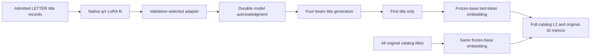

# Compatible BIGRec title-grounding reference

_Frozen method decision for the LETTER reproduction — 2026-10-28._

---

## 📋 Scope and source

This is a **compatible-backbone reference**, not an original-weight BIGRec
reproduction and not a claim of completing the LETTER paper. The implementation
retains BIGRec's two stages: title-generating LoRA adaptation, then nearest-title
grounding with a separate, frozen, unadapted language model.[^bigrec]

| Component | Frozen choice |
| --- | --- |
| Author implementation | `SAI990323/BIGRec@16fc86bf2af905c29d089e5f60b35b857e9e0fe3` |
| Pinned archive SHA-256 | `4acc47e62d2beb8d35f71b5985480584dc3266c8626279bbc29249936b86b58a` |
| Compatible backbone | `openlm-research/open_llama_7b_v2@e5961def23172a2384543940e773ab676033c963`, Apache-2.0[^backbone] |
| Original LLaMA1 | Access unconfirmed; not downloaded or reused |
| Source/data redistribution | No explicit BIGRec source license found in the audited revision; independently acquired source and all experiment data remain private |
| Executable recipe | [`letter-bigrec-compatible-v1.json`](../configs/letter-bigrec-compatible-v1.json) |

Only the pure `generate_prompt` function is extracted from a checksum-verified
author AST. The native training module is not imported: its top-level
`LD_LIBRARY_PATH` replacement must not execute in the isolated runtime.
Adapters reconstruct the native operations rather than publicly vendoring the
author's code.[^train]

The frozen BIGRec harness was deployed with CRLF line endings; its execution
and maintenance hashes cover those exact bytes. A scoped `.gitattributes` rule
therefore restores CRLF for these Python files on both Windows and Linux.
Git blobs and `git archive` retain canonical LF and have different raw hashes.
Use an attribute-aware checkout or the preserved exact-byte deployment bundle
for recovery; never overwrite a running deployment with a canonical archive.
Clean-checkout regression tests exercise both `core.autocrlf` settings.

## 🎯 Decision and compatibility changes

The integration decision was made in a fresh parent-dispatched GPT-6-Astra
consultation, before GPU gates or test scoring. It uses the closest explicit
few-shot author recipe rather than silently replacing BIGRec with a generic
title recommender.

| Issue | Decision | Consequence |
| --- | --- | --- |
| Native train/inference whitespace differs | Use the native **training renderer** for both | Removes a real tokenizer-prefix mismatch; explicitly differs from native inference's extra space[^inference] |
| Native cutoff 512 can drop answer/EOS | Context 2048; remove whole oldest history items only | Every admitted quoted target and EOS survives |
| Target-dependent cropping could leak held-out labels | Reserve `max(128, longest catalog quoted-target suffix + EOS)` per dataset | Prompt shortening uses history and catalog metadata, never the actual held-out target |
| Native LoRA initialization was not explicitly seeded | Set initialization and Trainer seed 42 | A deterministic reconstruction, not recovery of an undefined random initialization |
| Duplicate titles | Preserve all original IDs; encode equal title strings once and expand back | Equal-title rows share embeddings without collapsing target identities |
| FP16 distance arithmetic | Float32 direct `torch.cdist(p=2)`, without normalization | Declared numeric deviation; avoids unsupported/unstable half-precision distance arithmetic |
| Native resume and adapter-only monkeypatch | Native adapter safetensors plus complete training state | Cold-resume equivalence must pass rather than treating a weight reload as a resume |
| Native checkpoint retention | Operational snapshots every four optimizer-step positions, retain immutable full states and best model | Persistence change only; epoch/validation/selection budget remains fixed |
| Legacy long-prompt beam-search memory | Keep only the already-computed last-token logits; exact in-place cache permutation; release obsolete output references | Native batch eight, four beams, four returned sequences and 128 tokens remain unchanged |

Increasing context does not change Yelp's admitted token sequences; none exceed
512. Instruments and Beauty require the compatibility correction. Long titles
that cannot be generated fully within 128 new tokens are not removed; the native
generation budget is preserved, with observed finish reasons recorded.

## 🗂️ Data and full-corpus admission

Use only the hash-verified LETTER release and its existing per-user
leave-two-out split. Training prefixes come from `s[:-2]`; validation targets
`s[-2]`; test targets `s[-1]`, with the validation item in test history. Histories
contain at most 20 items. Users are ordered by numeric original ID, prefixes by
increasing position. Titles are the released `title` strings verbatim: no invented
titles, categories, benchmark substitution, global-time split, seen-item
exclusion, or user filtering.

The game-domain author instruction/input construction is adapted only in domain
nouns and activity verbs: musical products/bought, beauty products/bought, and
businesses/visited. The original quoting, comma separator and trailing
newline-space are retained.[^preprocessing]

Every train, validation and test record is fully rendered and tokenized before
GPU work. The audit checks the canonical prompt prefix, complete quoted target,
EOS, native-cutoff behavior, retained history and original item identity.
Static target `finish_reason` is `N/A`.

| Dataset | Train prefixes | Fixed test users | Catalog items | Duplicate-title excess | Catalog answer reserve |
| --- | ---: | ---: | ---: | ---: | ---: |
| Instruments | 131,837 | 24,772 | 9,922 | 34 | 366 |
| Beauty | 131,413 | 22,363 | 12,101 | 28 | 294 |
| Yelp | 225,061 | 30,431 | 20,033 | 4,693 | 128 |

The independently hash-bound
[`semantic-input-ambiguity-v1.json`](../results/2026-10-28-letter/semantic-input-ambiguity-v1.json)
confirms 65 / 55 / 6,127 items in duplicate-title groups for Instruments / Beauty /
Yelp, spanning 31 / 27 / 1,434 groups. Their ambiguous-title test-target counts
are 178 / 173 / 8,508, respectively; Yelp's largest group has 149 items.
This is metadata evidence, **not a trained title-baseline result**.
Memoizing an equal title's embedding does not deduplicate the catalog: all
9,922 / 12,101 / 20,033 original rows still participate in ranking.
Primary metrics always use the true original item ID. Literal generated-title
matches, catalog-title-equivalence hits, and original-item metrics stratified by
title ambiguity are separate diagnostics, never substitutions for item hits.

| Dataset | Train records missing EOS at native 512 | Shortened train / validation / test | Shortened selected train records | Selected train maximum tokens |
| --- | ---: | --- | ---: | ---: |
| Instruments | 9,249 | 0 / 0 / 0 | 0 | 744 |
| Beauty | 19,479 | 550 / 68 / 74 | 7 | 1,891 |
| Yelp | 0 | 0 / 0 / 0 | 0 | 286 |

All records passed the final target/EOS and prefix checks. Beauty removes at most
six whole oldest history items; no title is truncated. The admitted catalog
contains no empty titles, but the implementation preserves and tests empty
strings rather than substituting text.

## ⚙️ Fixed training and inference

Training uses 1,024 prefixes per dataset, selected by
`Dataset.shuffle(42).select(range(1024)).shuffle(42)`. Validation uses a fixed
5,000-user `pandas.sample(n=5000, random_state=42)` subset selected before fitting.
This is explicitly a **few-shot label budget**, not all-data BIGRec training.

| Setting | Frozen value |
| --- | --- |
| Training precision | Native 8-bit loaded base with FP16 AMP |
| LoRA | Rank 8, alpha 16, dropout 0.05; **q/v only**; no trainable embedding/head |
| Objective | Ordinary shifted causal CE over the entire prompt and answer |
| Batch geometry | One GPU, microbatch 4, accumulation 32, effective batch 128 |
| Epoch budget | 50 maximum; validation every epoch; patience 5 |
| Optimizer | AdamW, learning rate `1e-4`, weight decay 0, linear schedule, 20 warmup steps |
| Ordering | Native length-grouping algorithm after the two HF shuffles |
| Collator | Left padding, multiple of eight, pad ID 0, label pad -100 |
| Selection | Best validation loss; never test metrics |
| Generation model | Fresh FP16 base plus selected LoRA, not the training-time int8 base |
| Generation | Batch eight; deterministic four beams and four returned sequences; 128 new tokens |
| Grounding query | First generated sequence only, with native outer-double-quote stripping |
| Grounding representation | Fresh frozen base, slow legacy tokenizer, BOS/no EOS, final hidden layer's final left-padded token |
| Ranking | Full original catalog, unnormalized L2; stable ascending original-ID ties |

The two-stage path is deliberately not the LETTER 20-beam semantic-ID ranking
pipeline. Beam budgets are not claimed to be equal.

The long-prompt Beauty gate exposed legacy `GenerationMixin` retaining several
complete cache copies and unused prefill logits. Instance-local generation hooks
retain only a cloned last-token logit slice and apply the same `index_select`
beam permutation one cache tensor at a time in place. Obsolete `ModelOutput`
cache entries are cleared through its mapping setter, not its attribute setter
(which retains mapping values when assigned `None`). Hooks and the cache method
are restored after generation. Process-scoped allocator fragmentation control
uses `max_split_size_mb:128`; no shared-runtime files are patched.

The corrected and ordinary paths produced exactly identical four-beam token
sequences and scores on eight real Beauty training prompts at the full
128-token budget. The long-prompt eight-user gate then passed with maximum
allocated memory 71.80 GiB on an 80 GB A100. These are execution-gate observations,
not held-out quality measurements. Grounding still uses the separate unpatched,
unadapted base.[^grounding]

## 🧪 Execution gates and persistence

`tests/test_letter_bigrec.py` covers source extraction, prefix parity, complete
target/EOS retention, whole-item cropping, native sampling, duplicate/empty
titles, stable full-catalog L2, actual token-derived finish reasons, complete
checkpoint requirements and immutable exports.

`bigrec_gate.py model` requires the full-corpus admission first. It checks
ordinary CE on real long training records, q/v-only gradients, unchanged frozen
parameters, exact adapter reload, a 100-real-row smoke, native pooling, duplicate
ranking, and full eight-user/four-beam generation using training prompts only.

The production-shaped continuation gate retains the full 50-epoch/400-step
schedule and 5,000-user validation subset. It compares a continuous 12-step run
with cold processes drained at steps 5, 8 and 9, including a chained
multi-preemption test. This covers a partial first epoch, an epoch/validation
boundary, and a partial subsequent epoch. At least five actual nonzero-learning-rate
AdamW updates—not merely incremented Trainer step counters—are required.
Adapter, optimizer, scheduler, FP16 GradScaler, RNG, recorded native
permutations, ordered training tensors/losses and validation/early-stop state
must agree exactly.

An epoch-boundary snapshot is published only **after validation** and selection
state finish. Sealing rejects `evaluations != global_step // 8` or inconsistent
microbatch positions. A hard interruption during validation falls back to the
preceding complete mid-epoch checkpoint instead of silently skipping validation.
Interrupted or invalid local seals are preserved in quarantine before recovery.
Earlier exploratory gate snapshots captured before epoch validation are diagnostic
artifacts, not admitted production resume points.

The protected runtime is not modified. The existing hash-guarded
Transformers-4.31 resume-only completed-epoch replay correction is required.
The BIGRec wrapper also persists the actual native permutations, avoiding
dependence on replaying omitted validation-loader RNG consumption, and explicitly
saves/restores `Accelerator.scaler` (which the legacy Trainer's separate scaler
branch does not cover).

Only the designated node-zero exporter writes to the approved private durable
directory, under the experiment-wide `bank.lock`. Remote workers only write
node-local outboxes. The exporter rsyncs remote immutable snapshots to node zero,
verifies hashes, serializes durable writes, and sends checksum-bound
acknowledgments. A live round-trip exporter handshake precedes each long fit;
the selected model must be acknowledged before test generation.

Generated titles, all four scores/token sequences/finish reasons, catalog and
query embeddings, original-ID rankings, adapters and complete training states
are private and banked in their native formats. Partial predictions never become
a reduced-denominator result. OOM is a blocked cell, not permission to reduce
beams or drop users. Supervisors drain only their own child process and never
cancel or alter the user's allocation.

For recovery, restore the native payload into node-local storage while excluding
the transport envelope `bank-receipt.json`. Restore the matching run configuration,
admission, source and selected-best checkpoint as well. The private evidence
bundle preserves the production configurations separately from the native
checkpoint tensors; the run configuration is checksum-bound by every checkpoint.

### Terminal-state maintenance

Restoring `EarlyStoppingCallback.early_stopping_patience_counter` alone does not
restore its terminal decision in Transformers 4.31. A checkpoint sealed when
patience reaches five must not enter another epoch, even if a simultaneous drain
or a crash prevented selected-model publication.

`bigrec_maintenance.py` supplies a versioned, checksum-guarded overlay over the
retained frozen implementation. It adds only three control-flow insertions:
terminal finalization before training, a terminal-status sidecar before sealing
new checkpoints, and terminal finalization before the drain branch. Existing
sealed checkpoints are not edited; their terminal status is derived from their
recorded patience counter and unchanged 400-step maximum.

`bigrec_terminal.py` publishes the **recorded best** adapter directly from its
verified checkpoint, without model construction, optimizer steps, microbatches,
validation, or reselection. Partial selected artifacts are preserved in
quarantine. Both the original base hashes and the effective overlay hash are
recorded explicitly; original run configurations, gates, source files, sampling,
50-epoch maximum, patience five and validation budget remain unchanged.

Production launches use the maintenance entry point and an immutable admitted
deployment manifest, not the retained legacy training entry point directly.
Admission requires native fault tests for cold terminal recovery, simultaneous
terminal validation/drain, and a crash between terminal sealing and publication,
plus exact before/after continuation checks from each fit's actual drained state.
Those tests passed on the pinned runtime: terminal cases performed no extra
optimizer updates, microbatches or validation and published the same recorded
best adapter. Real 7B continuations from Instruments step 41, Beauty step 35 and
Yelp step 49 matched the original implementation bitwise for adapter, optimizer,
scheduler, scaler and RNG state, as well as all 32 ordered microbatches/losses.
The maintained fits resumed those existing states; no whole fit was restarted.

## ✅ Verified execution status

| Check | Observed outcome |
| --- | --- |
| Local BIGRec and reused-protocol tests | 55 passed; two optional local CUDA tests skipped |
| Unit tests in the protected legacy runtime | 32 passed; one private-source-location check skipped |
| Real-backbone model gates | Passed on all three datasets, including 100 real training rows, CE, q/v-only gradients, reload, pooling and fixed-budget generation |
| Final cold continuation | 12 AdamW calls, 11 nonzero-learning-rate updates; all 384 ordered microbatches/losses and complete native state matched exactly across drains at 5, 8 and 9 |
| Frozen-base catalog embeddings | All 9,922 / 12,101 / 20,033 original rows computed and durably acknowledged |
| Fixed fits | All three started; at least five nonzero-learning-rate updates and a checksum-verified durable native full-state checkpoint observed for each |

Approval receipt SHA-256:
`4c3516c8fcb66d01a0189be1f68472557a7062941fa8845a56e8ec7ebe225872`.
Detailed receipts, process IDs, logs and native checkpoint acknowledgments are
preserved in the private handoff. Beauty exercised the native FP16 scaler's
overflow handling; actual optimizer calls are tracked separately from Trainer
step counters.

Training and subsequent bank-before-test evaluation remain active. **No final
BIGRec test metrics or full-paper completion are claimed here.**

## 📚 References

[^bigrec]: Bao et al. *A Bi-Step Grounding Paradigm for Large Language Models in Recommendation Systems*. https://arxiv.org/abs/2308.08434
[^train]: Pinned BIGRec training implementation and README recipe. https://github.com/SAI990323/BIGRec/blob/16fc86bf2af905c29d089e5f60b35b857e9e0fe3/train.py
[^inference]: Pinned BIGRec title-generation renderer and beam settings. https://github.com/SAI990323/BIGRec/blob/16fc86bf2af905c29d089e5f60b35b857e9e0fe3/inference.py
[^preprocessing]: Pinned BIGRec game preprocessing notebook. https://github.com/SAI990323/BIGRec/blob/16fc86bf2af905c29d089e5f60b35b857e9e0fe3/data/game/process.ipynb
[^backbone]: OpenLLaMA-7B-v2 pinned model card and license. https://huggingface.co/openlm-research/open_llama_7b_v2/tree/e5961def23172a2384543940e773ab676033c963
[^grounding]: Pinned BIGRec frozen-base title grounding and L2 scoring. https://github.com/SAI990323/BIGRec/blob/16fc86bf2af905c29d089e5f60b35b857e9e0fe3/data/movie/evaluate.py
