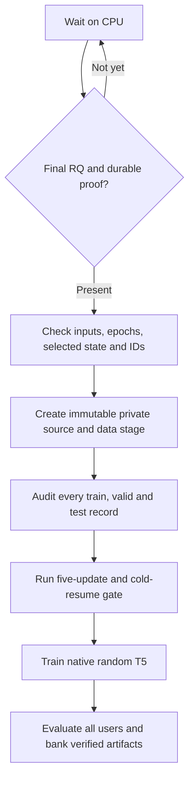

# Fresh tokenizer IDs to native T5

_LETTER compatible-method execution contract and admission gates._

---

## 📋 Scope and current evidence

This component connects **completed, durably banked fresh RQ IDs** to the already
validated native LETTER-TIGER learner. It does not fit RQ, change the frozen active
learner, implement LC-Rec, or claim completion of the paper reproduction.

The semantic encoder is OpenLLaMA-7B-v2 at
`e5961def23172a2384543940e773ab676033c963`; the downstream generator is a
**randomly initialized native small T5**, not OpenLLaMA.[^encoder]
Original-LLaMA1 access remains outside this component's evidence.

| Component | Owned file |
| --- | --- |
| Admission, immutable staging, input/run/evaluation verification | `scripts\letter\fresh_ids.py` |
| Node0 readiness, gates, continuation, banking | `scripts\letter\fresh_pipeline.py` |
| Frozen 39-cell recipe and dataset input fingerprints | `configs\letter-fresh-id-execution-v1.json` |
| Contract and regression tests | `tests\test_letter_fresh_ids.py` |

Real RQ runs were unfinished when the native format gate was executed. The gate
therefore used an explicitly synthetic, reversible catalog-numbering fixture over
the real Instruments item domain and interaction records. It exercised all
1,024 positional SID tokens. It did **not** manufacture an RQ checkpoint,
RQ completion receipt, real admission, or recommendation-quality result.

## 🏗️ Admission and lineage



Admission requires:

1. The exact frozen execution, method and tokenizer recipe checksums, declared
   compatible track, dataset and alpha/beta variant, and `synthetic_fixture=false`.
2. The original contiguous item domain and unchanged item/inter/index files in
   the original upstream tree. Only the private staged index is replaced.
3. All full semantic and teacher files and provenance receipts match the frozen
   per-dataset fingerprints. Matrices must be finite float32 `N×4096` and `N×32`.
   The semantic bank must have its complete all-field audit; the teacher must
   be the completed dataset-specific, training-only BCE reconstruction with no
   test evaluation. Every variant uses the same frozen semantic/teacher pair.
4. A checksummed **final** tokenizer bundle, latest sealed state at actual epoch
   20,000, and selected sealed state at a scheduled 2,000-epoch boundary.
   Both state specifications, initialization flags, selected pointers and
   minimum-collision value must agree. The native first-minimum selection policy
   and executed RQ source fingerprints are fixed.
5. The exact final export receipt, integer `codes.npy`, four positional tokens
   per item, values `0..255`, complete original item domain, and independently
   recomputed collision/utilization counts. Remaining collisions are retained;
   no fifth uniqueness token is added.
6. The corresponding node0 durable `bank-receipt.json` and every bundle byte
   verify under the shared `bank.lock`. An unfinished worker snapshot, a local
   export alone, or an acknowledgment for different completion bytes cannot admit
   training.

The bundle does not include every RQ epoch log. Admission verifies the sealed
20,000th state and the pinned native selection implementation; it does not
pretend to independently re-run the entire collision-selection history.

### Metadata-only source reuse

The adapter copies an explicit, canonical-LF, hash-guarded harness allowlist and
only the required private `LETTER-TIGER` source/config/tokenizer assets.
It never edits active `run.py`, the original upstream, or historical deployed
source snapshots.

| Source | SHA-256 |
| --- | --- |
| Frozen original `run.py` | `8e42dcefacf678df886edf5428e6ccd8fbb98f0047a5dffb322efa1a9a7458a9` |
| Private metadata-only `run.py` | `cf59709a5d0cbbf77d752769bd856be79ffde85efbd75e089e23417e7d45855b` |
| Frozen execution config, canonical LF | `fceeeefb3c28b689d50ba25ee9810211478a1cdb3cb144ae2a11dcf0ba70990a` |

The only Python AST changes are the real-run receipt kind
`fresh-id-compatible-rebuild` and insertion of
`experiment_lineage = manifest["experiment_lineage"]` into that receipt.
Smoke runs retain kind `smoke` and carry the same explicit lineage. There is no
global binding monkeypatch or post-training receipt relabeling. The separate
gate-only tensor tracer delegates unchanged arguments to the native model.

The derived manifest binds the exact parent-manifest bytes, unchanged item/inter
hashes, new index hash, encoder identity, random T5 identity, full input receipts,
RQ selection/export hashes, execution recipe and durable proof. It excludes
stale released-SID statistics and moves paper targets to
`paper_reference_context_only`. The unchanged full audit binds this manifest;
the native run binds that audit; the unchanged evaluator embeds the complete
source run configuration. Additional verifiers enforce the same chain.

## ⚙️ Frozen downstream recipe

| Setting | Value |
| --- | --- |
| T5 | Native random initialization; 4 layers, `d_model=128`, `d_ff=1024`, 6 heads, `d_kv=64`, dropout 0.1 |
| Inputs | Native splits, all training prefixes, history 20, maximum token length 512 |
| Training | LR `5e-4`, maximum 200 epochs, minimum validation loss, patience 20 |
| Instruments / Yelp | 2 workers × micro256 × accumulation2 = nominal 1,024 |
| Beauty | 2 workers × micro512 × accumulation1 = nominal 1,024 |
| Variants | Instruments/Beauty: semantic, CF, diversity, full; Yelp: semantic, full |
| Temperatures | 1.0 for every variant; additional 0.7 for full using the **same immutable index stage** |
| Seeds | All 13 seed-42 cells first, then 13 seed-17, then 13 seed-23 cells |
| Evaluation | Every test user, full-prefix catalog trie, 20 beams, 10 new tokens, no seen-item exclusion |
| Reporting | Exact code metrics and declared original-item expansion diagnostics, independently recomputed |

Native model, data, collator, loss, optimizer, scheduler, iteration and selection
operations are unchanged from the verified harness.[^author]
The verified Transformers-4.31 resume-only sampler correction is required; this
component checks it but does not rewrite the shared environment.

The small gate deliberately uses 100 records, micro16, accumulation2, effective64
and five optimizer updates. This permits integral two-worker epochs. It is not a
production-batch equivalence claim: the previously verified full-data
dataset-specific production-geometry gates remain separate.

## 🧪 Executed native gate

On authorized node0 GPUs 2/3, the original active source hash stayed unchanged.
All three full semantic/teacher bank pairs passed their actual-byte provenance
checks. An actual partial Instruments RQ bundle was rejected.

The Instruments fixture audit used the staged native author classes:

| Split | Records / strict clean | Input tokens p50 / p90 / p99 / max | Target tokens |
| --- | --- | --- | --- |
| Train | 131,837 / 131,837 | 13 / 57 / 81 / 81 | 5 |
| Valid | 24,772 / 24,772 | 17 / 45 / 81 / 81 | 5 |
| Test | 24,772 / 24,772 | 21 / 49 / 81 / 81 | 5 |

All targets were four atomic positional SID tokens plus EOS; there were zero
over-cap records. The resulting tokenizer vocabulary was 33,124. The native
five-update run and a fresh-process resume after update 3 matched bitwise across
model, optimizer, scheduler and **both ranks' RNG states**. Actual ordered
input/label tensor traces, loss/LR history and callback state also matched.
The smoke callback's early-stopping counter is `null`; this is not a new
full-training early-stopping test. A native full-trie probe returned 20 distinct
valid IDs with EOS, and rendered train/test examples were persisted privately.

Private evidence locations are recorded in the ignored handoff, not in this
document. The original gate's relative artifact names and hashes are:

| Artifact | SHA-256 |
| --- | --- |
| `fixture-stages/Instruments-format-v1/stage.json` | `2cc49730376517f20718fdb55e543593e07bf0839ad5d6bbe7fc3beb537ebc65` |
| `fixture-audits/Instruments-format-v1/audit.json` | `c880b93e2c7a25f3fe031adf6b15c3a06bb7a69f7f7176f4afd5d86db1ab18d6` |
| `fixture-gates/Instruments-format-v1/gate.json` | `979b3746dd963f337a8110ea8515fa3de41a6dd2cdd4dcbc88576e77f6db7b38` |
| Hardened-adapter repeat: `fixture-gates/Instruments-format-v2/gate.json` | `adec1978e48bb726a7194ada92f6c1f3f589b1fa8a63c062ef6df0effe887421` |

These are format/continuation evidence, **not learned fresh-RQ paper-data results**.
Each real admitted index must pass its own full audit and small native gate before
the queue trains that variant.

The hardened repeat also exercised native serialized training-argument/output
identity checking. All 56 fresh-ID tests passed in the actual Torch-1.13.1 /
Transformers-4.31 environment; the local scoped suite passed 88 tests including
the coupled protocol, trace and banking tests. A one-cycle readiness invocation
reported 39 waiting cells, no real stages or runs, and zero GPU memory on devices
2/3. Deployment identifiers, access details, PIDs and absolute artifact locations
are retained only in private/ignored records.

## 🚀 Running the readiness driver

Only `.local\letter\job.json` supplies the allocation binding. The private
deployment contains copies of that binding and the frozen allowlisted harness,
not a different allocation. Use the existing `.local\letter\aml.ps1` node0 entry.
Remote worker inspection, if needed, must use `ssh -n`; workers never bank Gen2.

The binding has a strict schema: allocation/access metadata, node/GPU ownership,
authorization metadata, `node_directory`, `shared_parent`, `durable_directory`,
and `experiment_id` are required; only the optional `automation_id` extension is
accepted. Paths are canonical absolute POSIX paths, without traversal, redundant
separators or network-path syntax. The owned directory must be a direct child of
the node-local scratch mount, and the shared parent must be strictly below the
Gen2 mount. The durable directory must be the experiment's immediate child under
that supplied shared parent. Local and durable directory names must both match
the supplied experiment ID with hyphens normalized to underscores. The validator
does not access the shared mount while checking these lexical boundaries.

The ignored, task-scoped launchers supply `BINDING`, `CONTROL` and `WORK`. A new
controller revision uses a new absolute, direct-child `fresh-t5-*` work directory,
with the same work basename for its durable namespace. Changed controller bytes
cannot reuse an older immutable queue binding. Inspect and stop only the
positively identified idle waiter before replacement; preserve its old
source, queue, logs and gate receipts.

An explicit operational adoption is the exception when a live study must retain
its work/run paths. It publishes a **new binding file**, never rewrites the old
binding, and requires the old digest, the exact new binding, and a checksummed
snapshot of protected existing artifacts. Recipe, queue order, seeds,
temperatures, allocation binding, work paths and durable paths must agree.
Only controller source/control identity and the declared operational admission
policy may change. Adoption and execution acquire the same exclusive driver
lease before any binding is written. The protected manifest must enumerate the
**exact complete pre-adoption file set**. Missing entries, added files,
redirected paths, byte-length changes or checksum changes all reject adoption;
the only additional file allowed on a repeated check is the already verified
new versioned binding itself.

The remote command has this shape:

```bash
ROOT="$(python3 -c 'import json,sys; print(json.load(open(sys.argv[1]))["node_directory"])' "$BINDING")"
CUDA_VISIBLE_DEVICES=2,3 LETTER_SEED=42 \
  bash "$ROOT/project/scripts/letter/env.sh" env CUDA_VISIBLE_DEVICES= \
  PYTHONDONTWRITEBYTECODE=1 \
  python "$CONTROL/scripts/letter/fresh_pipeline.py" \
  --binding "$BINDING" --project "$ROOT/project" \
  --control "$CONTROL" --work "$WORK" \
  driver --checks 432
```

`--checks 1` performs one bounded readiness cycle. The normal driver waits 600
seconds between idle checks and uses **no GPU while waiting**. It takes the first
ready cell within the earliest unfinished seed; it does not choose by test
results. Every distributed launch uses a unique c10d rendezvous at `localhost:0`,
never Torch-1.13 `--standalone` and its shared port 29400.

Task-local control/evidence:

| Path under the supplied `WORK` | Purpose |
| --- | --- |
| `queue-binding.json` | Immutable configuration/source hashes and all 39 cells |
| `driver.json`, `driver.lock` | Actual PID/command and exclusive single-driver lease |
| `status.json` | Current waiting, executing, blocked or finished state |
| `commands/` | PID/start-time/session identity, exact argv, assigned GPU UUIDs, occupancy snapshots and invocation logs |
| `stages/`, `audits/`, `gates/` | Per-index immutable admission and preflight evidence |
| `runs/`, `checkpoint-snapshots/` | Native run directories and sealed checkpoint snapshots |
| `evaluations/`, `results/`, `acks/` | Preserved evaluation attempts, verified summaries and post-bank acknowledgments |

## 💾 Persistence and recovery

All durable reads and writes are restricted to node0 and serialized with
`$ROOT/bank.lock`. The destination is the supplied experiment directory's
`openllama-v2/<work-basename>` subtree. Original RQ bundles are read from its sibling
`openllama-v2/tokenizers` subtree.

The unchanged `bank_watch.py` banks sealed native T5 checkpoints during training;
the unchanged `bank.py` banks stages, audits, gates, complete models, predictions
and summaries. The frozen complete run is verified and banked **immediately after
training, before any test evaluation is launched or continued**. Failure to bank
that run prevents evaluation. The queue advances only after verified banking, not merely because
a local result JSON exists. No original upstream source or data is added to
public Git.

Training starts only after the exporter announces readiness, with a 60-second
startup deadline. The controller and checkpoint banker have CUDA hidden; only
gate, training and evaluation children receive devices2/3. Before every GPU
launch the controller records index/UUID, compute-client PID/name/memory and
aggregate memory until it observes three exact idle-baseline samples spanning
at least two seconds. It never substitutes a nonzero-memory threshold. A live
unidentified client, MPS/unknown client or PID with a changed `/proc` start time
blocks launch without being signaled. No-client memory above the recorded idle
baseline is treated as ambiguous teardown and boundedly resampled.

Every GPU child starts in its own process session. The command receipt records
PID, PGID, session ID, `/proc/<pid>/stat` start time, label and assigned GPU
UUIDs. Occupancy remains monitored after spawn: only exact descendants of the
recorded session are admitted. A foreign client appearing in the pre/post-spawn
race drains and joins only the owned training group, preserves state and fails
closed. An unexpected owned client, including a banker CUDA regression, is a
lifecycle fault; its exact group and the new learner are drained before failure.
After every child exit, the controller waits for recorded clients to disappear
and for the complete idle quiet window. Evidence is retained beside the command.

The exporter's exit status is checked at least every second while
the training subprocess runs. An unexpected exit requests SIGTERM for only the
owned, isolated training-launcher process session; the native launcher propagates
the drain to its workers. The native step-boundary checkpoint behavior is
unchanged. The controller records the failed exporter and drain outcome in
`commands/.../supervision.json`, retains logs/checkpoints, and fails rather than
retrying with a dead exporter. A drain still pending after 120 seconds is reported
explicitly, not called a successful stop.

A normal exporter exit is accepted only with exit code zero and a validated
training-complete marker, including model and run-configuration checksums. The
exporter is never included in the training process session; explicit exporter
shutdown still acquires the shared bank lock first, so it cannot interrupt
durable IO.

Resume is explicit and restricted to the run's highest complete sealed state.
The helper verifies model/optimizer/scheduler, callback state, every rank's RNG,
and native serialized training arguments, including the original output directory
and seeds. Copying a checkpoint from another run is rejected. It never calls a
metadata-only restart exact continuation.

Native training gets at most three sealed-state invocations per cell execution.
Malformed provenance, missing sealed state, changed configuration, occupied
devices or failed gates stop advancement and preserve evidence. Re-running the
same frozen driver resumes eligible work without changing training parameters.
Partial evaluations are retained in numbered attempt directories; a later
fixed-budget attempt uses a new directory, with at most three attempts. Completed
stages/runs/results and incomplete durable destinations are never overwritten.
An incomplete durable copy therefore blocks rather than silently replacing it.

Trainer retains only the best and latest checkpoints, so a watcher can observe a
sealed directory just before native checkpoint rotation removes it. A source
`ENOENT` confined to that owned checkpoint (including Python's aggregated
`shutil.Error`) is classified as a transient rotation: the incomplete snapshot
is renamed to a task-owned quarantine directory and the watcher retries the next
cycle. Missing staging paths, permission errors, checksum failures and any
non-source copy error remain fatal. This preserves fail-closed exporter
supervision without draining a valid fit merely because Trainer rotated an old
sealed checkpoint during copying.

This path was exercised by the Beauty semantic+CF cell: the original controller
drained at sealed step11,099, a versioned controller adopted the exact protected
work tree, resumed full state and completed epoch93 with the prior epoch73
selection unchanged. Its complete evaluation and independent audit are reported
in `letter-results.md`.

### Admitted RQ dependency correction

`fresh_rq_admission.py` is the versioned entry point for the two explicitly
admitted Instruments semantic/CF continuations described in `rq_recovery.md`.
Its helper and dependency hashes, trusted admission digest, capsule locations,
exact scope and both durable resume-chain packages come only from the private
integration contract. Startup also requires the integration file's SHA-256 as
an independent command-line trust root; self-described hashes are insufficient.
All integration/helper/capsule/durable path components are resolved inside their
authorized roots and symlink components are rejected.

The pinned recovery wrapper calls its saved **original native full-budget
verifier directly and first**, then passes an immutable copy of that result to
compatibility validation. A native rejection performs no capsule,
checkpoint/export or resume-chain reads. The shared `fresh_ids.verify_rq`
binding is never replaced, so alias recursion is rejected.

Successful repaired admission independently recomputes every task and correction
from `events.zip`, requires zero failed tasks, verifies parent input/RNG context
and replays the pinned endpoint policy from each captured NPZ. Its recomputed
task/correction/phase counts must equal the attestation. It also requires a
durably banked exact-full-state chain from the authorized epoch16,400 state
through epoch16,402 and every completed resumed checkpoint to epoch20,000.
Each invocation has a hashed receipt proving exact model, optimizer,
Python/NumPy/Torch/CUDA RNG restoration; the post-correction selected state has
an additional exact export-restore receipt. Missing, partial/model-only, stale
or mismatched evidence fails closed.

The optional `stage_real(..., rq_verifier=...)` hook adds the complete verified
`rq_compatibility` object at both the experiment-lineage root and its RQ record
**before** constructing a new manifest. An existing stage is never relabeled.
A selected checkpoint predating the correction remains native and untouched;
post-correction selections disclose their exact restore proof. The lineage also
reports correction counts by epoch/phase/level, whether export was corrected,
and the corrected index/codes hashes. It retains the explicit statement that
bitwise identity with a native execution past the crash is not claimed.

This controller runs with GPUs hidden from its own Python process. Child
training/generation commands still receive the explicit two-GPU lease and retain
their original recipe. A probe of real sealed training-argument metadata showed
that `map_location="cpu"` alone could initialize CUDA when devices were visible;
the same metadata loaded with devices hidden without initializing CUDA.
That observation does not establish the historical cause of earlier prelaunch
occupancy failures. The ownership-aware classifier strengthens rather than
weakens the foreign-process guard.

No RQ package overlay is installed or put on the T5 environment's import path.
Only the pinned verification modules are loaded. The learned-index vocabulary is
derived from the actual frozen IDs; the earlier synthetic fixture's vocabulary
size is not a requirement for real runs.

The allocation itself is never canceled. A job-wide preemption still requires
the task's external allocation/lifecycle owner to restore the same admitted
paths and restart the driver; this component does not create another allocation
or transplant checkpoints under an unverified path.

## 🔍 Validation and limitations

Run the scoped tests from Windows:

```powershell
python -m pytest tests\test_letter_fresh_ids.py tests\test_letter_protocol.py `
  tests\test_letter_trace.py tests\test_letter_remote_bank.py `
  tests\test_letter_tokenizer_bank.py -q `
  --basetemp .local\letter\fresh-id-test-work --tb=short
```

Tests were observed red before implementation/hardening. They cover original
file mutations, malformed domains/codes, unfinished and cross-track RQ states,
wrong variants/teachers, selected-state mismatches, durable corruption, immutable
outputs, wrong run labels, foreign native checkpoints, missing rank state,
metadata-only AST equivalence, frozen numerical recipes, seed ordering,
temperature-pair index identity, waiting and preserved partial evaluation.
Integration regressions additionally cover private-binding schema/containment,
versioned work without altering an older queue, final-run banking before new,
partial or completed evaluation, exporter startup failure, and deliberate
exporter death with graceful draining of an owned process tree (including native
two-worker `torchrun`) while an unrelated process remains alive.

The licensed semantic encoder and reconstructed teachers are methodological
deviations from unrecovered original inputs. The author-confirmed Instruments
RQ settings are transferred to Beauty/Yelp without test tuning. Published
targets remain context only. Neither passing software gates nor running the
readiness driver implies completion or numerical reproduction of the original
LETTER study.[^paper]

[^encoder]: Pinned OpenLLaMA model card: https://huggingface.co/openlm-research/open_llama_7b_v2/blob/e5961def23172a2384543940e773ab676033c963/README.md
[^author]: Pinned native LETTER source: https://github.com/HonghuiBao2000/LETTER/tree/8d0154e28de37dbb6e24871c508ad8ddb1921cda/LETTER-TIGER
[^paper]: LETTER paper, version 3: https://arxiv.org/html/2405.07314v3
