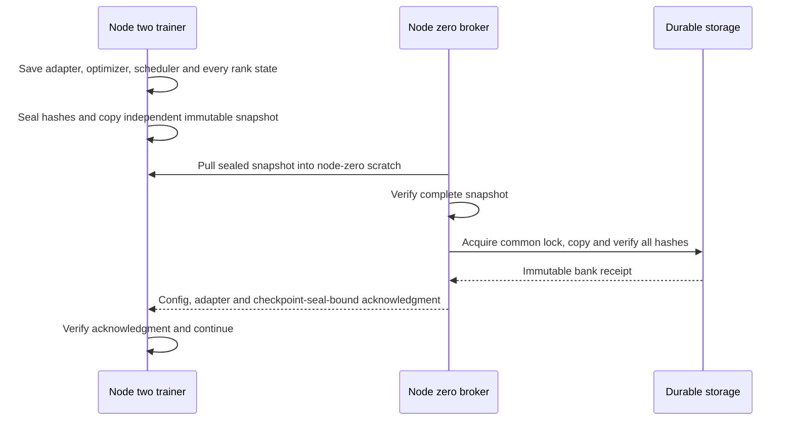

# LC-Rec compatible-backbone execution

_Runbook for the released-ID compatible-backbone hybrid; execution gates are not recommendation-quality results._

---

## 📋 Scope and prerequisites

The executable contract is
[`letter-lc-compatible-execution-v1.json`](../configs/letter-lc-compatible-execution-v1.json).
It combines the pinned author-released semantic IDs with the separately identified
OpenLLaMA-7B-v2 backbone. It is **not an original-LLaMA1 reproduction** and is not
a fresh-tokenizer reconstruction. Model identity and licensing are fixed in
[`letter-openllama-v2-method-v1.json`](../configs/letter-openllama-v2-method-v1.json).[^model]

| Requirement | Contract |
|---|---|
| Author source | `8d0154e28de37dbb6e24871c508ad8ddb1921cda`; unchanged native model, dataset, collators, and loss[^author] |
| Runtime | Private Python 3.10, Torch 1.13.1+cu117, Transformers 4.31.0, PEFT 0.4.0, Accelerate 0.21.0, bitsandbytes 0.41.1 |
| Input audit | Complete all-record, all-template PASS; every artifact and executed input hash reverified |
| Model loading | Verified converted safetensors; native int8; restored temperature; `pretraining_tp=1` |
| Tokenization | Slow legacy LlamaTokenizer, BOS1/EOS2/PAD0; no chat template or automatic EOS |
| Padding | Separate tokenizer instances: right for training, left for generation |
| Allocation | Only the private current-job binding; assigned devices only; never alter or release the allocation |

The full audit certifies Instruments and Yelp. Beauty fails the native audit and
is rejected without filtering, prompt repair, or dropping auxiliary tasks.
The current execution entry point admits **Instruments only**. Yelp's native
1,759 microbatches per epoch are not divisible by accumulation two; its proposed
micro64/accumulation1 amendment needs its own production-shaped continuation gate.

## ⚙️ Training recipe and declared differences

| Instruments setting | Value |
|---|---:|
| Full training prefixes | 131,837 |
| Epochs / learning rate / temperature | 4 / 0.0002 / 0.8 |
| Workers × microbatch × accumulation | 4 × 8 × 2 |
| Effective batch / prepared microbatches per epoch | 64 / 4,120 |
| LoRA rank / alpha / dropout | 8 / 16 / 0.05 |
| Optimizer / weight decay | Native AdamW / 0.01 |
| Schedule / warmup | Cosine / 0.01 |
| Precision / context | BF16 / 2,048 |
| Tasks / history / separator | `seqrec` / 20 / `, ` |
| Validation | Two fixed sampled native templates per user, seed42 |

All seven projection families (`q/k/v/o/gate/down/up`) receive LoRA adapters.
The active `modules_to_save.default` embedding and head remain trainable;
their unused `original_module` copies remain frozen.

This implementation deliberately uses native **eager attention** and
**unsharded AdamW with DDP**, not the release launcher's FlashAttention/ZeRO2
combination.[^launcher] It makes no exact hardware/parallelism claim. No shared
runtime packages or frozen harness files are modified.

Validation runs only at completed epochs. The earliest checkpoint with minimum
validation loss is selected after the full budget; no early stopping or held-out
test selection is used. Checkpoints are also saved after the first update and
every 50 updates for persistence, without introducing extra validation calls.

## 🔬 Admission and exact continuation

Run `lc_run.py fit --gate` before a long fit. This uses 100 admitted native rows,
the actual 7B int8 backbone, real BF16 computation, all four ranks, and the
unchanged microbatch/accumulation geometry. Its four epochs produce eight actual
optimizer updates. Independent cold processes then repeat the run with a cut
inside an epoch and at an epoch boundary.

`lc_run.py reload-probe` cold-loads the saved adapter on the verified real
backbone and compares full validation-probe logits bitwise. `lc_run.py admit`
requires:

- Native forward/loss equality with `CE(logits / temperature)`.
- Finite nonzero new-SID embedding/head gradients and frozen original copies.
- Bitwise final adapter, optimizer, scheduler, every-rank RNG, sampler generator,
  ordered tokenized inputs, per-microbatch losses, and validation callback state.
- Both cold continuation cuts and all-rank cold adapter-logit reload.
- Identical source, runtime, model, tokenizer, audit, corpus, and recipe fingerprints.

The existing guarded Trainer full-epoch sampler replay is retained. There is one
additional **process-local LC loader correction**: eliminate one-batch lookahead
and restore Python/NumPy RNG before the first resumed stochastic prompt is
collated. Trainer still restores Torch/CUDA RNG at its original point. The
already-collated prompt RNG is preserved rather than rewound a second time.
This prevents a superficially successful adapter resume from changing the next
native random template.

Legacy DDP also starts with a different gradient-reduction bucket layout from its
steady-state layout. A cold resume otherwise changes floating-point summation
order despite identical inputs and RNG. The resume-only correction performs one
native backward and bucket rebuild, discards those gradients, verifies no
trainable parameter changed, and restores all RNG before the actual next
microbatch. It performs no optimizer or scheduler update. Deterministic Torch
algorithms are required; the real continuation comparison must still pass.

An additional CPU native-data test exercises all 131,837 production prefixes,
four ranks, and 4,120 microbatches per epoch with three interruption positions.
A separate real-model probe generates fixed 20-beam outputs from one fixed
validation prompt under both declared decoder policies.

No tolerance relaxation or adapter-only restart qualifies as exact continuation.
Synthetic tests and a full-corpus audit alone cannot substitute for these real
model gates.

## 💾 Checkpoints and single-writer banking



`lc_checkpoint.py` requires adapter weights, adapter configuration, optimizer,
scheduler, Trainer state, callback state, run configuration, and **every** rank's
RNG and sampler/ordered-input state. Partial files, missing ranks, symlinks,
mutation, or a disguised full-base checkpoint fail verification.

The broker runs on the explicitly designated node-zero writer:

```bash
python scripts/letter/lc_checkpoint.py broker \
  --source-host node-2 --source "$RUN/snapshots" \
  --inbox "$NODE_ZERO_SCRATCH/lc-inbox" \
  --destination "$DURABLE/lc-instruments" \
  --lock-file "$COMMON_BANK_LOCK" --writer-host node-0
```

All variables above come from the private authorized task binding. The trainer
requires a fresh exporter heartbeat before a full fit and waits for a verified
acknowledgment after each save. Independent snapshots are never hard links into
rotating checkpoints. Node two never writes durable storage.

To verify or resume:

```bash
python scripts/letter/lc_checkpoint.py verify "$RUN/checkpoint-50"
torchrun --nproc_per_node=4 --master_port "$FRESH_PORT" \
  scripts/letter/lc_run.py fit "${INPUT_ARGUMENTS[@]}" \
  --output "$RUN" --gate-report "$ADMISSION" --resume latest
```

`INPUT_ARGUMENTS` supplies `--upstream`, `--manifest`, `--method-spec`,
`--execution-spec`, `--model`, `--model-receipt`, `--audit`, and `--dataset`.
Launch inside the existing scoped `env.sh`. Keep PID, launcher, receipts, and
operational status under ignored `.local/letter` and the authorized task root.
A changed implementation requires a newly identified gate, not a resume into a
changed run configuration.

## 📊 Frozen-checkpoint evaluation

`lc_evaluate.py` requires a completed full-budget run, immutable selected
checkpoint, and its verified durable acknowledgment. It reserves each
checkpoint/decoder-policy pair once; an interrupted evaluation is preserved,
not silently rerun under the same identity.

| Policy | Interpretation |
|---|---|
| `author-position-sets` | Primary compatible-hybrid replay: the author's independent allowed sets at each SID position[^constraint] |
| `full-prefix-trie-correction` | Separately named corrected diagnostic: only complete catalog prefixes are allowed |

Both use the actual padded input width to isolate the generation prefix, not
a search for incidental `Response:` fragments. They generate exactly four SID
tokens plus EOS, with fixed 20 beams, every user exactly once, no distributed
`drop_last`, no seen-item exclusion, and no adaptive beam reduction on OOM.
Like the native LC evaluator, final generation reloads the base in BF16 rather
than reusing the int8 training instance. Pinned PEFT 0.4 keeps LoRA tensors in
FP32 and the saved embedding/head in BF16 despite the `torch_dtype=bf16`
argument; the loader verifies those actual native dtypes and exact cast
adapter values rather than coercing the entire adapter.[^launcher]

Raw finite scores and invalid-code counts are retained. The primary native LC
code metric retains duplicate beams and sums duplicate-target NDCG contributions,
matching the released evaluator.[^metrics] Original-item diagnostics separately
deduplicate codes, expand collision groups in ascending original item order, and
deduplicate items. These are not interchangeable metrics.

## ✅ Validation and troubleshooting

CPU contracts:

```powershell
python -m pytest tests\test_letter_lc_execution.py tests\test_letter_lc_audit.py -q `
  --basetemp .local\letter\pytest-lc-execution
```

| Failure | Safe next step |
|---|---|
| Full-audit/source checksum mismatch | Restore the exact audited bytes; do not waive the audit |
| Missing frozen dependency on a worker | Copy only the independently hash-verified missing file; preserve active historical deployments |
| Non-bitwise real continuation | Save both endpoints and failure evidence; do not start the full fit |
| Missing bank acknowledgment | Keep the independent scratch snapshot; repair the node-zero exporter before proceeding |
| Incomplete checkpoint | Preserve the partial directory; only a complete sealed checkpoint is a resume candidate |
| OOM or non-finite loss/gradient | Preserve evidence and stop the cell; no silent precision, beam, recipe, or corpus changes |

## 🔄 Automatic continuation and isolated Yelp execution

`lc_lifecycle.py` runs as a CPU-only control process. Its private, versioned plan
waits for the Instruments learner to exit after its full budget, then verifies
both the selected and final checkpoint acknowledgments. It independently seals
the **root run completion, configuration, loader/runtime, selection, and both
checkpoint receipts** into a final-run bundle. Only node zero banks that bundle,
under the existing common lock. The resulting `lc-bundle-bank` receipt is
distinct from a checkpoint acknowledgment; a checkpoint acknowledgment cannot
authorize final test evaluation.

The controller then runs both declared policies with the frozen four-rank
evaluator and banks every per-rank prediction file, completion marker, and
aggregate result. Each GPU attempt is reserved once. Failed or interrupted
attempts remain preserved and block advancement rather than being silently
rerun. State, process IDs, reservations, and immutable receipts live in the
ignored control directory so a desktop restart does not lose the queue.

Yelp uses `lc_yelp.py` in a **separate private deployment** that imports the
original v4 source without overwriting it. Audited source/model/tokenizer/corpus
paths remain unchanged, and the original full-audit fingerprint comparison
still runs. Additional private-control hashes are bound into its run identity.

| Yelp geometry | Native, not admitted | Explicit amendment |
|---|---:|---:|
| Workers × microbatch × accumulation | 4 × 32 × 2 | 4 × 64 × 1 |
| Effective batch | 256 | 256 |
| Prepared rank microbatches per epoch | 1,759 | 880 |
| Balanced global rows per epoch | 225,152 | 225,280 |
| Original training prefixes | 225,061 | 225,061 |
| Repeated padding rows | 91 | **219** |
| Integral accumulation epoch | No | Yes |
| Full-budget optimizer updates | Unsafe continuation | 5,280 over six epochs |

CPU preparation measures both actual loaders and all-prefix coverage, then
checks 12 interrupted/replayed rank streams, including sampler, Python/NumPy/
Torch RNG and scalar-model AdamW/scheduler/validation state. It is not a GPU
admission. The queued real gate uses microbatch64 on every rank, including a
maximum-length native-record memory/loss/gradient probe, twelve bounded real
updates over six epochs, two cold interruptions, and full-microbatch bitwise
logit reload. The native validation batch remains 32; template, response mask,
temperature, LoRA settings, and epoch budget are unchanged.

Only after Instruments training **and both banked evaluations** release the
assigned four devices can the Yelp GPU gate start. Its full six-epoch fit is
conditional on real GPU admission, followed by the same separate final-run
bank-before-test protocol and both banked evaluations. No other device or job
is used as a fallback. Beauty remains unadmitted.

## 🛡️ Narrow exporter-timeout recovery

`lc_recovery.py` is a separately versioned CPU-only wrapper around the frozen
continuation queue, not a rewrite of the learner or final-evaluation pipeline.
It retains the existing queue plan, state, reservations, final-run bank-before-test
checks, both decoder policies, and the isolated Yelp queue.

Automatic recovery is restricted to the exact rank-zero `TimeoutError` emitted
by the frozen `wait_for_ack` callback. Every other error is explicitly blocked.
Before one future launch, the wrapper requires:

- Unchanged learner/support/launcher, admission, run configuration, and input
  fingerprints.
- The failed step to remain the latest complete checkpoint and current failed
  generation, with matching independent snapshot, all-rank state, and bank ack.
- No owned supervisor, launcher, torchrun, or rank process, and no compute user
  on the four assigned GPUs.
- The original exporter to remain alive without uninterruptible I/O; the common
  bank lock must be immediately acquirable. No exporter restart, storage reset,
  or writer bypass is attempted.
- Matching worker, exporter-inbox, and durable receipts plus verified durable
  checkpoint bytes under that lock.

An exclusive, persisted failure identity is reserved on both nodes before launch.
A bounded storage permit remains protected by the node-zero lock until the worker
returns its launch result. The worker rechecks source, generation, process and
GPU state, and remotely verifies the live writer/lock lease immediately before
starting the unchanged launcher. Lost, uncertain, raced, or aborted reservations
are preserved and are never automatically retried for that failure.

An explicitly parent-handled historical failure is recorded as consumed without
launching anything. An active parent-owned learner is observation-only. The
wrapper's inspection mode is read-only and records that no launch was invoked.

[^model]: Pinned compatible backbone: https://huggingface.co/openlm-research/open_llama_7b_v2/tree/e5961def23172a2384543940e773ab676033c963
[^author]: Pinned official LETTER repository: https://github.com/HonghuiBao2000/LETTER/tree/8d0154e28de37dbb6e24871c508ad8ddb1921cda
[^launcher]: Native LC training integration: https://github.com/HonghuiBao2000/LETTER/blob/8d0154e28de37dbb6e24871c508ad8ddb1921cda/LETTER-LC-Rec/lora_finetune.py
[^constraint]: Native LC per-position constraints: https://github.com/HonghuiBao2000/LETTER/blob/8d0154e28de37dbb6e24871c508ad8ddb1921cda/LETTER-LC-Rec/data.py
[^metrics]: Native LC duplicate handling: https://github.com/HonghuiBao2000/LETTER/blob/8d0154e28de37dbb6e24871c508ad8ddb1921cda/LETTER-LC-Rec/evaluate.py
