# Privately configured P5 cross-node continuation

_Generic publication source for checkpoint-bound continuation and verified result transport._

## 📋 Published source versus deployed identity

The public xnode modules contain no allocation paths, host assignments, device
leases, live process identities, or private receipt hashes. Actual access
configuration and operational evidence belong in **ignored private files**.
Tests generate synthetic bindings under ignored test workspaces.

This configuration canonicalization is **not a deployment**. Its source hashes
naturally differ from historical private bundles. Exact live recovery must use
the already-banked private worker/broker releases, their original manifests,
environment, registration certificate and committed owner/control lineage.
Do not copy public source over a frozen release, rewrite a bound manifest, or
waive an old hash guard to make the identities appear equal.

The scientific reference remains separate from execution bindings. See
[the reference protocol](letter-p5-reference.md) for indexing, title ambiguity
and category availability. Configuration does not authorize a new experiment,
lease, budget, checkpoint choice or test evaluation.

## 🔐 Explicit private bindings

Every executable entrypoint requires `--bindings` naming a private JSON file.
The schema is `p5-xnode-bindings-v1`; all fields below must be present. There is
no environment-variable discovery, user-home lookup, remembered-job fallback,
or placeholder output directory.

| Field | Required value and validation |
| --- | --- |
| `kind` | `p5-xnode-bindings-v1` |
| `root` | Explicit absolute node-local allocation root, not a filesystem root |
| `p5_root` | Absolute experiment directory contained in `root` |
| `control_root` | Absolute control directory contained in `root` |
| `durable_root` | Explicit absolute durable directory, separate from experiment/control directories |
| `python` | Explicit absolute interpreter path; never a command-name default |
| `writer_host`, `worker_host` | Distinct host aliases without SSH options, URLs or shell syntax |
| `cells` | Explicit map of allowed cell names to the assignment fields below |
| `adopted_cell` | One retained writer-host cell, or `null` to disable adoption |
| `learner_sha256` | Exact approved learner source identity |
| `legacy_device_guard` | Exact AST expression from that approved learner's device guard |
| `legacy_transport_guard` | Exact AST expression from that approved learner's transport guard |

Each `cells` entry specifies `role` (`writer` or `worker`), nonnegative integer
`gpu`, nonempty `gpu_uuid`, positive integer `microbatch` and `accumulation`,
nonnegative integer `root_step`, and positive integer `ownership_epoch`.
The effective batch remains 128; the admitted microbatch and accumulation must
match the private assignment exactly. Cell and lease names cannot be paths.

Binding validation creates no files or directories. Module root accessors return
`None` before configuration, not relative `Path` placeholders. A mutex publishes
one recursively immutable, process-local snapshot. An identical repeat is
accepted, but changing its path or contents is rejected. Read-only validation
uses that snapshot without repeatedly reopening the configuration file; control
write/lock gates detect changed binding bytes before writing. Missing
configuration fails before staging, lock creation or transport.

Output paths must be explicit, absolute and within the declared root. Traversal
and symlink escapes are rejected. Durable destinations are separately checked
and require the configured writer. Runtime manifests cannot silently select
foreign base/assets/maintenance/proof paths; any root/durable fields they
provide must agree with the private binding document. Bindings and configured
directory trees must be trusted and non-mutating during an operation: observed
hash/containment checks do not authenticate a host or make concurrent
symlink/junction replacement atomic.

## ⚙️ Bootstrap and propagation

Supply private filenames explicitly. The shell variables in this example are
caller inputs, **not defaults read by the Python modules**:

```powershell
python -B scripts\letter\p5_xnode_broker.py --bindings $env:P5_PRIVATE_BINDINGS serve --runtime-manifest $env:P5_PRIVATE_RUNTIME
python -B scripts\letter\p5_xnode_control.py --bindings $env:P5_PRIVATE_BINDINGS --runtime-manifest $env:P5_PRIVATE_RUNTIME --lease $env:P5_PRIVATE_LEASE guardian -- --spec $env:P5_PRIVATE_QUEUE
python -B scripts\letter\p5_xnode_adopt.py --bindings $env:P5_PRIVATE_BINDINGS --spec $env:P5_PRIVATE_ADOPTION
```

The binding document must be inside its declared local root and provisioned at
the intended absolute path on each participating host. Worker subprocesses and
broker RPCs propagate both `--bindings` and the parent's `--bindings-sha256` pin.
A counterpart with missing or different binding bytes fails before creating
message staging; uploads follow a successfully pinned `prepare-message` RPC,
not an unconditional remote directory-creation command. SSH uses `-n`; only the
configured host alias is passed to transport.

Importing a module neither discovers a deployment nor creates application
output. Use `-B` as shown to suppress interpreter bytecode-cache writes as well.
Ignoring private evidence does not untrack previously committed files or retract
Git history; the privacy check here covers the current owned publication tree.

Runtime/source hash checks remain mandatory. A newly configured public-source
run needs its own accurately bound private manifests and admission evidence;
the bootstrap is not a mechanism for accepting historical source mismatches.
The AST adapter still verifies the exact approved learner hash and exact
operational match counts before replacing only device/transport checks.

## 🔒 Ownership and continuation invariants

```mermaid
flowchart LR
    accTitle: Privately Bound Continuation
    accDescr: Explicit private configuration and verified continuation evidence precede owner commitment. Workers publish local state and the designated writer verifies durable export.
    private_bindings["Validate private bindings"] --> native_gate["Verify continuation gate"]
    native_gate --> retire_dispatch["Fence old dispatch"]
    retire_dispatch --> commit_owner["Commit owner lineage"]
    commit_owner --> worker_outbox["Publish worker-local state"]
    worker_outbox --> writer_import["Verify writer import"]
    writer_import --> bound_receipt["Return bound receipt"]
```



Full model, optimizer, scheduler, sampler, RNG and validation state are preserved.
The original 20 epochs, FP32 computation, effective batch, history, prompts,
full catalog, all-user 20-beam evaluation, validation-only model selection and
frozen-model test policy do not change. Checkpoint cadence remains 900 seconds
plus the existing epoch/drain/prime boundaries.

Cross-node admission compares actual cold-save/reload continuation against the
source proof, including model/optimizer/state tensor bits, native sampled rows
and losses. It also checks populated-optimizer memory, complete beam geometry
and host headroom. Production resumes the admitted source checkpoint, never a
probe output. Actual paths, fingerprints, measurements and receipts stay private.

The already-loaded source dispatcher must be fenced, not merely its file edited.
A retained fit can be observed by a non-restarting adopter bound to its host
boot ID, PID, start ticks and command hash. Missing or reused process identities
do not authorize a replacement. No fake completion markers are used.

## 💾 Immutable state and frozen-result binding

Publication generations are transport order, not optimizer steps. The protocol
retains legal same-step validation transitions and rejects regressions, skipped
ancestry, changed contracts, foreign owners and divergent replays. Immutable
acceptance records recover a stale head index without rolling back accepted
progress. Workers never directly export to durable storage.

| Boundary | Required binding |
| --- | --- |
| Final-test bank request | Actual accepted frozen head or its declared selected checkpoint |
| Worker result advertisement | Current native/outbox frozen head, declared selection and exact contract |
| Writer result publication | Selected artifact/seal equals the frozen acceptance record; latest artifact/seal equals its head; contract equals the lease |
| Worker result receipt | Exact local frozen checkpoint acknowledgement and envelope, complete snapshot receipt and `binding_version: 2` |
| Completion marker | Revalidation and atomic write under native pointer and publication locks |

An earlier validation winner is valid when the frozen head declares it.
Membership somewhere in the accepted ancestry is not sufficient. Stale results
are rejected, never repaired or relabeled. The result snapshot must include
genuine complete predictions and a complete verified seal.

Registry locking precedes the common durable-writer lock. Transport happens
outside the durable lock. Historical acknowledgements and original registration
anchors remain immutable; current control authority still gates mutations.
Versioned compatibility checks retain their narrow stated scope rather than
claiming arbitrary behavioral equivalence.

## 🧪 Validation and privacy boundary

The owned tests cover explicit/unconfigured bootstrap, foreign paths and hosts,
traversal, binding changes, assignment rejection, source identity checks,
publication crash recovery, full receipt binding and non-restarting adoption.
Small CPU models create genuine native forty-generation checkpoint chains for
frozen-result tests; these fixtures are not trained reference results.

Whole-owned-surface privacy checks include every `p5_xnode*.py` module,
`test_letter_p5_xnode*.py` test and this document. Real allocation configuration,
private hashes and historical operational reports must not be added to those
files. Detailed pre/post source comparisons and live identity observations are
kept in ignored operational evidence.

Before recovering an existing run, consult its private handoff and banked
control chain. Verify the exact deployed bytes and use the recorded environment
and commands. Publication-only canonicalization is never itself a reason to
restart a fit, change a lease, alter control events or deploy new code.

## 🔁 Job-wide GPU UUID re-registration

> **Historical v1 warning:** `p5_xnode_reregister.py` and
> `letter-p5-uuid-reregistration-v1.json` are retained as review evidence only.
> Their commit path fails closed and is not deployable. Use v2 exclusively.

Container replacement invalidates every lease whose physical GPU UUID changed.
It is not live-process adoption: `p5_xnode_adopt.py` requires the original PID
lifetime and boot identity. The deployable offline implementation is
`p5_xnode_reregister_v2.py`; its public scope and invariants are recorded in
`configs/letter-p5-uuid-reregistration-v2.json`.

The private `p5-uuid-reregistration-request-v2` names old/new bindings, the
complete registry, the exact transition set, the unchanged runtime template,
replacement-GPU receipts and role-specific root evidence. Writer cells use
ordinary P5 full-state bank checkpoints plus their verified bank
acknowledgments and receipts. Worker cells use the highest accepted xnode
ledger head plus its complete package and acknowledgment, or the distinct
`p5-uuid-reregistration-worker-durable-root-v2` recovery evidence described
below. Never construct a synthetic writer xnode ledger.

Sequence-3 publication certificates may retain writer owners only as the
historical identity fields `cell`, `gpu`, `lease_id`, `owner_node`, and
`ownership_epoch`. V2 accepts exactly that compact shape without editing or
fabricating the historical certificate. It reconstructs the successor writer
lease from the unchanged compact identity, exact old/new private assignments,
the receipt-verified writer checkpoint/ack/contract, the verified input
manifest, and the newly computed canonical runtime-manifest hash. The plan
records hashes of every reconstruction authority. A partial or extended
unknown owner shape, writer host/GPU/epoch mismatch, old/new binding
disagreement, foreign writer acknowledgement, changed contract/input, or
runtime hash mismatch fails closed. Complete historical writer leases remain
supported and preserve their unrelated fields.

### Receipt-verified writer durable recovery

If node-local ordinary writer bank acknowledgements were erased, do not reuse
a stale acknowledgement or fabricate one. Use the distinct
`p5-uuid-reregistration-writer-durable-root-v2` evidence kind. It binds the
certified old registry event, compact or full historical writer identity,
exact old/new assignments, durable destination, unchanged external contract,
an exact checkpoint-directory inventory, and a selection policy.

Every listed checkpoint must be a direct non-symlink child of the declared
durable destination and have an exact writer-created `bank-receipt.json`
covering its sealed model, training state, and seal. After receipt and file
hash verification, v2 opens the trusted sealed training state and requires its
embedded contract and optimizer-boundary marker to match, plus exact
step/epoch/phase agreement with the seal. Listed roots must have legal
monotonic P5 progress. The highest verified checkpoint is selected by default;
a lower checkpoint requires `intentional_rollback`, a non-empty reason, and
records every abandoned newer verified checkpoint.

This authority is explicitly `p5-writer-durable-recovery-v1` with
`historically_accepted=false`; it does not claim that a missing ordinary ack
ever existed. Writer and worker receipt recoveries are recorded together under
certificate recovery kind `p5-ownership-durable-recovery-v1`. They retain the
same all-cell commit and activation-last fence.

### Receipt-verified worker durable recovery

An unacknowledged successor does not prove its parent was historically
accepted: workers can publish multiple generations before receiving any
acknowledgment. When the accepted ledger is missing or behind but complete
Gen2 packages and their writer-created bank receipts survive, use
`p5-uuid-reregistration-worker-durable-root-v2`. This mode is explicitly
`p5-xnode-durable-recovery-v1`, not accepted-ledger reconstruction.

The evidence binds the certified old registry event, old lease, durable
destination root, unchanged contract, exact package inventory, selection
policy and optional successor observation. Starting at the certified lease
root, validation requires generation 1..N with no gaps, exact parent seals,
legal step/epoch/phase transitions, production envelopes owned by the exact
old lease/event, complete package seals, and exact bank-receipt inventories.
Unlisted package directories, missing receipts, partial packages, mixed
leases, divergent parents, changed destinations or foreign events fail
closed. The old accepted ledger is neither read as authority nor written.

The default selected root is the highest fully receipt-verified contiguous
package. Selecting a lower generation requires
`selection.policy=intentional_rollback`, an explicit reason, and records every
newer verified package as abandoned. A successor observation is optional and
is recorded only as non-authoritative evidence; it never upgrades a package
to historical acceptance. The ownership event and certificate label the
chosen root as receipt-verified durable recovery with
`historically_accepted=false`. The replacement lease still starts publication
generation zero at that chosen root and requires the same deterministic
replacement-GPU continuation, optimizer-memory and 20-beam proofs.

### Replacement-GPU proof runner

Generate each private `p5-replacement-gpu-proof-v1` with
`replacement_gpu_proof.py`. Its request binds one cell to the chosen
complete checkpoint, unchanged contract, current host/physical index/UUID,
preserved microbatch, and exact anchored `native`, `upstream`, `manifest`,
`recipe`, `model`, `corpus`, and frozen `runtime` inputs. Each input entry has
`path`, `anchor`, and `anchor_sha256`; the runtime anchor must be the exact
`p5_run.py`. `contract_sha256` is the file SHA-256, while the checkpoint seal
must independently bind the canonical JSON contract digest.
Use `configs/letter-p5-replacement-gpu-proof-request-v1.example.json` as the
field-complete template and replace every `PRIVATE_*` value.

The output must be a new child below the private binding's
`control_root/gates`; an existing attempt or any production-run path is
rejected. The runner does not save, advance, or publish a production run. It
constructs two independent models and full optimizer/scheduler/sampler
contexts, cold-loads the same sealed root into each, and verifies bitwise
model, optimizer, scheduler, sampler, all RNG, training, and validation state.
Before each continuation it restores that copy's checkpoint RNG, then requires
identical next sampled indices/rows, loss, optimizer update, and resulting
state. It also requires populated finite optimizer moments and executes actual
20-return beam generation, including completion of the longest catalog path.

Run only on the privately bound replacement node/GPU:

```bash
CUDA_VISIBLE_DEVICES="$PHYSICAL_GPU_INDEX" \
python -B scripts/letter/replacement_gpu_proof.py \
  --request "$PRIVATE_REPLACEMENT_PROOF_REQUEST"
```

Use the emitted
`$CONTROL_ROOT/gates/<fresh-attempt>/p5-replacement-gpu-proof.json` as that
cell's `proofs` entry in the v2 transition request. Stop without preparing the
transition on any changed input anchor, checkpoint/contract mismatch,
host/index/UUID mismatch, absent optimizer memory, continuation difference,
incomplete beam geometry, or pre-existing attempt directory. CPU unit tests
exercise orchestration and failure behavior only; they never substitute for
this bound CUDA receipt.

Preparation verifies registry ancestry and sequence, rejects pending foreign
intent, and selects each role's authorized receipt-bound full-state head. It keeps
the scientific contract, input manifest, control/state source hashes,
host/index and batch geometry unchanged. It precomputes a new runtime manifest
at stable canonical paths, binds its SHA-256 into every transitioned lease,
mints lease IDs and epoch `old+1`, and emits the exact aggregate
`p5-xnode-crossnode-proof-v1` consumed by the unchanged worker control. The
event contains that proof's file SHA-256, the broker-v3 release SHA-256,
`sequence=parent+1`, and one all-cell owner map.

Run:

```bash
python -B scripts/letter/p5_xnode_reregister_v2.py prepare \
  --request "$PRIVATE_REQUEST_V2" --output "$PRIVATE_PLAN_V2"

python -B scripts/letter/p5_xnode_reregister_v2.py verify \
  --request "$PRIVATE_REQUEST_V2" --plan "$PRIVATE_PLAN_V2"

python -B scripts/letter/p5_xnode_reregister_v2.py commit \
  --request "$PRIVATE_REQUEST_V2" --plan "$PRIVATE_PLAN_V2"
```

The writer-only commit takes the registry lock before the common bank lock,
banks one ownership event/certificate, and stages canonical files below
`XROOT`: `leases/`, `current/ownership-certificate.json`,
`current/runtime-manifest.json`, `current/crossnode-proof.json`,
`current/bindings.json`, unchanged runtime source, restored root
checkpoint/contract/pointer trees, and worker bootstrap directories whose
`.xnode` contains only the five-field registration. It publishes
`activation/last-published.json` last. If interruption occurs after commit but
before activation, broker v3 fences the transition; after checking that the
canonical stage is complete and unchanged, finish only the activation step:

```bash
python -B scripts/letter/p5_xnode_reregister_v2.py activate \
  --request "$PRIVATE_REQUEST_V2" --plan "$PRIVATE_PLAN_V2"
```

Broker release `p5-xnode-broker-v3` contains only its source hashes and runtime
manifest SHA-256. It must not contain a certificate, registration-anchor or
activation hash, which would create a release/event/certificate hash cycle.
Its owner authority is the current committed certificate plus the
last-published activation manifest. It rejects committed-but-not-activated
events, sequence mismatch, incomplete activation inventory, stale canonical
bytes, a different runtime/proof/lease hash, or a release SHA mismatch.

Before starting a worker guardian, archive its old `.xnode` and copy only the
corresponding staged `registration.json` into a newly created `.xnode`.
Registrations retain the unchanged control's five fields: `kind`,
`writer_host`, `lease_sha256`, `event_sha256`, and
`input_manifest_sha256`. Because node filesystems are separate, copy the
activated canonical bindings, current certificate/runtime/proof and that
worker's lease/root bundle to the same bound paths on the worker, verifying
every hash from `activation/last-published.json`; materialize the staged root
checkpoint, contract and pointer as the canonical local run root. Do not copy
the writer's registry lock, intent, durable receipt authority, or another
cell's registration. Start broker v3 first and guardians only after broker
status reports the activated sequence.

Stop on any ancestry/sequence mismatch, pending foreign intent, missing or
partial full state, stale UUID, failed continuation/memory/geometry proof,
epoch skip, changed role/host/index/batch/input/runtime source, certificate or
receipt mismatch, partial cell set, stale canonical file, inherited transport
state, or broker release mismatch. Never repair a stop by editing a lease,
inventing a writer ledger, reusing an old registration/outbox, or resuming from
weights alone.
