# Privately configured P5 cross-node continuation

_Generic publication source for checkpoint-bound continuation and verified result transport._

## 📋 Published source versus deployed identity

The public xnode modules contain no allocation paths, host assignments, device
leases, live process identities, or private receipt hashes. Actual access
configuration and operational evidence belong in **ignored private files**.
Tests generate synthetic bindings under ignored test workspaces.

This configuration canonicalization is **not a deployment**. Its source hashes
naturally differ from historical private bundles. Exact live recovery must use
the already-banked private worker/broker releases, their original manifests,
environment, registration certificate and committed owner/control lineage.
Do not copy public source over a frozen release, rewrite a bound manifest, or
waive an old hash guard to make the identities appear equal.

The scientific reference remains separate from execution bindings. See
[the reference protocol](letter-p5-reference.md) for indexing, title ambiguity
and category availability. Configuration does not authorize a new experiment,
lease, budget, checkpoint choice or test evaluation.

## 🔐 Explicit private bindings

Every executable entrypoint requires `--bindings` naming a private JSON file.
The schema is `p5-xnode-bindings-v1`; all fields below must be present. There is
no environment-variable discovery, user-home lookup, remembered-job fallback,
or placeholder output directory.

| Field | Required value and validation |
| --- | --- |
| `kind` | `p5-xnode-bindings-v1` |
| `root` | Explicit absolute node-local allocation root, not a filesystem root |
| `p5_root` | Absolute experiment directory contained in `root` |
| `control_root` | Absolute control directory contained in `root` |
| `durable_root` | Explicit absolute durable directory, separate from experiment/control directories |
| `python` | Explicit absolute interpreter path; never a command-name default |
| `writer_host`, `worker_host` | Distinct host aliases without SSH options, URLs or shell syntax |
| `cells` | Explicit map of allowed cell names to the assignment fields below |
| `adopted_cell` | One retained writer-host cell, or `null` to disable adoption |
| `learner_sha256` | Exact approved learner source identity |
| `legacy_device_guard` | Exact AST expression from that approved learner's device guard |
| `legacy_transport_guard` | Exact AST expression from that approved learner's transport guard |

Each `cells` entry specifies `role` (`writer` or `worker`), nonnegative integer
`gpu`, nonempty `gpu_uuid`, positive integer `microbatch` and `accumulation`,
nonnegative integer `root_step`, and positive integer `ownership_epoch`.
The effective batch remains 128; the admitted microbatch and accumulation must
match the private assignment exactly. Cell and lease names cannot be paths.

Binding validation creates no files or directories. Module root accessors return
`None` before configuration, not relative `Path` placeholders. A mutex publishes
one recursively immutable, process-local snapshot. An identical repeat is
accepted, but changing its path or contents is rejected. Read-only validation
uses that snapshot without repeatedly reopening the configuration file; control
write/lock gates detect changed binding bytes before writing. Missing
configuration fails before staging, lock creation or transport.

Output paths must be explicit, absolute and within the declared root. Traversal
and symlink escapes are rejected. Durable destinations are separately checked
and require the configured writer. Runtime manifests cannot silently select
foreign base/assets/maintenance/proof paths; any root/durable fields they
provide must agree with the private binding document. Bindings and configured
directory trees must be trusted and non-mutating during an operation: observed
hash/containment checks do not authenticate a host or make concurrent
symlink/junction replacement atomic.

## ⚙️ Bootstrap and propagation

Supply private filenames explicitly. The shell variables in this example are
caller inputs, **not defaults read by the Python modules**:

```powershell
python -B scripts\letter\p5_xnode_broker.py --bindings $env:P5_PRIVATE_BINDINGS serve --runtime-manifest $env:P5_PRIVATE_RUNTIME
python -B scripts\letter\p5_xnode_control.py --bindings $env:P5_PRIVATE_BINDINGS --runtime-manifest $env:P5_PRIVATE_RUNTIME --lease $env:P5_PRIVATE_LEASE guardian -- --spec $env:P5_PRIVATE_QUEUE
python -B scripts\letter\p5_xnode_adopt.py --bindings $env:P5_PRIVATE_BINDINGS --spec $env:P5_PRIVATE_ADOPTION
```

The binding document must be inside its declared local root and provisioned at
the intended absolute path on each participating host. Worker subprocesses and
broker RPCs propagate both `--bindings` and the parent's `--bindings-sha256` pin.
A counterpart with missing or different binding bytes fails before creating
message staging; uploads follow a successfully pinned `prepare-message` RPC,
not an unconditional remote directory-creation command. SSH uses `-n`; only the
configured host alias is passed to transport.

Importing a module neither discovers a deployment nor creates application
output. Use `-B` as shown to suppress interpreter bytecode-cache writes as well.
Ignoring private evidence does not untrack previously committed files or retract
Git history; the privacy check here covers the current owned publication tree.

Runtime/source hash checks remain mandatory. A newly configured public-source
run needs its own accurately bound private manifests and admission evidence;
the bootstrap is not a mechanism for accepting historical source mismatches.
The AST adapter still verifies the exact approved learner hash and exact
operational match counts before replacing only device/transport checks.

## 🔒 Ownership and continuation invariants

```mermaid
flowchart LR
    accTitle: Privately Bound Continuation
    accDescr: Explicit private configuration and verified continuation evidence precede owner commitment. Workers publish local state and the designated writer verifies durable export.
    private_bindings["Validate private bindings"] --> native_gate["Verify continuation gate"]
    native_gate --> retire_dispatch["Fence old dispatch"]
    retire_dispatch --> commit_owner["Commit owner lineage"]
    commit_owner --> worker_outbox["Publish worker-local state"]
    worker_outbox --> writer_import["Verify writer import"]
    writer_import --> bound_receipt["Return bound receipt"]
```



Full model, optimizer, scheduler, sampler, RNG and validation state are preserved.
The original 20 epochs, FP32 computation, effective batch, history, prompts,
full catalog, all-user 20-beam evaluation, validation-only model selection and
frozen-model test policy do not change. Checkpoint cadence remains 900 seconds
plus the existing epoch/drain/prime boundaries.

Cross-node admission compares actual cold-save/reload continuation against the
source proof, including model/optimizer/state tensor bits, native sampled rows
and losses. It also checks populated-optimizer memory, complete beam geometry
and host headroom. Production resumes the admitted source checkpoint, never a
probe output. Actual paths, fingerprints, measurements and receipts stay private.

The already-loaded source dispatcher must be fenced, not merely its file edited.
A retained fit can be observed by a non-restarting adopter bound to its host
boot ID, PID, start ticks and command hash. Missing or reused process identities
do not authorize a replacement. No fake completion markers are used.

## 💾 Immutable state and frozen-result binding

Publication generations are transport order, not optimizer steps. The protocol
retains legal same-step validation transitions and rejects regressions, skipped
ancestry, changed contracts, foreign owners and divergent replays. Immutable
acceptance records recover a stale head index without rolling back accepted
progress. Workers never directly export to durable storage.

| Boundary | Required binding |
| --- | --- |
| Final-test bank request | Actual accepted frozen head or its declared selected checkpoint |
| Worker result advertisement | Current native/outbox frozen head, declared selection and exact contract |
| Writer result publication | Selected artifact/seal equals the frozen acceptance record; latest artifact/seal equals its head; contract equals the lease |
| Worker result receipt | Exact local frozen checkpoint acknowledgement and envelope, complete snapshot receipt and `binding_version: 2` |
| Completion marker | Revalidation and atomic write under native pointer and publication locks |

An earlier validation winner is valid when the frozen head declares it.
Membership somewhere in the accepted ancestry is not sufficient. Stale results
are rejected, never repaired or relabeled. The result snapshot must include
genuine complete predictions and a complete verified seal.

Registry locking precedes the common durable-writer lock. Transport happens
outside the durable lock. Historical acknowledgements and original registration
anchors remain immutable; current control authority still gates mutations.
Versioned compatibility checks retain their narrow stated scope rather than
claiming arbitrary behavioral equivalence.

## 🧪 Validation and privacy boundary

The owned tests cover explicit/unconfigured bootstrap, foreign paths and hosts,
traversal, binding changes, assignment rejection, source identity checks,
publication crash recovery, full receipt binding and non-restarting adoption.
Small CPU models create genuine native forty-generation checkpoint chains for
frozen-result tests; these fixtures are not trained reference results.

Whole-owned-surface privacy checks include every `p5_xnode*.py` module,
`test_letter_p5_xnode*.py` test and this document. Real allocation configuration,
private hashes and historical operational reports must not be added to those
files. Detailed pre/post source comparisons and live identity observations are
kept in ignored operational evidence.

Before recovering an existing run, consult its private handoff and banked
control chain. Verify the exact deployed bytes and use the recorded environment
and commands. Publication-only canonicalization is never itself a reason to
restart a fit, change a lease, alter control events or deploy new code.
