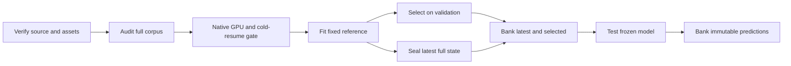

# P5 identifier references for LETTER

_Source-pinned declared reference reconstruction; not recovered LETTER baseline recipes._

---

## 📋 Scope and provenance

These additional references use the indexing paper's native P5 implementation,
not this repository's randomly initialized small TIGER. The paper-era source is
`Wenyueh/LLM-RecSys-ID@bc9a4b1bcae36d58d304f7ddaaa5fbe5e1be1ca0` (MIT).[^1]
All native source, metadata, weights, examples, predictions and checkpoints remain
in ignored/private storage. No native implementation is vendored.

| Input | Frozen identity |
| --- | --- |
| Reference configuration | `configs/letter-p5-reference-v1.json` |
| Native source archive SHA-256 | `3e64c60b8333f6e97f67452ba55ef5eca2485e01290aa4f6419445bde6426e34` |
| LETTER release | `HonghuiBao2000/LETTER@8d0154e28de37dbb6e24871c508ad8ddb1921cda` |
| Pretrained model | Apache-2.0 `google-t5/t5-small@df1b051c49625cf57a3d0d8d3863ed4d13564fe4` |
| Safe model weights SHA-256 | `bd944e5f1b3ad9b70dd9d00010a517059e19265671076b8b0a4a58d9491842bc` |
| Isolated environment | `environments/letter-p5/{pyproject.toml,uv.lock}` |
| Runtime | Python 3.10; Torch 1.13.1+cu117; Transformers 4.26.0; NumPy 1.24.4; SciPy 1.10.1; sklearn 1.2.2 |

The native README and the checked Beauty SemID log establish the shared starting
recipe: pretrained T5-small, 20 epochs, learning rate .001, warmup .05, clipping 1,
dropout .1, AdamW weight decay .01 and epsilon 1e-6.[^2] They do **not** recover
the settings behind LETTER's reported P5 table. The model downloader verifies the
exact revision, Apache license, Git/LFS hashes and every asset; it never downloads
or loads a pickle model checkpoint.[^3]

## 🧩 Catalog and identifier decisions

| Reference | Instruments | Beauty | Yelp |
| --- | --- | --- | --- |
| TID | Literal native title representation | Same | Same |
| CID | Full-catalog native-overwrite graph | Same | Same |
| SemID | Released paths plus native missing-path ID fallback | **Blocked:** category field absent | **Blocked:** category field absent |

Every original catalog row is retained, including respectively 9, 33 and 14 items
absent from fitting interactions. Original item `i` becomes native metadata key
`i+1`; original item zero is never the model's padding zero. Original numeric user
keys remain verbatim in native prompts. No P5 benchmark data, timestamps, heldout
interaction fitting, or unrelated category mapping is introduced.

### CID: preserve source behavior, expose its limitations

`CID_generation.py` excludes each user's last two events, counts ordered tuples
from `combinations(sequence, 2)`, sorts their counts descending, and overwrites
both symmetric matrix entries in that order.[^4] Thus directional counts 3 and 2
produce weight **2**, not 5. This implementation preserves that policy, including
self-pairs; diagnostics explicitly compare it with the unused undirected sum.

The native matrix-size assumption—number of distinct fitting items equals a
dense original-ID domain—does not hold for these releases. The sole graph-coverage
adaptation is an `N × N` matrix with cold zero-affinity rows. Such rows can change
the warm-item spectral partition too; they are not innocuous append-only IDs.
Cold assignments carry no observed collaborative affinity.

The root matrix is value-equivalent float64 CSR. Native sklearn settings remain
`n_clusters=20`, `assign_labels="cluster_qr"`, `random_state=0`,
`affinity="precomputed"` and the default ARPACK solver. Oversized clusters are
split by the **unchanged fixed-width helper extracted from the checked
`CID_generation.py` AST**, at most eight levels, maximum leaf size 500.
`CF_index.one_further_indexing` is deliberately not substituted: it adds an
eigengap width heuristic.

The standard generator's method-2 serialization block is also executed from
verified source. Its `<A…>` path tokens and native per-leaf suffixes flow through
`CF_representation`. There are no arbitrary LETTER suffixes, missing-item fallback
substitutions, or dropped cold nodes. Source-compatible dense/sparse partition
fixtures and repeated sparse fits are tested; floating-point storage equivalence
is not claimed to prove identical partitions on every possible graph.

### TID: preserve text, distinguish identities

Native `title_representation` returns the bracketed title (or the native `name`
override, if actually present).[^5] The adapter neither strips nor shortens it.
Missing title fields block admission; genuine empty titles and duplicates are
retained and counted. Each cell has a fresh tokenizer, so category/CID tokens
cannot accidentally alter title segmentation.

Primary metrics use the **tokenizer-canonical decoded native target string**.
They are not raw-title identity or unique-item accuracy. Every canonical string
maps to a list of original IDs, never a last-write-wins dictionary. The separate
item diagnostic expands distinct beam strings to ascending original IDs, then
deduplicates items. Primary ranks retain duplicate beam positions. Tokenizer
normalization changes, unknown-token rows, raw collisions and canonical collisions
are reported; unknown target tokens still contribute to the loss.

The hash-bound metadata evidence is
`results/2026-10-28-letter/semantic-input-ambiguity-v1.json`, SHA-256
`aac34d48b7475cde8583923de5eccaee2ed95c945657637dbebc0a1db88b797e`.
All three releases have zero empty raw titles.

| Raw-title ambiguity | Instruments | Beauty | Yelp |
| --- | --- | --- | --- |
| Duplicate groups | 31 | 27 | 1,434 |
| Items in those groups | 65 | 55 | 6,127 |
| Test targets in those groups | 178 | 173 | 8,508 |
| Largest group | 3 | 3 | 149 |

The P5 tokenization audits found 34, 28 and 4,697 excess canonical collision items
respectively. Yelp has four additional excess collisions introduced by
tokenization. Title ambiguity is consequently substantial on Yelp, not a corner
case. These are metadata/catalog diagnostics, **not trained title-baseline
results**, and are never used to deduplicate the catalog or choose a fit.

No legacy blanket `>` removal or implicit tie averaging is used in the reference
metrics. NDCG uses the declared stable beam rank and `1/log2(rank+1)`.

### SemID: available paths are not fabricated taxonomy

The Instruments release contains 9,922 string fields: 9,661 nonempty paths all
start with `Musical Instruments`, and 261 fields are empty. There are no root-only
nonempty paths. The declared adapter splits nonempty strings on literal commas,
preserves labels without stripping, wraps them as `[path]`, and lets the native
function remove the root. An existing empty string becomes `[[]]`.

The native missing-path branch then assigns the numeric native item ID and emits
its native `<category_i>` ID token, **not a recovered category**.[^5] The
Instruments reference must be named “SemID with native missing-path ID fallback.”
Its private report identifies each fallback original ID. Entirely missing
Beauty/Yelp category fields remain unavailable; an all-ID fallback is not
misrepresented as reconstructed SemID.

Category counters use the native seed-42 shuffle and native uniqueness suffix.
Registration order is sorted instead of Python-set iteration. All identifiers
must remain unique after native label normalization and tokenization; all added
tokens must be atomic. Mapping invariance under heldout-label mutation is tested.

## 🔬 Native training and complete-corpus admission

The native sequential dataset exposes ten prompts and
`10 × sum(len(train_user)-1)` indices. An index fixes user/prompt but resamples a
target uniformly from that user's fitting prefix. This distribution is preserved,
not replaced with deterministic one-target-per-index training.[^6]

The exhaustive audit visits **every possible training prefix with every prompt**
and every validation/test user. It compares native strings with original-ID
histories/targets, tokenizes complete inputs, checks all whole-word IDs and catalog
labels, and records length quantiles and row digests. Training support counts are
1,318,370 / 1,314,130 / 2,250,610 for Instruments / Beauty / Yelp. Validation and
test use each user's penultimate/final item; test history includes validation.
Both histories use the latest 20 items.

The native 512-token collator cap and generation length 10 are unsafe for titles.
For example, the Instruments audit found 80,485 training prompt variants above
512 input tokens; its complete maximum is 896. Of its 9,922 catalog titles, 9,916
would not fit the native total generation length 10. These findings are not
grounds to delete rows or shorten targets.

A thin tokenizer facade retains the native collator but disables truncation and
rejects records beyond a catalog/prompt-derived upper bound. EOS and padding
whole-word IDs are explicitly zeroed, correcting the native shorter-row EOS
padding dependence. All real whole-word IDs must fit the unchanged 512-row table.
The native per-example mean token CE is preserved; only padding is masked.

## ⚙️ Fixed reference recipe and GPU gate

| Setting | Declared reference |
| --- | --- |
| Initialization | Verified pretrained native P5, not random TIGER |
| Epochs / seed | 20 / 42 |
| Optimizer | Native Transformers AdamW, lr .001, epsilon 1e-6, weight decay .01 |
| Schedule / clipping | Linear; 5% warmup; clip norm 1 at optimizer boundary |
| Effective batch | 128 actual examples; partial windows weighted by their real counts |
| Nominal microbatch | 64, accumulation 2 |
| Precision / workers | float32 / zero workers |
| Selection | Validation recall@10, strictly greater, earliest epoch on ties |
| Evaluation | All users, no seen-item exclusion, 20 beams and 20 returns |
| Decoding | Native full-catalog trie, length penalty 1, early stopping false |
| Decoder bound | Decoder-start token plus longest complete catalog target including EOS |

The log's two GPUs × microbatch64 motivates the declared batch128, but this is not
proof of the native run's effective synchronized batch: the source trainer calls
`model.module(...)`. Neither synchronization nor its absence is asserted here.
This reference does not claim the source's distributed/dropout trajectory.

If the real worst-length training gate reports CUDA OOM, only microbatch divisors
64, 32, 16, 8, 4, 2, 1 may be tried, in order. Effective128, loss weighting, tokens,
epochs and beams remain unchanged. The chosen microbatch/accumulation is frozen
in a hashed gate plus `admitted-operating-recipe.json`; no validation/test score
selects it. Non-memory failures are not silently retried with different settings.

The ~128-row gate exercises five real native updates, a fresh-process interruption
after update two, byte-identical final model weights, complete optimizer/scheduler/
RNG/sampler/epoch continuation, matching subsequent sampled rows and losses,
nonzero whole-word gradients and effects, padding invariance, 20-beam cached versus
uncached parity, the actual longest training records, 100 validation users, and a
gate-only forced longest-catalog-path completion. The latter is not an evaluation
scoring policy.

Generation explicitly invokes the native encoder with `whole_word_ids` and
`shijie`, then supplies its encoder output to beam search. A thin cache adapter
maps `past_key_values` to the native legacy `past` argument. This avoids the known
generation-kwargs compatibility issue without disabling whole-word features or
editing installed Transformers.[^7] The one unused pretrained cross-attention
relative-bias tensor is accepted only because native P5 explicitly names it in
`_keys_to_ignore_on_load_unexpected`; every other mismatch fails.

## 💾 Persistence and execution

P5 checkpoints have their own `p5-full-state-v1` seal, not fabricated TIGER or
conventional-baseline checkpoint formats. They contain model safetensors plus the
locally generated optimizer, scheduler, Python/NumPy/CPU/CUDA RNG, permutation,
cursor, epoch and validation state. Only SHA-verified, locally generated training
state is unpickled. Checkpoints publish after complete optimizer updates; SIGTERM
drains to such a boundary. Unsaved trace tails are preserved as forensic files and
reconciled to the committed checkpoint before continuation.

Start the P5 node0 bank watcher **before** a long fit. It uses the same experiment
`bank.lock` as other writers, exports immutable latest and selected artifacts,
verifies SHA receipts and publishes acknowledgements. Interrupted destinations
receive a new retry name; they are not overwritten. Final test waits for both
latest and selected acknowledgements. Completed test batches are immutable,
frozen-model-bound chunks: a preemption resumes those same users/model without
reselecting or regenerating already committed batches. A final result is not
durably complete until `results-banked.json` exists.

### Crash-consistent selection and result publication

The committed `latest.json` names the authoritative sealed training state.
`selected.json` and `validation-history.json` are recoverable projections, not
independent authorities. Restore and pre-freeze selection resolution verify the
referenced state, its contract, saved validation-best decision and earliest-tie
policy. A missing/stale/corrupt selection pointer is reconstructed from that
state, including at the final epoch with no later improvement. Immutable model
artifacts are never overwritten or chosen using test outcomes. Conflicts with an
already-frozen model fail closed. Displaced pointer metadata is preserved.

A stable per-run metadata lock serializes publishers and recovery readers.
Restore refuses to combine one checkpoint generation with another generation's
selection. Files and containing directories are synchronized at publication
boundaries on the native POSIX runtime.

Result construction uses a unique owned partial directory. Admission requires all
result, prediction, completion, frozen-model, configuration, pointer and history
files; all 20 validation prediction files; complete unique-user coverage with
20 finite-scored beams; consistent model bindings; and every declared checksum.
Only a completely verified snapshot is atomically renamed into its final name.
Retries reverify existing snapshots rather than interpreting directory existence
as completion. Incomplete/malformed local attempts and obsolete acknowledgements
are preserved in quarantine; incomplete durable attempts are retained and receive
new retry destinations. A durable acknowledgement is published only after the
complete destination inventory, seal and receipt have been reverified.

### Maintenance of already-running frozen references

The original running bundle remains immutable. `p5_maintenance.py` provides a
separately versioned, hash-allowlisted **external I/O guard**, not a rewritten
scientific contract. Its narrowly enumerated hooks cover checkpoint publication,
restore/selection recovery, result snapshots, and guarded child dispatch. Model,
loss, data, sampler, optimizer and scheduler implementations remain the original
frozen learner. There is no bare-child fallback.

Effective runtime provenance is recorded separately in
`maintenance-attestation.json`, binding the unchanged original contract, original
base source, maintenance release and learned-state continuation proof. Original
source hashes are not represented as hashes of the added guard. Deployment
requires exact model-byte and optimizer/scheduler/sampler/RNG equivalence plus
matching subsequent sampled rows and losses, starting from all seven actual
learned checkpoints in isolated clones. Metadata reconciliation is checked for
RNG neutrality.

Maintenance drains only positively identified owned fits/controllers, preserves
and banks their exact optimizer-boundary state, and uses the same common durable
writer lock. The scientific budget and checkpoint policy remain unchanged:
**900 seconds plus epoch/drain/prime**, not periodic 100-update writes. No lease
expansion or parallelization onto other GPUs is implicit.

The maintenance suite passed **74 native-runtime tests**. Seven learned-state
baseline/guard comparisons also passed, each comparing two subsequent updates:
model tensor bytes, optimizer, scheduler, sampler, all RNG streams, sampled-row
digests and losses matched. The originally active fits were preserved at steps
13,604 (Instruments CID) and 3,852 (Instruments TID), checksum-banked, and resumed
through the separately attested guard. Neither the original frozen bundle nor any
of the seven bound scientific contract files was rewritten.

Use only the authorized `.local\letter\aml.ps1` node0 entry and the job described
in `.local\letter\job.json`. Training stays on node-local scratch; only node0
writes the approved durable directory. `p5_queue.py` refuses occupied GPUs and
allows only physical GPUs 4 and 5. It does not create allocations, displace other
processes, change permissions or cancel AML jobs.

Private queue specifications contain paths to `native`, `upstream`, `manifest`,
`recipe`, `model`, and each cell's `corpus`, `gate` and `run`. Use
`p5_queue.py --spec <private-spec> --gates-only` for gate-only admission; omit
`--gates-only` for the fixed fit queue. Private handoff JSON records actual PIDs,
log/spec paths, hashes, admission state and bank receipts. Do not infer completion
from a queued cell or an open process.

## 🧪 Validation and remaining limits

Run `python -m pytest -q tests/test_letter_p5.py` in the isolated P5 environment,
with `LETTER_P5_SOURCE` and `LETTER_P5_MODEL` pointing to private verified inputs.
CPU integration tests should set `CUDA_VISIBLE_DEVICES=''`. The native GPU gate
is a separate operation and requires a complete admitted corpus.

The pure tests cover full graph coverage/cold rows, source overwrite equivalence,
heldout isolation, dense/CSR fixture partitions, literal metadata, native fallback,
all prompt/split support, atomic IDs, EOS/padding and full target lengths, actual
loss denominators, exact full-state restoration, collision metrics, frozen-test
continuation, trace recovery, and immutable bank corruption rejection.

The isolated native suite passed **25 tests**. All seven eligible cells also
passed the native five-update/cold-restart gate and 100-user, 20-beam generation.
A second longest-record update restored the already populated optimizer before
measuring memory, so admission does not rely on first-step optimizer memory.

| Cell | Admitted microbatch × accumulation | Populated-optimizer peak bytes |
| --- | --- | --- |
| Instruments CID | 64 × 2 | 5,679,340,544 |
| Beauty CID | 64 × 2 | 6,267,714,560 |
| Yelp CID | 64 × 2 | 6,288,667,136 |
| Instruments TID | 64 × 2 | 45,845,544,448 |
| Instruments SemID with native fallback | 64 × 2 | 7,672,591,872 |
| Beauty TID | 16 × 8 | 61,163,191,296 |
| Yelp TID | 64 × 2 | 12,117,207,552 |

Beauty TID's 64/32 microbatch attempts failed the memory gate, not an accuracy
criterion. The admitted 16 × 8 setting retains all target tokens and all 20 beams.
Native empty-prefix masking is retained for padding rows of already-finished beam
examples; every final returned hypothesis still has to be complete, finite-scored,
and in the catalog. These gates are **not completed 20-epoch reference results**.

A queue may first prime each admitted cell to a fixed number of actual optimizer
updates, seal/bank that progress, then resume the same runs to the full budget.
This does not change epochs, scheduler horizon, sampled data or checkpoint
selection. `--prime-steps` is an execution boundary, not a new recipe or restart
from weights alone.

These are declared, corrected references. Longer complete-title decoding,
canonical-title identity, cold-inclusive spectral fitting, source-runtime
compatibility changes, batch128, serial sampling and explicit missing-path fallback
are material declarations. None may be relabeled as exact published LETTER P5
results. Beauty/Yelp SemID remain blocked without matching original category
metadata. No BIGRec, existing LETTER/RQ/LC/baseline/fresh-ID code, or `progress.md`
is modified by this implementation.

[^1]: [Indexing implementation and paper](https://github.com/Wenyueh/LLM-RecSys-ID/tree/bc9a4b1bcae36d58d304f7ddaaa5fbe5e1be1ca0), [arXiv:2305.06569](https://arxiv.org/abs/2305.06569).
[^2]: [Pinned README recipes](https://github.com/Wenyueh/LLM-RecSys-ID/blob/bc9a4b1bcae36d58d304f7ddaaa5fbe5e1be1ca0/README.md), [native Beauty SemID log](https://github.com/Wenyueh/LLM-RecSys-ID/blob/bc9a4b1bcae36d58d304f7ddaaa5fbe5e1be1ca0/log/beauty/pretrain_t5_small_beauty_SemID.log).
[^3]: [Pinned pretrained T5-small snapshot](https://huggingface.co/google-t5/t5-small/tree/df1b051c49625cf57a3d0d8d3863ed4d13564fe4).
[^4]: [Native CID graph, recursion and serialization](https://github.com/Wenyueh/LLM-RecSys-ID/blob/bc9a4b1bcae36d58d304f7ddaaa5fbe5e1be1ca0/CID_generation.py).
[^5]: [Native title and category functions](https://github.com/Wenyueh/LLM-RecSys-ID/blob/bc9a4b1bcae36d58d304f7ddaaa5fbe5e1be1ca0/item_rep_method.py).
[^6]: [Native dataset, prompt sampling and collator](https://github.com/Wenyueh/LLM-RecSys-ID/blob/bc9a4b1bcae36d58d304f7ddaaa5fbe5e1be1ca0/data.py).
[^7]: [Author-confirmed generation compatibility issue](https://github.com/Wenyueh/LLM-RecSys-ID/issues/2), [native P5 model](https://github.com/Wenyueh/LLM-RecSys-ID/blob/bc9a4b1bcae36d58d304f7ddaaa5fbe5e1be1ca0/modeling_p5.py).
