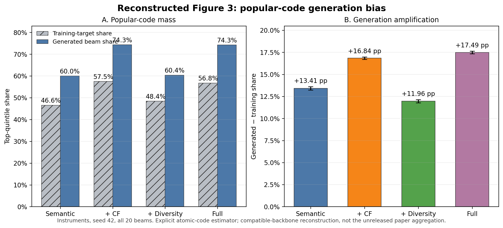

# LETTER reproduction: measured results

_Updated 2026-10-31. Completed components are reported separately below; the full multi-seed reproduction remains unfinished._

---

## 📊 Concise completed-results matrix

Every cell below is **Recall@10 / NDCG@10**. Released-ID T5 rows are means
over seeds42,17,23; conventional references use seed42 and explicitly
reconstructed settings, not recovered LETTER baseline recipes. Every saved
prediction in all36 cells was rechecked against the original held-out
targets and complete user coverage. Exact per-seed values, sample standard
deviations and prediction hashes are in the
[verified aggregate matrix](../results/2026-10-28-letter/status-matrix-20261028-1231.json).

| Method and metric identity | Instruments | Beauty | Yelp |
| --- | ---: | ---: | ---: |
| Paper LETTER-TIGER, code reference[^1] | 0.11220 / 0.08310 | 0.06720 / 0.03640 | 0.04260 / 0.02310 |
| Released-ID T5, temperature0.7, code | 0.10905 / 0.08135 | 0.06350 / 0.03423 | 0.04419 / 0.02340 |
| Released-ID T5, temperature1.0, code | 0.10706 / 0.08053 | 0.06547 / 0.03481 | 0.04210 / 0.02271 |
| Released-ID T5, temperature0.7, item diagnostic | 0.10868 / 0.08067 | 0.06329 / 0.03406 | 0.03961 / 0.02135 |
| Released-ID T5, temperature1.0, item diagnostic | 0.10653 / 0.07985 | 0.06509 / 0.03457 | 0.03836 / 0.02101 |
| BPR-MF, item | 0.07678 / 0.04161 | 0.02898 / 0.01258 | 0.06207 / 0.03454 |
| LightGCN, item | 0.08623 / 0.04518 | 0.03466 / 0.01551 | 0.06530 / 0.03564 |
| SASRec-BCE, item | 0.08288 / 0.04029 | 0.04338 / 0.01925 | 0.03881 / 0.02223 |
| HGN-CE, item | 0.10350 / 0.07474 | 0.05903 / 0.02966 | 0.05583 / 0.03163 |
| Caser, item | 0.07073 / 0.04064 | 0.03662 / 0.01785 | 0.02810 / 0.01361 |
| BERT4Rec, item | 0.09188 / 0.06720 | 0.05259 / 0.02833 | 0.03628 / 0.01774 |

Lower temperature improves the three-seed mean on Instruments and Yelp,
but reduces it on Beauty. Three seeds do not establish statistical
significance or a universal benefit. Yelp is especially sensitive to
identity: the temperature0.7 Recall@10 mean is0.04419 by code but0.03961
under the declared original-item collision diagnostic. Several conventional
references outperform that diagnostic on Yelp under these reconstructed
settings. The paper's central claim of improving a generative backbone
still requires our fresh-ID, same-backbone comparisons. Compare item
metrics with item metrics, not with the paper's code-string matching.

All three auditable CF teachers and all three compatible-backbone semantic
embedding banks are complete and durably acknowledged. Some full-budget
tokenizer and compatible LC-Rec components have now completed, with their
measurements separated below. The full native LC corpus audit admits
Instruments and Yelp but rejects Beauty's untouched auxiliary-task corpus:
168 prompt variants exceed2048 tokens,91 have no supervised response after
masking, and841 have prompt/full token-prefix mismatches. These are
prompt-variant counts, not unique users. Empty auxiliary targets are
also retained in the failure evidence. No silent filtering or recipe
change has been used to bypass this gate. The complete aggregate
[LC corpus audit](../results/2026-10-28-letter/lc-corpus-audit-openllama-released-id.json)
preserves every task group, length distribution and failure count.

A subsequent [CPU-only Beauty admission study](letter-beauty-admission.md)
also rejected conditioning auxiliary sampling on each item's valid native
templates. Five original items have **zero valid `index2item` templates**;
all 85 freshly rendered variants for those items failed the unchanged checks.
Their maximum length was only 560 tokens, so increasing context would not
repair these particular boundary/empty-response defects. No sampler, item
filter or Beauty LC training variant was admitted.

The original LLaMA1 track remains blocked on model access. The OpenLLaMA
track is a separately named compatible-method replication; these semantic
features were not used to obtain the released-ID scores above. The remainder
of this report preserves the initial single-seed findings and their
conditional paired-user intervals.

## 📊 Frozen 32-dimensional teacher references

The already-fitted BCE SASRec teachers now have separately recorded test
references for the later Table 3 embedding-replacement comparison. These are
**32-dimensional teachers**, not the 50-dimensional SASRec benchmark above.
No new weights were fitted or reselected, and no partial tokenizer or
quantized embedding was used.

| Dataset | Recall@10 | NDCG@10 | Users | Validation-selected epoch |
| --- | ---: | ---: | ---: | ---: |
| Instruments | 0.08130 | 0.04269 | 24,772 | 80 |
| Beauty | 0.04163 | 0.01931 | 22,363 | 180 |
| Yelp | 0.03299 | 0.01609 | 30,431 | 201 |

All three fits completed their fixed 201 epochs before this evaluation. A
100-user validation-only parity check passed for each model before any test
scoring. Evaluation covered every user and original catalog item, used history
50 including the validation interaction, excluded no seen items, and resolved
score ties by ascending original item ID. Scoring was CPU float32 with two
intra-op threads and one inter-op thread. Every saved prediction was checked
against its original target, and all four R/N@5/10 metrics were independently
recomputed.

[Exact metrics and provenance](../results/2026-10-28-letter/frozen-teacher-references-cpu-v1.json)
include checkpoint and prediction hashes. The predictions, pre-test protocol,
admission evidence and exact scorer are durably banked. The original fitting
receipts remain immutable; separate evaluation receipts record this test access.
Replacement comparisons reuse these frozen references with matching teacher
identities and scoring semantics. The first completed-tokenizer results below
are partial coverage; these references alone do not establish a tokenizer benefit.

## 📊 Newly verified generative-model results

These are primarily **seed42 measurements**, not a completed multi-seed
ablation. The two explicitly labeled seed17 rows are the first independent
training-seed replication.
LC and BIGRec use the separately declared OpenLLaMA-7B-v2 compatible backbone,
not original LLaMA1. LC still uses the authors' released ID bank. Fresh-ID T5
uses newly trained IDs with OpenLLaMA only as the semantic encoder; its
generator is the authors' randomly initialized small T5. P5 is a separately
declared pretrained-T5 reference reconstruction. BIGRec uses1,024 training
prefixes, not all training examples.

| Experiment | Dataset | Metric identity | Recall@10 | NDCG@10 |
| --- | --- | --- | ---: | ---: |
| Fresh-ID T5, diversity-only, temperature1 | Instruments | Code | 0.10798 | 0.08091 |
| Fresh-ID T5, diversity-only, temperature1 | Instruments | Item diagnostic | 0.10754 | 0.08019 |
| Fresh-ID T5, semantic-only, temperature1 | Instruments | Code | 0.10786 | 0.07989 |
| Fresh-ID T5, semantic-only, temperature1 | Instruments | Item diagnostic | 0.10750 | 0.07922 |
| Fresh-ID T5, semantic-only, temperature1, seed17 | Instruments | Code | 0.10403 | 0.07860 |
| Fresh-ID T5, semantic-only, temperature1, seed17 | Instruments | Item diagnostic | 0.10363 | 0.07792 |
| Fresh-ID T5, semantic+CF, temperature1, seed17 | Instruments | Code | 0.10665 | 0.07988 |
| Fresh-ID T5, semantic+CF, temperature1, seed17 | Instruments | Item diagnostic | 0.10609 | 0.07920 |
| Fresh-ID T5, diversity-only, temperature1, seed17 | Instruments | Code | 0.10633 | 0.07957 |
| Fresh-ID T5, diversity-only, temperature1, seed17 | Instruments | Item diagnostic | 0.10556 | 0.07880 |
| Fresh-ID T5, full tokenizer, temperature1, seed17 | Instruments | Code | 0.11065 | 0.08150 |
| Fresh-ID T5, full tokenizer, temperature1, seed17 | Instruments | Item diagnostic | 0.11021 | 0.08086 |
| Fresh-ID T5, semantic+CF, temperature1 | Instruments | Code | 0.10843 | 0.08117 |
| Fresh-ID T5, semantic+CF, temperature1 | Instruments | Item diagnostic | 0.10811 | 0.08057 |
| Fresh-ID T5, full tokenizer, temperature1 | Instruments | Code | 0.10944 | 0.08079 |
| Fresh-ID T5, full tokenizer, temperature1 | Instruments | Item diagnostic | 0.10879 | 0.08006 |
| Fresh-ID T5, full tokenizer, temperature0.7 | Instruments | Code | 0.10859 | 0.08025 |
| Fresh-ID T5, full tokenizer, temperature0.7 | Instruments | Item diagnostic | 0.10807 | 0.07959 |
| Fresh-ID T5, semantic-only, temperature1 | Beauty | Code | 0.05938 | 0.03245 |
| Fresh-ID T5, semantic-only, temperature1 | Beauty | Item diagnostic | 0.05894 | 0.03219 |
| Fresh-ID T5, semantic+CF, temperature1 | Beauty | Code | 0.06323 | 0.03358 |
| Fresh-ID T5, semantic+CF, temperature1 | Beauty | Item diagnostic | 0.06305 | 0.03342 |
| Fresh-ID T5, semantic+diversity, temperature1 | Beauty | Code | 0.06019 | 0.03240 |
| Fresh-ID T5, semantic+diversity, temperature1 | Beauty | Item diagnostic | 0.06005 | 0.03225 |
| Fresh-ID T5, full tokenizer, temperature1 | Beauty | Code | 0.06283 | 0.03412 |
| Fresh-ID T5, full tokenizer, temperature1 | Beauty | Item diagnostic | 0.06256 | 0.03389 |
| Fresh-ID T5, full tokenizer, temperature0.7 | Beauty | Code | 0.06260 | 0.03369 |
| Fresh-ID T5, full tokenizer, temperature0.7 | Beauty | Item diagnostic | 0.06234 | 0.03355 |
| Fresh-ID T5, semantic-only, temperature1 | Yelp | Code | 0.04045 | 0.02094 |
| Fresh-ID T5, semantic-only, temperature1 | Yelp | Item diagnostic | 0.03608 | 0.01903 |
| Fresh-ID T5, full tokenizer, temperature1 | Yelp | Code | 0.04469 | 0.02307 |
| Fresh-ID T5, full tokenizer, temperature1 | Yelp | Item diagnostic | 0.04118 | 0.02160 |
| Fresh-ID T5, full tokenizer, temperature0.7 | Yelp | Code | 0.04157 | 0.02162 |
| Fresh-ID T5, full tokenizer, temperature0.7 | Yelp | Item diagnostic | 0.03690 | 0.01955 |
| P5 CID, declared reference | Instruments | Original item = canonical string | 0.09624 | 0.07409 |
| P5 SemID, declared reference | Instruments | Original item = canonical string | 0.10488 | 0.07932 |
| P5 CID, declared reference | Beauty | Original item = canonical string | 0.06184 | 0.03746 |
| LC, native position-set constraints | Instruments | Code | 0.11610 | 0.08972 |
| LC, full-prefix-trie correction | Instruments | Code | 0.11618 | 0.08977 |
| LC, either policy | Instruments | Item diagnostic | 0.11590 | 0.08902 |
| LC, native position-set constraints | Yelp | Code | 0.04689 | 0.02594 |
| LC, full-prefix-trie correction | Yelp | Code | 0.04689 | 0.02594 |
| LC, either policy | Yelp | Item diagnostic | 0.04318 | 0.02403 |
| BIGRec, title generation + frozen-base L2 | Instruments | Original item | 0.05010 | 0.03858 |
| BIGRec, title generation + frozen-base L2 | Beauty | Original item | 0.02589 | 0.01439 |
| BIGRec, native title generation + frozen-base L2 | Yelp | Original item | 0.01666 | 0.01289 |

The Yelp semantic-only arm completed175 epochs and selected epoch155 by
validation loss. Its all30,431-user code Recall@10/NDCG@10 is
0.04045/0.02094; the declared original-item collision diagnostic is
0.03608/0.01903. The larger code-to-item gap is consistent with its853 excess
collision items, but does not identify collisions as the sole cause. Every
prediction, validation record, model binding and durable file was independently
verified and banked at `verified-results/fresh-yelp-semantic-s42-t10-v1`.
The remaining Yelp component and generation-loss arms are still required before
interpreting the full ablation.

The matched Yelp semantic-only seed17 arm completed181 epochs /39,820 updates
and selected checkpoint35,420 /epoch161. Code Recall@10/NDCG@10 is
**.03766/.01912** and the original-item diagnostic is **.03375/.01732** across
all30,431 users. Both are descriptively below seed42, illustrating training
variation rather than a tokenizer or recipe change. The large code/item gap
persists with853 excess collision items and largest group65. Exact independently
verified evidence is in
[the Yelp semantic seed17 receipt](../results/2026-10-31-letter/fresh-yelp-semantic-s17-t10-v1.json).

The Yelp full-tokenizer seed17 tau1 arm completed116 epochs /25,520 updates and
selected checkpoint21,120 /epoch96. Code Recall@10/NDCG@10 is
**.04397/.02287** and the original-item diagnostic is **.04137/.02162**. It is
descriptively above the seed17 semantic arm, but this two-point comparison
does not include training-seed uncertainty. The tokenizer retains832 excess
collision items /largest group65, so code and item identities remain
materially different. Exact independently verified evidence is in
[the Yelp full seed17 receipt](../results/2026-10-31-letter/fresh-yelp-full-s17-t10-v1.json).

The matched seed17 tau0.7 arm completed126 epochs /27,720 updates and selected
checkpoint23,320 /epoch106. Code Recall@10/NDCG@10 is **.04249/.02210** and
the original-item diagnostic is **.03772/.01993**. In the predeclared
tau0.7-minus-tau1 paired-user bootstrap, code Recall@10 is **-.00148** with
marginal95% interval **[-.00365,+.00072]** and code NDCG@10 is **-.00077**
**[-.00193,+.00039]**; both include zero. Item Recall@10 is **-.00365**
**[-.00575,-.00151]** and item NDCG@10 is **-.00169**
**[-.00282,-.00057]**, favoring tau1 under the item diagnostic. These
intervals are conditional on the two trained models and do not include
training-seed uncertainty. Exact evidence is in
[the Yelp seed17 tau0.7 receipt](../results/2026-10-31-letter/fresh-yelp-full-s17-t07-v1.json)
and [paired comparison](../results/2026-10-31-letter/fresh-yelp-full-s17-t07-minus-t10-v1.json).

The Yelp full-tokenizer tau1 arm exact-resumed after the AML lifecycle reset
from sealed checkpoint23,980, completed118 epochs and selected epoch98.
Code Recall@10/NDCG@10 is **.04469/.02307** and the original-item diagnostic is
**.04118/.02160**, pointwise above semantic-only by about+.00424/+.00213 code
and+.00509/+.00257 item. Every restored
optimizer/RNG state, prediction, selection and durable byte was independently
verified and banked at `verified-results/fresh-yelp-full-s42-t10-v1`.

The same Yelp tokenizer at tau0.7 completed116 epochs and selected epoch96.
Code Recall@10/NDCG@10 is **.04157/.02162** and the item diagnostic is
**.03690/.01955**. In the predeclared paired-user tau0.7-minus-tau1 contrast,
code Recall@10 is **-.00312** with marginal95% interval
**[-.00519,-.00105]** and code NDCG@10 is **-.00145**
**[-.00253,-.00030]**. Item Recall@10 is **-.00427**
**[-.00624,-.00230]** and item NDCG@10 is **-.00206**
**[-.00310,-.00096]**. Thus all four R10/N10 intervals exclude zero in favor
of tau1 for this seed; the result remains conditional on two trained models
and does not include training-seed uncertainty. Exact evidence is banked at
`verified-results/fresh-yelp-full-s42-t07-v1` and
`verified-results/fresh-yelp-full-comparisons-v1`.

The first genuine fresh-ID cell completed98 epochs with the fixed200-epoch
maximum and patience20, selecting epoch78 by validation loss. Its tokenizer
completed all20,000 epochs before admission. Independent checks covered all
24,772 targets,20 distinct valid beams per user, code/item metrics,98 validation
records, selected/final model identity and complete durable run/evaluation/result
inventories. **One diversity-only cell does not establish a full-model gain**;
the other datasets and seeds remain unfinished.

The same seed/temperature full-tokenizer arm completed99 epochs and selected
epoch79. Independent checks again covered every user, beam, validation loss,
model byte and durable receipt. Relative to diversity-only, full regularization
raises code Recall@10 by0.00145 and item Recall@10 by0.00125, while code/item
NDCG@10 are lower by about0.00012. These mixed single-seed point differences
do not establish a uniform component gain.

The repaired semantic-only tokenizer's T5 arm also completed99 epochs and
selected epoch79. Its code R10/N10 is0.10786/0.07989 and item diagnostic is
0.10750/0.07922. The tokenizer lineage discloses exactly one guarded training
endpoint correction at epoch16,401 and zero validation/export corrections; no
native bitwise identity is claimed past the original crash. Full-minus-semantic
item Recall@10 is+0.00129 with paired95% interval
[-0.00149,+0.00436], and item NDCG@10 is+0.00084
[-0.00081,+0.00250]. Code Recall@10 is+0.00157
[-0.00121,+0.00452], and code NDCG@10 is+0.00090
[-0.00078,+0.00256]. All intervals include zero, so this seed does not establish
a recommendation gain from the added objectives.

The independent seed17 semantic-only replication completed91 epochs and
selected epoch71. Its code Recall@10/NDCG@10 is **.10403/.07860** and its
original-item diagnostic is **.10363/.07792**. Relative to seed42, the code
points are lower by.00383 Recall@10 and.00130 NDCG@10. This two-seed spread is
descriptive training-seed variation, not an uncertainty interval or a
significance test. Every model-selection record, all24,772 users,20 beams and
durable run/evaluation/result byte were independently reverified in
[the seed17 receipt](../results/2026-10-31-letter/fresh-instruments-semantic-s17-t10-v1.json)
and `verified-results/fresh-instruments-semantic-s17-t10-v1`.

The matching seed17 semantic+CF replication completed87 epochs and selected
epoch67. Its code Recall@10/NDCG@10 is **.10665/.07988** and item diagnostic is
**.10609/.07920**. Relative to seed17 semantic-only, the descriptive point
differences are +.00262/+.00128 for code and +.00246/+.00128 for item.
These paired configurations provide a second training seed but still do not
support a population-level or training-seed significance claim. Exact evidence
is in
[the seed17 CF receipt](../results/2026-10-31-letter/fresh-instruments-cf-s17-t10-v1.json)
and `verified-results/fresh-instruments-cf-s17-t10-v1`.

The seed17 diversity-only replication completed86 epochs and selected epoch66.
Its code Recall@10/NDCG@10 is **.10633/.07957** and item diagnostic is
**.10556/.07880**. The code Recall@10 point is lower than seed17 CF by.00032
and higher than seed17 semantic-only by.00230; these are descriptive
training-seed-conditioned points, not significance claims. Exact evidence is
in
[the seed17 diversity receipt](../results/2026-10-31-letter/fresh-instruments-diversity-s17-t10-v1.json)
and `verified-results/fresh-instruments-diversity-s17-t10-v1`.

The seed17 full-tokenizer tau1 replication also completed86 epochs and
selected epoch66. Its code Recall@10/NDCG@10 is **.11065/.08150** and item
diagnostic is **.11021/.08086**. Relative to seed17 semantic-only, the
descriptive differences are +.00662/+.00291 for code and +.00658/+.00294 for
item; full is also above the seed17 CF and diversity points. These two-seed
patterns strengthen the descriptive consistency of the full tokenizer but do
not substitute for training-seed uncertainty or a predeclared multi-seed
significance analysis. Exact evidence is in
[the seed17 full receipt](../results/2026-10-31-letter/fresh-instruments-full-s17-t10-v1.json)
and `verified-results/fresh-instruments-full-s17-t10-v1`.

The matched seed17 full-tokenizer tau0.7 cell completed89 epochs and selected
epoch69. Code Recall@10/NDCG@10 is **.11049/.08192** and the original-item
diagnostic is **.10992/.08120**. Relative to the same seed's tau1 cell, tau0.7
is lower by.00016 code Recall@10 and.00028 item Recall@10, while NDCG@10 is
higher by.00042/.00033. These small crossed point differences establish no
temperature winner or equivalence claim. All24,772 users,20 beams, selection
state and durable bytes were reverified in
[the seed17 tau0.7 receipt](../results/2026-10-31-letter/fresh-instruments-full-s17-t07-v1.json).

Beauty semantic-only seed17 is also complete. It trained91 epochs and selected
epoch71. Code Recall@10/NDCG@10 is **.06216/.03282** and the deterministic
original-item diagnostic is **.06135/.03233** across all22,363 users and20
beams. Its semantic tokenizer has11 excess collision items /largest group3.
This is a compatible-backbone second-seed point, not an original-LLaMA1 or
training-seed significance claim. Exact evidence is in
[the Beauty semantic seed17 receipt](../results/2026-10-31-letter/fresh-beauty-semantic-s17-t10-v1.json).

The Beauty CF tokenizer at seed17 completed the full20,000 tokenizer epochs,
and its downstream T5 completed98 epochs /12,642 updates, selecting
checkpoint10,062 /epoch78. Code Recall@10/NDCG@10 is **.06403/.03448** and the
original-item diagnostic is **.06386/.03432** across all22,363 users and20
beams. The tokenizer has8 excess collision items /largest group3. Relative to
the seed17 semantic point, the CF arm is descriptively higher by about
0.00188 Recall@10 and0.00167 NDCG@10; this two-point comparison is not a
significance claim. Exact independently verified evidence is in
[the Beauty CF seed17 receipt](../results/2026-10-31-letter/fresh-beauty-cf-s17-t10-v1.json).

The Beauty diversity tokenizer at seed17 also completed20,000 epochs; its
downstream T5 completed101 epochs /13,029 updates and selected
checkpoint10,449 /epoch81. Code Recall@10/NDCG@10 is **.06225/.03407** and the
original-item diagnostic is **.06202/.03393**. The tokenizer has9 excess
collision items /largest group3. Relative to the seed17 semantic point, these
single-seed differences are small and descriptive, not evidence of a
significant winner. Exact independently verified evidence is in
[the Beauty diversity seed17 receipt](../results/2026-10-31-letter/fresh-beauty-diversity-s17-t10-v1.json).

The Beauty full tokenizer at seed17 completed20,000 epochs; its temperature-1
downstream T5 completed93 epochs /11,997 updates and selected checkpoint9,417 /
epoch73. Code Recall@10/NDCG@10 is **.06207/.03329** and the original-item
diagnostic is **.06184/.03307**. The tokenizer has10 excess collision items /
largest group3. The point is close to the semantic/diversity seed17 cells and
below CF on Recall@10; it remains a descriptive compatible-backbone result.
Exact independently verified evidence is in
[the Beauty full seed17 receipt](../results/2026-10-31-letter/fresh-beauty-full-s17-t10-v1.json).

The matched Beauty full seed17 temperature-0.7 arm completed91 epochs /11,739
updates and selected checkpoint9,159 /epoch71. Code Recall@10/NDCG@10 is
**.06055/.03310** and the original-item diagnostic is **.06041/.03302**.
Relative to temperature1, its code Recall@10 difference is -0.00152 with
paired95% interval [-0.00416,+0.00107], while code NDCG@10 is -0.00018
[-0.00160,+0.00126]. All four code/item Recall@10/NDCG@10 intervals include
zero, so this seed establishes neither a lower-temperature benefit nor
equivalence. Exact evidence is in
[the tau0.7 receipt](../results/2026-10-31-letter/fresh-beauty-full-s17-t07-v1.json)
and [paired comparison](../results/2026-10-31-letter/fresh-beauty-full-s17-t07-minus-t10-v1.json).

The semantic+CF arm completed87 epochs and selected epoch67. Code R10/N10 is
0.10843/0.08117 and item diagnostic is0.10811/0.08057. CF-minus-semantic
Recall@10 and NDCG@10 intervals all include zero. Only NDCG@5 excludes zero:
code+0.00177[+0.00013,+0.00347] and item
+0.00179[+0.00013,+0.00348]. This marginal single-seed result does not
establish a broad recommendation gain.

For the same full tokenizer and seed, temperature0.7 selected epoch72 and
temperature1 selected epoch79. All four code/item R/N@5/10 point differences
favor temperature1. For code Recall@10, the0.7-minus1 difference is-0.000848
with marginal95% interval[-0.003392,+0.001695]; code NDCG@10 is-0.000539
[-0.001993,+0.000936]. Item Recall@10 is-0.000727
[-0.003271,+0.001817], and item NDCG@10 is-0.000475
[-0.001935,+0.000983]. All predeclared paired-user intervals include zero,
so this seed establishes neither a lower-temperature benefit nor equivalence.

### Instruments Table 2 component attribution

All five Instruments rows are now complete under the same compatible
reconstruction and all-user protocol. The two generation-loss rows reuse the
exact same full-tokenizer identifier bank.

| Tokenizer / generation loss | Paper R10 / N10 | Measured code R10 / N10 |
| --- | ---: | ---: |
| Semantic-only / ordinary CE | 0.1058 / 0.0797 | 0.10786 / 0.07989 |
| Semantic+CF / ordinary CE | 0.1078 / 0.0810 | 0.10843 / 0.08117 |
| Semantic+diversity / ordinary CE | 0.1075 / 0.0809 | 0.10798 / 0.08091 |
| All regularizers / ordinary CE | 0.1092 / 0.0819 | 0.10944 / 0.08079 |
| All regularizers / ranking-guided CE | 0.1122 / 0.0831 | 0.10859 / 0.08025 |

The first four measured point rows closely track the paper, but paired-user
intervals do not establish Recall@10/NDCG@10 gains for CF, diversity or full
versus semantic-only. Ranking-guided minus ordinary CE is negative at this
seed—code R10-0.00085[-0.00339,+0.00170] and N10
-0.00054[-0.00199,+0.00094]—with all intervals including zero. Thus the
five-row point pattern is partly reproduced, while the claimed component and
ranking-loss gains are not established. [Exact rows, paired statistics and
provenance](../results/2026-10-29-letter/table2-instruments-v1.json) are banked
at `verified-results/table2-instruments-v1`.

The first Beauty fresh-ID row is also complete. Its semantic-only tokenizer T5
completed89 epochs, selected epoch69 and reports code R10/N10
0.05938/0.03245 versus the paper's semantic-only0.0610/0.0331 row. Original
item diagnostics are0.05894/0.03219. Every prediction, validation record,
tokenizer identity and durable file was independently verified. This is one
compatible-backbone cell; the remaining Beauty component and generation-loss
rows are still required before interpreting Table2.

The Beauty semantic+CF arm also completed and was recovered without changing
its recipe after a fail-closed exporter race. Trainer rotated a sealed
checkpoint while it was being copied; v5 resumed exact full state from
step11,099, completed epoch93 with the unchanged epoch73 selection, banked the
run before evaluation and passed the generic all-user audit. Code R10/N10 is
0.06323/0.03358 and item diagnostic is0.06305/0.03342.
CF-minus-semantic Recall@10 is+0.00385 by code, paired95% interval
[+0.00089,+0.00684], and+0.00411 by item
[+0.00112,+0.00711]. NDCG@10 intervals include zero. This is positive
single-seed Recall evidence, not a universal component claim. Exact recovery
and comparison evidence are banked at
`openllama-v2/fresh-t5-v3/operational/fresh-rq-v5-recovery-result` and
`verified-results/fresh-beauty-cf-vs-semantic-v1`.

Beauty semantic+diversity completed102 epochs and selected epoch82. Code
R10/N10 is0.06019/0.03240; item diagnostic is0.06005/0.03225.
Diversity-minus-semantic R10 is+0.00080 by code and+0.00112 by item, while
N10 is effectively flat. All paired Recall/NDCG intervals at5/10 include zero,
so this seed does not establish a downstream diversity-objective gain. Exact
cell and comparison packets are
`verified-results/fresh-beauty-diversity-s42-t10-v1` and
`verified-results/fresh-beauty-diversity-vs-semantic-v1`.

Beauty full-tokenizer temperature1 completed97 epochs and selected epoch77.
Code R10/N10 is0.06283/0.03412 and item diagnostic is0.06256/0.03389.
Full-minus-semantic Recall@10 is+0.00344 by code, paired95% interval
[+0.00049,+0.00653], and+0.00362 by item
[+0.00063,+0.00671]; both NDCG@10 intervals include zero. Against CF, all
Recall@10/NDCG@10 intervals include zero. Against diversity, only the marginal
code NDCG@10 interval excludes zero; Recall@10 and item NDCG@10 remain
inconclusive. Exact cell and comparison packets are
`verified-results/fresh-beauty-full-s42-t10-v1` and
`verified-results/fresh-beauty-full-comparisons-v1`.

Beauty full-tokenizer temperature0.7 completed93 epochs and selected epoch73.
Code R10/N10 is0.06260/0.03369 and item diagnostic is0.06234/0.03355.
Ranking-guided-minus-ordinary code R10 is-0.00022 with paired95% interval
[-0.00300,+0.00255], and code N10 is-0.00043
[-0.00203,+0.00107]. Item intervals likewise include zero. Thus Beauty, like
Instruments, does not establish a temperature0.7 benefit at this seed. Exact
cell and five-row attribution evidence are banked at
`verified-results/fresh-beauty-full-s42-t07-v1` and
`verified-results/table2-beauty-v1`.

### Beauty Table 2 component attribution

| Tokenizer / generation loss | Paper R10 / N10 | Measured code R10 / N10 |
| --- | ---: | ---: |
| Semantic-only / ordinary CE | 0.0610 / 0.0331 | 0.05938 / 0.03245 |
| Semantic+CF / ordinary CE | 0.0660 / 0.0351 | 0.06323 / 0.03358 |
| Semantic+diversity / ordinary CE | 0.0618 / 0.0335 | 0.06019 / 0.03240 |
| All regularizers / ordinary CE | 0.0672 / 0.0357 | 0.06283 / 0.03412 |
| All regularizers / ranking-guided CE | 0.0672 / 0.0364 | 0.06260 / 0.03369 |

CF-minus-semantic Recall@10 is positive at this seed, but its NDCG@10 interval
includes zero. Full-minus-semantic Recall@10 is also positive while NDCG@10
remains inconclusive. Diversity is inconclusive, and ranking-guided versus
ordinary CE is pointwise negative with every declared interval spanning zero.
The measured component ordering partially follows the paper, but the claimed
ranking-loss gain is not reproduced. [Exact rows and paired
statistics](../results/2026-10-30-letter/table2-beauty-v1.json) remain
single-seed compatible-backbone evidence.

P5 CID completed all20 epochs /206,000 updates and selected the earliest
validation Recall@10 maximum at epoch4. Every prediction in all20 validation
epochs and the final24,772-user test was independently recomputed. The frozen
selection, one-test binding, complete state seals and durable result inventory
were checked. This CID catalog has no canonical-string collisions, so its
primary and original-item metrics coincide; that is not assumed for title IDs.

P5 SemID likewise completed20 epochs /206,000 updates and selected epoch3.
The node2 audit recomputed every row of all20 full-user validation epochs and
the one test, including205,900 locally recorded updates after the admitted
sealed step-100 root. Node0 separately rehashed every durable result and
selected/latest state file. R10/N10 is0.10488/0.07932, above the paper's
declared P5-SemID0.0964/0.0730 point. This collision-free catalog again makes
canonical and original-item metrics equal. Exact cross-node evidence is banked
at `verified-results/p5-instruments-semid-v1`.

Beauty P5 CID completed all20 epochs /205,340 updates and selected the earliest
validation Recall@10 maximum at epoch4. After the lifecycle reset removed
epochs1-19 prediction files, each was replayed from its exact receipt-backed
validation checkpoint in a clean frozen-runtime process; all metrics and
prediction hashes matched the frozen history. Recovery evidence and the final
result were durably bound before canonical publication. The all22,363-user
test reports Recall@10/NDCG@10 **.06184/.03746**, identical under code and
original-item identities for this collision-free CID catalog. Exact evidence
is in [the Beauty P5 CID receipt](../results/2026-10-31-letter/p5-beauty-cid-s42-v1.json).

LC completed all four epochs / 8,240 updates and selected checkpoint6,180
solely from validation loss. Both fixed20-beam evaluations covered all24,772
users. Independent verification checked every target, beam, score, item
expansion, per-rank checksum and final-run/evaluation bank authorization.
Native constraints emitted1,837 invalid codes among495,440 beams; the full
trie emitted zero. Aggregate item metrics are identical, so format validity
should not be presented as a demonstrated item-quality gain.

Yelp LC completed its fixed six epochs /5,280 updates and selected
checkpoint3,520 at the earliest minimum validation loss. Both decoder policies
covered all30,431 users with20 beams. They produce identical code and
original-item metrics: code Recall@10/NDCG@10 **.04689/.02594** and item
**.04318/.02403**. The native position-set decoder emitted367 invalid codes
among608,620 beams, while the full-prefix trie emitted zero; none of those
differences changed the aggregate target-hit metrics in this run. Every saved
row, collision expansion, checkpoint selection and durable acknowledgment was
independently recomputed and banked at `verified-results/lc-yelp-v1`.

BIGRec Yelp completed50 epochs, then four-beam/128-token generation and
single-best-title grounding for all30,431 users against all20,033 original
items. Every saved query's full-catalog L2 ranking was independently recomputed,
without new model generation or encoding. No users were removed:35 first-beam
answers reached the length limit. Title-equivalence Recall@10 is0.01840, a
separate diagnostic rather than a replacement for original-item Recall@10.

BIGRec Instruments likewise completed50 epochs and all24,772 users. Every
saved query was independently reranked against all9,922 catalog items without
new model inference. All first-beam answers ended with EOS; three secondary
beams reached the length limit. Its selected model, catalog, summary and
independent audit are banked. The pipeline subsequently reached zero backlog.
A final pass under the common writer lock reverified all880 outbox objects and
every durable file checksum:101 checkpoints,388 generation shards,388
grounding shards, the selected model, evaluation summary and exporter
handshake, totaling5.46 GB. No generation, encoding, grounding or ranking was
repeated for this persistence check.

[Exact new metrics and audit provenance](../results/2026-10-29-letter/verified-native-generative-v1.json)
include completed numerical and persistence checks. The original19-file audit
packet preserves the executed metric programs and dependencies; a separate
final-durability packet preserves the complete raw-object verification.

BIGRec Beauty also completed all22,363 users, and every saved query was
independently reranked against all12,101 original items. Recall@10 is0.02589
and NDCG@10 is0.01439. There were225 first-beam length finishes and1,043
length finishes across all beams; no user was filtered. Literal generated-title
match rate is0.00340. The title-equivalence and original-item Recall@10 values
coincide here, while title-equivalence NDCG@10 is0.01441; it remains a diagnostic,
not a replacement metric. Numerical/model/catalog/summary evidence is banked.
The pipeline subsequently reached zero backlog. A final pass under the common
writer lock reverified all804 outbox objects and every durable file checksum:
101 checkpoints,350 generation shards,350 grounding shards, the selected
model, evaluation summary and exporter handshake, totaling5.43 GB. This
persistence check repeated no model generation, encoding, grounding or ranking.

## 📉 First raw embedding-replacement results

All four Instruments tokenizer variants completed the entire20,000-epoch budget.
Semantic-only, CF-only and full selected epoch18,000; diversity-only selected
epoch20,000. Their actual exported IDs index the selected codebooks. Raw
residual-order vector sums replace only the frozen32D teacher's real item rows,
without normalization, rescaling or refitting.

| Instruments condition | Recall@10 | NDCG@10 |
| --- | ---: | ---: |
| Original frozen teacher, reused reference | 0.08130 | 0.04269 |
| Semantic-only tokenizer's raw quantized replacement | 0.00472 | 0.00209 |
| CF-regularized tokenizer's raw quantized replacement | 0.01909 | 0.00837 |
| Full tokenizer's raw quantized replacement | 0.02156 | 0.01033 |
| Diversity-only tokenizer's raw quantized replacement | 0.00521 | 0.00239 |

**All four replacements perform worse than the original teacher** in this
declared reconstruction. CF and full regularization substantially outperform
semantic-only and diversity-only replacements, but neither reproduces a gain
over the teacher or establishes a generative-model gain. Every per-user metric
and selected-codebook vector sum was independently verified; the original
teacher was not scored again.

Post-hoc median item-vector norms are1.259 for the teacher and3.810 /8.341 /
3.614 /8.708 for semantic /CF /diversity /full replacements. Declared
cosine-neighbor matching-position overlap is0.03512 /0.09922 /0.03968 /0.08411.
These describe distribution and neighborhood differences; they are not causal
tests or permission to retune the experiment. The compatible semantic encoder,
reconstructed teacher and declared analysis conventions remain limitations.

The semantic and CF tokenizers used the disclosed endpoint compatibility
correction: exactly one training correction each at epoch16,401, no validation
or export corrections, and independently verified full-state continuation.
[Exact complete Instruments results](../results/2026-10-29-letter/instruments-embedding-replacements-v1.json)
retain that provenance and all negative findings.

All four Beauty tokenizer variants have also completed20,000 epochs. Their
raw replacement results show the same limitation: CF regularization improves
on semantic/diversity-only replacements, but none preserves the original
teacher's accuracy.

| Beauty condition | Recall@10 | NDCG@10 | Selected tokenizer epoch |
| --- | ---: | ---: | ---: |
| Original frozen teacher, reused reference | 0.04163 | 0.01931 | N/A |
| Semantic-only replacement | 0.00550 | 0.00252 | 18,000 |
| CF-regularized replacement | 0.01623 | 0.00754 | 20,000 |
| Diversity-only replacement | 0.00461 | 0.00197 | 12,000 |
| Full replacement | 0.01731 | 0.00814 | 20,000 |

Under the predeclared cosine-neighbor / matching-position convention,
Beauty code overlap is0.06340 /0.12210 /0.06599 /0.11371 for semantic / CF /
diversity / full, respectively. Better overlap is not interchangeable with
better recommendation accuracy. Every replacement prediction and residual
vector sum was checked independently against the selected checkpoint and
actual exported IDs; the original teacher reference was reused unchanged.
[Exact Beauty results](../results/2026-10-29-letter/beauty-embedding-replacements-v1.json)
retain the negative findings and descriptive, uncalibrated vector norms.

Both Yelp tokenizers also completed20,000 epochs and passed full durable
rehashing. Semantic-only selected epoch12,000; full selected epoch16,000.
The semantic/full exported ID banks contain853/832 excess collision items,
respectively, with largest collision group65.

Their independently audited replacement analysis preserves the same negative
boundary as Instruments and Beauty:

| Yelp condition | Recall@10 | NDCG@10 | Cosine-neighbor position overlap |
| --- | ---: | ---: | ---: |
| Original frozen teacher, reused reference | 0.03299 | 0.01609 | N/A |
| Semantic-only replacement | 0.00062 | 0.00028 | 0.01141 |
| Full replacement | 0.00342 | 0.00142 | 0.07635 |

Full-minus-semantic replacement Recall@10 is+0.00279 with paired-user95%
interval[+0.00207,+0.00352], and NDCG@10 is+0.00114
[+0.00081,+0.00148]. Full therefore increases CF-neighbor code overlap and
outperforms semantic-only replacement, but both replacements remain far below
the unchanged teacher. This does not establish a generative-model gain.
[Exact Yelp tokenizer and mechanism results](../results/2026-10-30-letter/yelp-mechanism-summary-v1.json)
are banked at `verified-results/yelp-tokenizers-final-v1` and
`verified-results/yelp-mechanisms-v1`.

### Table 3 embedding-replacement comparison

The paper's Table3 rows and the declared reconstructions can now be compared
directly. Metrics remain original-item full-catalog ranking after replacing the
frozen teacher's item matrix; no refitting is performed.

| Dataset / tokenizer | Paper R10 / N10 | Measured R10 / N10 |
| --- | ---: | ---: |
| Instruments semantic-only / TIGER | 0.0150 / 0.0049 | 0.00472 / 0.00209 |
| Instruments full / LETTER | 0.0159 / 0.0058 | 0.02156 / 0.01033 |
| Beauty semantic-only / TIGER | 0.0213 / 0.0085 | 0.00550 / 0.00252 |
| Beauty full / LETTER | 0.0343 / 0.0118 | 0.01731 / 0.00814 |

Full-minus-semantic Recall@10 is+0.01683 on Instruments with paired-user95%
interval[+0.01481,+0.01881], and+0.01181 on Beauty
[+0.00979,+0.01368]. Corresponding NDCG@10 differences are+0.00824
[+0.00722,+0.00924] and+0.00562[+0.00465,+0.00664]. Full therefore improves
substantially over semantic-only within these fixed reconstructed models, but
every replacement remains far below the unchanged original teacher
(R10 0.08130/0.04163). The Instruments full point exceeds the paper's Table3
point while Beauty remains below it; neither licenses an overall
recommendation-gain claim. [Exact paired statistics and
provenance](../results/2026-10-29-letter/table3-embedding-replacement-v1.json)
are banked at `verified-results/table3-embedding-replacement-v1`.

### Table 4 CF-neighbor code similarity

The Table4-style analysis has now been independently recomputed for every
catalog item in Instruments and Beauty. The primary convention uses one
non-self cosine-nearest item in the frozen reconstructed32D CF teacher space
and measures the fraction of four level-qualified code positions that match.

| Dataset | Paper TIGER | Semantic | CF-only | Diversity-only | Full | Paper LETTER |
| --- | ---: | ---: | ---: | ---: | ---: | ---: |
| Instruments | 0.0849 | 0.03512 | 0.09922 | 0.03968 | 0.08411 | 0.2760 |
| Beauty | 0.1135 | 0.06340 | 0.12210 | 0.06599 | 0.11371 | 0.3312 |

Full-minus-semantic overlap is+0.04898 on Instruments with paired item-bootstrap
95% interval[+0.04631,+0.05145], and+0.05031 on Beauty
[+0.04756,+0.05310]. Thus collaborative regularization clearly increases this
declared overlap measure, but the full results remain far below the paper's
LETTER values. CF-only is higher than full in both datasets, while
diversity-only remains close to semantic-only. Dot-product-neighbor sensitivity
is lower in magnitude but preserves that broad ordering. These intervals are
conditional descriptive uncertainty, not population inference; the compatible
teacher/tokenizers and the paper's underspecified normalization, tie and overlap
rules remain limitations. [Exact per-variant intervals, sensitivities and
provenance](../results/2026-10-29-letter/table4-code-similarity-v1.json) are
banked at `verified-results/table4-code-similarity-v1`.

[Verified component metrics and provenance](../results/2026-10-29-letter/verified-components-v1.json)
retain exact values, source/checkpoint/prediction hashes, coverage and the
separate diagnostic identities. Raw predictions and learned vectors remain
private and durably banked.

### Figure 6/7 distribution and PCA diagnostics

The selected tokenizers also reproduce the paper's first-code assignment
histograms and center-only PCA inputs. The table reports first-level utilization
out of256, entropy in bits and the total variance explained by the first three
PCA components.

| Dataset / tokenizer | Utilized codes | Entropy | PCA-3 variance |
| --- | ---: | ---: | ---: |
| Instruments semantic | 104 | 6.425 | 0.578 |
| Instruments CF | 84 | 5.755 | 0.295 |
| Instruments diversity | 73 | 5.996 | 0.633 |
| Instruments full | 158 | 6.458 | 0.522 |
| Beauty semantic | 111 | 6.394 | 0.580 |
| Beauty CF | 164 | 6.668 | 0.234 |
| Beauty diversity | 66 | 5.806 | 0.615 |
| Beauty full | 179 | 6.746 | 0.449 |

Full regularization has the highest utilization and entropy on both datasets.
Diversity-only has the lowest utilization in both, so its intended anti-collapse
effect is not reproduced under this compatible reconstruction. CF changes the
distribution in opposite directions across datasets. PCA concentration is
descriptive only and is not interpreted as recommendation quality, semantic
fairness or proof of balanced usage. [Exact diagnostics](../results/2026-10-29-letter/tokenizer-distribution-pca-v1.json)
retain all ratios and reconstruction conventions; raw grouped counts and
coordinates remain in the private mechanism bundles.

### Figure 3 generation-bias reconstruction

Because the paper and released repository do not publish the exact Figure3
aggregation script, this is an explicitly qualified reconstruction rather than
an exact replay. The frozen primary estimator ranks position-specific learned
atomic codes by target-side frequency in the exact generator training examples,
uses the paper's five20% rank intervals with fractional tie allocation, and
gives every test user, each of20 valid beams and each learned code position
equal mass.

| Tokenizer | Top-quintile training share | Top-quintile generated share | Shift |
| --- | ---: | ---: | ---: |
| Semantic-only | 46.57% | 59.99% | +13.41 pp |
| Semantic+CF | 57.49% | 74.33% | +16.84 pp |
| Semantic+diversity | 48.41% | 60.37% | +11.96 pp |
| Full | 56.77% | 74.26% | +17.49 pp |

All variants over-generate popular codes. Relative to semantic-only, CF
increases the shift by+3.43 percentage points, paired95% interval
[+3.28,+3.57]; diversity reduces it by-1.45[-1.59,-1.31]; full increases it
by+4.08[+3.93,+4.23]. The declared diversity objective therefore reduces
relative generation amplification in this estimator, while CF dominates the
full tokenizer's increased concentration. Full nevertheless uses more atomic
code types, showing that catalog utilization and generated popularity
concentration are distinct. Full-identifier grouping and beam weighting remain
decoding-dependent sensitivities, so no causal or fairness claim is made.
[Exact four-tokenizer bins, comparisons and audit
provenance](../results/2026-10-29-letter/figure3-tokenizer-ablation-v2.json) are
banked at `verified-results/figure3-tokenizer-ablation-v2`; the earlier
semantic/full-only packet remains immutable.

The same frozen estimator is now complete for Beauty:

| Beauty tokenizer | Top-quintile training share | Generated share | Shift |
| --- | ---: | ---: | ---: |
| Semantic-only | 44.11% | 53.08% | +8.97 pp |
| Semantic+CF | 50.07% | 63.19% | +13.13 pp |
| Semantic+diversity | 46.33% | 52.81% | +6.48 pp |
| Full | 49.21% | 62.83% | +13.61 pp |

Relative to semantic-only, CF increases the shift by+4.16 percentage points,
paired95% interval[+3.98,+4.32]; diversity reduces it by-2.49
[-2.61,-2.35]; full increases it by+4.65[+4.49,+4.81]. Thus the same qualitative
pattern holds on Beauty: diversity reduces relative amplification, while CF
drives the full model toward popular codes. The exact audited result is
[published separately](../results/2026-10-30-letter/figure3-beauty-tokenizer-ablation-v3.json)
and banked at `verified-results/figure3-beauty-tokenizer-ablation-v3`.

### Figure 8 one-factor sweep status

The two-level tokenizer arm is the first completed Figure8 sweep result. It
finished20,000 epochs, selected epoch12,000 and emitted two-token IDs. After20
collision retries it still has1,121 excess collision items and largest group36,
so shorter identifiers substantially increase collisions versus the four-level
baseline. No downstream recommendation claim is made until its fixed T5 cell is
trained and evaluated. The exact final bundle was rehashed before node1 GPU1
was reassigned to the predeclared eight-level arm. Evidence is in
[the final L2 receipt](../results/2026-10-30-letter/figure8-levels2-final-v1.json)
and `verified-results/figure8-levels2-final-v1`.

The six-level tokenizer arm completed20,000 epochs and selected epoch16,000.
Its exported six-token bank has25 excess collision items, largest group3 and
utilization172/256/256/256/256/256; deterministic repair reduced only three
additional excess items. This is tokenizer evidence only until its dedicated
downstream cell runs. Exact evidence is in
[the final L6 receipt](../results/2026-10-31-letter/figure8-levels6-final-v1.json)
and `verified-results/figure8-levels6-final-v1`.

The `K=5` diversity-cluster arm also completed20,000 epochs and selected the
final scheduled checkpoint. Its exported four-token bank has25 excess
collision items, largest group3 and first-level utilization134/256. This is
tokenizer evidence, not recommendation performance; its dedicated tau0.7 T5
cell remains pending. Exact evidence is in
[the final K5 receipt](../results/2026-10-30-letter/figure8-clusters5-final-v1.json)
and `verified-results/figure8-clusters5-final-v1`.

The `alpha=0.1` arm completed20,000 epochs and selected epoch18,000. Its
four-token bank has25 excess collision items, largest group3 and first-level
utilization206/256. As with K5, this does not determine the recommendation
curve until the fixed downstream T5 cell finishes. Exact evidence is in
[the final alpha0.1 receipt](../results/2026-10-30-letter/figure8-alpha0p1-final-v1.json)
and `verified-results/figure8-alpha0p1-final-v1`.

Three more recovered arms have complete, independently rehashed final banks:
`alpha=0.001` selected epoch12,000 with first-level utilization56/256;
`beta=0.01` selected epoch18,000 with utilization168/57/134/256; and `K=15`
selected epoch12,000 with first-level utilization156/256. All three have25
excess collision items and largest group3 after deterministic collision
postprocessing. These remain tokenizer-only findings. Exact receipts:
[alpha0.001](../results/2026-10-30-letter/figure8-alpha0p001-final-v1.json),
[beta0.01](../results/2026-10-30-letter/figure8-beta0p01-final-v1.json), and
[K15](../results/2026-10-30-letter/figure8-clusters15-final-v1.json).

The restored pre-reset `alpha=0.01` and `beta=0.00001` final bundles have now
also passed the same independent all-byte audit. Both selected epoch18,000 and
finish with25 excess collision items /largest group3. Their first-level
utilization is118/256 and187/256 respectively; deterministic collision repair
reduced206 and70 pre-repair excess items. These are still tokenizer-only
findings. Exact receipts:
[alpha0.01](../results/2026-10-30-letter/figure8-alpha0p01-final-v1.json) and
[beta0.00001](../results/2026-10-30-letter/figure8-beta0p00001-final-v1.json).

The repaired `beta=0.001` arm also completed20,000 epochs and selected
epoch18,000. Its four-level bank has25 excess collision items, largest group3
and utilization129/117/256/256. The compatibility audit replayed160,080
initialization tasks:160,079 were native-defined and bitwise matched, while
one exact undefined CDF endpoint at epoch16,401 level0 required the admitted
index guard; export required no correction. Native bitwise execution is not
claimed past that crash. Exact lineage and durable evidence are in
[the beta0.001 final receipt](../results/2026-10-31-letter/figure8-beta0p001-final-v2.json)
and `verified-results/figure8-beta0p001-final-v2`.

The repaired `K=20` arm completed20,000 epochs and selected the final
checkpoint. Its bank has25 excess collision items, largest group3 and
utilization147/256/256/256. The admission-bound audit replayed360,200
initialization tasks:360,199 native-defined tasks matched bitwise, one exact
undefined CDF endpoint at epoch11,431 level1 used the guard, and all40 export
tasks were native-defined. Native bitwise execution is not claimed past the
crash. Exact evidence is in
[the K20 final receipt](../results/2026-10-31-letter/figure8-clusters20-final-v2.json)
and `verified-results/figure8-clusters20-final-v2`.

Two codebook-size arms are now independently final. The 128-code arm selected
epoch20,000 and has utilization103/128/128/128; the 512-code arm selected
epoch18,000 and has utilization204/512/512/512. Both finish with25 excess
collision items and largest group3 after deterministic collision repair, down
from93 and46 respectively. These are tokenizer-only findings until their
dedicated downstream T5 cells complete. Exact evidence:
[codes128](../results/2026-10-31-letter/figure8-codes128-final-v1.json) and
[codes512](../results/2026-10-31-letter/figure8-codes512-final-v1.json).

The 64-code arm is now also independently final. It selected epoch20,000,
uses all64 codes at every level, and reduces excess collision items from178 to
28 with largest group3. Its native run repeated the same undefined CDF endpoint
fault at epoch16,401/level0; the admitted compatibility continuation records
160,079 native-defined tasks, one correction, zero failures and zero export
corrections. An older final bundle omitted attestation ancestors and is
explicitly superseded by the ancestry-complete bundle. Exact evidence is in
[the codes64 final receipt](../results/2026-10-31-letter/figure8-codes64-final-v2.json).

Downstream evaluation for the 15 nonbaseline tokenizer arms is split across
immutable `fresh-t5-figure8-tokenizer-v2` and `v3` namespaces; v4 is reserved
for arms whose tokenizer completion requires the audited k-means endpoint
compatibility lineage. The preserved v1 attempt failed closed before any T5
update when its monitor sampled the wrong physical GPU pair. Each
completed tokenizer bank requires a fresh random seed-42 T5 fit at fixed
temperature 0.7 and an all-user 20-beam evaluation; no model or checkpoint is
shared across arms. The existing
full-tokenizer temperature-0.7 result is reused for the baseline point in the
identifier-length, codebook-size, alpha, beta and cluster panels. Together with
the separate five-arm temperature queue, Figure 8 therefore requires **20
additional T5 fits** beyond the already completed temperature-0.7 and
temperature-1.0 baseline fits.

The first downstream sweep cell, `L=2` at fixed tau0.7, completed61 epochs and
selected epoch41 solely from validation loss. Its all24,772-user code
Recall@10/NDCG@10 is **.11222/.08170**, while the deterministic original-item
diagnostic is **.09487/.07262**. The code score is descriptively above the
shared four-level tau0.7 baseline, but the item diagnostic is substantially
lower, consistent with the two-level bank's1,121 excess collision items. This
single-seed point is not a selected winner or a significance claim. Every
prediction, model-selection decision and durable byte was independently
reverified in
[the levels2 downstream receipt](../results/2026-10-30-letter/figure8-downstream-levels2-s42-t0p7-v1.json)
and `verified-results/figure8-downstream-levels2-s42-t0p7-v1`.

The `L=6` downstream cell completed120 epochs and selected checkpoint12,900 /
epoch100. Code Recall@10/NDCG@10 is **.10798/.08161** and the original-item
diagnostic is **.10758/.08095**. Its six-level tokenizer uses
172/256/256/256/256/256 codes and retains25 excess collision items. The result
is descriptively below the shared full-tokenizer baseline on Recall@10; no
identifier-length winner or monotonicity claim is made. Exact independently
verified evidence is in
[the L6 downstream receipt](../results/2026-10-31-letter/figure8-downstream-levels6-s42-t0p7-v1.json).

The `alpha=0.001` downstream cell completed at epoch93 after selecting
checkpoint9,417 /epoch73 solely by validation loss. Its all-user code
Recall@10/NDCG@10 is **.10722/.08035** and the deterministic original-item
diagnostic is **.10665/.07972**. Unlike the two-level arm, the code and item
views are nearly identical because this four-level bank has only25 excess
collision items. Relative to the shared full-tokenizer tau0.7 baseline this
single-seed point is descriptively lower, but it is not a winner selection or
significance claim. Every prediction, selection record and durable receipt was
independently reverified in
[the alpha0.001 downstream receipt](../results/2026-10-30-letter/figure8-downstream-alpha0p001-s42-t0p7-v1.json)
and `verified-results/figure8-downstream-alpha0p001-s42-t0p7-v1`.

The `alpha=0.01` downstream cell completed at epoch92 after selecting
checkpoint9,288 /epoch72. Its all-user code Recall@10/NDCG@10 is
**.11194/.08231** and the original-item diagnostic is **.11162/.08170**.
The two identities are again close because the four-level tokenizer has only25
excess collision items. This single seed is descriptively above the shared
full-tokenizer tau0.7 baseline, but no cross-arm winner or significance claim
is made. Exact independently reverified evidence is in
[the alpha0.01 downstream receipt](../results/2026-10-31-letter/figure8-downstream-alpha0p01-s42-t0p7-v1.json)
and `verified-results/figure8-downstream-alpha0p01-s42-t0p7-v1`.

The `alpha=0.1` downstream cell also completed at epoch92 and selected
checkpoint9,288 /epoch72. Code Recall@10/NDCG@10 is **.10439/.07873** and
the original-item diagnostic is **.10399/.07820**. This single seed is
descriptively below both the shared full-tokenizer tau0.7 baseline and the
alpha0.01 arm; no monotonic alpha trend or significance claim is made.
Every prediction, selection record and durable byte was independently
reverified in
[the alpha0.1 downstream receipt](../results/2026-10-31-letter/figure8-downstream-alpha0p1-s42-t0p7-v1.json)
and `verified-results/figure8-downstream-alpha0p1-s42-t0p7-v1`.

The `beta=0.00001` downstream cell completed at epoch87 and selected
checkpoint8,643 /epoch67. Code Recall@10/NDCG@10 is **.11053/.08185** and
the original-item diagnostic is **.10984/.08119**. The point is close to the
full-tokenizer tau0.7 baseline and alpha0.01 arm, but this single seed does not
establish an optimum or a monotonic beta trend. Every prediction, selection
record and durable byte was independently reverified in
[the beta0.00001 downstream receipt](../results/2026-10-31-letter/figure8-downstream-beta0p00001-s42-t0p7-v1.json)
and `verified-results/figure8-downstream-beta0p00001-s42-t0p7-v1`.

The repaired `beta=0.001` downstream cell completed at epoch78 and selected
checkpoint7,482 /epoch58. Code Recall@10/NDCG@10 is **.10786/.08020** and the
original-item diagnostic is **.10746/.07953**. It is descriptively below both
beta0.00001 and the full-tokenizer tau0.7 baseline; no monotonic beta or winner
claim is made. The admitted tokenizer lineage includes the single disclosed
undefined-endpoint correction and no export correction. Exact independently
verified evidence is in
[the beta0.001 downstream receipt](../results/2026-10-31-letter/figure8-downstream-beta0p001-s42-t0p7-v1.json)
and `verified-results/figure8-downstream-beta0p001-s42-t0p7-v1`.

The `beta=0.01` downstream cell completed at epoch86 and selected
checkpoint8,514 /epoch66. Code Recall@10/NDCG@10 is **.10996/.08150** and the
original-item diagnostic is **.10964/.08081**. It is descriptively between
beta0.00001 and beta0.001, so the three measured points do not establish a
monotonic beta trend. Exact independently verified evidence is in
[the beta0.01 downstream receipt](../results/2026-10-31-letter/figure8-downstream-beta0p01-s42-t0p7-v1.json)
and `verified-results/figure8-downstream-beta0p01-s42-t0p7-v1`.

The `alpha=0.001` downstream cell completed93 epochs and selected
checkpoint9,417 /epoch73. Code Recall@10/NDCG@10 is **.10722/.08035** and the
original-item diagnostic is **.10665/.07972**. It is descriptively below the
alpha0.01 and alpha0.1 points, but the measured alpha sweep remains
single-seed and no winner or monotonicity claim is made. An earlier compact
evidence packet is superseded by the full independent run/evaluation/result
inventory audit in
[the alpha0.001 downstream receipt](../results/2026-10-31-letter/figure8-downstream-alpha0p001-s42-t0p7-v1.json).

The `K=5` downstream cell completed86 epochs and selected checkpoint8,514 /
epoch66. Code Recall@10/NDCG@10 is **.11198/.08282** and the original-item
diagnostic is **.11134/.08214**. The four-level tokenizer retains only25
excess collision items, so code and item metrics remain close. This single
seed is descriptive and is not a selected cluster-count winner. Exact durable
evidence is in
[the K5 downstream receipt](../results/2026-10-31-letter/figure8-downstream-clusters5-s42-t0p7-v1.json).

The `K=15` downstream cell also completed86 epochs and selected
checkpoint8,514 /epoch66. Code Recall@10/NDCG@10 is **.10677/.07925** and the
original-item diagnostic is **.10625/.07856**. It is descriptively below K5
and the shared K10/full baseline, so the measured cluster-count points do not
support a monotonic trend or selected winner. Every prediction, selection and
durable byte was independently reverified in
[the K15 downstream receipt](../results/2026-10-31-letter/figure8-downstream-clusters15-s42-t0p7-v1.json).

The repaired `K=20` downstream cell completed87 epochs and selected
checkpoint8,643 /epoch67. Code Recall@10/NDCG@10 is **.11029/.08123** and the
original-item diagnostic is **.10972/.08056**. It lies above K15 but below K5
on Recall@10, so the measured cluster-count points remain non-monotonic and do
not establish a winner. The admitted tokenizer lineage includes one disclosed
native endpoint correction and zero export corrections. Every prediction,
selection and durable byte was independently reverified in
[the K20 downstream receipt](../results/2026-10-31-letter/figure8-downstream-clusters20-s42-t0p7-v1.json).

The `N=128` codebook-size downstream cell completed86 epochs and selected
checkpoint8,514 /epoch66. Code Recall@10/NDCG@10 is **.10899/.08048** and the
original-item diagnostic is **.10859/.07983**. The two identities remain close
because the tokenizer has only25 excess collision items, despite using just
103/128 first-level codes. This single seed is descriptively near the shared
`N=256` baseline and does not establish a codebook-size optimum or monotonic
trend. Every prediction, selection and durable byte was independently
reverified in
[the N128 downstream receipt](../results/2026-10-31-letter/figure8-downstream-codes128-s42-t0p7-v1.json).

The `N=512` cell also completed86 epochs and selected checkpoint8,514 /
epoch66. Code Recall@10/NDCG@10 is **.10903/.08117** and the original-item
diagnostic is **.10871/.08054**. Together, the measured N128, shared N256
baseline and N512 points are close and do not establish a monotonic
codebook-size trend or a selected optimum. N512 has the highest code NDCG@10
of those three point estimates, but this remains a single-seed descriptive
comparison. Every prediction, selection and durable byte was independently
reverified in
[the N512 downstream receipt](../results/2026-10-31-letter/figure8-downstream-codes512-s42-t0p7-v1.json).

The repaired `N=64` cell completed87 epochs and selected checkpoint8,643 /
epoch67. Code Recall@10/NDCG@10 is **.11093/.08049** and the original-item
diagnostic is **.11045/.07983**. It has the highest Recall@10 point estimate
among the four measured codebook sizes, while N512 has the highest NDCG@10;
the sweep is therefore non-monotonic and does not establish an optimum. The
admitted tokenizer lineage includes one disclosed undefined-endpoint
correction and zero export corrections. Every prediction, selection and
durable byte was independently reverified in
[the N64 downstream receipt](../results/2026-10-31-letter/figure8-downstream-codes64-s42-t0p7-v1.json).

## 📊 Instruments released-ID replay

The first LETTER-TIGER run produces Recall@10 **0.10976** and NDCG@10
**0.08202**, compared with the paper's 0.1122 and 0.0831. This is a
**downstream replay using the authors' released semantic IDs**, not a claim
that the tokenizer training or complete paper has been reproduced.[^1]

| Result | Recall@5 | Recall@10 | NDCG@5 | NDCG@10 |
| --- | ---: | ---: | ---: | ---: |
| Paper reference, not measured here | 0.09090 | 0.11220 | 0.07630 | 0.08310 |
| Measured temperature0.7, code metric | 0.08861 | 0.10976 | 0.07524 | 0.08202 |
| Measured temperature1.0, code metric | 0.08833 | 0.10980 | 0.07486 | 0.08175 |
| Temperature0.7, original-item diagnostic | 0.08816 | 0.10932 | 0.07451 | 0.08130 |
| Temperature1.0, original-item diagnostic | 0.08792 | 0.10907 | 0.07422 | 0.08101 |

All four paper-style metrics fall within the predeclared
`max(0.002, 5% of paper value)` approximate-agreement band. That is an
engineering check, **not statistical equivalence**. Recall@10 is about 2.17%
below the published point; NDCG@10 is about 1.30% below it.

The run used seed42, temperature0.7, LR `5e-4`, the original small T5
configuration, two workers with microbatch256 and accumulation2, and
validation-loss selection. It selected epoch72 and stopped at epoch92
after patience20. Evaluation covered **all 24,772 test users exactly once**
with 20 beams, full-prefix catalog constraints and no seen-item exclusion.

The selected model and complete predictions are durably banked. An independent
pass over every prediction verified the original held-out target, finite
descending scores, 20 distinct valid codes, complete user coverage and both
sets of aggregate metrics. Exact values and artifact hashes are in the
[measurement record](../results/2026-10-28-letter/instruments-seed42-tau07.json).

## 📏 Temperature-control comparison

The matched ordinary-CE arm also selected epoch72 and stopped at epoch92.
It uses the **same full LETTER ID bank**, not semantic-only TIGER IDs.
Its Recall@10 is 0.10980 and NDCG@10 is 0.08175; the paper's corresponding
ordinary-loss ablation reports 0.1092 and 0.0819.[^2]

In this seed, lowering temperature from 1.0 to 0.7 yields **one fewer
Recall@10 hit**, alongside a small positive NDCG point difference.
None of the four marginal paired-user intervals excludes zero:

| Code metric | Difference, 0.7 minus 1.0 | Marginal 95% interval |
| --- | ---: | --- |
| Recall@5 | +0.000283 | [-0.001979, +0.002383] |
| Recall@10 | -0.000040 | [-0.002382, +0.002383] |
| NDCG@5 | +0.000378 | [-0.001109, +0.001823] |
| NDCG@10 | +0.000277 | [-0.001079, +0.001647] |

This does **not establish a temperature benefit in this seed**; it also
does not prove equivalence or absence of an effect. The analysis uses the
predeclared 2,000 paired-user percentile bootstrap replicates, seed20261027,
with complete matched users/targets and no exclusions. Outcomes are bounded
and concentrated at zero, so no normal-distribution assumption is imposed.
Intervals are unadjusted and conditional on these trained models; they
exclude training-seed uncertainty and do not separately model cross-user
dependence through shared items.

The [complete comparison](../results/2026-10-28-letter/instruments-seed42-temperature-comparison.json)
includes original-item diagnostics, win/tie/loss counts, matched-control checks
and prediction hashes. The [control record](../results/2026-10-28-letter/instruments-seed42-tau10.json)
retains its metrics and timing limitations. Seeds17/23 were already declared
before these results; their purpose is to measure training variability, not
to retune these arms using the test outcomes.

## 📊 Beauty released-ID replay

The frozen seed42, temperature0.7 run yields Recall@10 **0.06421** and
NDCG@10 **0.03463**, both below the paper's reported points.[^1]

| Result | Recall@5 | Recall@10 | NDCG@5 | NDCG@10 |
| --- | ---: | ---: | ---: | ---: |
| Paper reference, not measured here | 0.04310 | 0.06720 | 0.02860 | 0.03640 |
| Measured temperature0.7, code metric | 0.04074 | 0.06421 | 0.02708 | 0.03463 |
| Measured temperature1.0, code metric | 0.04329 | 0.06775 | 0.02837 | 0.03625 |
| Temperature0.7, original-item diagnostic | 0.04047 | 0.06394 | 0.02685 | 0.03441 |
| Temperature1.0, original-item diagnostic | 0.04275 | 0.06739 | 0.02804 | 0.03597 |

Recall@5 **misses the advisory agreement band**: the absolute gap is
0.002363, exceeding `max(0.002, 0.05 * 0.0431) = 0.002155`. The other three
metrics fall within that engineering band, which is not an equivalence
test. No threshold was relaxed and no test-guided retraining was performed.

The model selected epoch77 and stopped at97. Evaluation covered all
**22,363 users** once, including 46 targets in collision groups. It uses
the declared continuation-safe Beauty geometry, two workers with
microbatch512 and accumulation1; this is not an unchanged replay of the
original microbatch configuration. The independent audit recomputed every
code/item metric, checked the validation-minimum selection and verified the
durable model and prediction hashes. See the [complete measurement](../results/2026-10-28-letter/beauty-seed42-tau07.json).

The [ordinary-loss control](../results/2026-10-28-letter/beauty-seed42-tau10.json)
selected epoch84 and stopped at104. All four point estimates favor
temperature1.0. Under the same predeclared paired-user bootstrap:

| Code metric | Difference, 0.7 minus 1.0 | Marginal 95% interval |
| --- | ---: | --- |
| Recall@5 | -0.002549 | [-0.005054, -0.000179] |
| Recall@10 | -0.003533 | [-0.006484, -0.000804] |
| NDCG@5 | -0.001297 | [-0.002991, +0.000365] |
| NDCG@10 | -0.001619 | [-0.003278, -0.000040] |

This is a **negative fixed-temperature contrast**, not evidence of a
general temperature benefit: temperature0.7 has 79 fewer Recall@10 hits.
Three code-metric intervals exclude zero, but they are marginal,
unadjusted and conditional on this seed's two trained models. They do
not establish cross-seed or family-wise significance. Under original-item
diagnostics, only the Recall@10 interval excludes zero; the NDCG@10
interval includes it. All diagnostics are retained in the
[complete paired analysis](../results/2026-10-28-letter/beauty-seed42-temperature-comparison.json).
The result is not used to select a new recipe or to recover missing
dataset-specific author settings from test performance.

## 🔍 Identity and interpretation

There are 122 test targets in semantic-ID collision groups. The primary metric
matches generated **codes**, as the released evaluator does. The original-item
diagnostic expands each ranked code to ascending original item IDs, deduplicates
and takes the first K. It is a target-independent tie convention, not a learned
reranker and not the paper's evaluation definition.

Consequently, close agreement with the code metric does not establish
equivalent original-item ranking. The two definitions remain separate,
especially for Yelp, whose released IDs have substantially more collisions.
See the [source/data study](letter-study.md) for that audit.

The completed alternative semantic banks provide a further
[input-ambiguity check](../results/2026-10-28-letter/semantic-input-ambiguity-v1.json).
Bitwise-identical semantic vectors occur for48 Instruments items,15 Beauty
items and1,247 Yelp items; their duplicate groups contain122,32 and1,306
test targets respectively. A deterministic item-wise encoder cannot
recover missing identity from identical inputs. This does not imply that
every learned collision is unavoidable or that batch-coupled Sinkhorn
assignment is item-wise.

Title-only methods face greater Yelp ambiguity:6,127 catalog items share
titles, affecting8,508 test targets, and the largest title group contains149
items. Title-string hits must therefore remain separate from original-item
grounding; a title-to-last-ID dictionary is not valid ground truth.

The observed trainer invocation took about 55.2 minutes on two A100 80GB GPUs;
the evaluation loop took about 27.4 minutes on one GPU. These timings exclude
environment setup and the complete input audit; they are not production
latency/QPS measurements or a hardware comparison with the paper.

## 📋 Remaining coverage

The same-ID, temperature-one control is a separate ordinary-CE comparison;
it must not be relabeled the semantic-only TIGER baseline. The released-ID
matrix, its predeclared seeds and six conventional references now have
completed results. Under the separately labeled OpenLLaMA-v2 compatibility
track, all core semantic/CF/diversity/full tokenizers for Instruments, Beauty
and Yelp are complete, as are the tokenizer replacement/mechanism analyses,
the Instruments and Beauty Table2 reconstructions, and the Instruments
and Beauty Figure3 reconstructions plus the Instruments LC/P5 references.

Three train-only BCE SASRec teachers have been completed and durably banked
for the reconstruction phase. Work still in progress consists of the remaining
fresh-ID seed matrix, Yelp fresh-ID ablations, Yelp LC evaluations, the
declared outstanding P5 references, and the remaining Figure8 tokenizer and
temperature arms. These fixed computations are not replaced by partial
checkpoints or correctness gates.

Original LLaMA1-7B access remains unavailable, so the compatible semantic
encoder and LC results are **not** exact original-backbone reproductions.
Beauty's unchanged native LC corpus remains inadmissible because its complete
audit found over-length, empty-response and token-prefix failures; no silent
filtering or alternate Beauty LC recipe is reported.

The [execution notes](letter-execution.md) describe the frozen source,
resume correction, declared geometry changes and storage contracts.
Operational progress and allocation details remain local and Git-ignored.

## 🔗 Reference

[^1]: Wang et al. "Learnable Item Tokenization for Generative Recommendation," arXiv 2405.07314v3, Table1. https://arxiv.org/html/2405.07314v3#S4.T1
[^2]: The same paper, Table2, variant(3). https://arxiv.org/html/2405.07314v3#S4.T2
