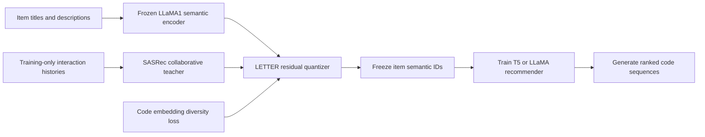

# LETTER: paper study and reproduction assessment

_Prepared 2026-10-27 against arXiv 2405.07314v3. Source and dataset inspection only; no model has been trained or evaluated for this study._

---

## 📋 Assessment

**Use the authors' implementation**, not a new implementation of the equations.
The paper links `HonghuiBao2000/LETTER`; the audited revision is
`8d0154e28de37dbb6e24871c508ad8ddb1921cda`. It contains the tokenizer,
both generative backends, and processed data for all three datasets.[^1][^2]
The primary scientific question is whether changing the *assignment of items
to semantic IDs*, rather than merely training the embeddings of fixed IDs,
improves sequential recommendation.

Reproduction is feasible, but it is **not a one-command replay**. The authors
published important LC-Rec settings in a later discussion, outside the README.
Their recommended CF implementation uses SASRec with BCE, not the stronger
default CE setting discussed for RecBole. Released semantic IDs also collide,
so the released evaluator's exact-code matches are not always exact-item
matches.[^3][^4][^5] These distinctions determine the experiment design.

The [execution plan](superpowers/plans/2026-10-27-letter-reproduction.md)
separates released-artifact replay, controlled retraining, and corrected
diagnostics. The [machine-readable manifest](../configs/letter-reproduction-v1.json)
preserves source hashes, all four published numeric tables, recovered recipes,
and audited dataset counts. **Published scores in that file are reference
targets, not measurements produced here.**

## 🧠 How LETTER works

A semantic ID is a short sequence such as
`<a_12><b_37><c_9><d_4>`. Its positions belong to different codebooks.
Rather than generate a product title or rank every item explicitly, the
recommender predicts these tokens autoregressively.[^1]

### Three tokenizer objectives

| Objective | Mechanism | Intended benefit |
| --- | --- | --- |
| Semantic regularization | Reconstruct LLaMA item embeddings through residual quantization | Coarse-to-fine semantic codes |
| Collaborative regularization | Contrast quantized vectors against pretrained SASRec item vectors | Behavior affects code assignment |
| Diversity regularization | Cluster code embeddings; contrast same-cluster and other codes | Reduce concentrated code usage |

The stated objective is
`L_LETTER = L_semantic + alpha * L_CF + beta * L_diversity`.
Four residual codebooks each contain 256 vectors of dimension 32. The first
code approximates the encoded semantic vector; subsequent codes approximate
what earlier codes failed to represent.[^1]

There are **two training stages**, not joint end-to-end training of changing
IDs and the recommender: train LETTER first, freeze its IDs, then train the
generative model. CF information can consequently affect the discrete
assignment before the recommender starts fitting.[^1]

### Ranking-guided generation

The downstream loss is token cross-entropy on `logits / temperature`.
A temperature below one concentrates negative-token gradients on harder
alternatives. This is not a separate item-level pairwise ranker, and the
argument in the appendix does not guarantee an improvement in every measured
top-K metric.[^1]

The release implements CF and diversity objectives with cross-entropy,
including a logarithm, whereas printed Equations 3 and 4 show probability
ratios without a logarithm. It also averages quantizer losses over levels.
For the primary reproduction, preserve the **released executable losses**;
do not silently replace them with a literal implementation of the printed
formulas.[^6]

### The two backends are different experiments

| Backend | Actual released implementation | Important distinction |
| --- | --- | --- |
| LETTER-TIGER | Randomly initialized T5; 4 layers, `d_model=128`, `d_ff=1024`, 6 heads, `d_kv=64` | Not pretrained T5-small, and not a 7B model |
| LETTER-LC-Rec | LLaMA1-7B, 8-bit base loading, LoRA, saved embedding/head modules | Pretrained language model with instruction-format training |

Both retain their language tokenizer vocabulary and add item tokens.
Replacing that vocabulary with a new 1,024-token-only vocabulary would be
another implementation, not this release. The paper explicitly says its
TIGER implementation is a reimplementation because the original TIGER code
was unavailable at the time.[^1][^7]

## 📊 Protocol and reference results

The paper uses Instruments, Beauty and Yelp; filters sparse users/items at
five interactions; holds out each user's final two interactions for validation
and test; and limits **generative histories** to 20 items.[^1]

The following are counts from a complete local inspection of the **released
JSON files**, not a guessed reconstruction from a similarly named Amazon
download. All item/index key sets are contiguous and zero-based; every
interaction resolves to both metadata and an ID. Minimum user sequence length
and minimum item interaction count are five in each release.

| Released dataset | Users | Items | Interactions | Training prefix examples |
| --- | ---: | ---: | ---: | ---: |
| Instruments | 24,772 | 9,922 | 206,153 | 131,837 |
| Beauty | 22,363 | 12,101 | 198,502 | 131,413 |
| Yelp | 30,431 | 20,033 | 316,354 | 225,061 |

For a sequence of length `n`, the training dataset makes `n - 3`
next-item prefix examples from the first `n - 2` interactions. Validation
predicts the penultimate item; test predicts the last item **with the
validation interaction included in its history**. There is one validation
target and one test target per user.[^8]

The release supplies integer sequences without the raw timestamps or original
ASIN/business-ID mapping needed to independently reconstruct every earlier
preprocessing decision. The author says Instruments was obtained from the
LC-Rec release. Do not replace these files with a fresh Amazon or Yelp
snapshot and still call the result the same benchmark.[^9]

### Main comparison: paper Table 1

Values below are **reported by the paper**, in fractions, not percentages.[^1]

| Dataset / model | Recall@5 | Recall@10 | NDCG@5 | NDCG@10 |
| --- | ---: | ---: | ---: | ---: |
| Instruments / TIGER | 0.0870 | 0.1058 | 0.0737 | 0.0797 |
| Instruments / LETTER-TIGER | 0.0909 | 0.1122 | 0.0763 | 0.0831 |
| Instruments / LC-Rec | 0.0824 | 0.1006 | 0.0712 | 0.0772 |
| Instruments / LETTER-LC-Rec | 0.0913 | 0.1115 | 0.0789 | 0.0854 |
| Beauty / TIGER | 0.0395 | 0.0610 | 0.0262 | 0.0331 |
| Beauty / LETTER-TIGER | 0.0431 | 0.0672 | 0.0286 | 0.0364 |
| Beauty / LC-Rec | 0.0443 | 0.0642 | 0.0311 | 0.0374 |
| Beauty / LETTER-LC-Rec | 0.0505 | 0.0703 | 0.0355 | 0.0418 |
| Yelp / TIGER | 0.0253 | 0.0407 | 0.0164 | 0.0213 |
| Yelp / LETTER-TIGER | 0.0277 | 0.0426 | 0.0184 | 0.0231 |
| Yelp / LC-Rec | 0.0230 | 0.0359 | 0.0158 | 0.0199 |
| Yelp / LETTER-LC-Rec | 0.0255 | 0.0393 | 0.0168 | 0.0211 |

Reported Recall@10 gains over the corresponding backbone are 6.05%, 10.16%
and 4.67% for TIGER, and 10.83%, 9.50% and 9.47% for LC-Rec. These are
relative differences calculated from the rounded table entries, not evidence
of production uplift or statistical significance.

The full table also compares MF, Caser, HGN, BERT4Rec, LightGCN, SASRec,
BIGRec and three P5 variants. Their complete experiment configurations are
not bundled. The v3 HTML additionally prints Instruments LightGCN
Recall@10 as `0.0100`, below Recall@5 `0.0794`; that inconsistent value is
preserved and flagged in the manifest rather than silently repaired.[^1][^10]

### Component attribution: paper Table 2

| Tokenizer / generation loss | Instruments R@10 | Instruments N@10 | Beauty R@10 | Beauty N@10 |
| --- | ---: | ---: | ---: | ---: |
| Semantic only / ordinary CE | 0.1058 | 0.0797 | 0.0610 | 0.0331 |
| Semantic + CF / ordinary CE | 0.1078 | 0.0810 | 0.0660 | 0.0351 |
| Semantic + diversity / ordinary CE | 0.1075 | 0.0809 | 0.0618 | 0.0335 |
| All regularizers / ordinary CE | 0.1092 | 0.0819 | 0.0672 | 0.0357 |
| All regularizers / ranking-guided CE | 0.1122 | 0.0831 | 0.0672 | 0.0364 |

The last two rows must reuse the **same learned tokenizer**; otherwise the
temperature comparison is confounded. Tables 3 and 4 respectively test
replacing a CF model's item embeddings with quantized embeddings and code
similarity between CF-neighbor items. Their targets are also preserved in
the manifest.[^1]

## ⚙️ Recovered training recipes

### Tokenizer and TIGER

The paper specifies AdamW, learning rate `1e-3`, batch size 1,024 and
**20,000 tokenizer epochs**, not 20,000 optimizer steps. At the released
catalog sizes, that is approximately 200,000 / 240,000 / 400,000 batch updates
for Instruments / Beauty / Yelp, before initialization and evaluation.
Every epoch also performs CPU constrained clustering for the codebooks.[^1][^6]

The author confirmed an Instruments starting point of `alpha=0.02`,
`beta=0.0001`, `K=10`, tokenizer LR `1e-3`, TIGER LR `5e-4` and
`temperature=0.7`. Temperature is sensitive; the author suggests `[0.7, 1.0]`
for a bounded search. This is not a complete per-dataset tokenizer recipe.[^11]

The released TIGER launcher uses two workers, batch 256 per worker and
accumulation two: effective batch 1,024. The trainer runs at most 200 epochs,
uses validation loss for best-checkpoint selection, and has early-stopping
patience 20. Its launcher sets temperature to **1.0**, so blindly running it
does not reproduce the confirmed ranking-guided Instruments recipe.[^7]

### LC-Rec settings outside the README

The author-linked document provides the following settings.[^3]

| Dataset | Tasks mixed during training | Epochs | Learning rate | Temperature |
| --- | --- | ---: | ---: | ---: |
| Instruments | `seqrec` | 4 | 0.0002 | 0.8 |
| Beauty | `seqrec,item2index,index2item` | 4 | 0.0002 | 1.0 |
| Yelp | `seqrec` | 6 | 0.0003 | 1.0 |

| Dataset | Batch per device | Accumulation | LoRA rank | LoRA alpha |
| --- | ---: | ---: | ---: | ---: |
| Instruments | 8 | 2 | 8 | 16 |
| Beauty | 4 | 2 | 8 | 16 |
| Yelp | 32 | 2 | 16 | 32 |

Shared settings include seed 42, response-only supervision, maximum length
2,048, BF16, ZeRO-2, cosine scheduling, warmup ratio 0.01, weight decay
0.01, LoRA dropout 0.05, all seven listed attention/MLP projection targets,
and `embed_tokens,lm_head` in `modules_to_save`. Validation constructs two
sampled prompts per user; the released test command uses prompt zero.[^3][^7]

The exported dictionaries do not contain world size. Four workers, consistent
with the paper hardware and launcher, give effective batches 64, 32 and 256;
this is an **explicit reconstruction convention**, not an independently
recovered run receipt. Preserve those batches when changing worker counts.

Use **LLaMA1-7B**, not LLaMA2, LLaMA3 or a modern embedding model. The author
explicitly identifies LLaMA1 for matching the semantic features. A checkpoint
path alone is insufficient provenance: the next phase must record authorized
weight and tokenizer identities.[^12]

## 🔍 What the source and data audit found

### Semantic-ID collisions change the meaning of a hit

| Dataset | Unique released IDs | Excess items over unique IDs | Items in collision groups | Largest group |
| --- | ---: | ---: | ---: | ---: |
| Instruments | 9,897 | 25 | 48 | 3 |
| Beauty | 12,088 | 13 | 24 | 3 |
| Yelp | 19,201 | 832 | 1,247 | 65 |

These are full-file counts. Yelp's excess is 4.15% of its catalog; 1,306 test
targets belong to a colliding group. The evaluator compares **code strings**,
not original item IDs, and `get_all_items()` collapses duplicate strings.
A code hit therefore cannot distinguish all original items in those groups.[^8]

The author acknowledges collisions and attributes them to duplicated item
information.[^5] The inspected Instruments and Yelp collision groups indeed
have identical cleaned title/description pairs within each group. However,
**four Beauty collision groups contain different cleaned title/description
pairs**. Even equal metadata is not proof that two original catalog IDs are
interchangeable. Preserve the paper-style metric and publish a separately
labeled item-identity diagnostic; do not silently append a fifth token.

### Data and evaluation boundaries

| Finding | Consequence for reproduction |
| --- | --- |
| Yelp has 2,027 test targets previously seen by that user | Do not import SilverTorch's seen-item exclusion into the primary protocol |
| Some targets are globally unseen in fitting interactions | Keep the released catalog; report warm/cold coverage instead of dropping these targets |
| Semantic preprocessing averages title and description embeddings separately | Do not replace it with concatenated-text or last-token pooling |
| `clean_text` empties fields at 2,000 characters | Preserve and measure this transform; 85 Beauty fields become empty |
| LC-Rec constraints allow tokens by position, not full prefix | Native decoding can emit nonexistent combinations despite the paper's trie description |
| LC-Rec distributed testing uses `drop_last=True` | Four workers omit three users each on Beauty and Yelp |
| LC-Rec OOM handling reduces beam width | Disallow this for controlled measurements; record OOM instead |

The first four entries were inspected against all released data and the
preprocessor; the last three follow directly from the released evaluator.[^8][^13]
A full token-length audit still requires the actual LLaMA tokenizer and has
**not** been performed. Character counts are not a substitute.

### Missing assets and implementation traps

| Surface | Observed state | Planned treatment |
| --- | --- | --- |
| Semantic embeddings | No `.emb-llama-td.npy` files shipped | Regenerate with the exact encoder and preprocessing |
| Collaborative assets | Only an Instruments `9922 x 32` item tensor | Use it for a tagged artifact replay; retrain complete teachers for controlled runs |
| SASRec provenance | Author names `pmixer/SASRec.pytorch`, confirms BCE | Pin the historical implementation; never silently substitute RecBole CE |
| CF item numbering | SASRec padding row zero was already removed from the shipped tensor | Do not remove another row; export rebuilt rows `1..N` to LETTER IDs `0..N-1` |
| Complete teachers / trained recommenders | Not shipped | Table 3 and recommender evaluation require training, not just loading the release |
| Best tokenizer arguments | Not attached to each released ID bank | Treat banks as author-trained artifacts, not fully reproducible tokenizer receipts |
| Paths and devices | Hardcoded CUDA visibility; inconsistent relative embedding/checkpoint paths | Parameterize without changing the objective; honor only allocated devices |
| Environment | Only Torch is pinned; extra imports and legacy APIs are present | Isolate and lock a compatible runtime before GPU scale |
| Public reuse | No explicit LICENSE found at the audited LETTER revision | Keep downloaded source/data private and ignored; do not vendor them |

The author confirms the checked-in ID banks were produced by their earlier
training. That supports their use for artifact replay, but does not recover
the missing encoder revision, tokenizer seed/config or training provenance.[^14]
The CF tensor was inspected through archive metadata, without executing its
pickle payload. Its shape, byte count and hash agree with 9,922 rows of
32-dimensional float storage.

For missing CF artifacts, use the **author-named** SASRec implementation,
pinned here to `29b9922adfc0dd1710a5f8fad8dddace2639fc76`, the last revision
before LETTER's first submission. The exact revision used by the authors is
unknown. Its supplied evaluator samples 100 negatives and at most 10,000
users, so that evaluator cannot stand in for full-catalog primary metrics.
Its training loop also evaluates test data periodically; remove that
test-feedback path from controlled fitting.[^4][^15]

### Figure 8 cannot be reproduced by changing flags alone

The inspected figure sweeps lengths `{2,4,6,8}`, codebook sizes
`{64,128,256,512}`, alpha `{0.001,0.01,0.02,0.1}`, beta
`{0.00001,0.0001,0.001,0.01}`, cluster counts `{5,10,15,20}` and
temperatures `{0.6,0.7,0.8,0.9,1.0,1.1,1.2}`.[^1]

The release initializes **256** centers regardless of the requested codebook
size, leaves several diversity-clustering calls fixed at **10**, pairs
codebooks with a four-entry epsilon list using `zip`, and provides only six
output token prefixes. An eight-level or nondefault-cluster sweep needs
explicit parameter plumbing and feasibility tests. Running the existing CLI
with different flags is not evidence that the requested architecture ran.[^6]

## 🎯 Reproduction boundaries and next phase

The recommended sequence is: **released-ID Instruments pilot**, controlled
tokenizer/recommender retraining, all three datasets and both backends,
component ablations, then the mechanistic analyses and parameter sweeps.
Missing conventional/P5/BIGRec baseline reruns remain a separately budgeted
coverage layer; reproducing the four main rows must not be called reproducing
every row of Table 1.

Existing SilverTorch operations provide useful patterns: a separate GPU
environment, unique work directories, SSH completion markers, checksummed
transfers, full input audits, and early durable checkpoint export. Its model
stack, datasets, seen-item filters and ANN metrics are **not** the LETTER
protocol. In particular, the existing semantic environment's Torch 2.13 /
Transformers 5.10 stack is not a drop-in environment for this legacy release.
See the [existing environment](../environments/semantic/pyproject.toml) and
[storage/execution gates](semantic-study-design.md#-evaluation-and-execution-gates).

No Azure job was connected to, submitted, altered or cancelled during this
preparation. The handoff needs the allowed AML job/compute and devices, durable
storage, authorized LLaMA1-7B snapshot, and runtime budget. A single A100 80GB
is the preferred starting allocation; four NVIDIA GPUs make the LC-Rec
launcher shape easier to preserve. Runtime must be measured in the pilot,
especially the tokenizer's CPU clustering, rather than estimated from GPU
count alone.

## 🔗 Sources

Academic database queried: the arXiv API, exact ID `2405.07314v3`, returned one
entry. Its parsed metadata is retained in the manifest: first submitted
2024-05-12, v3 updated 2025-10-17, accepted at CIKM 2024. Repository revisions,
the paper HTML, numeric tables and the public author recipe export were
inspected on 2026-10-27.

[^1]: Wang et al. "Learnable Item Tokenization for Generative Recommendation," CIKM 2024, arXiv v3, Sections 3-4 and Appendix 7. https://arxiv.org/html/2405.07314v3
[^2]: Official LETTER release, pinned revision. https://github.com/HonghuiBao2000/LETTER/tree/8d0154e28de37dbb6e24871c508ad8ddb1921cda
[^3]: Author's LC-Rec recipe clarification in [HonghuiBao2000/LETTER#19](https://github.com/HonghuiBao2000/LETTER/issues/19), linking the three-dataset parameter document. https://docs.google.com/document/d/1rVeu3JqGXZNjapiMi1ioXIlXdXSt8zl94FmaAFYwX4g/edit
[^4]: Author's SASRec source and BCE-versus-CE clarifications: [HonghuiBao2000/LETTER#5](https://github.com/HonghuiBao2000/LETTER/issues/5), [HonghuiBao2000/LETTER#20](https://github.com/HonghuiBao2000/LETTER/issues/20), and [HonghuiBao2000/LETTER#22](https://github.com/HonghuiBao2000/LETTER/issues/22).
[^5]: Author's collision explanation, [HonghuiBao2000/LETTER#21](https://github.com/HonghuiBao2000/LETTER/issues/21). https://github.com/HonghuiBao2000/LETTER/issues/21
[^6]: Pinned tokenizer implementation: https://github.com/HonghuiBao2000/LETTER/tree/8d0154e28de37dbb6e24871c508ad8ddb1921cda/RQ-VAE
[^7]: Pinned backbone training, configurations and launchers: https://github.com/HonghuiBao2000/LETTER/tree/8d0154e28de37dbb6e24871c508ad8ddb1921cda/LETTER-TIGER and https://github.com/HonghuiBao2000/LETTER/tree/8d0154e28de37dbb6e24871c508ad8ddb1921cda/LETTER-LC-Rec
[^8]: Pinned sequence construction and code-string metrics: https://github.com/HonghuiBao2000/LETTER/blob/8d0154e28de37dbb6e24871c508ad8ddb1921cda/LETTER-TIGER/data.py and https://github.com/HonghuiBao2000/LETTER/blob/8d0154e28de37dbb6e24871c508ad8ddb1921cda/LETTER-TIGER/evaluate.py
[^9]: Author's Instruments source clarification, [HonghuiBao2000/LETTER#16](https://github.com/HonghuiBao2000/LETTER/issues/16). https://github.com/HonghuiBao2000/LETTER/issues/16
[^10]: Author's baseline-setting clarification, [HonghuiBao2000/LETTER#33](https://github.com/HonghuiBao2000/LETTER/issues/33). https://github.com/HonghuiBao2000/LETTER/issues/33
[^11]: Author-confirmed Instruments tokenizer/TIGER starting settings, [HonghuiBao2000/LETTER#26](https://github.com/HonghuiBao2000/LETTER/issues/26). https://github.com/HonghuiBao2000/LETTER/issues/26
[^12]: Author's LLaMA1-7B recommendation, [HonghuiBao2000/LETTER#7](https://github.com/HonghuiBao2000/LETTER/issues/7). https://github.com/HonghuiBao2000/LETTER/issues/7
[^13]: Pinned semantic preprocessing and LC-Rec evaluation: https://github.com/HonghuiBao2000/LETTER/tree/8d0154e28de37dbb6e24871c508ad8ddb1921cda/data_process and https://github.com/HonghuiBao2000/LETTER/blob/8d0154e28de37dbb6e24871c508ad8ddb1921cda/LETTER-LC-Rec/test_ddp.py
[^14]: Author's released-ID provenance and padding-row clarifications: [HonghuiBao2000/LETTER#35](https://github.com/HonghuiBao2000/LETTER/issues/35) and [HonghuiBao2000/LETTER#24](https://github.com/HonghuiBao2000/LETTER/issues/24).
[^15]: Historical author-named SASRec implementation, Apache-2.0. https://github.com/pmixer/SASRec.pytorch/tree/29b9922adfc0dd1710a5f8fad8dddace2639fc76
