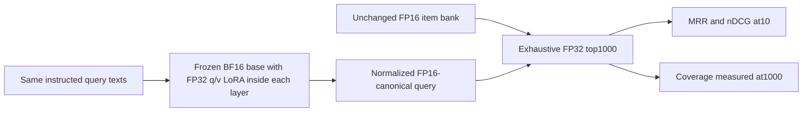

# Query-only adaptation: better head ranking, weaker deep recall

_One fixed Qwen0.6 LoRA epoch against an unchanged 8,841,823-passage item bank._

---

Query-only adaptation improved selected-dev MRR@10, but it did not produce
an across-the-board retrieval gain. The fixed adapter also reduced
Recall@1000 on internal validation and TREC20, and increased measured
encoding and raw-query/exact-search cost. This is a **mixed exploratory
result**, not a replacement for the larger-model study, a personalization
rescue or a general finetuning success claim.[^1]

## 🔬 Fixed intervention and completed evidence

| Contract | Actual pilot |
| --- | --- |
| Base | Pinned Qwen3-Embedding-0.6B; native1024D, BF16/SDPA |
| Item side | Same8,841,823 normalized canonical FP16 vectors; no item training or re-encoding |
| Adapter | Every layer's query/value attention projections:56 targets, rank16/alpha32, 2,293,760 FP32 parameters |
| Optimization | Seed17, constant AdamW2e-5, one epoch over the first50,000 frozen fitting queries |
| Accumulation | Microbatch8/effective64;781 full64-query updates plus one16-query update:782 total |
| Positives/alternatives | All52,998 fitting positives,600,000 retrieved weak negatives and3,200,000 uniform alternatives |
| Selection | Final completed epoch only; no validation-best checkpoint, recipe sweep, negative refresh or intermediate winner |
| Quality | Fresh raw base versus final attached adapter; fixed batch16 groups; whole-bank exhaustive FP32 top1000, TF32 off; no reranker |
| Populations | Existing train-sourced5,000-query internal validation; separate inspected dev1000/TREC19 43/TREC20 54 |
| Runtime | Three fresh paired process contexts;10 warmups/50 measured groups per arm/path |
| Engineering | Full source/token audit; real100-query/five-step gradient, frozen-state and checkpoint-resume smoke before scale |

The [fixed protocol](../configs/semantic-extension-query-adaptation-v1.json)
was specified before fitting. Internal validation had previously been
inspected and remained diagnostic only. Neither it nor the final panels
selected a checkpoint or authorized a rescue. Smoke state was discarded:
the one-epoch run restarted the original base and seed17.[^1][^2]

All56,097 actual instructed strings were audited. There was zero overflow
above the unchanged512-token cap; maximum instructed lengths were83 for
fitting,63 for validation and40 for final evaluation. The original
Instruct/Query rendering, tokenizer special tokens, left padding,
multiple-of-eight padding, last-valid-token pooling and FP32 normalization
were preserved. Generation/finish-reason/thinking metadata is **N/A** for
these static contrastive embedding inputs.[^1][^2]

The fitting loss retains the complete positive set rather than one
convenient target:

\[
\mathcal L_q=
\log\sum_{i\in P_q\cup H_q\cup U_q}e^{s(q,i)/0.05}
-\log\sum_{p\in P_q}e^{s(q,p)/0.05}.
\]

Retrieved alternatives came from the fixed base-query/scalar-half
FAISS/p64/top1000 preparation's first100. Up to12 distinct alternatives
exclude all known fitting positives;64 distinct uniform alternatives
exclude both prior sets. They are **weak negatives**, not exhaustive
relevance truth, and are never refreshed from held-out labels.[^2]

## 🎯 Head ranking improves in some populations

Intervals resample the original paired query identities20,000 times with
seed20261011. They are pointwise95%, population-specific and unadjusted
across the20 reported metrics. Reused inspected panels and a single seed
make the experiment post-test exploratory, not untouched-test confirmation.[^1]

| Population | Queries | Base MRR@10 | Adapter MRR@10 | Difference | Pointwise95% interval |
| --- | --- | --- | --- | --- | --- |
| Internal validation | 5000 | 0.290137 | 0.296913 | +0.0067764 | [+0.0023312,+0.0112120] |
| Selected dev | 1000 | 0.327349 | 0.342294 | +0.0149456 | [+0.0052766,+0.0249949] |
| TREC19 | 43 | 0.806202 | 0.857973 | +0.0517719 | [+0.0124585,+0.1010520] |
| TREC20 | 54 | 0.804189 | 0.783025 | −0.0211640 | [−0.0746914,+0.0272928] |

The validation and selected-dev nDCG@10 intervals are also positive.
TREC19's nDCG difference is+0.0235669 with interval
[−0.0041377,+0.0511273]; TREC20 is−0.0179907 with interval
[−0.0442548,+0.0037831]. Positive MRR evidence must not be generalized
into uniform graded-relevance improvement across panels.[^1]

## 🚧 Recall@1000 regresses rather than sharing the head gain

| Population | Base Recall@1000 | Adapter Recall@1000 | Difference | Pointwise95% interval |
| --- | --- | --- | --- | --- |
| Internal validation | 0.975467 | 0.971217 | −0.0042500 | [−0.0073000,−0.0013000] |
| Selected dev | 0.975833 | 0.973750 | −0.0020833 | [−0.0085000,+0.0041667] |
| TREC19 | 0.858949 | 0.843171 | −0.0157776 | [−0.0398200,+0.0037350] |
| TREC20 | 0.850690 | 0.836222 | −0.0144688 | [−0.0248501,−0.0061495] |

Every **Recall@1000** point estimate is negative. Internal validation and
TREC20 intervals exclude zero; selected dev and TREC19 are inconclusive.
All Recall@10/100 results, including null and negative findings, are
retained in the full aggregate package rather than selecting only
MRR@10. All Recall@10 and Recall@100 intervals include zero; TREC20's
Recall@100 point difference is positive, not a recall regression at
every cutoff.[^1]

The operationally relevant interpretation is **head-rank/deep-coverage
trade-off for this asymmetric recipe**. Keeping the item geometry fixed
does not guarantee that changing the query side preserves deep recall.
The sampled objective, weak alternatives, single epoch and unmerged
implementation are parts of the intervention; this run does not isolate
their individual causal contributions or show that all finetuning harms
recall.

## ⏱️ Unmerged adapter cost remains visible

Each mean below averages three context-level batch means. Ratios average
the three paired adapter/base mean ratios. These are finite offline batch
observations, not individual-request p99 or offered-load serving QPS.[^3]

| Path | Base mean ms | Adapter mean ms | Paired time ratio | Extra wall time |
| --- | --- | --- | --- | --- |
| Encode batch1 | 40.6639 | 48.2499 | 1.18654 | 18.65% |
| Encode batch16 | 42.7384 | 50.1352 | 1.17308 | 17.31% |
| Raw query plus exact search, batch16 | 86.6488 | 94.2681 | 1.08795 | 8.80% |

The base path uses a fresh original model without adapter modules, not a
zero-adapter path that pays extra matrix operations. The adapter remains
attached and unmerged: its native FP32 low-rank projections add
implementation-specific work. No merging, compilation, fused adapter
serving or base quantization was tried. The numbers are not intrinsic
parameter-count scaling or a best-optimized serving comparison.[^1][^3]

The whole-catalog FP32 item tensor is loaded once outside timed requests;
the benchmark does not upload/recast the item bank for every query.
Both models and the bank are resident. Batch1 encoding is a separate
cost diagnostic, not a batch1 quality/latency point. All900 raw durations
are preserved:3 contexts ×3 paths ×2 arms ×50 samples.[^3]

Memory is finite sampled benchmark-device evidence; the additional idle
administrative GPU context is accounted separately. The fixed48-GiB
observed-use and8-GiB headroom gates are admission criteria, not protection
against all unseen peaks. Worker drains and passive original native
keeper restoration were verified after the completed sequence.[^1][^2]

## 🧭 What this changes in the learning

This pilot shows that query-only training can shift the ranking of an
existing item bank without re-encoding8.84M items. It does **not** establish
a universal better retriever: top-rank gains, deep-recall losses and
adapter runtime overhead must be considered together.

Its absolute MRR and wall times must not be compared directly with the
earlier Qwen8 or Qwen0.6 tables as a model leaderboard. The selected query
population, raw execution geometry and exact-search/no-reranker path
differ from earlier ANN/reranking operating points. The matched fresh
base in this pilot is the valid comparison.[^1][^4]

This is IR rather than personalized recommendation. The separate
personalization gate remains failed, and the FP32/MLP primary
non-inferiority comparisons remain not assessed. No earlier negative
result, missing reference or production-reproduction limitation is
rescued by this adapter.[^4]

The useful next hypothesis is not “add more finetuning”: it is whether a
prospectively controlled objective or jointly learned item/query geometry
can retain deep candidate coverage while improving head rank, with
optimized adapter serving measured separately. That is future work,
not a sweep or extra experiment performed in this window.

[^1]: [Sealed pilot summary and all20 metric contrasts](../results/2026-10-12-query-adaptation/summary.json) and [complete aggregate quality table](../results/2026-10-12-query-adaptation/quality.csv).
[^2]: [Fixed one-recipe protocol](../configs/semantic-extension-query-adaptation-v1.json), [native adapter core](../src/rrbench/semantic_query_adaptation.py) and [source-bound audit/training/evaluation runner](../src/rrbench/semantic_query_adaptation_run.py).
[^3]: [Three-context timing records](../results/2026-10-12-query-adaptation/timing.csv), [all900 raw durations](../results/2026-10-12-query-adaptation/timing-samples.csv) and [source/file seals](../results/2026-10-12-query-adaptation/checksums.json).
[^4]: [Original real-semantic findings](real-semantic-results.md), [completed full pipeline findings](actual-pipeline-results.md) and [controlled personalization result](controlled-personalization-results.md).
