# Real-catalog GPU retrieval profiles

_Completed ANN characterization in the bounded semantic extension._

---

**Status:** the ANN-only matrix and actual CUDA profiles are complete. The
separately gated raw-encoder, actual-candidate pipeline comparison is still
in progress; its [reviewed nine-attempt partial frame](actual-pipeline-initial-results.md)
is available. No whole-pipeline qualification follows from this ANN report.

## 📐 What was measured

The catalog contains **8,841,823 real MS MARCO passages** represented by
Qwen3-Embedding-8B's normalized 1024D MRL prefix. This still requires the full
8B encoder when encoding text; the measurements here start from the stored
query vectors and exclude encoder cost.[^1]

| Contract | Completed evidence |
| --- | --- |
| Quality population | Fixed 5,000-query validation panel, not the separate 1,000-query pipeline primary population |
| Shared partition | 16,384 IVF clusters; probes64 and probes256 |
| Retrieval depth | 1,000 actual external item IDs |
| Backends | FAISS/Silver FP32, actual scalar-half FAISS, Silver half, Silver rowwise INT8 |
| Independent process starts | Three paired restart contexts for each backend: 15 fresh arms |
| Unprofiled timing | Batches1/16, 10 warmups and 50 varying paired measurements per condition: 60 conditions and 3,000 durations |
| Instrumented profiling | Five separate processes, four conditions each, two profiled batches per condition: 20 actual CUDA traces |
| Resource regime | Original checked STOP/CONT lease, separate from the later cooperative pipeline regime |

Full-panel ANN predictions are computed in batch16. Each timed varying
batch1/batch16 sample must reproduce its corresponding canonical-panel
candidate IDs exactly and scores within the specified tolerance. Source,
partition, query and schedule hashes are paired within each restart. All
completed payload hashes were verified before aggregation.[^2]
This is within-backend timing/quality parity, not a claim that different
engines produce identical candidate IDs or scores.

The selected validation queries and inspected study make this an
**exploratory offline result**, not deployment validation. Restarting the
process does not turn the same 5,000 judged queries into 15,000 independent
quality observations. The judged-positive metrics treat unjudged passages
as zero gain, not exhaustively known negatives.

## ⚡ Batch and precision change the ordering

Values below are arithmetic means of the three restart-level batch latency
means, in milliseconds. They are not per-query latency at batch16, serving
QPS, tail SLOs or latency confidence intervals.[^2]

| Probes | Batch | FAISS FP32 | Silver FP32 | FAISS scalar-half | Silver half | Silver rowwise INT8 |
| --- | --- | --- | --- | --- | --- | --- |
| 64 | 1 | 1.921 | 1.681 | 1.858 | 1.607 | 2.092 |
| 64 | 16 | 3.612 | 4.167 | 3.327 | 2.725 | 2.526 |
| 256 | 1 | 3.473 | 2.071 | 3.347 | 1.688 | 2.085 |
| 256 | 16 | 10.145 | 12.073 | 9.035 | 6.641 | 4.621 |

The FP32 crossover repeats **in every restart at both probe counts**:
Silver FP32 wins at batch1 and loses at batch16. However, that does not imply
FAISS wins batched ANN in general. Silver half and rowwise INT8 are faster
than this FAISS scalar-half implementation at batch16. Conversely, INT8 is
the slowest tested p64/batch1 representation despite its smaller stored
codes. Precision, batch, probe count and the concrete implementations all
matter.

At p256/batch16, rowwise INT8's 4.621-ms batch mean versus FAISS half's
9.035 ms is an ANN-only observation. It must not be promoted to a similar
end-to-end speedup when a large query encoder or text scorer is included.

## 🧪 The profiles narrow the mechanism

The Silver adapter is numerically checked against the untouched search
before a trace is exported. Traces contain real CUDA kernel events, not a
CPU-only profiler fallback. FAISS's public search boundary is measured as a
native search; its internal CUDA kernels remain visible.[^2]

```mermaid
flowchart LR
    accTitle: Observed Silver Retrieval Boundaries
    accDescr: The instrumented Silver path separates centroid selection, dynamic capacity synchronization, selected-item scoring, INT8 rescaling and final top-k remapping. Neural reranking is not inside the selected-item scoring kernel.
    centroid_selection["Centroid selection"] --> capacity_sync["Dynamic capacity host sync"]
    capacity_sync --> selected_scoring["Selected-item scoring kernel"]
    selected_scoring --> int8_rescaling["INT8 rescaling when applicable"]
    int8_rescaling --> topk_remap["Top-k and external-ID remap"]
    topk_remap --> separate_ranker["Separate neural scorer in pipeline experiments"]
```

At p256/batch16, the following figures cover **two instrumented batches**.
Kernel-event counts are not unique kernel names, and summed kernel durations
are not uninstrumented request latencies or additive wall-time fractions.[^3]

| Backend | CUDA kernel events | Sum of kernel durations, ms | Main selected-list scoring kernel, ms |
| --- | --- | --- | --- |
| FAISS FP32 | 7 | 18.866 | 14.525 native IVF scan; additional native scan stage: 3.928 |
| Silver FP32 | 117 | 22.331 | 20.648 |
| FAISS scalar-half | 7 | 16.785 | 12.437 native IVF scan; additional native scan stage: 3.932 |
| Silver half | 121 | 11.542 | 10.068 |
| Silver rowwise INT8 | 159 | 6.889 | 5.204 |

The selected-list scoring cost changes substantially with precision. Thus
explaining Silver FP32's batch deficit **solely** through Python, `.item()`
or kernel count is not supported. INT8 has more observed kernel events but
much less summed kernel duration. The traces also expose separate centroid
selection, capacity synchronization, query quantization, scale restoration,
top-k and ID-remapping work.

This evidence does not isolate memory bandwidth, arithmetic throughput,
occupancy or scheduling as the causal explanation. It neither establishes
MFU nor shows fusion of the complete encoder/ANN/neural-ranker pipeline.
The public `fused_kmean_ann` primitive scores selected items; its name does
not make all surrounding stages one fused operation.

## 🎯 Quality and memory boundaries

These p256 point estimates are descriptive on the same 5,000 cached-query
validation population.[^2]

| Backend | Geometric Recall@1000 versus exhaustive FP32 | Judged MRR@10 |
| --- | --- | --- |
| FAISS FP32 | 0.923083 | 0.328898 |
| Silver FP32 | 0.923083 | 0.328888 |
| FAISS scalar-half | 0.923083 | 0.328898 |
| Silver half | 0.922735 | 0.328926 |
| Silver rowwise INT8 | 0.922493 | 0.328846 |

The small geometry/MRR differences are not proof of universal quality
equivalence. In particular, they do not discharge the pipeline's predeclared
0.002-MRR non-inferiority margin on its different 1,000-query primary frame.
That requires the corresponding actual-query, actual-candidate paired
confidence bounds.

All ANN-only conditions satisfied their observed 8-GiB headroom gate.
At p256/batch16, conservative minimum headroom across the three restarts was
34.03 GiB for FAISS FP32, 45.47 for Silver FP32, 59.52 for FAISS scalar-half,
62.34 for Silver half and 70.71 for rowwise INT8.[^2] These sampled
device/allocator observations include implementation allocations, not just
theoretical vector storage. They exclude co-resident encoder/scorer weights
and are not continuous peak or unseen-workload guarantees.

## 📦 Reproducible evidence and next boundary

The [source-bound summary](../results/2026-10-11-semantic-extension/ann-summary.json)
binds the complete tables and original completion receipts. The
[60 condition records](../results/2026-10-11-semantic-extension/ann-characterization.csv)
and [restart comparisons](../results/2026-10-11-semantic-extension/ann-restarted-comparisons.csv)
retain denominators and separate timing context. The
[profile table](../results/2026-10-11-semantic-extension/ann-profiles.csv),
[kernel events](../results/2026-10-11-semantic-extension/ann-profile-kernels.csv)
and [CPU/device operator observations](../results/2026-10-11-semantic-extension/ann-profile-operators.csv)
expose the measured mechanism without fabricating wall-time percentages.

The remaining comparison includes raw Qwen8 encoding, actual ANN candidates,
the same frozen MLP/BGE scorer and resident versus local-cascade boundaries.
It uses the prospective [geometry and resource contracts](semantic-extension-protocol.md),
not historical query substitution or subtraction of the standalone ANN
numbers above. The [initial actual-pipeline findings](actual-pipeline-initial-results.md)
record the complete nine-attempt priority frame while the remaining matrix
and separate pipeline profiles continue.

[^1]: [Pinned semantic models](../configs/semantic-models-pinned.json), [original full-corpus findings](real-semantic-results.md) and [extension protocol](semantic-extension-protocol.md).
[^2]: [ANN characterization](../results/2026-10-11-semantic-extension/ann-characterization.csv), [three-restart comparisons](../results/2026-10-11-semantic-extension/ann-restarted-comparisons.csv) and [checksummed summary](../results/2026-10-11-semantic-extension/ann-summary.json).
[^3]: [Actual CUDA trace summaries](../results/2026-10-11-semantic-extension/ann-profiles.csv), [kernel-duration aggregates](../results/2026-10-11-semantic-extension/ann-profile-kernels.csv) and [separate attributed CPU/device observations](../results/2026-10-11-semantic-extension/ann-profile-operators.csv).
