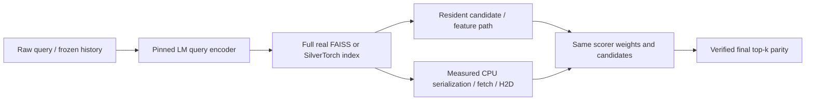

# Real-corpus GPU retrieval and ranking results

_Full real-catalog semantic study; source-pinned models, actual FAISS/SilverTorch/TorchRec, and GPT-6-Astra review._

---

## 📌 Main findings

The study evaluates **8,841,823 real MS MARCO passages** and **1,798,875 training-observed, caption-covered KuaiRand videos**. All catalog rows were encoded and checksum-validated; the study does not substitute interaction counts or a smaller catalog for million-item retrieval.

The original systems study reached 80M **synthetic** vectors, while its trained MovieLens experiment had only 3,521 warm items and used a 128D matrix-factorization retriever, not a semantic language model. This expansion replaces those scale/model limitations with full real catalogs rather than retroactively relabeling the original evidence.

Faster GPU retrieval and a stronger semantic model are separate interventions. The FP32 shared-partition ANN comparison isolates implementations; native-versus-MRL exact retrieval isolates representation dimensions. Same-scorer online comparisons keep query encoder, index, weights, precision and candidate IDs fixed within each boundary control. This is an offline/local study, not a reproduction of Meta's private QPS, TCO or engagement gains.[^1]

## 📏 Scale, model strength and protocols

| Track | Real item catalog | Primary final queries | Strong text subset |
| --- | --- | --- | --- |
| Semantic IR | 8,841,823 | 6,980 dev-small + 43/54 TREC | 1,000 dev-small + all 43/54 TREC |
| Recommendation | 1,798,875 | 2,707 conditional warm/history queries | 819 fixed users, one retained query each |

IR and personalized recommendation must not be conflated. The recommendation split uses whole recorded-clock-block boundary quarantine, frozen training exposure histories, and retrospective 2026 captions. Exact historical exposure/feedback availability is unestablished. Only **14.78% of all test-positive events** belong to the frozen semantic catalog; the reported conditional query means cannot be multiplied by that event coverage to manufacture unconditional recall.[^2]

The encoder arms are MiniLM-L6 (384D), BGE-large (1024D), Qwen3-Embedding-0.6B (1024D), and Qwen3-Embedding-8B (native 4096D plus independently normalized 1024D MRL). They are trained retrievers, not arbitrary chatbot hidden-state embeddings. The pinned Qwen cards report stronger English/Chinese retrieval aggregates for the larger embedding model, but those publisher scores are not this experiment's recommendation results.[^3]

| Role | Pinned model | Parameters | Stored D / pair cap |
| --- | --- | --- | --- |
| Retrieval | sentence-transformers/all-MiniLM-L6-v2 | 22,713,216 | 384 |
| Retrieval | BAAI/bge-large-en-v1.5 | 335,141,888 | 1024 |
| Retrieval | Qwen/Qwen3-Embedding-0.6B | 595,776,512 | 1024 |
| Retrieval | Qwen/Qwen3-Embedding-8B | 7,567,295,488 | 4096/1024 |
| Reranking | BAAI/bge-reranker-v2-m3 | 567,755,777 | 512 tokens / pair |
| Reranking | Qwen/Qwen3-Reranker-0.6B | 595,776,512 | 512 tokens / pair |
| Reranking | Qwen/Qwen3-Reranker-8B | 8,188,548,096 | 512 tokens / pair |

Qwen uses last-valid-token pooling and its official query instruction. For the MRL1024 arm, the first 1024 components of the native 4096D embedding are selected and renormalized before canonical FP16 storage. MiniLM uses masked-mean pooling, BGE uses CLS, and each arm has a pinned tokenizer/input cap. Encoder counts above are measured loaded parameters; reranker counts are pinned weight metadata. Larger semantic capacity adds online query cost as well as offline catalog cost, so quality gains must justify both.[^3][^7]

Offline item encoding cost is amortizable and must not be added to every online request. The following cost is the **sum of worker wall time** across complete shards, not parallel elapsed time or hardware MFU; it includes loading, CPU tokenization and I/O. Brief declared correctness smokes shared owned encoder GPUs.

| Catalog | Encoder | Items | Native D | Summed worker hours | Rows / worker s |
| --- | --- | --- | --- | --- | --- |
| kuairand | qwen06 | 1,798,875 | 1024 | 1.46 | 342.3 |
| kuairand | qwen8 | 1,798,875 | 4096 | 6.42 | 77.9 |
| msmarco | bge-large | 8,841,823 | 1024 | 2.34 | 1050.0 |
| msmarco | minilm | 8,841,823 | 384 | 0.90 | 2734.5 |
| msmarco | qwen06 | 8,841,823 | 1024 | 5.96 | 411.7 |
| msmarco | qwen8 | 8,841,823 | 4096 | 31.99 | 76.8 |

## 🔍 Exact semantic retrieval quality

Exhaustive FP32 inner products operate over the identical canonical FP16-stored vectors, with TF32 disabled. FP32 arithmetic does not recover precision already lost at storage. These rows have no IVF approximation confound.

| Encoder | Stored D | Dev MRR@10 | TREC19 NDCG@10 | TREC20 NDCG@10 | Dev Recall@1000 |
| --- | --- | --- | --- | --- | --- |
| minilm | 384 | 0.3055 | 0.6361 | 0.6568 | 0.9646 |
| bge-large | 1024 | 0.3616 | 0.7083 | 0.7025 | 0.9780 |
| qwen06 | 1024 | 0.3171 | 0.6651 | 0.6773 | 0.9801 |
| qwen8 | 1024 | 0.3657 | 0.7528 | 0.7440 | 0.9911 |
| qwen8 | 4096 | 0.3690 | 0.7633 | 0.7411 | 0.9931 |

TREC binary recall uses grade ≥2; NDCG retains raw relevance grades. Unjudged items contribute zero gain without becoming exhaustive negative truth. Pretrained models may have seen MS MARCO; this is not untouched zero-shot generalization.[^4]

Native 4096D is not supported by the pinned SilverTorch dispatch. It is compared with FAISS and exact retrieval over the full corpus, not silently relabeled as SilverTorch. Native FP32 storage exceeds one 80GB GPU; explicit unsupported outcomes remain in the raw matrix.

| Full-catalog lexical reference | TREC19 NDCG@10 | TREC20 NDCG@10 |
| --- | --- | --- |
| SQLite FTS5 BM25 / Unicode61 | 0.4501 | 0.4745 |

This lexical reference indexes every passage with SQLite's actual FTS5 scoring and audited token vocabulary. It is not Lucene/Anserini BM25 or a complete hybrid/lexical tuning study; tokenizer and query construction are part of the declared baseline.

The full native **IVF-SQhalf could not be constructed** on a clean A100 80GB, including a second probe with scratch reduced to 128MiB. Search in those GPU IVF cells is N/A, not zero quality or an implicit CPU fallback. The precise allocator/packing cause is not established. A separate classic, device-only contiguous FAISS FlatFP16 control held all 8,841,823 native vectors and executed one fixed sanity query, leaving 11.21 GiB free. That proves layout-specific storage/search feasibility, not IVF feasibility, FP32-oracle equivalence, quality/latency-grid performance, or native LM/reranker co-fit. Raw vector bytes alone are not a sufficient deployment budget.

## ⚙️ Actual shared-partition ANN performance

Representative Qwen8-MRL1024 operating point: 16,384 shared spherical IVF clusters, **256 probes, top-1,000**, one query. Complete search includes centroid probing, scoring, top-k and external-ID remapping. Geometry recall is overlap against exhaustive top-1,000, not relevance recall.

| Catalog | Backend | Mean query ms | Geometric Recall@1000 |
| --- | --- | --- | --- |
| msmarco | faiss-cpu-fp32 | 67.451 | 0.9175 |
| msmarco | faiss-gpu-fp32 | 2.693 | 0.9175 |
| msmarco | faiss-gpu-fp16 | 2.554 | 0.9175 |
| msmarco | silver-fp32 | 1.421 | 0.9175 |
| msmarco | silver-fp16 | 1.098 | 0.9172 |
| msmarco | silver-int8-global | 1.253 | 0.9157 |
| msmarco | silver-int8-rowwise | 1.332 | 0.9170 |
| kuairand | faiss-cpu-fp32 | 40.908 | 0.8027 |
| kuairand | faiss-gpu-fp32 | 2.176 | 0.8027 |
| kuairand | faiss-gpu-fp16 | 2.059 | 0.8027 |
| kuairand | silver-fp32 | 1.017 | 0.8027 |
| kuairand | silver-fp16 | 0.955 | 0.8020 |
| kuairand | silver-int8-global | 1.221 | 0.7950 |
| kuairand | silver-int8-rowwise | 1.283 | 0.8021 |

This finite-grid comparison does not prove a globally optimal operating point or offered-load serving QPS. INT8-global and rowwise methods are named adaptations with rescaling before top-k; compare their geometry and relevance before claiming lossless speed. The new FAISS FP16 arm uses actual half scalar codes. Earlier IVFFlat `useFloat16`-flag rows stored FP32 values and must not be cited as verified FP16 measurements; original archives are preserved.[^5]

| IR Qwen8-MRL, p256 / top1,000 | Batch1 ms | Batch16 ms | Geometry recall |
| --- | --- | --- | --- |
| faiss-gpu-fp32 | 2.693 | 8.809 | 0.9175 |
| silver-fp32 | 1.421 | 11.548 | 0.9175 |
| faiss-gpu-fp16 | 2.554 | 7.567 | 0.9175 |
| silver-fp16 | 1.098 | 6.118 | 0.9172 |
| silver-int8-rowwise | 1.332 | 3.949 | 0.9170 |

At this tested IR point, Silver FP32 helps one-query search but FAISS FP32 is faster at batch16. Precision and batch size both matter: never summarize the matrix as one universal SilverTorch speedup. The raw grid contains every probe, depth, storage arm and batch measurement, with unsupported outcomes kept distinct from measured zero quality.

## 🧠 Strong rerankers and actual TorchRec

The common pool is a label-independent, rank-interleaved union of the 0.6B and 8B-MRL retrievers. Caps are applied to its ordered candidate prefix **before** reranking. Each scorer sees the same IDs; positives are never injected into final retrieval. Strong text scorers use the official BGE logit or Qwen final yes-minus-no logit grammar.[^3]

| Same common 500 candidates | Selected dev MRR@10 | TREC19 NDCG@10 | TREC20 NDCG@10 |
| --- | --- | --- | --- |
| bge-m3-rerank | 0.4017 | 0.7508 | 0.7528 |
| qwen06-rerank | 0.3493 | 0.7085 | 0.6694 |
| qwen8-rerank | 0.3574 | 0.7405 | 0.7185 |
| semantic-mlp (3-seed mean) | 0.3572 | 0.7512 | 0.7316 |
| torchrec-dlrm (3-seed mean) | 0.3085 | 0.7252 | 0.7120 |
| torchrec-dcn (3-seed mean) | 0.3203 | 0.7229 | 0.6980 |

| Selected dev, fixed common prefix | Candidates | MRR@10 | NDCG@10 | Queries with known hit |
| --- | --- | --- | --- | --- |
| bge-m3-rerank | 10 | 0.3866 | 0.4484 | 665 |
| bge-m3-rerank | 50 | 0.4013 | 0.4738 | 850 |
| bge-m3-rerank | 100 | 0.3982 | 0.4702 | 902 |
| bge-m3-rerank | 500 | 0.4017 | 0.4738 | 969 |
| qwen06-rerank | 10 | 0.3605 | 0.4277 | 665 |
| qwen06-rerank | 50 | 0.3541 | 0.4261 | 850 |
| qwen06-rerank | 100 | 0.3526 | 0.4219 | 902 |
| qwen06-rerank | 500 | 0.3493 | 0.4182 | 969 |
| qwen8-rerank | 10 | 0.3712 | 0.4359 | 665 |
| qwen8-rerank | 50 | 0.3619 | 0.4347 | 850 |
| qwen8-rerank | 100 | 0.3600 | 0.4325 | 902 |
| qwen8-rerank | 500 | 0.3574 | 0.4308 | 969 |

BGE is stronger than the much larger Qwen8 reranker on the observed selected dev-small points. Adding candidates raises the known-hit ceiling without automatically improving final NDCG; BGE's cap500 dev NDCG is essentially unchanged from cap50, while both Qwen scorers fall. These are all declared caps, not a test-selected claim that cap50 is globally optimal or that model size causes poorer ranking. Paired contrasts and their intervals are retained for every cap.

TorchRec arms instantiate actual DLRM and DLRM_DCN with EmbeddingBagCollection/KeyedJaggedTensor. Dense 512→128 and over-architecture 512→256→1 layers, 128D sparse embeddings, and three low-rank cross layers make them materially larger than the initial MovieLens harness. They learn from fitting-only query groups with transferable features, not query-ID shortcuts. They are nevertheless a cheaper information class than text cross-encoders; architectural efficiency does not guarantee equal model quality.[^6]

All 819 selected recommendation users have **zero known positives in the common first-500 pool**. Reranking cannot recover an absent candidate. The corresponding zero metrics are a qrel-derived ceiling of this pipeline, not evidence that three scorers are equivalent or semantically incapable. Full 2,707-query actual-retriever/cached quality is reported separately.

## 🏗️ One-GPU online and local cascade costs

Each cell holds the actual Qwen8 query encoder, a full Qwen8-MRL1024 index and chosen scorer simultaneously on one A100 80GB. It measures raw query tokenization/encoding, complete ANN, actual ID/feature/text movement, scoring and final selection. The local-cascade control is in-process serialization/fetch/H2D—not invented RPC. Text needs CPU IDs/tokenization in both paths, and no transformer-kernel fusion is claimed.

The table shows integrated versus local-cascade wall time at **batch16, cap500**. Every point has one warmup and only three measured distinct batches; all raw samples and min-max ranges are retained. These are descriptive means, not tail SLOs, confidence intervals, or demonstrated steady-state performance.

Personalized text cells use the verified unique-query history-bounding wrapper: within each pair batch, repeated raw histories are tokenized once before the same 160-token prefix is reused. Earlier naive per-candidate history preprocessing measurements are retained separately. This removes redundant CPU work without changing tokens, weights or scores; all three scorers passed exact bounded-text and score parity probes.

Three workers running stale pre-amendment timing code were stopped before completion. Their evidence was archived separately as superseded; no stale outputs enter the primary matrix. Replacement measurements used the approved one-warmup/three-distinct-batch protocol rather than outcome-based resampling. This execution correction is separate from the history-bounding optimization.

| Catalog | Scorer | ANN | Integrated batch ms | Local cascade batch ms |
| --- | --- | --- | --- | --- |
| msmarco | bge-m3-rerank | faiss-gpu-fp32 | 10022.7 | 10058.2 |
| msmarco | bge-m3-rerank | silver-fp32 | 10067.2 | 10013.8 |
| msmarco | qwen06-rerank | faiss-gpu-fp32 | 28953.4 | 28919.4 |
| msmarco | qwen06-rerank | silver-fp32 | 28925.1 | 28948.8 |
| msmarco | qwen8-rerank | faiss-gpu-fp32 | 157874.2 | 157858.4 |
| msmarco | qwen8-rerank | silver-fp32 | 158469.8 | 158500.6 |
| msmarco | semantic-mlp | faiss-gpu-fp32 | 58.5 | 85.6 |
| msmarco | semantic-mlp | silver-fp32 | 58.9 | 86.6 |
| msmarco | torchrec-dlrm | faiss-gpu-fp32 | 57.9 | 88.5 |
| msmarco | torchrec-dlrm | silver-fp32 | 59.2 | 87.9 |
| msmarco | torchrec-dcn | faiss-gpu-fp32 | 60.1 | 87.5 |
| msmarco | torchrec-dcn | silver-fp32 | 59.4 | 89.2 |
| kuairand | bge-m3-rerank | faiss-gpu-fp32 | 17327.4 | 17302.2 |
| kuairand | bge-m3-rerank | silver-fp32 | 17215.0 | 17229.2 |
| kuairand | qwen06-rerank | faiss-gpu-fp32 | 48176.3 | 48194.3 |
| kuairand | qwen06-rerank | silver-fp32 | 48038.3 | 48057.9 |
| kuairand | qwen8-rerank | faiss-gpu-fp32 | 261091.9 | 261057.2 |
| kuairand | qwen8-rerank | silver-fp32 | 262020.8 | 262053.6 |
| kuairand | semantic-mlp | faiss-gpu-fp32 | 682.2 | 708.9 |
| kuairand | semantic-mlp | silver-fp32 | 682.7 | 708.7 |
| kuairand | torchrec-dlrm | faiss-gpu-fp32 | 682.8 | 709.5 |
| kuairand | torchrec-dlrm | silver-fp32 | 683.0 | 709.5 |
| kuairand | torchrec-dcn | faiss-gpu-fp32 | 683.5 | 709.5 |
| kuairand | torchrec-dcn | silver-fp32 | 684.3 | 710.8 |

ANN-only speedups can be hidden by query encoding and heavy reranking. FAISS GPU also supports resident GPU scoring, so residency is not unique to SilverTorch. Use full-pipeline costs and the right candidate/quality policy when assessing deployment—not a kernel-only speedup. NVML startup/co-resident/post-condition memory samples include external FAISS allocations; they are not continuous peaks. No MFU is fabricated from utilization.

The IR Qwen8-reranker/FAISS cell recovered from an allocator OOM warning and completed all required checks, but its near-device-capacity memory samples do not establish generous deployment headroom. The warning and initialization/outlier samples are retained. This is not a no-OOM robustness guarantee.

In this fixed batch16/cap500 IR control, resident MLP/TorchRec inference removes roughly 27–31ms of measured local-cascade wall time with either index. The text pipelines instead require seconds to minutes per batch; milliseconds of ANN/boundary improvement do not materially change those observed whole costs. This is a total-wall-time comparison, not measured percentages for individual internal stages. Recommendation raw-history query processing also remains in the online timer after redundant candidate-pair preprocessing is removed.

## 🎯 Recommendation interpretation and diagnostic

| Frozen-history full-catalog exact retrieval | Stored D | Recall@1000 | Known-hit queries / 2,707 |
| --- | --- | --- | --- |
| qwen06 | 1024 | 0.003940 | 14 |
| qwen8 | 1024 | 0.001478 | 4 |
| qwen8 | 4096 | 0.001478 | 5 |

The stronger 8B retriever's IR gain does not transfer automatically to personalized recommendation: its frozen-history exact retrieval has only four or five known-hit queries here, versus 14 for 0.6B. These sparse conditional observations do not establish a universal 0.6B advantage. The central recommendation obstacle in this experiment is candidate signal/coverage, not a demonstrated lack of ANN numerical fidelity.

| Full catalog ID/control baseline | Conditional panel | Recall@1000 |
| --- | --- | --- |
| logged-mf | validation | 0.004451 |
| logged-mf | test | 0.004638 |
| training-positive-popularity | validation | 0.034977 |
| training-positive-popularity | test | 0.030692 |

The logged MF baseline fits all 4,498,635 admitted catalog-covered training exposures, including 1,203,235 positive rows, for 983 users and the full 1,798,875-item table. It has 230,381,824 parameters. Its rapidly falling training loss and weak full-catalog recall are compatible with sparse item support and pointwise observed-exposure versus full-catalog ranking mismatch. They do not establish general MF inferiority.

One fixed, test-informed exploratory diagnostic averages all positive training exposure vectors per user, including event multiplicity. Exact test Recall@1000 is 0.0003694 versus 0.0014777 for exposure-history exact retrieval. This jointly changes label selection, history length, aggregation and query encoding; its null result cannot identify positive selection alone, nor rule out better personalized semantic models. Caption duration identity matched exactly in 864/864 valid sample pairs, versus one after permutation, strengthening ID-namespace sanity without validating every caption.

## 🧪 Uncertainty, limitations and adoption lessons

| Paired exact-retrieval contrast | Panel / metric | Mean difference | 95% empirical query interval |
| --- | --- | --- | --- |
| Qwen8-native4096 minus Qwen8-MRL1024 | dev-small / mrr@10 | +0.00322 | [+0.00026, +0.00607] |
| Qwen8-native4096 minus Qwen8-MRL1024 | trec19 / ndcg@10 | +0.01051 | [+0.00050, +0.02205] |
| Qwen8-native4096 minus Qwen8-MRL1024 | trec20 / ndcg@10 | -0.00283 | [-0.01568, +0.00920] |
| Qwen8-MRL1024 minus Qwen06-1024 | dev-small / mrr@10 | +0.04866 | [+0.04166, +0.05553] |
| Qwen8-MRL1024 minus Qwen06-1024 | trec19 / ndcg@10 | +0.08764 | [+0.04400, +0.13453] |
| Qwen8-MRL1024 minus Qwen06-1024 | trec20 / ndcg@10 | +0.06668 | [+0.03430, +0.10282] |

These are exploratory, pointwise bootstrap intervals, without multiplicity adjustment across the reported contrasts, metrics and candidate caps. Exclusion of zero is not multiplicity-corrected confirmatory evidence.

Paired query/user resampling is computed from unchanged per-query IDs, with 2,000 draws for empirical IR contrasts and 20,000 user-cluster draws for the MF/popularity comparison. Report both query-weighted and equal-user sensitivity where appropriate. Zero-width intervals from all-zero observed metrics are not proof of exact population performance. Three training seeds do not triple the independent sample count.

The expensive text subset and reduced online sampling are transparent post-test compute-budget amendments, frozen before bulk text inference. Full catalog sizes and primary retrieval/cached query panels remain unchanged. The common-pool quality cannot be paired with single-retriever timing as one deployed point. Sparse recommendation judgments and warm-target coverage severely bound recommendation conclusions.

For adoption, first validate semantic/personalization signal and candidate recall; then choose dimensionality/quantization against exact judged quality; only then optimize index and stage boundaries. Strong pretrained retrieval or cross-encoding cannot compensate for incorrect eligibility, poor user representations or absent candidates. TorchRec is an implementation baseline, not a universal winning ranker. The public SilverTorch code does not supply Meta's private production models.

[Full measured CSV/JSON artifacts](../results/2026-10-10-real-semantic/summary.json) and paired statistical comparisons accompany this report. Source revisions, model cards, dataset/license contracts, input length audits and complete checksums are in the [design](semantic-study-design.md) and pinned configs.

[^1]: Meta SilverTorch public source, paper and engineering overview. https://github.com/meta-recsys/silvertorch/tree/22c2007ed5d28ec8304de081cc2393778708ad12 ; https://doi.org/10.1145/3805712.3809755 ; https://engineering.fb.com/2026/05/26/ml-applications/silvertorch-index-as-model-new-retrieval-paradigm-recommendation-systems/
[^2]: KuaiRand dataset, supplementary captions and field descriptions. https://doi.org/10.1145/3511808.3557624 ; https://zenodo.org/records/10439422 ; https://zenodo.org/records/18159199 ; https://github.com/chongminggao/KuaiRand
[^3]: Qwen3 embedding/reranking family and pinned model cards. https://arxiv.org/abs/2506.05176 ; https://huggingface.co/Qwen/Qwen3-Embedding-8B/blob/1d8ad4ca9b3dd8059ad90a75d4983776a23d44af/README.md ; https://huggingface.co/Qwen/Qwen3-Reranker-8B/blob/77d193c791ed757ca307ee72715aa132723da912/README.md
[^4]: MS MARCO usage terms and TREC guidelines. https://github.com/microsoft/msmarco/blob/master/README.md ; https://github.com/microsoft/msmarco/blob/master/TREC-Deep-Learning-2020.md
[^5]: Pinned FAISS GPU cloner. https://github.com/facebookresearch/faiss/blob/v1.14.1/faiss/gpu/GpuCloner.cpp
[^6]: Actual TorchRec DLRM implementation. https://github.com/meta-pytorch/torchrec/blob/v1.8.0-rc1/torchrec/models/dlrm.py
[^7]: Pinned MiniLM, BGE encoder and BGE reranker model cards. https://huggingface.co/sentence-transformers/all-MiniLM-L6-v2/blob/1110a243fdf4706b3f48f1d95db1a4f5529b4d41/README.md ; https://huggingface.co/BAAI/bge-large-en-v1.5/blob/d4aa6901d3a41ba39fb536a557fa166f842b0e09/README.md ; https://huggingface.co/BAAI/bge-reranker-v2-m3/blob/953dc6f6f85a1b2dbfca4c34a2796e7dde08d41e/README.md
