# Native RQ endpoint compatibility correction

_Decision and validation record for Instruments semantic/CF seed42, 2026-10-29._

---

## 🔍 Established cause

Both stopped fits were reproduced from their complete epoch16400 checkpoints,
including model, optimizer, Python, NumPy, Torch and CUDA RNG state. The failure
occurred before the first optimizer update of epoch16401, inside an actual loky
worker running vendored k-means++ in `k-means-constrained==0.7.3`.

The native potential uses a float32 sum, while `stable_cumsum` accumulates the same
nonnegative distances in float64. A draw below the rounded potential exceeded the
cumulative endpoint; `searchsorted` returned256 for a256-row codebook.

| Captured first-codebook failure | Float32 potential | Float64 cumulative endpoint | Offending draw |
| --- | ---: | ---: | ---: |
| Semantic | 994.0698852539062 | 994.0698158144951 | 994.0698598094825 |
| CF | 5174.43212890625 | 5174.431832909584 | 5174.431996460387 |

The float64 endpoints also matched `math.fsum` of the captured weights. Both
failures used the same initialization RNG state and occurred while choosing
center6. Inputs, failed attempts, dependency manifests and original source bytes
are preserved in the private evidence bank.

## 🔧 Decision and limits

Policy `rq-kmeans-cdf-endpoint-v1` extends **only the undefined out-of-range case**:
replace an offending index with the existing CDF's left inverse at its endpoint.
This selects row255 in both captured failures. Unlike unconditional clipping,
the endpoint inverse also respects a trailing zero-weight plateau.

The correction requires finite, nonnegative, supported arithmetic; an exact
match to the native potential reduction and candidate indices; and an overrun
within the standard nonnegative-summation roundoff ceiling. Uncharacterized
subnormal arithmetic, nonfinite data, inconsistent inputs and larger unexplained
errors fail closed. In-range candidates retain their original object and values.
No random draw is added to the scientific RNG streams.

| Option | Decision |
| --- | --- |
| Retry with another seed, skip clustering/batches, reset codebooks or restart the fit | Rejected: changes the experiment |
| Change every potential to a float64 sum or rescale all draws | Rejected: may change previously defined trajectories |
| Guarded endpoint extension in a private package | Chosen: changes only the native crashing boundary |

This is a **compatibility correction**, not a claim of bitwise identity with an
original execution past its crash. Alpha/beta, architecture, constrained
clustering parameters, initialization count, worker count, full catalog,
batch1024, scheduled evaluations, first-minimum selection and20000-epoch budget
remain unchanged. The original harness, native RQ source, existing configuration
contracts and old checkpoints are not rewritten.

## 🧪 Validation

The native gates cover:

- Captured initialization failures and the unchanged native RNG draw budget
- Exact successful-path results/RNG for float32/float64, dense/sparse,
  duplicate/zero data, magnitudes and local-trial counts
- Actual ten-initialization loky execution: all nine previously successful
  tasks per captured case retain exact centers and post-task RNG
- Rejection of unsupported or inconsistent endpoint faults
- Real9922-row continuations from epoch16400 through16404, with40 optimizer
  updates per parameter in each arm
- Entire model/optimizer/selection/initialization/RNG state equality between
  continuous execution and a cold split at16402; even the final serialized
  checkpoint bytes matched
- Additive checkpoint/export provenance rejection tests and unchanged behavior
  for unrelated RQ arms

The bounded tests use the original20000-epoch configuration and the existing
drain option; they are validation-only continuations, not shortened experiments.
They do not establish final recommendation quality.

## 🔗 Persistence and downstream admission

```mermaid
flowchart LR
    accTitle: Compatibility evidence publication order
    accDescr: New checkpoints and exports are sealed with compatibility evidence before native pointers publish them, then banked and admitted with explicit lineage.
    restored_state["Complete native state"] --> corrected_fit["Private corrected fit"]
    corrected_fit --> checkpoint_evidence["Checkpoint plus evidence"]
    checkpoint_evidence --> native_pointer["Publish native latest pointer"]
    native_pointer --> durable_bundle["Node0 locked bank"]
    durable_bundle --> explicit_lineage["Native gate plus compatibility gate"]
```

New checkpoint directories carry `compatibility/attestation.json`, the pinned
admission, source/gate archives and actual worker evidence. These are sealed
before `latest-state.json` advances. Final export evidence is sealed before
run completion, and completion explicitly binds its compatibility attestation.
The existing banker copies those whole directories without modification.

`rq_recovery_lineage.verify_rq_with_compatibility` composes the unchanged native
full20000-epoch admission with mandatory, trusted-digest-bound compatibility
verification for exactly these two run IDs. A private downstream queue must use
that wrapper before building a **new** stage. It must not fall back to the old
verifier when compatibility evidence is absent. Other arms retain their native
verification behavior; existing stages and contracts remain immutable.

An older selected checkpoint remains legitimate and is not relabeled or changed.
Downstream lineage distinguishes an enabled correction from actual export
triggers and preserves the source, gate, base-state and export evidence hashes.
Private deployment paths, admission digests, current PIDs and banking receipts
belong in the session-local recovery handoff, not this public explanation.
