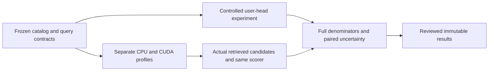

# Controlled personalization and real-semantic profiling extension

_Bounded follow-up to the immutable real-corpus study at `69bbd5e`._

---

## 🎯 Questions and scope

The extension asks two questions: whether a small learned user representation
can recover useful personalized candidate signal against the frozen video
catalog, and which actual retrieval/ranking pipeline provides a defensible
quality, latency and memory tradeoff. It does not repeat corpus encoding or
claim to reproduce Meta's private production models or serving gains.[^1]

All original results remain unchanged. Reusing inspected test panels makes
this follow-up **post-test exploratory**, even though recipes, validation
decisions and final evaluations are frozen before the new outcomes.

| Workstream | Reused inventory | Intervention | Primary comparison |
| --- | --- | --- | --- |
| Personalized candidate signal | 1,798,875 Qwen0.6B-encoded videos | One shared user head over the same past exposure vectors | Equal-user known-positive Recall@1000 and wrong-user/popularity controls |
| Real-semantic characterization | 8,841,823 Qwen8-MRL1024 passages | Storage/backend, batch and measured stage boundaries | Complete search and actual-candidate ranking quality plus synchronized wall time |

The machine-readable recipe and absolute execution gates are in
[`semantic-extension-v1.json`](../configs/semantic-extension-v1.json).
The previous [real-corpus findings](real-semantic-results.md) define the
input, model, sparse-judgment and coverage limitations.

## 🧠 Controlled shared user representation

Item vectors remain fixed. A 658,433-parameter attention-pooling/residual head
maps up to 12 training exposure-item vectors to a normalized 1024D query.
Relative-recency embeddings permit order sensitivity. Zero-initialized output
attention and residual layers start the head at the same-history mean, rather
than silently changing history selection, catalog eligibility or item training.

The new fitting cohort selects at most 50,000 admitted training timestamp
blocks using label-independent, user-balanced hashes. Positive-target and
nonempty-history filtering occurs afterward, with all attrition reported.
Every history envelope must end before the target's lower bound; histories
are not outcome-selected and held-out exposures are never appended.

The fixed sampled objective is:

\[
\mathcal L_q =
\log\sum_{i\in P_q\cup L_q\cup U_q}\exp(s(q,i)/\tau)
-\log\sum_{i\in P_q}\exp(s(q,i)/\tau),\qquad \tau=0.05.
\]

Every covered fitting positive in \(P_q\) is retained. \(L_q\) contains up to
12 distinct logged nonpositive items, excluding positives. \(U_q\) contains
up to 64 distinct sampled catalog alternatives, excluding both previous sets.
Sampling is fixed per query/seed and never consults validation/test labels.
These are source-distinct **weak negatives**, not verified exhaustive
irrelevance or an unbiased engagement estimator.

| Control | What it distinguishes |
| --- | --- |
| Frozen raw-history Qwen0.6B | Existing text-history retrieval |
| Mean of the same exposure vectors | Learned aggregation versus changed item/history selection |
| Training-positive popularity | Personalized utility versus a strong nonpersonalized control |
| Recent-history items plus popularity | Recurrence versus novel-to-selected-history retrieval |
| Uniform catalog candidates | Sparse-hit baseline |
| Whole-user history derangement | Aligned personalization versus assigning the wrong user's history |
| Within-history order permutation | Temporal sensitivity with the same exposure multiset |

“Novel” means outside the fixed selected history, not historically never
exposed. Training-positive support strata are not total exposure-support
strata. They are secondary diagnostics and do not replace the original
conditional query/user denominators.

## 🚦 Fixed validation admission and final evaluation

The pilot is **seed17, epoch3, full-catalog exhaustive top1000**, evaluated
only on the unchanged validation panel. The proposed resource gate requires
at least 10 distinct hit users and an equal-user aligned-minus-wrong-user
Recall@1000 difference of at least 0.005. This is an information-value
threshold, not a power calculation.

Only a passing, on-time persisted decision admits seed23. Failure means no
rescue sweep; a missed pilot deadline is time-budget incomplete, not evidence
of no signal. Final test metrics cannot authorize more fitting. A second seed
that is not admitted is **not assessed by design**, not a missing experiment.

Primary metrics preserve all conditional panel rows, including zero-hit
users. Equal-user and query-weighted means are reported separately.
Comparators share item/query mappings and the same aggregation. The
catalog-positive event coverage is reported numerically alongside these
conditional results; incompatible means are never multiplied.

Any two-seed research qualification uses a mean of per-query seed metrics,
not a prediction ensemble or test-selected winner. Its fixed quality and
runtime thresholds remain exploratory qualification criteria, not causal
engagement uplift or deployment readiness.

## ⚙️ Real ANN profiles and actual-pipeline comparison

The ANN characterization retains exactly 16,384 shared IVF clusters.
FAISS/Silver FP32, actual scalar-half FAISS, Silver FP16 and rowwise INT8 are
tested at probes64/256, depth1000 and batches1/16. Three independently started
sessions use label-independent paired query schedules and counterbalanced
backend order. Batch64 is a conditional memory stress case, not an
unconditionally promised point.

Profiles run separately from primary wall-time samples. CPU self time and
CUDA device time can overlap or nest; their sum is not a request latency or
critical path. CUDA tracing requires actual exported kernel events. A
completed unsupported-profiler attempt is not successful GPU profiling.

The complete-pipeline comparisons use frozen semantic-MLP seed17 and BGE
scorers, depth1000 and prefix caps50/500. Each point retrieves its **own actual
candidates**, then scores the prefix before final top10. Its quality cannot
be replaced with earlier common-union quality.

Raw Qwen8 query execution is checked against the canonical cached MRL rows
on 100 real initial queries and every measured/pretrace batch. The declared
vector tolerance is maxabs0.0001/mincos0.99999; observed drift is retained,
not called bit-exact or lossless. Within-backend resident/local-cascade
candidate and final IDs must match exactly and scorer values must meet the
declared tolerance. FAISS can feed a resident neural scorer too.[^2]

## 📐 Interpretation and execution limits

Two predeclared cap50/probes64 MLP comparisons use the fixed 1,000 selected
dev queries for MRR@10 non-inferiority. TREC19/20 remain separate graded
panels. A lower confidence bound must exceed the specified negative margin;
an interval containing zero is not equivalence. Multiple primary comparisons
receive the declared adjustment; other intervals remain secondary exploratory
comparisons.

Fresh FP32 resident timing is the reference. A deployment candidate must
demonstrate complete-pipeline benefit or quantified memory savings within
the latency tolerance, rather than an ANN-only speedup. Observed headroom
and finite no-OOM runs are admission evidence, not guarantees against unseen
peaks. No serving QPS, tail SLO, energy, MFU or fabricated RPC is inferred.

Only source/implementation/checkpoint-bound completed files can be reused.
An absolute cutoff bounds in-flight registered workers. Worker identity and
process completion are verified before original keeper restoration; empty
process argv during teardown is pending observation, not permission to
signal or certify successful drainage.

[^1]: [Original study protocol](semantic-study-design.md) and [measured results](real-semantic-results.md).
[^2]: FAISS GPU interoperability. https://github.com/facebookresearch/faiss/wiki/Faiss-on-the-GPU
