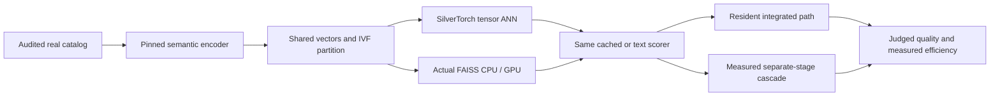

# Real-corpus semantic retrieval and ranking study

_Expanded study requested 2026-10-10; reviewed with GPT-6-Astra. This protocol is separate from the completed synthetic/ID-feature experiments._

---

## 📏 What the earlier experiments actually established

| Previous track | Measured scale | Models | Boundary |
| --- | --- | --- | --- |
| Synthetic ANN | 1M, 20M, 80M vectors | Random 128D vectors, not a language model | Systems/numerical investigation |
| Synthetic filtering | Up to 40M items | Synthetic multi-value metadata | Bloom correctness and timing |
| MovieLens quality | 3,521 warm items | Trained 128D MF; 32D MLP/TorchRec embeddings | Small public recommendation adaptation |
| Frozen TorchRec inference | Same small feature schema | Real DLRM/DCN classes | No automatic stronger-model or semantic claim |

Thus the previous study did reach millions **for systems experiments**, but it
did not test a language-model-generated million-item catalog. A recommendation
dataset with millions of interactions is not necessarily a million-item
retrieval inventory. The new study counts actual usable unique catalog items.

## 🗂️ Two real-data tracks

MS MARCO passage v1 supplies 8,841,823 real passages and official query/qrel
splits. It is an information-retrieval benchmark with noncommercial research
terms; it is not personalized recommendation.[^1]

KuaiRand-1K supplies a roughly 4.37M-video metadata inventory and about 11.7M
standard-policy events for 1,000 users. Its official 2026 caption/category
supplement adds natural-language content. The recommendation catalog is
frozen to items observed in admitted training timestamp blocks, with
join/semantic coverage audited and at least 1M usable items required.[^2]

| Track | Inventory | Quality source | Important limitation |
| --- | --- | --- | --- |
| MS MARCO | Full 8.84M passage catalog | Official dev-small and judged TREC-DL19/20 | Sparse judgments and possible model pretraining exposure |
| KuaiRand | 1,798,875 post-guard, training-observed caption-covered items | Recorded-clock long-view prediction | Fixed retrospective metadata, not historically versioned semantics |

KuaiRand's Zenodo metadata declares CC-BY-4.0, while the original archive
includes CC-BY-SA-4.0. Preserve the exact licenses and conservatively respect
ShareAlike for dataset adaptations. Raw data, captions, user IDs and
checkpoints are not put into public Git. Monthly aggregates, future
popularity, future-aware k-core filtering and final-target review/history
text are excluded.

The recommendation experiment is explicitly **retrospective personalization
with recorded-clock separation**. The 2026 captions cannot be asserted to
have been available in 2022. Exact exposure and feedback-release times are
not documented, and the small randomized exposure pool does not make full
million-item retrieval unbiased.[^5]

### Recorded-clock boundary contract

The declared `date` defines the nominal period. UTC+08:00 is an explicit
benchmark convention, not an established provenance fact. For each row,
let `D` be that date's midnight and define the recorded-clock envelope
`[min(D,time_ms), max(D+one_day,time_ms+1))`. Merge envelopes for every
`(user_id,time_ms)` block across both input files. Admit the entire block
only if its nominal dates and merged envelope fit wholly within one
declared split; otherwise quarantine it. Do not repair dates, treat equal
timestamps as duplicates, or assert that blocks are sessions.[^5]

The completed audit retained a 1,798,875-item caption-covered catalog from
2,118,585 admitted-training observed videos. It quarantined 7,558 of
11,713,045 events, in 1,307 blocks. Frozen histories use **training exposure
items only**, without long-view/click-conditioned selection, and require
each history block's upper bound to precede the target block's lower bound.
No validation/test history updates are appended.

| Coverage audit | Validation | Test |
| --- | ---: | ---: |
| Retained events | 2,522,575 | 4,129,242 |
| Long-view-positive events | 667,225 | 1,068,924 |
| Positive events inside the frozen semantic catalog | 171,616 | 157,937 |

These counts establish a substantial warm-catalog ceiling. Conditional
eligible-catalog ranking quality cannot be presented as all-target
recommendation recall. Report coverage and unconditional retrieval limits
alongside conditional metrics. Captions cover a broader 32,038,725-row
supplement; the audited metadata/interaction join, not supplement size,
defines the actual retrieval inventory.

## 🧠 Stronger semantic representations

| Encoder | Approximate size | Native dimension | Compared dimension | Pooling |
| --- | --- | --- | --- | --- |
| MiniLM-L6 | 22M parameters | 384 | 384 | Masked mean |
| BGE-large-en-v1.5 | 335M | 1024 | 1024 | CLS |
| Qwen3-Embedding-0.6B | 0.6B class | 1024 | 1024 | Last valid token |
| Qwen3-Embedding-8B | 8B class | 4096 | 4096 native and 1024 official MRL prefix | Last valid token, then prefix re-normalization |

Model cards, instructions, tokenizer revision, weight commit, parameter
count, token limit, padded tokens and output normalization are recorded.[^3]
The native Qwen 8B dimension is **not** supported by the pinned SilverTorch
CUDA dispatch. Its 1024D MRL output is an explicit deployment representation,
not a silently substituted native model result. Native-versus-MRL quality is
compared on the same real corpus.

At 8.84M items, raw 1024D vectors take approximately 33.7 GiB FP32, 16.9 GiB
FP16 or 8.4 GiB INT8. Native 4096D takes about 134.9/67.5/33.7 GiB. These
exclude indexes, model weights, activations, IDs, caches and workspaces.
Putting an 8B embedding model and an 8B reranker beside a native 4096D index
on one 80GB GPU is not automatically feasible.

GPU efficiency can fund richer online query/history encoders, but corpus
encoding is primarily offline. Larger models are not guaranteed better;
quality, latency, storage and amortized build costs must all be measured.

## 🏗️ Architecture and model controls

ANN comparison uses identical vectors, normalization, cluster assignments and
external IDs, plus exact FP32 geometric ground truth. Judge-based relevance
Recall/MRR/NDCG is separate from ANN top-k overlap. INT8 rescaling precedes
candidate top-k. Exact eligibility is verified before truncation, with Bloom
NOT conformance retained from the existing audit.

Strong text rerankers are BGE-reranker-v2-m3, Qwen3-Reranker-0.6B and
Qwen3-Reranker-8B. Qwen scores the official instruction/prefix/suffix using
the final-token yes-minus-no logit, not a generic text classifier or generated
explanation.[^4] They are not mislabeled as Meta's private MoL OverArch.

Cached-vector semantic MLP and **actual TorchRec DLRM/DCN** are supervised on
fitting-only data, with transferable features. No learned query-ID shortcut
is used for IR. They are cheaper information/compute classes than text
cross-encoders. Recommendation baselines additionally use permitted
past-only user/item/category/history features.

For integrated-versus-cascade comparisons, preserve the **same candidates,
weights, precision, features and scorer**. Measure actual ID movement,
CPU feature/text fetch, serialization, H2D input and final selection. Do not
invent network latency or imply that an 8B transformer is fused into the
SilverTorch ANN kernel. Call the result a local cascade unless real RPC is
implemented and timed.

## 🧪 Evaluation and execution gates

`configs/semantic-study-v1.json` freezes model families, token/precision
contracts and the initial matrix. Final query labels are not used to choose
instructions, checkpoints, dimensions or hyperparameters. A fitting/validation
split is fixed before hard-negative mining; positives are never injected
into final retrieval candidate sets. Pretraining exposure remains documented,
not described as untested zero-shot generalization.

Execution starts with dataset/license/checksum audits and a 100-row model
pooling/template/score smoke. GPT-6-Astra reviews code before full encoding,
then raw results and conclusions before publication. Large encodings are sharded to node-local scratch, resumed by complete shard
receipts, and banked early through the sole shared-storage writer. Complete
canonical model specifications, required native/MRL representation sets,
source bytes, exact row mappings, and snapshot/tokenizer/weight hashes bind
the smoke and shard gates. A production-batch, long-real-text smoke precedes
the full workers. Model weights are redownloadable; curated embeddings and
hard-to-recreate results are durable.

Only finite declared arms run: four primary encoders; three pretrained
rerankers; three cached supervised architectures. A pilot determines
practical encoder/reranker batch sizes without tuning on relevance labels.
Unsupported memory/dimension/score paths remain explicit, never silently
replaced with smaller models or catalogs.

Report offline encoding/build/training separately from query encoding,
retrieval, text/token/feature transfer and reranking. Measure wall-clock batch
latency, token/pair throughput, memory, utilization and profiler breakdowns.
Do not invent MFU from a GPU utilization percentage; a defensible FLOP count
and corresponding hardware peak would be required.

[^1]: Microsoft. MS MARCO passage ranking data and usage terms. https://github.com/microsoft/msmarco/blob/master/Datasets.md ; https://github.com/microsoft/msmarco/blob/master/README.md
[^2]: Gao et al. KuaiRand and official supplementary metadata. https://doi.org/10.1145/3511808.3557624 ; https://zenodo.org/records/10439422 ; https://zenodo.org/records/18159199 ; https://github.com/chongminggao/KuaiRand
[^3]: Encoder model cards. https://huggingface.co/sentence-transformers/all-MiniLM-L6-v2 ; https://huggingface.co/BAAI/bge-large-en-v1.5 ; https://huggingface.co/Qwen/Qwen3-Embedding-0.6B ; https://huggingface.co/Qwen/Qwen3-Embedding-8B
[^4]: Reranker model cards and official score examples. https://huggingface.co/BAAI/bge-reranker-v2-m3 ; https://huggingface.co/Qwen/Qwen3-Reranker-0.6B ; https://huggingface.co/Qwen/Qwen3-Reranker-8B ; https://github.com/QwenLM/Qwen3-Embedding
[^5]: KuaiRand field documentation and unresolved timestamp semantics. https://github.com/chongminggao/KuaiRand/blob/main/README.md ; https://github.com/chongminggao/KuaiRand/issues/4
