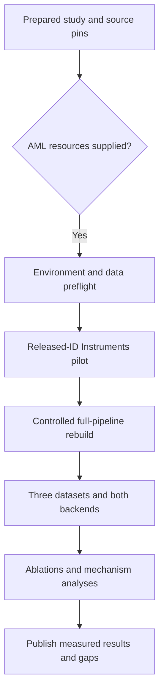

# LETTER reproduction implementation plan

> **For agentic workers:** Use `executing-plans` to implement and execute this plan task-by-task. The unchecked steps below describe future work, not unfinished preparation or experiments already run.

**Goal:** Reproduce the main LETTER results using the authors' code and data, then establish which gains survive controlled retraining and item-level evaluation.

**Architecture:** Keep immutable upstream snapshots separate from a small, recorded compatibility patch set. Run released-ID replay and full retraining as distinct tracks; preserve native paper-style metrics beside explicitly labeled corrected diagnostics. Reuse SilverTorch's AML transport/storage practices, not its models or recommendation protocol.

**Tech stack:** Author PyTorch implementations of RQ-VAE, T5 and LLaMA1-7B/LoRA; author-named BCE SASRec; isolated Linux/CUDA environment; Azure ML interactive-job transport; JSON manifests and per-user result records.

**Status:** Study, source inspection and full released-JSON audit are complete. GPU execution awaits the user's AML handoff. No environment image, training runner, compatibility patch or trained checkpoint is claimed to exist yet.

---

## 🎯 Scope and experiment identity

Read the [paper study](../../letter-study.md) and
[frozen preparation manifest](../../../configs/letter-reproduction-v1.json)
first. The manifest is descriptive protocol data, **not a runnable AML job**.

| Track | Inputs and purpose | What it may establish |
| --- | --- | --- |
| Released-ID replay | Author ID banks plus recovered downstream recipes | Reproduce downstream behavior without reconstructing tokenizer training |
| Controlled rebuild | Re-encoded text, train-only BCE SASRec, retrained tokenizers/backbones | Test the proposed mechanism with auditable upstream inputs |
| Decoder diagnostic | Same checkpoint, native constraints versus full catalog trie | Isolate decoding implementation effects |
| Item-identity diagnostic | Same predictions, explicit collision handling | Distinguish code hits from original-item hits |
| Extended paper coverage | Remaining baselines and analysis/sweep runs | Broader coverage; never inferred from the core four-model matrix |

The primary core is four model conditions on three datasets, initially seed
42. Once settings are frozen, seeds 17 and 23 provide independent replications.
That is 12 core downstream fits per seed, not a promise to launch all 36
before measuring cost. Released-ID pilots do not substitute for the tokenizer
ablations.



## 📦 File and artifact boundaries

Paths below are the planned implementation surfaces. Keep original third-party
source private/ignored until redistribution permissions are clear.

| Path | Responsibility |
| --- | --- |
| `configs/letter-reproduction-v1.json` | Current immutable source/target reference; version any later protocol amendment separately |
| `environments/letter/pyproject.toml` and lock file | Separate, GPU-validated dependency set; do not change SilverTorch manifests |
| `.local/letter/upstream/` | Working checkout of the pinned LETTER source |
| `.local/letter/sasrec/` | Working checkout of the pinned historical SASRec source |
| `.local/letter/patches/` | Exact upstream diffs, rationale, source hash and affected experiment track |
| `scripts/letter/prepare.py` | Original data/ID/CF conversion and complete input-audit tooling |
| `scripts/letter/run.py` | Original launcher/manifest/checkpoint-resume orchestration around upstream entrypoints |
| `scripts/letter/evaluate.py` | Original per-user metric records, strict coverage checks and separately named diagnostics |
| `tests/test_letter_protocol.py` | Split, row mapping, tokenization, objective, decoding and resume contracts |
| `.local/letter/job.json`, `.local/letter/aml.ps1`, `.local/letter/pull.ps1` | Private allocation binding and checksummed transport; never commit resource/access configuration |
| `runs/letter/` and approved durable storage | Raw attempts, logs, input receipts, checkpoints and predictions |
| `docs/letter-results.md` and `results/<dated-letter-run>/` | Create only after measurements exist; publish permitted aggregates and limitations |

The implementation files in this table are **future work**, not commands that
can already be invoked. Avoid a new training framework: delegate learning to
the upstream model/data classes and keep adapters narrowly scoped.

## 🔐 Task 1: bind the supplied allocation

**Files:** Create private `.local/letter/job.json` and allocation receipt.
Read, but do not modify, the existing SilverTorch transport helpers.

- [ ] Record the user-supplied job name/URL, subscription, resource group, workspace, node/GPU allowance, connection method, durable output location and budget
- [ ] Record the authorized LLaMA1-7B weights/tokenizer location; request a path or authorized download route, never secret or private-key contents
- [ ] Check the supplied job's live status and only inspect its allowed nodes
- [ ] Verify free GPU memory, driver/runtime, CPU cores, scratch capacity and write access to the designated durable subdirectory
- [ ] Preserve the user's allocation: stop only this experiment's own processes, never cancel or release the AML job

After the handoff, the read-only status command is:

```powershell
$job = Get-Content -LiteralPath .local\letter\job.json -Raw | ConvertFrom-Json
$required = "name", "subscription", "resource_group", "workspace", "private_key"
foreach ($field in $required) {
    if ([string]::IsNullOrWhiteSpace($job.$field)) {
        throw "Missing allocation field: $field"
    }
}
$status = az ml job show --name $job.name --subscription $job.subscription `
    --resource-group $job.resource_group --workspace-name $job.workspace `
    --query status --output tsv
if ($LASTEXITCODE -ne 0) { throw "Cannot inspect the supplied AML job." }
if ($status -ne "Running") { throw "Allocation is not running: $status" }
```

This syntax follows the current Azure ML CLI reference.[^1] Do not populate
this file from an old SilverTorch `job.json` or from historical workspace
defaults. If the user supplies a compute target rather than an existing job,
prepare a new job only within that authorization; verify image/GPU family,
quota and SLA tier first.

The reviewed SilverTorch `.local/aml.ps1` encodes LF-normalized scripts and
requires an unambiguous remote exit marker. Its `pull.ps1` verifies SHA-256
after base64 transfer. Adapt those mechanisms, not the old resource values.
For multi-node hops use noninteractive SSH with stdin detached from the
parent command. A zero local SSH exit code without the remote completion
marker is not success.

## ⚙️ Task 2: freeze a compatible environment

**Files:** Create `environments/letter/pyproject.toml`, its lock file, and a
private runtime receipt. Modify only the ignored upstream working copies.

- [ ] Fetch LETTER at `8d0154e28de37dbb6e24871c508ad8ddb1921cda` and SASRec at `29b9922adfc0dd1710a5f8fad8dddace2639fc76`; verify commits and content receipts before patching
- [ ] Start with an isolated Python 3.10 / Torch `1.13.1+cu117` compatibility candidate, matching the only pinned upstream dependency; resolve and pin the remaining packages before training
- [ ] Include the actual imports: NumPy, scikit-learn, `k-means-constrained`, Transformers, Accelerate, PEFT, bitsandbytes, DeepSpeed, SentencePiece, tqdm, evaluate, W&B, FastChat and its FlashAttention dependency
- [ ] Resolve `prepare_model_for_int8_training`, the custom T5/LLaMA forward APIs, and `fastchat.train.llama2_flash_attn_monkey_patch` against pinned versions; do not install latest packages into the shared image
- [ ] Disable external W&B reporting, preserve logs locally, and record full package/CUDA/GPU information
- [ ] Verify actual CUDA tensor operations, tokenizer/model imports, int8 loading, one forward/backward step and save/reload before admitting a long run

No tested full dependency lock is available yet. A modern isolated port is a
fallback only if the legacy candidate is untenable; record that change and
establish objective/forward parity before using it. An attention-kernel
replacement is not automatically numerically identical.

Minimum operation-only patches:

| Upstream location | Required change | Contract |
| --- | --- | --- |
| TIGER `finetune.py`, `test.py`; LC-Rec `lora_finetune.py` | Remove internal `CUDA_VISIBLE_DEVICES` assignments | Caller allocation remains authoritative |
| RQ-VAE `main.py` | Expose seed with default 42; require explicit data/CF/output paths | Seed 42 preserves existing initialization intent |
| RQ-VAE `generate_indices.py` | Accept explicit checkpoint/output/device; seed export; check state loading | No guessed timestamped path, silent state mismatch or overwritten bank |
| TIGER `test.py` | Read the saved training tokenizer instead of a fresh unpinned `t5-small` tokenizer | Exact token-to-ID equality with the training vocabulary |
| LC-Rec `test_ddp.py` | Fixed beam budget and complete-user mode | OOM fails; every primary user appears once |
| Both dataset/test-collator/evaluator paths | Preserve stable user/record IDs as metadata and save per-user beams/scores | Metadata never enters model inputs; paired metrics and coverage are auditable |
| RQ-VAE trainer and CF adapter | Save/restore complete training state | Model, optimizer, epoch/step, RNG and sampler state identify a true resume |

Keep each diff with its rationale. Do not switch training from `LETTER` to
plain `LlamaForCausalLM` merely because an issue suggests it: that is not a
drop-in implementation of the temperature-scaled objective or `set_hyper`.
Preserve the release's `original_module` freeze and verify actual active
`modules_to_save` gradients; do not infer trainability from that flag alone.[^2]

## 🧪 Task 3: implement the data and evaluator contracts

**Files:** Create `scripts/letter/prepare.py`, `scripts/letter/evaluate.py`
and `tests/test_letter_protocol.py`.

- [ ] Write failing contract tests for the fixtures below, then implement the adapters against upstream classes
- [ ] Audit all nine released JSON files against the manifest hashes and counts
- [ ] Freeze per-user split receipts; distinguish ordered event positions from repeated item identities
- [ ] Audit every actual tokenized input/target, including all LC-Rec training prompt variants that can be sampled
- [ ] Save 100 paired training/inference examples locally for format inspection, with no external data logging
- [ ] Run the targeted tests and require the actual adapter outputs, not a second independent toy implementation, to satisfy the fixtures

Required fixtures and exact outcomes:

| Contract | Fixture | Required outcome |
| --- | --- | --- |
| Leave-two-out | One user's sequence `[0,1,2,3,4]` | Train `[0]->1`, `[0,1]->2`; validation `[0,1,2]->3`; test `[0,1,2,3]->4` |
| CF row mapping | Original items `0,1,2`; SASRec rows `0,1,2,3` | Discard padding row 0 once; LETTER rows equal SASRec rows 1,2,3 |
| Temporal isolation | Alter final test item without changing earlier events | Training examples and CF positive-fitting inputs do not change |
| Collision accounting | Codes `A,A,B` for original items `0,1,2` | 3 items, 2 distinct codes, 1 excess collision, largest group 2 |
| Prefix validity | Valid IDs `(a0,b0)` and `(a1,b1)` | Full trie permits only `b0` after `a0`, not `b1` |
| Metric computation | One target at rank 2, one absent from top 10 | Mean R@5/R@10 `0.5`; mean N@5/N@10 `0.5/log2(3)` |
| Distributed coverage | 5 users, 4 workers | Each of all 5 users counted exactly once; neither drop nor padding duplication |
| Beam invariant | Request 20 beams and inject OOM | Failed cell with OOM receipt, not successful evaluation at 19 beams |
| Resume | Save and reload after a known optimizer step | Correct next step, optimizer/RNG restoration; weights-only warm start labeled separately |

For the metric fixture, the numerical oracle is:

```python
import math

target_ranks = [2, None]
for k in (5, 10):
    recall = sum(r is not None and r <= k for r in target_ranks) / 2
    ndcg = sum(1 / math.log2(r + 1) for r in target_ranks
               if r is not None and r <= k) / 2
    assert recall == 0.5
    assert math.isclose(ndcg, 0.31546487678572877)
```

Future validation command, once those files exist:

```powershell
python -m pytest tests\test_letter_protocol.py -q
```

Length/parity gates must count every full formatted record, not estimate from
characters: p50/p90/p99/max tokens, over-cap counts, number of supervised
tokens, EOS retention, and single-token encoding of every SID token.
Retain LLaMA1's actual instruction wrapper ending in `### Response:`;
do not introduce a modern chat template or thinking mode. Static targets
have generation `finish_reason = N/A`.

For source semantic encoding, preserve the 2,000-character cleaning rule,
separate title/description masked means and their equal average, maximum
2,048 tokens per field, item-row order and absence of extra normalization.
Report discarded text fields. For SFT, no admitted record may silently lose
the SID answer or EOS. If the recovered recipe violates that gate, preserve
the failed replay finding and specify an amended input/cap policy as a
separate run rather than relabeling it exact reproduction.

Primary metrics use all users, 20 beams, at most 10 new tokens, no sampled
negatives and **no seen-item exclusion**. Keep native code-string matching.
For collision diagnostics, preserve stable distinct-code rank order, expand
each valid code to ascending original item IDs, deduplicate and take the
first K items. This arbitrary but target-independent tie convention is
explicitly non-paper; also report invalid-code rates and collision-target
coverage. Run LC-Rec's full-trie diagnostic separately, using the same weights.

## 🚀 Task 4: run the released-ID Instruments pilot

**Files:** Create `scripts/letter/run.py`; write only new `runs/letter/`
attempt directories and durable receipts.

- [ ] Run 100-example backend/format probes and five training updates after the complete data gate
- [ ] Check finite losses, nonzero intended gradients, exact checkpoint/tokenizer reload, and a valid generated SID
- [ ] Train released-ID LETTER-TIGER on Instruments with seed 42, LR `5e-4`, temperature `0.7`, maximum 200 epochs and upstream best-validation-loss selection
- [ ] Train released-ID LETTER-LC-Rec using the recovered Instruments recipe, not the checked-in shell defaults
- [ ] Evaluate frozen selected checkpoints once on test; save per-user ranked codes, scores, identity flags and metrics
- [ ] Measure CPU clustering separately in a tokenizer timing probe before authorizing full retraining

The tokenizer initialization probe must retain the full catalog, or a
feasible fixture with at least as many points as centers. **Do not initialize
a 256-center quantizer with a 100-item smoke sample.**

The commands below are **Linux commands on the supplied AML node**, after
the compatibility patches and validated environment exist. `LETTER_ROOT`,
`LETTER_RUN_DIR`, `LLAMA1_7B` and `LETTER_WORLD_SIZE` are required bindings
from the launcher, not hardcoded workstation paths. The launcher sets
`CUDA_VISIBLE_DEVICES` to the user's allowed devices.

```bash
set -euo pipefail
: "${LETTER_ROOT:?}" "${LETTER_RUN_DIR:?}" "${LETTER_WORLD_SIZE:?}"
export WANDB_MODE=disabled
cd "$LETTER_ROOT/LETTER-TIGER"
# Valid for the selected worker count only when division is exact.
test $((1024 % (256 * LETTER_WORLD_SIZE))) -eq 0
ACCUM=$((1024 / (256 * LETTER_WORLD_SIZE)))
test "$ACCUM" -ge 1
torchrun --standalone --nproc_per_node="$LETTER_WORLD_SIZE" finetune.py \
  --base_model "$LETTER_ROOT/LETTER-TIGER/ckpt/TIGER" \
  --data_path "$LETTER_ROOT/data" --dataset Instruments \
  --index_file .index.json --seed 42 \
  --output_dir "$LETTER_RUN_DIR/tiger" \
  --per_device_batch_size 256 --gradient_accumulation_steps "$ACCUM" \
  --learning_rate 5e-4 --epochs 200 --temperature 0.7
```

```bash
set -euo pipefail
: "${LETTER_ROOT:?}" "${LETTER_RUN_DIR:?}" "${LLAMA1_7B:?}" "${LETTER_WORLD_SIZE:?}"
export WANDB_MODE=disabled
cd "$LETTER_ROOT/LETTER-LC-Rec"
test $((64 % (8 * LETTER_WORLD_SIZE))) -eq 0
ACCUM=$((64 / (8 * LETTER_WORLD_SIZE)))
test "$ACCUM" -ge 1
torchrun --standalone --nproc_per_node="$LETTER_WORLD_SIZE" lora_finetune.py \
  --base_model "$LLAMA1_7B" --data_path "$LETTER_ROOT/data" \
  --dataset Instruments --index_file .index.json --seed 42 \
  --output_dir "$LETTER_RUN_DIR/lc-rec" \
  --per_device_batch_size 8 --gradient_accumulation_steps "$ACCUM" \
  --learning_rate 2e-4 --epochs 4 --temperature 0.8 \
  --lora_r 8 --lora_alpha 16 --only_train_response \
  --tasks seqrec --train_prompt_sample_num 1 --train_data_sample_num 0
```

A one-GPU pilot uses accumulation 4 for TIGER and 8 for LC-Rec here.
Changing world size still changes some numerical/sampling behavior; record
it, even when effective batch size is preserved.

After the selected checkpoints and per-user-output hooks exist, native
evaluation can start with one worker to avoid the distributed tail-drop:

```bash
set -euo pipefail
: "${LETTER_ROOT:?}" "${LETTER_RUN_DIR:?}" "${LLAMA1_7B:?}"
mkdir -p "$LETTER_RUN_DIR/evaluation"
cd "$LETTER_ROOT/LETTER-TIGER"
python test.py \
  --ckpt_path "$LETTER_RUN_DIR/tiger" --data_path "$LETTER_ROOT/data" \
  --dataset Instruments --index_file .index.json --seed 42 --gpu_id 0 \
  --results_file "$LETTER_RUN_DIR/evaluation/tiger-native.json" \
  --test_batch_size 2 --num_beams 20 --sample_num -1 \
  --metrics hit@5,hit@10,ndcg@5,ndcg@10
cd "$LETTER_ROOT/LETTER-LC-Rec"
torchrun --standalone --nproc_per_node=1 test_ddp.py \
  --base_model "$LLAMA1_7B" --ckpt_path "$LETTER_RUN_DIR/lc-rec" \
  --data_path "$LETTER_ROOT/data" --dataset Instruments \
  --index_file .index.json --seed 42 --test_prompt_ids 0 \
  --results_file "$LETTER_RUN_DIR/evaluation/lc-rec-native.json" \
  --test_batch_size 1 --num_beams 20 --sample_num -1 \
  --metrics hit@5,hit@10,ndcg@5,ndcg@10
```

The upstream name `hit@K` equals Recall@K for this single-target protocol.
Keep that naming conversion explicit in reports. These native commands do
not by themselves implement the separately planned item/trie diagnostics.

Instruments reference targets: LETTER-TIGER R@10 `0.1122`, N@10 `0.0831`;
LETTER-LC-Rec R@10 `0.1115`, N@10 `0.0854`. Diagnose discrepancies in source,
vocabulary, response masking, checkpoint choice and decoder before changing
learning rates. Do not retune on the test set.

## 🔄 Task 5: reconstruct the complete training chain

**Files:** Extend the original preparation/launcher tools; retain upstream
`data_process/amazon_text_emb.py`, `RQ-VAE/main.py`, model classes and trainers.

- [ ] Encode all three catalogs using the authorized LLaMA1-7B snapshot; verify finite `N x 4096` outputs and exact row maps
- [ ] Fit a 32-dimensional BCE SASRec teacher for each dataset/seed using only fitting interactions, preserving each complete teacher checkpoint
- [ ] Export `item_emb.weight[1:N+1]` in original zero-based LETTER item order; compare the Instruments supplied tensor only as a separate provenance-limited reference
- [ ] Train semantic-only and full LETTER tokenizers with identical semantic inputs, seeds, codebook structure and schedules
- [ ] Export new immutable ID banks, collision statistics and tokenizer receipts; point downstream `--index_file` at each actual new bank
- [ ] Train and evaluate the four core conditions on Instruments, then Beauty and Yelp
- [ ] Freeze selected parameters before the independent seeds 17 and 23

The SASRec source pin preserves the author-named BCE implementation. Its
original CF hyperparameters are unavailable; start an explicitly labeled
reconstruction with hidden size 32 and other pinned CLI defaults: LR `0.001`,
batch 128, maximum history 50, two blocks, one head, dropout `0.5`, no
embedding L2, Adam betas `(0.9,0.98)`, at most 201 epochs. The **CF history
window is not a recovered paper setting**. Use validation-only selection,
record any bounded teacher tuning separately, and exclude the original loop's
periodic test evaluation. Keep the distinction between this CF teacher and
an independently configured Table 1 SASRec baseline.

Verify the teacher sampler's RNG and checkpoint-resume state. Its shipped
100-negative evaluator is not the primary evaluator. Exposing a seed while
leaving nondeterministic multiworker sampling undocumented is insufficient.

Tokenizer command for the confirmed Instruments starting point:

```bash
set -euo pipefail
: "${LETTER_ROOT:?}" "${LETTER_RUN_DIR:?}" "${LETTER_EMB:?}" "${LETTER_CF:?}"
cd "$LETTER_ROOT"
python RQ-VAE/main.py \
  --device cuda:0 --data_path "$LETTER_EMB" --cf_emb "$LETTER_CF" \
  --ckpt_dir "$LETTER_RUN_DIR/tokenizer" \
  --epochs 20000 --batch_size 1024 --lr 1e-3 \
  --num_emb_list 256 256 256 256 --e_dim 32 \
  --sk_epsilons 0 0 0 0.003 --alpha 0.02 --beta 0.0001
```

Here `cuda:0` is the first **exposed, allowed** GPU, not a request for physical
GPU zero. For the semantic-only control set both alpha and beta to zero.
The source still computes CF/diversity terms at zero weight; do not feed an
unmatched CF matrix merely because its weight is zero.

Compare baseline and LETTER within the same author backend. A semantic-only
control in this implementation is the **authors' TIGER-style control**, not
proof of reproducing an independent original TIGER system. For LC-Rec keep
tasks, data, LoRA configuration, effective batch, precision and selection
policy fixed within each paired comparison; alter the tokenizer and declared
temperature only.

Start with the recovered recipes. If tuning is needed, select on validation
NDCG@10, with Recall@10 then a fixed configuration ordering as tie-breakers.
Do not compare validation-loss scales across different temperatures to choose
temperature. Within each run retain the native best-validation-loss checkpoint
policy initially and record it. Freeze any change to checkpoint selection as
a protocol amendment before test evaluation.

## 📈 Task 6: reproduce attribution and analysis experiments

**Files:** Extend the original evaluator/report tooling and recorded
upstream patch set; add parameterization tests before sweeps.

- [ ] Run all five Table 2 variants on Instruments and Beauty; reuse the same full tokenizer for ordinary versus ranking-guided generation
- [ ] Reproduce Figure 6 first-code histograms using sorted frequencies and groups of 15 codes; report utilization, entropy and collisions as additional diagnostics
- [ ] Reproduce Figure 7 PCA visualization from first-code embeddings, fixing the projection procedure and labeling it descriptive rather than proof of fairness
- [ ] Reproduce Table 3 by freezing each complete 32D SASRec teacher and replacing its item matrix with quantized vectors; preserve padding and all non-item weights
- [ ] Reproduce Table 4 by pairing each item with its nearest other CF item and measuring matching code positions; report the exact similarity/tie definition
- [ ] Reproduce Figure 3 assignment/generation-frequency groups from the same fixed catalog, histories and evaluation outputs
- [ ] Run the six one-factor-at-a-time Figure 8 sweeps only after the parameterization gate and cost gate

The paper does not fully specify every analysis detail. For Table 4, the
initial explicit convention is cosine similarity on the fixed CF vectors,
self excluded, lowest item ID breaking ties, and mean fraction of equal
positions in the two length-L codes. Label this a reconstruction assumption;
do not equate it to the authors' unreleased analysis script. For Table 3,
replace the shared item matrix, affecting both history encoding and candidate
scoring, while preserving the teacher's non-item parameters.

Figure 8 implementation gate:

| Surface | Exact requirement |
| --- | --- |
| `RQ-VAE/models/vq.py::init_emb` | Initialize `self.n_e` centers, not literal 256 |
| `RQ-VAE/models/rq.py` | Require equal lengths of codebook-size and epsilon lists before constructing layers |
| Trainer and exporter clustering calls | Pass the requested cluster count instead of falling back to 10 |
| Diversity positive sampling | Build groups from actual labels; prohibit empty/singleton positive groups |
| Cluster capacities | Require `K * size_min <= N <= K * size_max`; preserve existing bounds for default `K=10,N=256` |
| Exporter token prefixes | Generate exactly L level-specific prefixes, supporting all eight requested levels |
| Runtime receipt | Assert actual layer count, codebook shapes, cluster count, epsilons and emitted SID length |

A feasible declared sweep convention is
`size_min=min(N//(2*K),10)` and `size_max=max(6*K,ceil(N/K))`
for diversity clustering. It preserves the default bounds but is **not**
a recovered nondefault author setting. Record it with the sweep, and verify
that every positive-sampling group has at least two codes.

The full manifest contains the figure's grid. These are one-factor sweeps,
not a Cartesian product. Reuse unchanged artifacts where valid and count
both tokenizer and downstream retraining cost for each changed ID bank.
The paper provides plotted trends, not downloadable numerical curve data;
compare trends and clearly labeled visual estimates rather than inventing
precise figure targets.

## 📚 Task 7: close broader baseline coverage

**Files:** Add separately pinned baseline receipts and configurations only
for actually admitted runs.

- [ ] Inventory MF, Caser, HGN, BERT4Rec, LightGCN, SASRec, BIGRec, P5-TID, P5-SemID and P5-CID as the remaining Table 1 rows
- [ ] For each, obtain its original implementation and reference settings, pin source/license/environment and convert the identical released split
- [ ] Preserve the author-clarified BCE SASRec baseline objective; label a stronger CE variant as an extension, not a reproduction
- [ ] Require the same full-catalog evaluation frame, valid-target coverage and no test-based selection; record any irreconcilable original protocol differences
- [ ] Report each baseline as measured, unavailable or not run, never copy a paper score into the reproduced-result column

The author says baseline settings generally follow the original papers,
but complete run configurations are absent.[^3] This phase is a distinct
provenance and compute commitment. The core comparison remains useful if
the budget cannot cover it, but the completion claim must then be **core
LETTER reproduction**, not a full reproduction of every paper experiment.

## 💾 Resource, persistence and reporting rules

Prefer one A100 80GB for initial environment/encoding/backbone probes.
Four NVIDIA GPUs are useful for the release-shaped LC-Rec run; other NVIDIA
allocations are acceptable after capacity and effective-batch checks.
Do not silently substitute ROCm or a different language model.

Plan provisionally for roughly 100-200 GB of isolated scratch, depending on
model formats and retained checkpoints; verify actual capacity rather than
treating that range as a measured requirement. Raw float32 semantic vectors
for all 42,056 released items occupy about 0.64 GiB before other artifacts.
Tokenizer time can be CPU-clustering-bound, with up to ten clustering workers
per fit; concurrent GPU allocation alone does not establish useful parallelism.

Before admitting expensive stages, measure initialization time, median
tokenizer epoch time, backbone step time, evaluation throughput and peak
memory. Extrapolate using actual remaining epochs/steps and include evaluation
and checkpoint overhead. No GPU-hour or completion-time promise is made now.

Checkpoint first to node-local storage, then serialize large durable exports
through one writer. Treat node scratch and job mounts as potentially
job-scoped; verify the named durable destination survives a job change.
Use complete-file/metadata markers and hashes. Test an interruption and
resume before a multi-hour run; reject incomplete saves. A weights-only LC-Rec
adapter restart is not restoration of optimizer/scheduler/RNG state.

Every attempt needs a unique immutable directory containing source and patch
hashes, data/embedding/ID-bank hashes, arguments, seed, model/tokenizer
identities, package/GPU receipts, fit/validation/test roles, checkpoint
selection, actual sample counts, raw per-user predictions and failure status.
Persist expensive embeddings, complete selected checkpoints and raw results
early. Do not publish raw interactions, model weights or third-party assets
without their applicable permissions.

Report, for every measured condition:

| Evidence | Required output |
| --- | --- |
| Recommendation quality | R@5/R@10/N@5/N@10, exact denominator, code versus item identity |
| Paper agreement | Paper target, observed value, absolute gap, relative gap |
| Component effect | Paired differences under matched inputs and training controls |
| Uncertainty | Per-seed values, across-seed mean/SD; 2,000 paired-user bootstrap replicates per seed |
| Tokenizer behavior | Reconstruction/CF/diversity losses, utilization, collision rate, actual codebook shapes |
| Cost | Encoding, CF fitting, tokenization, downstream training and decoding measured separately |
| Limitations | Source/recipe assumptions, coverage, invalid outputs, truncation, OOM and unrun cells |

The predeclared numeric triage rule is
`abs(observed - paper) <= max(0.002, 0.05 * paper)`.
It is an engineering indicator of approximate agreement, **not** statistical
proof or permission to tune against test scores. Report negative/null outcomes.
A directionally positive point estimate alone is not a robust-gain claim.
Keep seed variation separate from within-seed user bootstrap intervals.

Preparation is complete when the study, manifest and this plan agree.
Execution is complete only when admitted cells have persistent, verified
artifacts and the report distinguishes reproduced evidence from missing
coverage. Neither outcome authorizes cancelling the user's AML allocation.

## 🔗 References

[^1]: Azure CLI v2 `az ml job` reference, including `show` and `connect-ssh`, inspected 2026-10-27. https://learn.microsoft.com/en-us/cli/azure/ml/job?view=azure-cli-latest
[^2]: Author implementation discussions: [HonghuiBao2000/LETTER#12](https://github.com/HonghuiBao2000/LETTER/issues/12) and [HonghuiBao2000/LETTER#17](https://github.com/HonghuiBao2000/LETTER/issues/17). Interpret suggestions against the pinned code and active PEFT modules, not as interchangeable experiment definitions.
[^3]: Author's baseline-setting clarification, [HonghuiBao2000/LETTER#33](https://github.com/HonghuiBao2000/LETTER/issues/33). https://github.com/HonghuiBao2000/LETTER/issues/33
