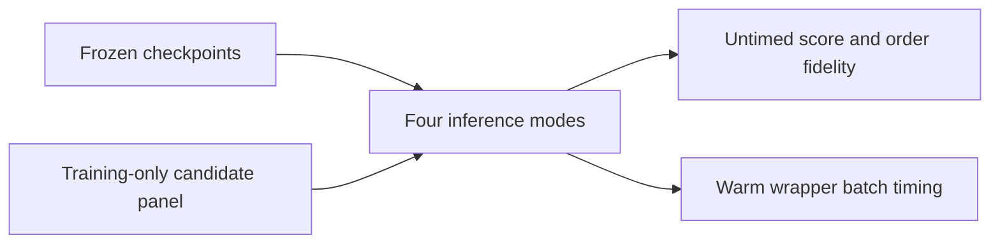

# Frozen TorchRec inference comparison

_Final bounded milestone, 2026-10-10. Earlier results, checkpoints, and held-out evaluations remain immutable._

---

## 📋 Scope and execution contract

This compares actual TorchRec DLRM and DLRM_DCN checkpoints for seeds17/23/42 under eager FP32, eager BF16 autocast, and the supported dense-path compilation in FP32/BF16. Weights and sparse embedding outputs remain FP32. Only `dense_arch`, `inter_arch`, and `over_arch` are compiled; sparse input/lookup and final selection stay eager.[^1]

The panel is128 deterministic training-active users and frozen MF candidatecaps 100/500/1000; batches1/16; three50-sample repeats after20 warmups. No training labels, validation/test targets, or validation/test histories were loaded. Exact training-seen eligibility is fixed before comparing execution modes.

The timer includes step marking, KeyedJaggedTensor creation, forward inference, masking and stable top100 selection. It excludes candidate/feature preparation, transfers, reference/fidelity collection, first-call compilation and profiling. It is warm local reranker-wrapper batch latency, not serving QPS.

## 🎯 Measured findings

36 of36 compiled-FP32 cells passed the fixed score-fidelity gate and completed their measurements. 72 successful compiled cells also had profiler-observed CUDA-graph replay. This is not inferred merely from a compiled wrapper.

| Mode | Representative cells | Runtime ratio vs eager FP32 range | Top10 overlap range | NRMSE range |
| --- | --- | --- | --- | --- |
| eager-fp32 | 6 | 1.000-1.000x | 1.0000-1.0000 | 0.000000-0.000000 |
| eager-bf16 | 6 | 0.762-0.810x | 0.9828-0.9930 | 0.005147-0.008945 |
| compiled-fp32 | 6 | 0.766-0.835x | 1.0000-1.0000 | 0.000000-0.000000 |
| compiled-bf16 | 6 | 0.742-0.811x | 0.9828-0.9930 | 0.005147-0.008945 |

A runtime ratio below1 means the mode was slower than eager FP32 at the same frozen checkpoint and shape. BF16 score/order agreement is descriptive and cannot be promoted to held-out recommendation-quality non-inferiority.

Across all declared conditions, 0 alternative-mode cells were faster than their paired eager-FP32 reference. This does not imply that larger/richer DLRM workloads or different compilation scopes behave identically.

## ✅ Coverage and correctness outcomes

All144 declared cells were attempted. Outcomes: `{"ok": 144}`. Errors, unsupported paths and fixed FP32 fidelity failures are retained explicitly rather than replaced by eager fallback.

Compiled FP32 has a prespecified per-score `atol=1e-5, rtol=1e-4` gate. BF16 is intentional approximation: its numerical and order agreement is empirical, not a claim of unchanged recommendation quality. Even passing FP32 score tolerance does not establish identical ordering. Top100 overlap at cap100 is marked trivial.[^2]

Graph output snapshots are copied outside timing before the next marked invocation. An A/B/A same-shape fixture checks changed inputs and repeat determinism. Compiled cells require three-block Dynamo/profiler evidence, no graph breaks, fail-on-recompile measurement stance, and unchanged timing counters. `cudaGraphLaunch` observation is separate from successful Inductor compilation.[^3]

## 📊 Representative warm runtime

Batch16, candidatecap1000. Every row remains paired by frozen checkpoint seed and input shape.

| Model | Seed | Mode | Batch ms | Repeat SD | Runtime ratio vs eager FP32 | Execution |
| --- | --- | --- | --- | --- | --- | --- |
| torchrec-dlrm | 17 | eager-fp32 | 0.9387 | 0.0141 | 1.000x | eager |
| torchrec-dlrm | 17 | eager-bf16 | 1.1668 | 0.0062 | 0.804x | eager |
| torchrec-dlrm | 17 | compiled-fp32 | 1.2244 | 0.0053 | 0.767x | inductor_with_cuda_graph_replay |
| torchrec-dlrm | 17 | compiled-bf16 | 1.2649 | 0.0014 | 0.742x | inductor_with_cuda_graph_replay |
| torchrec-dlrm | 23 | eager-fp32 | 0.9295 | 0.0039 | 1.000x | eager |
| torchrec-dlrm | 23 | eager-bf16 | 1.1702 | 0.0323 | 0.794x | eager |
| torchrec-dlrm | 23 | compiled-fp32 | 1.2131 | 0.0032 | 0.766x | inductor_with_cuda_graph_replay |
| torchrec-dlrm | 23 | compiled-bf16 | 1.2448 | 0.0100 | 0.747x | inductor_with_cuda_graph_replay |
| torchrec-dlrm | 42 | eager-fp32 | 0.9390 | 0.0147 | 1.000x | eager |
| torchrec-dlrm | 42 | eager-bf16 | 1.1591 | 0.0038 | 0.810x | eager |
| torchrec-dlrm | 42 | compiled-fp32 | 1.2230 | 0.0250 | 0.768x | inductor_with_cuda_graph_replay |
| torchrec-dlrm | 42 | compiled-bf16 | 1.2487 | 0.0041 | 0.752x | inductor_with_cuda_graph_replay |
| torchrec-dcn | 17 | eager-fp32 | 1.0224 | 0.0031 | 1.000x | eager |
| torchrec-dcn | 17 | eager-bf16 | 1.3410 | 0.0031 | 0.762x | eager |
| torchrec-dcn | 17 | compiled-fp32 | 1.2779 | 0.0662 | 0.800x | inductor_with_cuda_graph_replay |
| torchrec-dcn | 17 | compiled-bf16 | 1.2742 | 0.0024 | 0.802x | inductor_with_cuda_graph_replay |
| torchrec-dcn | 23 | eager-fp32 | 1.0208 | 0.0055 | 1.000x | eager |
| torchrec-dcn | 23 | eager-bf16 | 1.3352 | 0.0020 | 0.764x | eager |
| torchrec-dcn | 23 | compiled-fp32 | 1.2228 | 0.0014 | 0.835x | inductor_with_cuda_graph_replay |
| torchrec-dcn | 23 | compiled-bf16 | 1.2581 | 0.0048 | 0.811x | inductor_with_cuda_graph_replay |
| torchrec-dcn | 42 | eager-fp32 | 1.0250 | 0.0021 | 1.000x | eager |
| torchrec-dcn | 42 | eager-bf16 | 1.3192 | 0.0019 | 0.777x | eager |
| torchrec-dcn | 42 | compiled-fp32 | 1.2311 | 0.0191 | 0.833x | inductor_with_cuda_graph_replay |
| torchrec-dcn | 42 | compiled-bf16 | 1.3094 | 0.0746 | 0.783x | inductor_with_cuda_graph_replay |

## 🔍 Compiler-only fidelity

Compiled modes are also compared with their corresponding eager precision, separating compilation changes from the BF16-versus-FP32 approximation. Only compiled FP32 has the fixed score-tolerance acceptance gate.

| Model | Seed | Compiled mode | NRMSE vs same-precision eager | Top10 overlap | FP32 gate |
| --- | --- | --- | --- | --- | --- |
| torchrec-dlrm | 17 | compiled-fp32 | 0.000000 | 1.0000 | True |
| torchrec-dlrm | 17 | compiled-bf16 | 0.000000 | 1.0000 | not an equivalence gate |
| torchrec-dlrm | 23 | compiled-fp32 | 0.000000 | 1.0000 | True |
| torchrec-dlrm | 23 | compiled-bf16 | 0.000000 | 1.0000 | not an equivalence gate |
| torchrec-dlrm | 42 | compiled-fp32 | 0.000000 | 1.0000 | True |
| torchrec-dlrm | 42 | compiled-bf16 | 0.000000 | 1.0000 | not an equivalence gate |
| torchrec-dcn | 17 | compiled-fp32 | 0.000000 | 1.0000 | True |
| torchrec-dcn | 17 | compiled-bf16 | 0.000017 | 1.0000 | not an equivalence gate |
| torchrec-dcn | 23 | compiled-fp32 | 0.000000 | 1.0000 | True |
| torchrec-dcn | 23 | compiled-bf16 | 0.000047 | 1.0000 | not an equivalence gate |
| torchrec-dcn | 42 | compiled-fp32 | 0.000000 | 1.0000 | True |
| torchrec-dcn | 42 | compiled-bf16 | 0.000013 | 1.0000 | not an equivalence gate |

## 🔬 Score and ordering fidelity

Same representative shape; FP32 is the reference. Normalized RMSE divides by reference RMS over every eligible panel score, and an all-zero reference makes it undefined.

| Model | Seed | Mode | NRMSE vs FP32 | Max score error | Top10 set overlap | Top100 set overlap |
| --- | --- | --- | --- | --- | --- | --- |
| torchrec-dlrm | 17 | eager-bf16 | 0.005147 | 0.249803 | 0.9828 | 0.9953 |
| torchrec-dlrm | 17 | compiled-fp32 | 0.000000 | 0.000008 | 1.0000 | 1.0000 |
| torchrec-dlrm | 17 | compiled-bf16 | 0.005147 | 0.249803 | 0.9828 | 0.9953 |
| torchrec-dlrm | 23 | eager-bf16 | 0.006089 | 0.092041 | 0.9930 | 0.9945 |
| torchrec-dlrm | 23 | compiled-fp32 | 0.000000 | 0.000002 | 1.0000 | 1.0000 |
| torchrec-dlrm | 23 | compiled-bf16 | 0.006089 | 0.092041 | 0.9930 | 0.9945 |
| torchrec-dlrm | 42 | eager-bf16 | 0.005176 | 0.141399 | 0.9922 | 0.9947 |
| torchrec-dlrm | 42 | compiled-fp32 | 0.000000 | 0.000004 | 1.0000 | 1.0000 |
| torchrec-dlrm | 42 | compiled-bf16 | 0.005176 | 0.141399 | 0.9922 | 0.9947 |
| torchrec-dcn | 17 | eager-bf16 | 0.005562 | 0.177265 | 0.9875 | 0.9934 |
| torchrec-dcn | 17 | compiled-fp32 | 0.000000 | 0.000004 | 1.0000 | 1.0000 |
| torchrec-dcn | 17 | compiled-bf16 | 0.005562 | 0.177265 | 0.9875 | 0.9934 |
| torchrec-dcn | 23 | eager-bf16 | 0.006552 | 0.368145 | 0.9867 | 0.9938 |
| torchrec-dcn | 23 | compiled-fp32 | 0.000000 | 0.000010 | 1.0000 | 1.0000 |
| torchrec-dcn | 23 | compiled-bf16 | 0.006553 | 0.368145 | 0.9867 | 0.9938 |
| torchrec-dcn | 42 | eager-bf16 | 0.008945 | 0.476120 | 0.9836 | 0.9930 |
| torchrec-dcn | 42 | compiled-fp32 | 0.000000 | 0.000011 | 1.0000 | 1.0000 |
| torchrec-dcn | 42 | compiled-bf16 | 0.008945 | 0.476120 | 0.9836 | 0.9930 |

## ⏱️ First-call costs

First-call wall time can include compilation, compiler-cache lookup and initial graph preparation. It is not deducted from a deployment cold start. Compilation caches can be warm across processes; these are observed first calls, not guaranteed clean-cache build costs.

| Model | Seed | Compiled mode | First-call ms | Initial warmup ms | Observed graph launches |
| --- | --- | --- | --- | --- | --- |
| torchrec-dlrm | 17 | compiled-fp32 | 4058.5 | 60.0 | 3 |
| torchrec-dlrm | 17 | compiled-bf16 | 4185.6 | 50.4 | 3 |
| torchrec-dlrm | 23 | compiled-fp32 | 1226.9 | 48.4 | 3 |
| torchrec-dlrm | 23 | compiled-bf16 | 1290.4 | 49.2 | 3 |
| torchrec-dlrm | 42 | compiled-fp32 | 1235.8 | 49.2 | 3 |
| torchrec-dlrm | 42 | compiled-bf16 | 1305.3 | 49.2 | 3 |
| torchrec-dcn | 17 | compiled-fp32 | 2722.2 | 53.9 | 3 |
| torchrec-dcn | 17 | compiled-bf16 | 3742.5 | 66.4 | 3 |
| torchrec-dcn | 23 | compiled-fp32 | 1252.1 | 48.9 | 3 |
| torchrec-dcn | 23 | compiled-bf16 | 1351.5 | 51.8 | 3 |
| torchrec-dcn | 42 | compiled-fp32 | 1262.0 | 48.5 | 3 |
| torchrec-dcn | 42 | compiled-bf16 | 1339.3 | 53.6 | 3 |

## ⚠️ Explicit unsuccessful cells

No declared cell required an unsupported or error fallback.

## 🛡️ Limits and final handoff

This is an inference/fidelity extension conditional on one training-only candidate panel and small two-table rankers, not another test-set evaluation, quality non-inferiority test, distributed embedding benchmark, or full SilverTorch compiled serving graph. No checkpoints were reselected or retrained. Earlier studies are unchanged.

The original keepalive supervisor/profile is restored, and only node0 writes the durable experiment bank. Access and operational details remain local/ignored. This completes the two bounded hourly follow-ups; no additional unbounded compute is scheduled.

[^1]: Meta-PyTorch. TorchRec DLRM `compile_dense_path`. https://github.com/meta-pytorch/torchrec/blob/v1.8.0-rc1/torchrec/models/dlrm.py#L573-L609
[^2]: PyTorch2.13. Numerical accuracy and automatic mixed precision. https://docs.pytorch.org/docs/2.13/notes/numerical_accuracy.html ; https://docs.pytorch.org/docs/2.13/amp.html
[^3]: PyTorch2.13. CUDAGraph Trees and step boundaries. https://docs.pytorch.org/docs/2.13/user_guide/torch_compiler/torch.compiler_cudagraph_trees.html ; https://docs.pytorch.org/docs/2.13/generated/torch.compiler.cudagraph_mark_step_begin.html
